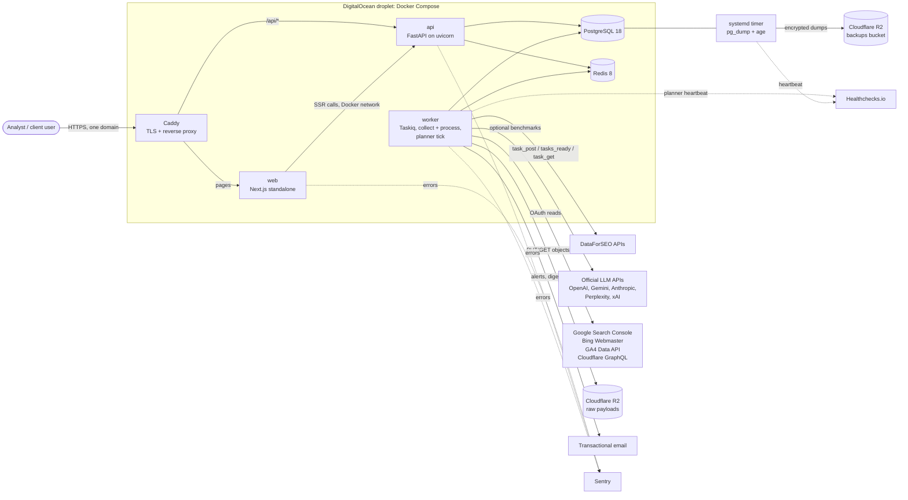
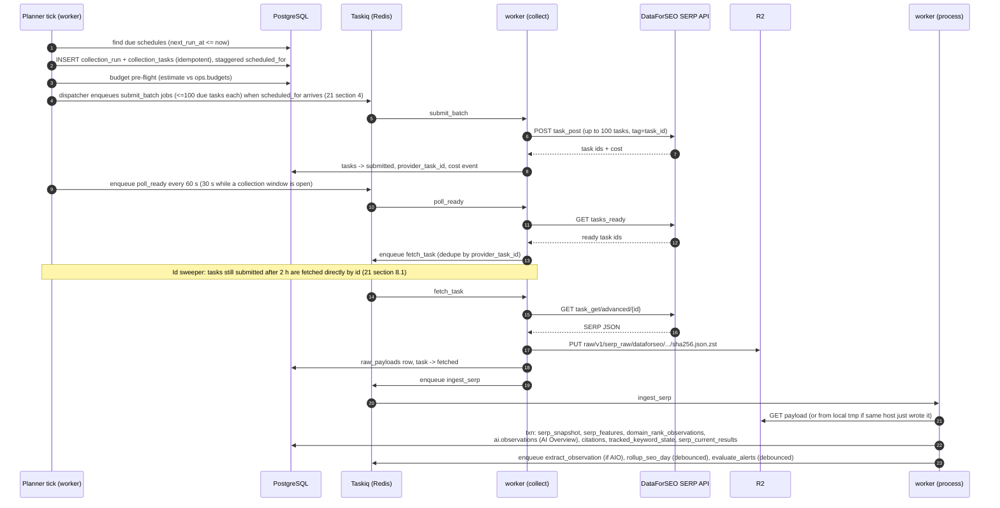
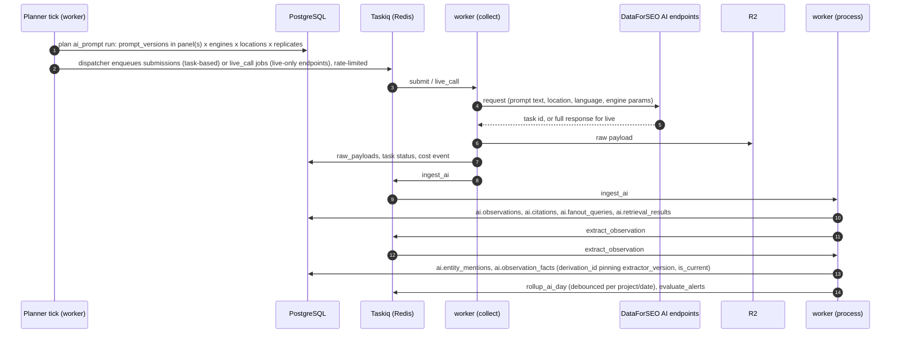
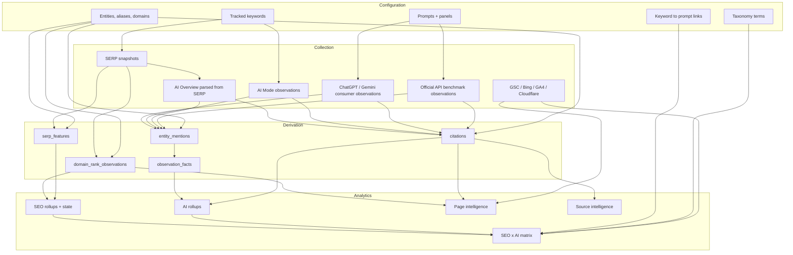

# 03. System Architecture

Status: Draft for architecture freeze (Phase 0)
Last updated: 2026-09-30
Related: [04-data-model.md](04-data-model.md), [21-scheduler-workers.md](21-scheduler-workers.md), [22-infrastructure-devops.md](22-infrastructure-devops.md), ADRs in [adr/](adr/), in particular [ADR-022](adr/ADR-022-python-backend-simplified-platform.md)
Locked architecture diagram: [diagrams/architecture-locked.html](diagrams/architecture-locked.html)

## 1. Architecture in one paragraph

A Python backend (one project with two entrypoints, `api` and `worker`) and a Next.js web app run as Docker Compose services on one DigitalOcean droplet next to PostgreSQL 18 and Redis 8, behind Caddy on one domain: Caddy routes `/api/*` to the FastAPI `api` and everything else to `web`, whose server components call the API over the Docker network. Collection is asynchronous: the planner tick inside the worker plans runs into PostgreSQL, the worker submits batched tasks to DataForSEO (and later other providers), polls for readiness, stores raw payloads compressed in Cloudflare R2, normalizes them into provider-independent observation rows, runs extraction, and refreshes rollups. PostgreSQL is the ledger for all state; Redis (through Taskiq) is transport and coordination only. Every metric is computed from append-only observations plus versioned derivations, so any number on screen can be traced to raw evidence.

## 2. System context



There is no public callback endpoint: readiness is polling only ([ADR-022](adr/ADR-022-python-backend-simplified-platform.md)). API keys for outside clients are deferred (tables may exist, no routes).

## 3. Technology choices (summary; each has an ADR)

| Layer | Choice | ADR |
|---|---|---|
| Language | Python 3.13 on the backend (package manager `uv`); TypeScript in `apps/web` | [ADR-022](adr/ADR-022-python-backend-simplified-platform.md) (supersedes [ADR-001](adr/ADR-001-typescript-monorepo.md)) |
| Repo | `apps/web/` (Next.js, pnpm), `backend/` (one Python project, two entrypoints), `data/fixtures/`, `infra/`, `docs/`. No Turborepo | ADR-022 |
| API framework | FastAPI with Pydantic v2, served by uvicorn; OpenAPI 3.1 generated by FastAPI; base path `/api/v1` | ADR-022 |
| Contracts | Pydantic models are the contract. `apps/web` uses a client generated from the OpenAPI document (`openapi-typescript` plus `openapi-fetch`), regenerated in CI and committed; drift fails CI | ADR-022 |
| DB access | SQLAlchemy 2 (async, asyncpg) for application code; raw SQL for analytics | ADR-022, [ADR-003](adr/ADR-003-postgresql-ledger.md) |
| Migrations | Alembic (SQL in `op.execute` is allowed), run by the one-off `migrator` container during deploy | ADR-022 |
| Database | PostgreSQL 18, native partitioning, no extensions beyond contrib | [ADR-003](adr/ADR-003-postgresql-ledger.md) |
| Queue | Taskiq with the Redis broker: two queues, `collect` and `process`, in one worker process; the PostgreSQL task table is the ledger. Fallback if Taskiq fails its Phase 1 smoke test: Celery | ADR-022 (supersedes the transport in [ADR-005](adr/ADR-005-queue-bullmq-postgres-ledger.md)) |
| Object storage | Cloudflare R2 (S3 API) | [ADR-004](adr/ADR-004-raw-payloads-r2.md) |
| Auth | Own module in FastAPI: argon2id passwords, opaque session ids in `auth.sessions` with a 60 s Redis read-through cache, email verification and password reset with hashed tokens, invitations, roles, TOTP (pyotp), an opt-in at first and required for owner and admin from launch hardening | ADR-022 (supersedes [ADR-014](adr/ADR-014-better-auth.md)) |
| Frontend | Next.js (App Router), TypeScript, pnpm, TanStack Query and Table, ECharts, shadcn/ui on Tailwind v4, the locked design system; `output: 'standalone'`, one Node process on the droplet | [20-frontend-specification.md](20-frontend-specification.md), ADR-022 |
| Reverse proxy | Caddy 2 (automatic HTTPS) on one domain: `/api/*` to `api`, everything else to `web`. No CORS, one cookie | [22-infrastructure-devops.md](22-infrastructure-devops.md) |
| Hosting | One DigitalOcean droplet (2 vCPU, 4 GB, 80 GB, Ubuntu 26.04), Docker Compose. Cloudflare proxied DNS optional. Vercel not used | ADR-022, [ADR-002](adr/ADR-002-single-droplet-compose.md) |
| Primary provider | DataForSEO (SERP, Labs, Keywords Data, AI Optimization) | [ADR-006](adr/ADR-006-dataforseo-primary-adapters.md) |
| Errors and performance | Sentry (Python SDK and Next.js SDK, 10% performance sampling) | [25-observability.md](25-observability.md) |
| Cron heartbeat | Healthchecks.io | [25-observability.md](25-observability.md) |

Why Python for the backend: the parts of the product that are ours (extraction, canonicalization, statistics) are stronger in Python, where URL handling, fuzzy matching and statistics (Wilson intervals, bootstrap, paired comparisons) are library calls rather than ports. The original design already expected a Python sidecar for heavier NLP, so a TypeScript backend would have meant two backends within a year. The rest of the work is async HTTP collection plus SQL analytics, which FastAPI, SQLAlchemy async and Taskiq handle in one asyncio model. The cost is two toolchains in the repo (uv and pnpm); the contract between them is the OpenAPI document, and any drift between API and client fails CI at client generation. See [ADR-022](adr/ADR-022-python-backend-simplified-platform.md); [ADR-001](adr/ADR-001-typescript-monorepo.md) records the earlier TypeScript decision.

## 4. Repository layout

```
repo/
  apps/
    web/                    Next.js app (standalone, on the droplet), generated API client, the design system
  backend/                  one Python project (uv), two entrypoints: api and worker
    src/idraft/
      api/                  FastAPI app: routers, auth, tenancy, problem+json errors, OpenAPI
      worker/               Taskiq broker and tasks, planner and dispatcher tick, maintenance schedule, ops CLI
      domain/               pure business logic: metrics, rank derivation, statistics, alert evaluation
      extraction/           pure: canonicalizer, domain resolver, alias matcher, list parser, classifiers
      providers/            provider adapters (dataforseo first; first-party clients later) + adapter contract tests
      collectors/           workload orchestration: planners, submitters, fetchers, ingesters; owns persistence
      db/                   SQLAlchemy models and sessions, Alembic migrations, repository helpers, RLS helper
      storage/              R2 client, zstd, raw payload writer and reader
      config/               settings from the environment, validated at start
    tests/                  pytest, Testcontainers (postgres:18, redis:8), Hypothesis where it earns its keep
  data/
    fixtures/               recorded provider responses (registry with schema hashes)
    gold/                   versioned gold sets for extraction and rank derivation (doc 26 section 4)
  infra/
    compose/                docker-compose.yml, Caddyfile, non-secret app.env, Postgres and Redis config
    systemd/                backup and host-check units and timers
    scripts/                bootstrap-droplet.sh, deploy.sh, backup.sh, restore-verify.sh
  docs/                     this documentation package
```

Dependency rule (enforced with import-linter contracts in `backend/pyproject.toml`, run in CI):

```
api, worker -> collectors, domain, extraction, providers, db, storage, config
collectors  -> providers, extraction, domain, db, storage, config
providers   -> config                                                (never db)
extraction  -> (nothing internal)                                    (pure: no db, no network)
domain      -> (nothing internal)                                    (pure functions)
db, storage -> config
```

`domain` and `extraction` import nothing internal and do no I/O, which is what makes the gold-dataset tests fast and deterministic. `providers` never imports `db`: an adapter turns a request into provider calls and a provider response into a canonical object. Persistence belongs to `collectors`. These are the same purity rules as before ADR-022; only the enforcement tool changed.

## 5. Process model

| Process | Replicas (V1) | Responsibility | Scales by |
|---|---|---|---|
| `web` | 1 (one Node process, `output: 'standalone'`) | pages and server rendering; server components call `api` over the Docker network | vertical |
| `api` | 1 (uvicorn) | HTTP API at `/api/v1`: auth, tenancy, reads, writes, OpenAPI | profile first; a second container behind Caddy only after profiling (section 10, step 4) |
| `worker` | 1 | Taskiq worker consuming `collect` and `process`; the planner and dispatcher tick under Redis locks; Taskiq's scheduler for maintenance cron jobs | per-queue concurrency, then a second worker container (step 3) |
| `postgres` | 1 | ledger | vertical, then a Volume, then a dedicated droplet |
| `redis` | 1 | Taskiq transport, locks, rate limiters, session cache | vertical |
| `caddy` | 1 | TLS, reverse proxy on one domain, request size limits | n/a |
| `migrator` | one-off | `alembic upgrade head` during deploy | n/a |

There is no scheduler container and no worker split ([ADR-022](adr/ADR-022-python-backend-simplified-platform.md)). The one worker process keeps provider I/O and CPU work apart with per-queue concurrency: `collect` (8) mostly waits on HTTP, `process` (4) parses payloads, extracts and rolls up. CPU-bound steps run off the event loop (`asyncio.to_thread`) so provider calls keep moving during an ingest burst. A spike of 10,000 SERP payloads cannot starve the API because `process` concurrency is capped and `api` is a separate container.

## 6. Queues

The brief suggested seven queues split by channel and priority. We use two Taskiq queues split by **resource profile**, both consumed by the one worker process. Separate queues are only justified when the work needs a different concurrency or rate limit.

| Queue | Concurrency (V1) | Rate limit | Jobs |
|---|---|---|---|
| `collect` | 8 | shared limiter at 1,000 calls/min, 50% of the DataForSEO account limit (see 06 section 3.2, 21 section 7); per-provider token buckets for LLM APIs; per-integration quotas for first-party APIs | provider calls: `submit_batch`, `poll_ready`, `fetch_task`, `live_call`; later `benchmark_call` and `classify_batch` (official LLM APIs) and `gsc_sync`, `bing_sync`, `ga4_sync`, `cloudflare_sync` (first-party) |
| `process` | 4 | none | ingest (`ingest_serp`, `ingest_ai`, `ingest_keyword_metrics`), extraction (`extract_observation`, `rederive_range`), analytics (`rollup_seo_day`, `rollup_ai_day`, `refresh_state`, `evaluate_alerts`, `cost_rollup`), maintenance (partitions, retention, R2 lifecycle audit, backfills, reconciliation, `ops_health`) |

Priority mapping: the dispatcher is the only producer of provider jobs, so priority is its enqueue order. High-priority schedules (for example daily tracking of priority-1 keywords) are dispatched first, standard next, discovery and backfills last, so they reach the head of `collect` in that order. Detailed lifecycle, retry and dead-letter behavior are in [21-scheduler-workers.md](21-scheduler-workers.md).

## 7. Core flows

### 7.1 SEO rank collection



The shared fetch cache of [ADR-017](adr/ADR-017-shared-fetch.md) (identical same-day fingerprints fetched once) is built in Phase 11 or later; until then each project fetches its own SERPs, so the flow above has no cache lookup.

### 7.2 AI prompt collection



### 7.3 Combined data flow



### 7.4 Read path (UI)

1. The browser loads pages from `web` through Caddy on one domain. Server components call the API over the Docker network (`http://api:8000/api/v1`), forwarding the session cookie; client components fetch with TanStack Query against `/api/v1` on the same origin. The session cookie is `__Host-session` (`HttpOnly`, `Secure`, `SameSite=Lax`, `Path=/`), so there is no CORS and no parent-domain cookie. State-changing requests also pass an Origin check (CSRF).
2. API resolves the session (opaque id in `auth.sessions`, 60 s Redis read-through cache) to a user, checks membership and role for the workspace in the path, opens a transaction, sets `app.workspace_id` with `set_config`, runs SQLAlchemy queries (raw SQL for analytics) against current-state tables and rollups, returns JSON.
3. Heavy aggregate endpoints (overview, matrix) are cached in Redis for 5 minutes keyed by `(workspace, project, endpoint, normalized filters, data_version)`. `data_version` is a per-project counter incremented by rollup jobs, so caches invalidate on new data without explicit purges.
4. Drill-down to evidence (a specific SERP or AI answer) reads the observation row, then the raw payload from R2 only when the user opens the raw view.

## 8. Cross-cutting concerns

| Concern | Approach | Doc |
|---|---|---|
| Multi-tenancy | `workspace_id` on every tenant row, RLS on API connections, workspace in every URL path | [24-security.md](24-security.md) |
| Idempotency | Deterministic idempotency keys on tasks, unique constraints, a deterministic Redis dedupe key per queue message, handlers that check the ledger first (doc 21 section 5.2) | [21-scheduler-workers.md](21-scheduler-workers.md) |
| Versioning | Integer versions of every component on every derived row; `ops.component_versions` registry | [12-normalized-observation-schemas.md](12-normalized-observation-schemas.md) |
| Cost control | Pre-flight estimates, budgets, per-call cost events, daily rollups | [27-cost-model.md](27-cost-model.md) |
| Observability | Structured JSON logs to stdout (read with `docker compose logs`), Sentry, Healthchecks, one external uptime check, the in-app Operations screen over `ops.collection_tasks`, `ops.collection_runs` and `ops.cost_daily`. No metrics endpoint | [25-observability.md](25-observability.md) |
| Config | Non-secret settings in `infra/compose/config/app.env`; platform secrets in `/etc/seo-platform/.env` (root-owned, mode 0600), written by the deploy workflow from GitHub Actions environment secrets and passed to each service by Compose (doc 24 section 5.1); validated at start; process refuses to start on invalid config | [22-infrastructure-devops.md](22-infrastructure-devops.md) |
| Time | UTC in storage; project timezone for business dates, computed once at ingest | [04-data-model.md](04-data-model.md) |

## 9. Measurement integrity rules (architectural invariants)

These are enforced in code review and, where possible, in tests.

1. **No silent merging of observation classes.** Metric functions take `observation_class` as a required parameter. There is no default.
2. **No metric without a denominator.** Every metric function returns `{ value, numerator, denominator, n_observations, window, filters, method_version }`. The API contract enforces the shape (see [19-api-specification.md](19-api-specification.md) section 2.6).
3. **No overwrite of observations.** Repositories for observation tables expose `insert` only. The runtime roles (`app_api` for `api`, `app_worker` for `worker`) have no `UPDATE` grant on observation partitions except the specific role columns covered by `ops.derivation_log`.
4. **Raw first.** A provider response is written to R2 and registered in `ops.raw_payloads` before normalization. If normalization fails, the raw payload still exists and can be re-ingested after a parser fix.
5. **Version boundaries are visible.** If a breaking component version changes inside a chart window, the chart shows a marker.
6. **Estimates are labeled.** Search volume, AI demand estimates, CTR-based traffic, and anything modeled carries `is_estimate: true` and a `method` string in API responses.

## 10. Scaling path

The architecture is sized for V1 on one droplet. It scales in these steps without a rewrite. Trigger values are fixed by [ADR-022](adr/ADR-022-python-backend-simplified-platform.md) and are canonical in [28-data-growth-scaling.md](28-data-growth-scaling.md) sections 7 (all steps) and 8 (ClickHouse); step numbers are the same in 03, 22 and 28.

| Step | Trigger (any) | Change |
|---|---|---|
| 0 | V1 | Everything on one 4 GB droplet |
| 1 | Swap in steady use; PostgreSQL buffer cache hit ratio under 99% for a week; the database over 10 GB | Resize the droplet to 8 GB (vertical, minutes of downtime) |
| 2 | The database over 40 GB | Attach a DO Volume; then move PostgreSQL to its own droplet with the Volume, over the VPC |
| 3 | The collection window overruns twice in a month | Raise worker concurrency; then a second `worker` container against the same PostgreSQL and Redis |
| 4 | API p95 over 300 ms on the overview with rollups in place | Profile the query first; a second `api` container behind Caddy is the last resort |
| 5 | Any two of the doc 28 section 8 conditions (for example > 500 M observation rows and dashboard p95 > 1 s after tuning) | Add ClickHouse fed by CDC or batch export from partitions; PG remains the ledger |
| 6 | The tool is offered to outside companies | API keys, envelope encryption of tenant credentials, PITR, GFS backups |

Nothing in V1 prevents these steps: processes communicate only through PostgreSQL, Redis and R2 over the network, all config is environment-based, and no process relies on local disk state except the ephemeral spool directory.