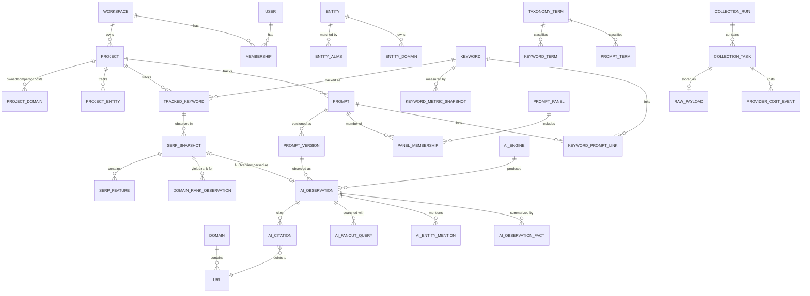

# 04. Data Model

Status: Draft for architecture freeze (Phase 0)
Owner: Backend / Data
Last updated: 2026-09-30
Depends on: [03-system-architecture.md](03-system-architecture.md), [12-normalized-observation-schemas.md](12-normalized-observation-schemas.md)

This document is the canonical relational model. Every other document that mentions a table refers to the definitions here. If another document disagrees with this one, this one wins and the other is a bug.

## 1. Design principles

1. **PostgreSQL is the ledger.** Every fact the product reports is derivable from rows in PostgreSQL plus raw payloads in R2. Redis holds nothing that cannot be rebuilt.
2. **Observations are append-only.** Rank observations, SERP snapshots, AI observations, citations and first-party metric rows are never updated in place after ingest, except for the `status` of a failed ingest and soft-delete flags on tenant deletion. Corrections are new rows with a higher `*_version`.
3. **Derived facts are versioned, not overwritten.** Extraction results (mentions, recommendation labels, sentiment) carry a `derivation_id` that pins extractor, entity configuration and classifier versions. Re-running extraction writes new rows and flips `is_current`. Historical metric values stay reproducible.
4. **Five observation classes stay separate.** Consumer-UI AI observations, official-API AI observations, SERP observations (including AI Overview and AI Mode), first-party publisher data, and organic rank data live in distinct tables or are distinguished by a non-null `observation_class` column that every metric query filters on. No view silently unions them.
5. **Identity is separate from measurement.** A tracked keyword's identity (text, location, language, device, engine) is immutable. Measurement-affecting settings that can change (depth profile, target URL) are versioned in a history table.
6. **Compact facts in PostgreSQL, bulky evidence in R2.** Full SERP JSON and full AI vendor responses are stored compressed in R2. PostgreSQL keeps the normalized facts needed for analytics plus a pointer to the raw object.
7. **Tenant-owned rows carry `workspace_id`.** Global dictionaries (`core.domains`, `core.urls`, provider registries) do not. Tenant tables have row-level security enabled (see section 13).
8. **High-volume tables are range-partitioned by month from day one.** Retrofitting partitioning onto a 200 million row table is a multi-day migration; doing it at creation costs nothing.

## 2. Conventions

| Concern | Convention |
|---|---|
| PostgreSQL version | 18 (see ADR-003). Uses built-in `uuidv7()`. |
| Schemas | `auth` (our own auth module: users, sessions, tokens, TOTP, workspaces, memberships, invitations), `core` (tenancy, taxonomy, entities, domains, URLs), `seo`, `ai`, `fp` (first-party), `ops` (scheduling, costs, alerts, audit, raw payload registry). |
| Primary keys, tenant entities | `uuid DEFAULT uuidv7()`. Time-ordered, safe to expose in URLs, good B-tree locality. |
| Primary keys, observations | `bigint GENERATED ALWAYS AS IDENTITY` plus the partition key (`observed_at`) in a composite PK. Exposed in the API as strings. |
| Timestamps | `timestamptz`, stored in UTC. Business dates (for daily rollups) are `date` computed in the project's timezone at ingest time and stored explicitly (`observed_date`). |
| Enumerations | `text` with `CHECK` constraints for small closed sets that rarely change. Registry tables (`ai.engines`, `ops.providers`, `seo.serp_feature_types`) for sets that grow. |
| Money | `numeric(14,6)` in USD. Provider costs are fractions of a cent. |
| Soft delete | `deleted_at timestamptz` on configuration entities only (projects, keywords, prompts). Observations are never soft-deleted; tenant deletion purges them by partition-aware batch delete. |
| JSONB | Only for (a) provider-specific extras that have no canonical column, (b) small structured blobs whose shape is versioned (`settings`, feature payloads). Never for anything filtered or aggregated in a hot path. |
| Naming | Tables plural snake_case. FK columns `<entity>_id`. Booleans `is_*`/`has_*`. |

Extensions required: `citext`, `pg_trgm` (keyword/prompt search), `pgcrypto` (`digest()` for hashes in SQL-side backfills), `btree_gist` (exclusion constraint on panel membership history), `pg_stat_statements` (observability). No other extensions in V1.

DDL in this document is grouped by domain for readability, so some foreign keys reference tables defined further down. The migration files create tables in dependency order (registries and dictionaries first) and add cross-domain foreign keys with `ALTER TABLE ... ADD CONSTRAINT` where needed. Partition management is done by an in-house PL/pgSQL function (section 12), not `pg_partman`, so V1 runs the stock `postgres:18` image without a custom build. The PITR phase (pgBackRest with WAL archiving, [23-backup-disaster-recovery.md](23-backup-disaster-recovery.md) section 13) introduces a custom image (`FROM postgres:18` plus the pgBackRest package, built in CI and pinned by digest) because `archive_command` runs inside the database container; it adds no extensions.

## 3. Conceptual model



The model has one spine that joins everything: **domain and URL**. A URL that ranks organically, a URL cited in an AI Overview, a URL cited by ChatGPT, and a page reported by Search Console are the same `core.urls` row. That is what makes page-level cross-channel analysis a join instead of a fuzzy match.

The second spine is **taxonomy**. Topics, clusters and tags attach to both keywords and prompts through parallel link tables, so "AI visibility for topic CRM" and "SEO visibility for topic CRM" filter the same term IDs.

The third spine is the **keyword to prompt link**, which is many-to-many and records how each link was created.

## 4. Identity and tenancy

Authentication is our own module in the FastAPI app ([ADR-022](adr/ADR-022-python-backend-simplified-platform.md), superseding ADR-014), so the `auth` schema is ours and is created by Alembic migrations like every other schema. "Organization" in earlier drafts is our **workspace**: `auth.workspaces` and `auth.memberships` keep the shape they had, and the role set is unchanged.

| Table | Purpose | Notes |
|---|---|---|
| `auth.users` | Accounts | argon2id password hash on the row; no separate accounts table (Google OIDC is deferred) |
| `auth.sessions` | Server-side sessions | Opaque id in the `__Host-session` cookie, stored as a sha256 hash; 60 s Redis read-through cache |
| `auth.verification_tokens` | Email verification and password reset | Single-use, stored hashed, short expiry |
| `auth.totp_secrets` | TOTP (pyotp) and recovery codes | Required for `owner` and `admin` |
| `auth.workspaces` | Tenants (the former "organization") | Unchanged fields, below |
| `auth.memberships` | User role per workspace | `role` constrained to our role set; unchanged |
| `auth.invitations` | Pending workspace invitations | Token stored hashed; `project_ids` copied on acceptance |
| `auth.api_keys` | Workspace API keys | **Deferred, no routes in V1** (doc 19 section 3.2.4); table kept so keys can ship without a migration |

Roles (section 3.1 of [24-security.md](24-security.md)): `owner`, `admin`, `editor`, `analyst`, `viewer`, `billing`.

```sql
CREATE TABLE auth.users (
    id                    uuid PRIMARY KEY DEFAULT uuidv7(),
    email                 citext NOT NULL UNIQUE,
    name                  text NOT NULL,
    image                 text,
    password_hash         text NOT NULL,          -- argon2id encoded string; parameters travel with the hash
    email_verified_at     timestamptz,            -- NULL until verified; unverified users cannot create workspaces
    is_platform_operator  boolean NOT NULL DEFAULT false,   -- installation operator; set only by the ops CLI
    disabled_at           timestamptz,
    created_at            timestamptz NOT NULL DEFAULT now(),
    updated_at            timestamptz NOT NULL DEFAULT now()
);

CREATE TABLE auth.sessions (
    id                   uuid PRIMARY KEY DEFAULT uuidv7(),   -- internal id used by the session list and revoke routes
    token_hash           bytea NOT NULL UNIQUE,               -- sha256 of the opaque cookie value; the value is never stored
    user_id              uuid NOT NULL REFERENCES auth.users(id) ON DELETE CASCADE,
    state                text NOT NULL DEFAULT 'active' CHECK (state IN ('pending_totp','active')),
    fresh_until          timestamptz,             -- password or TOTP verified; 10 minutes (24 section 2)
    idle_expires_at      timestamptz NOT NULL,    -- sliding lifetime (24 section 2)
    absolute_expires_at  timestamptz NOT NULL,
    revoked_at           timestamptz,
    ip                   inet,
    user_agent           text,
    created_at           timestamptz NOT NULL DEFAULT now(),
    last_seen_at         timestamptz NOT NULL DEFAULT now()   -- updated at most once per minute
);
CREATE INDEX ON auth.sessions (user_id) WHERE revoked_at IS NULL;

CREATE TABLE auth.verification_tokens (
    id            uuid PRIMARY KEY DEFAULT uuidv7(),
    user_id       uuid NOT NULL REFERENCES auth.users(id) ON DELETE CASCADE,
    purpose       text NOT NULL CHECK (purpose IN ('email_verification','password_reset')),
    token_hash    bytea NOT NULL UNIQUE,          -- sha256 of the emailed token
    expires_at    timestamptz NOT NULL,
    consumed_at   timestamptz,
    created_at    timestamptz NOT NULL DEFAULT now()
);
CREATE INDEX ON auth.verification_tokens (user_id, purpose) WHERE consumed_at IS NULL;

CREATE TABLE auth.totp_secrets (
    user_id               uuid PRIMARY KEY REFERENCES auth.users(id) ON DELETE CASCADE,
    secret_encrypted      bytea NOT NULL,         -- the server must recompute codes, so the secret is encrypted (AES-GCM, key from the platform secrets file), not hashed
    confirmed_at          timestamptz,            -- NULL until the first valid code; an unconfirmed secret does not count as enabled
    last_used_step        bigint,                 -- last accepted 30 s time step; blocks code replay
    recovery_code_hashes  text[] NOT NULL DEFAULT '{}',   -- sha256 hex of 80-bit random codes; a used code is removed
    created_at            timestamptz NOT NULL DEFAULT now()
);

CREATE TABLE auth.invitations (
    id            uuid PRIMARY KEY DEFAULT uuidv7(),
    workspace_id  uuid NOT NULL REFERENCES auth.workspaces(id) ON DELETE CASCADE,
    email         citext NOT NULL,
    role          text NOT NULL CHECK (role IN ('owner','admin','editor','analyst','viewer','billing')),
    project_ids   uuid[],                         -- copied to the membership on acceptance; NULL = all projects
    token_hash    bytea NOT NULL UNIQUE,          -- sha256 of the token in the invitation link
    status        text NOT NULL DEFAULT 'pending' CHECK (status IN ('pending','accepted','declined','cancelled','expired')),
    invited_by    uuid NOT NULL REFERENCES auth.users(id),
    expires_at    timestamptz NOT NULL,           -- created_at + 7 days (19 section 3.2.2)
    responded_at  timestamptz,
    created_at    timestamptz NOT NULL DEFAULT now()
);
CREATE UNIQUE INDEX ON auth.invitations (workspace_id, email) WHERE status = 'pending';

CREATE TABLE auth.workspaces (
    id           uuid PRIMARY KEY DEFAULT uuidv7(),
    name         text NOT NULL,
    slug         citext NOT NULL UNIQUE,
    logo         text,
    metadata     text,
    plan_code    text NOT NULL DEFAULT 'internal',
    timezone     text NOT NULL DEFAULT 'UTC',
    status       text NOT NULL DEFAULT 'active' CHECK (status IN ('active','suspended','deleting')),
    purge_after  timestamptz,                     -- set on soft delete to deleted time + 30 days (24 section 13)
    created_at   timestamptz NOT NULL DEFAULT now()
);

CREATE TABLE auth.memberships (
    id            uuid PRIMARY KEY DEFAULT uuidv7(),
    workspace_id  uuid NOT NULL REFERENCES auth.workspaces(id) ON DELETE CASCADE,
    user_id       uuid NOT NULL REFERENCES auth.users(id) ON DELETE CASCADE,
    role          text NOT NULL CHECK (role IN ('owner','admin','editor','analyst','viewer','billing')),
    project_ids   uuid[],                         -- NULL = all projects; else restricted to these
    created_at    timestamptz NOT NULL DEFAULT now(),
    UNIQUE (workspace_id, user_id)
);
CREATE INDEX ON auth.memberships (user_id);

-- Deferred, no routes in V1 (ADR-022; 19 section 3.2.4). Created so API keys can ship without a migration.
CREATE TABLE auth.api_keys (
    id                     uuid PRIMARY KEY DEFAULT uuidv7(),
    workspace_id           uuid NOT NULL REFERENCES auth.workspaces(id) ON DELETE CASCADE,
    name                   text NOT NULL,
    prefix                 text NOT NULL UNIQUE,  -- 8 chars, shown in UI and used for lookup
    key_hash               bytea NOT NULL,        -- sha256(secret); the secret is shown once
    scopes                 text[] NOT NULL,       -- permission keys (24 section 3.2), subset of the creator's
    expires_at             timestamptz,           -- default created_at + 365 days
    ip_allowlist           cidr[] NOT NULL DEFAULT '{}',
    rate_limit_per_minute  integer NOT NULL DEFAULT 120 CHECK (rate_limit_per_minute BETWEEN 1 AND 600),
    last_used_at           timestamptz,           -- updated at most once per minute
    last_used_ip           inet,
    created_by             uuid NOT NULL REFERENCES auth.users(id),
    created_at             timestamptz NOT NULL DEFAULT now(),
    revoked_at             timestamptz
);
CREATE INDEX ON auth.api_keys (workspace_id);
```

`auth.users`, `auth.sessions`, `auth.verification_tokens` and `auth.totp_secrets` have no `workspace_id` and no RLS: the auth module reads them before any workspace is known, always by a unique key (email, token hash, user id). What the API may change on them is bounded by column grants instead (section 13.1). `auth.workspaces`, `auth.memberships`, `auth.invitations` and `auth.api_keys` follow section 13, with two additions: a user can read their own memberships and the workspaces those belong to before a workspace is chosen, and invitation acceptance looks the invitation up by `token_hash` through a `SECURITY DEFINER` function.

```sql
CREATE TABLE core.projects (
    id                   uuid PRIMARY KEY DEFAULT uuidv7(),
    workspace_id         uuid NOT NULL REFERENCES auth.workspaces(id) ON DELETE RESTRICT,
    name                 text NOT NULL,
    slug                 citext NOT NULL,
    primary_domain_id    integer REFERENCES core.domains(id),   -- the foreign key is added by the Phase 2 revision that creates core.domains
    default_location_id  integer,            -- provider-neutral location id, see core.locations
    default_language_code text,              -- ISO 639-1, e.g. 'en'
    timezone             text NOT NULL DEFAULT 'UTC',
    deep_check_weekday   smallint NOT NULL DEFAULT 1 CHECK (deep_check_weekday BETWEEN 0 AND 6),  -- day of top-100 check
    status               text NOT NULL DEFAULT 'active'
                         CHECK (status IN ('active','paused','archived')),
    settings             jsonb NOT NULL DEFAULT '{}'::jsonb,   -- validated by Pydantic model ProjectSettingsV1 (fields: 19 section 3.3)
    data_version         bigint NOT NULL DEFAULT 0,   -- incremented by ingest and rollup jobs; cache keys, ETags, cursors (03 section 7.4)
    entity_config_version integer NOT NULL DEFAULT 1, -- incremented on any entity, alias or domain-role change (13 section 3)
    created_by           uuid REFERENCES auth.users(id),
    created_at           timestamptz NOT NULL DEFAULT now(),
    updated_at           timestamptz NOT NULL DEFAULT now(),
    deleted_at           timestamptz,
    UNIQUE (workspace_id, slug)
);
CREATE INDEX ON core.projects (workspace_id) WHERE deleted_at IS NULL;
```

### 4.1 Quotas and budgets

```sql
CREATE TABLE core.workspace_quotas (
    workspace_id          uuid PRIMARY KEY REFERENCES auth.workspaces(id) ON DELETE CASCADE,
    max_projects          integer NOT NULL DEFAULT 10,
    max_tracked_keywords  integer NOT NULL DEFAULT 5000,
    max_active_prompts    integer NOT NULL DEFAULT 1000,
    max_ai_observations_per_month integer NOT NULL DEFAULT 20000,
    max_serp_checks_per_month     integer NOT NULL DEFAULT 200000,
    updated_at            timestamptz NOT NULL DEFAULT now()
);

CREATE TABLE ops.budgets (
    id               uuid PRIMARY KEY DEFAULT uuidv7(),
    workspace_id     uuid NOT NULL REFERENCES auth.workspaces(id) ON DELETE CASCADE,
    project_id       uuid REFERENCES core.projects(id) ON DELETE CASCADE,  -- NULL = workspace-wide
    workload         text CHECK (workload IN ('seo_rank','ai_prompt','keyword_research','ai_benchmark','extraction_llm','first_party','all')),  -- budget groups, section 11.4.1
    period           text NOT NULL DEFAULT 'month' CHECK (period IN ('month')),
    limit_usd        numeric(14,2) NOT NULL CHECK (limit_usd >= 0),
    soft_limit_pct   smallint NOT NULL DEFAULT 80 CHECK (soft_limit_pct BETWEEN 1 AND 100),
    action_on_hard   text NOT NULL DEFAULT 'pause' CHECK (action_on_hard IN ('pause','alert_only')),
    created_at       timestamptz NOT NULL DEFAULT now(),
    UNIQUE NULLS NOT DISTINCT (workspace_id, project_id, workload, period)
);
```

## 5. Shared dimension tables

### 5.1 Domains and URLs (global dictionaries)

These tables are **not** tenant-scoped. A URL is a public fact. Deduplicating URLs across tenants keeps citation and SERP tables narrow (8-byte ids instead of 80-byte strings). The API never lists these tables directly; every read path joins from a tenant-scoped table first, so a tenant cannot enumerate URLs observed for another tenant.

```sql
CREATE TABLE core.domains (
    id                  integer GENERATED ALWAYS AS IDENTITY PRIMARY KEY,
    host                text NOT NULL          -- lowercased, punycode (IDNA), no trailing dot, 'www.' kept
                        CHECK (host = lower(host) AND length(host) BETWEEN 1 AND 255),
    registrable_domain  text NOT NULL,         -- eTLD+1 via Public Suffix List (publicsuffixlist), e.g. 'example.co.uk'; the host itself for an IP
    public_suffix       text NOT NULL,         -- '' for an IP
    is_ip               boolean NOT NULL DEFAULT false,
    default_category    text REFERENCES core.domain_categories(code),  -- global classification, see 14-citation-intelligence
    category_source     text CHECK (category_source IN ('seed_list','rule','llm','manual')),
    category_version    smallint,
    first_seen_at       timestamptz NOT NULL DEFAULT now(),
    UNIQUE (host),
    -- registrable_domain is host or a dot-suffix of it; public_suffix is registrable_domain or a
    -- dot-suffix of it; an IP is its own registrable domain with an empty public suffix
    CHECK (registrable_domain = host OR right(host, length(registrable_domain) + 1) = '.' || registrable_domain),
    CHECK (CASE WHEN is_ip THEN public_suffix = '' AND registrable_domain = host
                ELSE public_suffix <> '' AND (public_suffix = registrable_domain
                     OR right(registrable_domain, length(public_suffix) + 1) = '.' || public_suffix) END)
);
CREATE INDEX ON core.domains (registrable_domain);
-- app_api: SELECT, and INSERT of (host, registrable_domain, public_suffix, is_ip) only. Every
-- workspace reads the row its first writer created, so the API never sets a classification.

CREATE TABLE core.domain_categories (
    code        text PRIMARY KEY,      -- 'brand_owned','competitor', are tenant roles, NOT categories
    label       text NOT NULL,
    description text NOT NULL
);
-- Seed: 'news','review_aggregator','ugc_forum','social','video','wiki_reference','vendor_site',
--       'marketplace','directory','government','education','blog_independent','affiliate','docs','other'

CREATE TABLE core.urls (
    id                bigint GENERATED ALWAYS AS IDENTITY PRIMARY KEY,
    url_hash          bytea NOT NULL,           -- sha256(canonical URL without scheme), 32 bytes; http and https merge (14 section 3)
    canonical_url     text NOT NULL,            -- normalized per 14-citation-intelligence section 3
    domain_id         integer NOT NULL REFERENCES core.domains(id),
    path              text NOT NULL,            -- canonical path without query, for page grouping
    first_seen_at     timestamptz NOT NULL DEFAULT now(),
    canonicalizer_version smallint NOT NULL,
    UNIQUE (url_hash)
);
CREATE INDEX ON core.urls (domain_id);
```

`core.urls` never stores the raw URL as the provider returned it; the raw form stays on the observation row (`raw_url`) where it is needed for provenance. Canonicalization rules and their version are documented in [14-citation-intelligence.md](14-citation-intelligence.md). If canonicalization rules change, a backfill job computes the new canonical form, inserts new `core.urls` rows as needed, and writes a mapping table `core.url_remap(old_url_id, new_url_id, canonicalizer_version)`; old observation rows are not rewritten.

URL upsert pattern (hot path, used by every ingest worker):

```sql
INSERT INTO core.urls (url_hash, canonical_url, domain_id, path, canonicalizer_version)
SELECT * FROM unnest($1::bytea[], $2::text[], $3::int[], $4::text[], $5::smallint[])
ON CONFLICT (url_hash) DO NOTHING;
SELECT id, url_hash FROM core.urls WHERE url_hash = ANY($1::bytea[]);
```

Workers keep a process-local LRU (50,000 entries) of `url_hash -> id` and `host -> domain_id`.

### 5.2 Locations and languages

Provider location codes differ. We store our own `core.locations` keyed by a stable internal id and map to each provider.

```sql
CREATE TABLE core.locations (
    id                integer PRIMARY KEY,         -- we adopt Google Ads geo target criteria ids (also used by DataForSEO location_code)
    name              text NOT NULL,               -- 'Austin,Texas,United States'
    country_iso       char(2) NOT NULL CHECK (country_iso ~ '^[A-Z]{2}$'),
    location_type     text NOT NULL,               -- 'Country','State','City','DMA Region',...
    parent_id         integer REFERENCES core.locations(id),
    is_active         boolean NOT NULL DEFAULT true
);
CREATE TABLE core.provider_location_map (
    provider_code     text NOT NULL REFERENCES ops.providers(code),
    location_id       integer NOT NULL REFERENCES core.locations(id),
    provider_value    text NOT NULL,               -- e.g. DataForSEO location_code as text, SerpApi 'location' string
    supports          text[] NOT NULL,             -- surfaces supported (not workload values): {'serp','ai_mode','llm_scraper',...}
    PRIMARY KEY (provider_code, location_id)
);
```

Using Google Ads geo target ids as our primary key is a deliberate shortcut: DataForSEO, Google Ads, and Search Console country codes all line up with it, and it is stable. It is an assumption to revisit if a future provider cannot map to it.

### 5.3 Taxonomy (shared by keywords and prompts)

```sql
CREATE TABLE core.taxonomy_vocabularies (
    id            uuid PRIMARY KEY DEFAULT uuidv7(),
    workspace_id  uuid NOT NULL REFERENCES auth.workspaces(id) ON DELETE CASCADE,
    project_id    uuid,                      -- NULL = workspace-wide vocabulary
    kind          text NOT NULL CHECK (kind IN ('topic','cluster','product','service','market','campaign','persona','tag','custom')),
    name          text NOT NULL CHECK (name = btrim(name) AND length(name) BETWEEN 1 AND 100),  -- e.g. 'Topics'
    is_hierarchical boolean NOT NULL DEFAULT false,
    is_single_valued boolean NOT NULL DEFAULT false,  -- e.g. cluster: one per keyword
    UNIQUE (id, workspace_id),
    FOREIGN KEY (project_id, workspace_id) REFERENCES core.projects(id, workspace_id) ON DELETE CASCADE
);
CREATE UNIQUE INDEX ON core.taxonomy_vocabularies (workspace_id, project_id, kind, lower(name)) NULLS NOT DISTINCT;
CREATE INDEX ON core.taxonomy_vocabularies (project_id);

CREATE TABLE core.taxonomy_terms (
    id             uuid PRIMARY KEY DEFAULT uuidv7(),
    workspace_id   uuid NOT NULL,
    vocabulary_id  uuid NOT NULL,
    parent_id      uuid,                     -- in the same vocabulary
    name           text NOT NULL CHECK (name = btrim(name) AND length(name) BETWEEN 1 AND 200),
    slug           citext NOT NULL CHECK (slug::text ~ '^[a-z0-9]+(-[a-z0-9]+)*$'),
    path           text NOT NULL             -- materialized path 'crm/crm-for-startups' for subtree queries
                   CHECK (path ~ '^[a-z0-9]+(-[a-z0-9]+)*(/[a-z0-9]+(-[a-z0-9]+)*)*$'),
    source         text NOT NULL DEFAULT 'manual' CHECK (source IN ('manual','import','auto_cluster','ai_suggestion')),
    description    text,
    created_at     timestamptz NOT NULL DEFAULT now(),
    UNIQUE NULLS NOT DISTINCT (vocabulary_id, parent_id, slug),
    UNIQUE (id, workspace_id),
    UNIQUE (id, vocabulary_id),
    CHECK (parent_id IS DISTINCT FROM id),
    -- a root's path is its slug; a child's path ends in '/' and its slug
    CHECK (CASE WHEN parent_id IS NULL THEN path = slug::text
                ELSE right(path, length(slug) + 1) = '/' || slug::text END),
    FOREIGN KEY (vocabulary_id, workspace_id) REFERENCES core.taxonomy_vocabularies(id, workspace_id) ON DELETE CASCADE,
    FOREIGN KEY (parent_id, vocabulary_id) REFERENCES core.taxonomy_terms(id, vocabulary_id) ON DELETE CASCADE
);
CREATE INDEX ON core.taxonomy_terms (vocabulary_id, path text_pattern_ops);
CREATE INDEX ON core.taxonomy_terms (parent_id);
```

Intent, funnel stage and priority are **columns** on keywords and prompts, not taxonomy terms, because they are single-valued, analytics-critical, and have a fixed value set:

- `intent`: `informational`, `navigational`, `commercial`, `transactional`, `local`, `unknown`
- `funnel_stage`: `tofu`, `mofu`, `bofu`, `retention`, `unknown`
- `priority`: `smallint` 1 (highest) to 5

Topic, cluster, product, service, market, campaign, persona and tags are terms. A keyword can have many terms per vocabulary unless the vocabulary is `is_single_valued`.

## 6. Entities: brands, aliases, competitors

A competitor is an entity with a project role, not a separate table. This keeps SEO competitor tracking (by domain) and AI competitor tracking (by name and domain) on the same object.

```sql
CREATE TABLE core.entities (
    id             uuid PRIMARY KEY DEFAULT uuidv7(),
    workspace_id   uuid NOT NULL REFERENCES auth.workspaces(id) ON DELETE CASCADE,
    entity_type    text NOT NULL CHECK (entity_type IN ('brand','product','organization','person','other')),
    canonical_name text NOT NULL CHECK (canonical_name = btrim(canonical_name) AND length(canonical_name) BETWEEN 1 AND 200),
    parent_entity_id uuid,                                  -- product -> brand
    description    text,
    is_ambiguous   boolean NOT NULL DEFAULT false,         -- name is a common word ('Notion','Monday','Apple')
    disambiguation_hints text[] NOT NULL DEFAULT '{}',      -- context words that confirm the entity ('crm','project management')
    created_at     timestamptz NOT NULL DEFAULT now(),
    updated_at     timestamptz NOT NULL DEFAULT now(),
    UNIQUE (id, workspace_id),
    CHECK (parent_entity_id IS DISTINCT FROM id),
    FOREIGN KEY (parent_entity_id, workspace_id) REFERENCES core.entities(id, workspace_id)
);
CREATE UNIQUE INDEX ON core.entities (workspace_id, lower(canonical_name), entity_type);
CREATE INDEX ON core.entities (parent_entity_id);

CREATE TABLE core.entity_aliases (
    id              uuid PRIMARY KEY DEFAULT uuidv7(),
    workspace_id    uuid NOT NULL,
    entity_id       uuid NOT NULL,
    alias           text NOT NULL CHECK (length(alias) BETWEEN 1 AND 200),
    match_mode      text NOT NULL DEFAULT 'word_boundary'
                    CHECK (match_mode IN ('word_boundary','exact_case','substring','regex')),
    case_sensitive  boolean NOT NULL DEFAULT false,
    language_code   text,                        -- NULL = any language
    is_negative     boolean NOT NULL DEFAULT false,  -- phrases that must NOT count ('apple pie' for Apple)
    requires_context boolean NOT NULL DEFAULT false, -- only counts if a disambiguation hint is within N tokens
    created_by      uuid REFERENCES auth.users(id) ON DELETE SET NULL,
    created_at      timestamptz NOT NULL DEFAULT now(),
    UNIQUE (entity_id, alias, match_mode, is_negative),
    CHECK (match_mode = 'regex' OR alias = btrim(alias)),   -- a pattern may start or end with a space
    FOREIGN KEY (entity_id, workspace_id) REFERENCES core.entities(id, workspace_id) ON DELETE CASCADE
);
-- an alias that ignores case is the same alias whatever its case
CREATE UNIQUE INDEX ON core.entity_aliases (entity_id, lower(alias), match_mode, is_negative)
    WHERE match_mode IN ('word_boundary','substring') AND NOT case_sensitive;

CREATE TABLE core.entity_domains (
    id             uuid PRIMARY KEY DEFAULT uuidv7(),  -- an entity may claim several path prefixes on a host
    entity_id      uuid NOT NULL,
    workspace_id   uuid NOT NULL,                  -- for row-level security, as on every tenant table
    domain_id      integer NOT NULL REFERENCES core.domains(id),
    match_scope    text NOT NULL DEFAULT 'registrable'
                   CHECK (match_scope IN ('host','registrable','path_prefix')),
    path_prefix    text CHECK (path_prefix ~ '^/([^?#]*[^/?#])?$'),  -- for 'path_prefix' scope, e.g. '/@brand' on medium.com
    UNIQUE NULLS NOT DISTINCT (entity_id, domain_id, match_scope, path_prefix),
    CHECK ((match_scope = 'path_prefix') = (path_prefix IS NOT NULL)),
    FOREIGN KEY (entity_id, workspace_id) REFERENCES core.entities(id, workspace_id) ON DELETE CASCADE
);
CREATE INDEX ON core.entity_domains (domain_id);

CREATE TABLE core.project_entities (
    project_id     uuid NOT NULL,
    entity_id      uuid NOT NULL,
    workspace_id   uuid NOT NULL,
    role           text NOT NULL CHECK (role IN ('own','competitor','watch')),
    is_primary     boolean NOT NULL DEFAULT false,  -- at most one live 'own' entity per project; once one is, another takes over, it is never cleared
    track_seo      boolean NOT NULL DEFAULT true,
    track_ai       boolean NOT NULL DEFAULT true,
    color_index    smallint CHECK (color_index BETWEEN 1 AND 6),  -- series colour --chart-1 to --chart-6, so it follows the theme; NULL lets the UI choose
    added_at       timestamptz NOT NULL DEFAULT now(),
    removed_at     timestamptz,                      -- history is kept for longitudinal SOV integrity
    PRIMARY KEY (project_id, entity_id),
    CHECK (NOT is_primary OR role = 'own'),
    FOREIGN KEY (project_id, workspace_id) REFERENCES core.projects(id, workspace_id) ON DELETE CASCADE,
    -- no cascade: a role, removed or not, keeps the entity it names alive
    FOREIGN KEY (entity_id, workspace_id) REFERENCES core.entities(id, workspace_id)
);
CREATE UNIQUE INDEX project_one_primary_own ON core.project_entities (project_id)
    WHERE role = 'own' AND is_primary AND removed_at IS NULL;
CREATE INDEX ON core.project_entities (entity_id);
```

Owned domains for a project are the `core.entity_domains` of entities with `role = 'own'`. There is no separate "owned domains" table; that would create two sources of truth.

A helper view joins the two for `GET {P}/domains` and for ingest:

```sql
CREATE VIEW core.project_domain_roles WITH (security_invoker = true) AS
SELECT pe.project_id, pe.workspace_id, pe.entity_id, pe.role, ed.domain_id, ed.match_scope, ed.path_prefix
FROM core.project_entities pe
JOIN core.entity_domains ed ON ed.entity_id = pe.entity_id AND ed.workspace_id = pe.workspace_id
WHERE pe.removed_at IS NULL;
```

It is a plain view, not a materialized one: a materialized view cannot have row-level security, so the API could read every workspace's rows through it, while a view run with the reader's rights applies the base tables' policies (migration 0010). Ingest keeps its own in-process cache of a project's domain rules; if it ever needs a materialized view, that one is readable by the worker only.

As built (migration 0010), every tenant table of sections 5.3 and 6 refers to its parents through `(id, workspace_id)` rather than `id` alone (`core.entities`, `core.projects`, `core.taxonomy_vocabularies` and `core.taxonomy_terms` have `UNIQUE (id, workspace_id)` for it), so a row cannot point into another workspace even for a role that bypasses row-level security; a term's parent is keyed by `(id, vocabulary_id)` instead, which keeps it in the same vocabulary and so the same workspace. `tests/db/test_rls.py` reads every key between tenant tables from the catalog and fails on one without the workspace. Entity, alias and vocabulary names compare without case where case does not matter, and a term's slug is unique among its siblings, roots included (`UNIQUE NULLS NOT DISTINCT`). An entity that a project role names, even a removed one, cannot be deleted: the API answers `409 entity_in_use` from the key violation, which also settles a race with a concurrent attach. Role history is the role row plus the audit log: re-attaching an entity or changing its role updates the one row per project and entity.

## 7. SEO tables

### 7.1 Keywords and tracked keywords

```sql
CREATE TABLE seo.keywords (
    id              uuid PRIMARY KEY DEFAULT uuidv7(),
    workspace_id    uuid NOT NULL REFERENCES auth.workspaces(id) ON DELETE CASCADE,
    text            text NOT NULL,                  -- as entered, trimmed
    normalized_text text NOT NULL,                  -- NFKC, lowercase, collapsed whitespace
    language_code   text NOT NULL,
    created_at      timestamptz NOT NULL DEFAULT now(),
    UNIQUE (workspace_id, normalized_text, language_code)
);
CREATE INDEX ON seo.keywords USING gin (normalized_text gin_trgm_ops);

CREATE TABLE seo.tracked_keywords (
    id               uuid PRIMARY KEY DEFAULT uuidv7(),
    workspace_id     uuid NOT NULL,
    project_id       uuid NOT NULL REFERENCES core.projects(id) ON DELETE CASCADE,
    keyword_id       uuid NOT NULL REFERENCES seo.keywords(id),
    -- identity (immutable after creation; changing any of these creates a new tracked keyword)
    search_engine    text NOT NULL DEFAULT 'google' CHECK (search_engine IN ('google','bing')),
    location_id      integer NOT NULL REFERENCES core.locations(id),
    language_code    text NOT NULL,
    device           text NOT NULL CHECK (device IN ('desktop','mobile')),
    os               text,                          -- 'windows','macos','android','ios' or NULL = provider default
    -- mutable, measurement-affecting (versioned in tracked_keyword_config_history)
    config_version   integer NOT NULL DEFAULT 1,
    depth_profile    text NOT NULL DEFAULT 'standard'
                     CHECK (depth_profile IN ('light','standard','deep','full','weekly','weekly_light','until_own_match_100')),
                     -- daily/weekly depth plan, see 06-dataforseo-seo-integration section 2.2
    target_url_id    bigint REFERENCES core.urls(id),
    -- mutable, descriptive
    intent           text NOT NULL DEFAULT 'unknown',
    intent_source    text CHECK (intent_source IN ('provider','manual','rule')),
    funnel_stage     text NOT NULL DEFAULT 'unknown',
    priority         smallint NOT NULL DEFAULT 3 CHECK (priority BETWEEN 1 AND 5),
    business_value   numeric(12,2),                 -- optional user-assigned value per click or per conversion
    frequency        text NOT NULL DEFAULT 'daily' CHECK (frequency IN ('daily','weekly','custom')),
    schedule_id      uuid REFERENCES ops.schedules(id),
    source           text NOT NULL DEFAULT 'manual'
                     CHECK (source IN ('manual','csv_import','api','gsc_import','discovery','bulk_paste')),
    is_active        boolean NOT NULL DEFAULT true,
    created_by       uuid REFERENCES auth.users(id),
    created_at       timestamptz NOT NULL DEFAULT now(),
    updated_at       timestamptz NOT NULL DEFAULT now(),
    deleted_at       timestamptz,
    CONSTRAINT tracked_keyword_identity UNIQUE
        (project_id, keyword_id, search_engine, location_id, language_code, device)
);
CREATE INDEX ON seo.tracked_keywords (project_id) WHERE deleted_at IS NULL AND is_active;
CREATE INDEX ON seo.tracked_keywords (schedule_id) WHERE deleted_at IS NULL AND is_active;

-- Visibility weight w_k per tracked keyword (09 section 6.2); scheme from ProjectSettingsV1.visibility_weight_scheme.
CREATE VIEW core.keyword_weights AS
SELECT tk.id AS tracked_keyword_id,
       tk.project_id,
       (CASE coalesce(p.settings->>'visibility_weight_scheme', 'uniform')
            WHEN 'priority' THEN CASE tk.priority WHEN 1 THEN 3 WHEN 2 THEN 2 WHEN 3 THEN 1 WHEN 4 THEN 0.5 ELSE 0.25 END
            WHEN 'business_value' THEN coalesce(tk.business_value, 1)
            ELSE 1
        END)::numeric AS weight
FROM seo.tracked_keywords tk
JOIN core.projects p ON p.id = tk.project_id;

CREATE TABLE seo.tracked_keyword_config_history (
    tracked_keyword_id uuid NOT NULL REFERENCES seo.tracked_keywords(id) ON DELETE CASCADE,
    config_version     integer NOT NULL,
    depth_profile      text NOT NULL,
    target_url_id      bigint,
    valid_from         timestamptz NOT NULL,
    valid_to           timestamptz,
    changed_by         uuid REFERENCES auth.users(id),
    change_reason      text,
    PRIMARY KEY (tracked_keyword_id, config_version)
);

CREATE TABLE seo.keyword_groups (
    id            uuid PRIMARY KEY DEFAULT uuidv7(),
    workspace_id  uuid NOT NULL,
    project_id    uuid NOT NULL REFERENCES core.projects(id) ON DELETE CASCADE,
    parent_id     uuid REFERENCES seo.keyword_groups(id) ON DELETE CASCADE,
    name          text NOT NULL,
    path          text NOT NULL,
    UNIQUE (project_id, parent_id, name)
);
CREATE TABLE seo.keyword_group_members (
    group_id           uuid NOT NULL REFERENCES seo.keyword_groups(id) ON DELETE CASCADE,
    tracked_keyword_id uuid NOT NULL REFERENCES seo.tracked_keywords(id) ON DELETE CASCADE,
    PRIMARY KEY (group_id, tracked_keyword_id)
);
CREATE INDEX ON seo.keyword_group_members (tracked_keyword_id);

CREATE TABLE seo.tracked_keyword_terms (
    tracked_keyword_id uuid NOT NULL REFERENCES seo.tracked_keywords(id) ON DELETE CASCADE,
    term_id            uuid NOT NULL REFERENCES core.taxonomy_terms(id) ON DELETE CASCADE,
    assigned_by        text NOT NULL DEFAULT 'manual' CHECK (assigned_by IN ('manual','import','rule','auto_cluster','ai_suggestion')),
    PRIMARY KEY (tracked_keyword_id, term_id)
);
CREATE INDEX ON seo.tracked_keyword_terms (term_id);

-- Optional per-keyword competitor override. Default competitor set is core.project_entities(role='competitor').
CREATE TABLE seo.tracked_keyword_competitors (
    tracked_keyword_id uuid NOT NULL REFERENCES seo.tracked_keywords(id) ON DELETE CASCADE,
    entity_id          uuid NOT NULL REFERENCES core.entities(id) ON DELETE CASCADE,
    mode               text NOT NULL CHECK (mode IN ('include','exclude')),
    PRIMARY KEY (tracked_keyword_id, entity_id)
);
```

Taxonomy terms attach to `tracked_keywords` rather than `keywords` because a workspace-level keyword can be tracked by two projects that classify it differently.

### 7.2 Keyword metrics (append-only snapshots)

```sql
CREATE TABLE seo.keyword_metric_snapshots (
    id                 bigint GENERATED ALWAYS AS IDENTITY PRIMARY KEY,
    workspace_id       uuid NOT NULL,
    keyword_id         uuid NOT NULL REFERENCES seo.keywords(id) ON DELETE CASCADE,
    location_id        integer NOT NULL,
    language_code      text NOT NULL,
    source             text NOT NULL,             -- 'dataforseo_google_ads','dataforseo_labs','dataforseo_clickstream'
    fetched_at         timestamptz NOT NULL,
    data_month         date,                      -- last month covered by the provider's data
    search_volume      integer,
    monthly_searches   jsonb,                     -- [{"year":2026,"month":8,"search_volume":1900},...]
    cpc_usd            numeric(10,4),
    competition        numeric(5,4),              -- 0..1 paid competition
    competition_level  text,                      -- 'LOW','MEDIUM','HIGH'
    keyword_difficulty smallint,                  -- 0..100, provider-defined, see 09 section 8
    intent_main        text,
    intent_detail      jsonb,                     -- provider intent probabilities
    serp_item_types    text[],                    -- provider-reported SERP composition, if returned
    raw_payload_id     bigint,
    cost_event_id      bigint,
    is_material_change boolean NOT NULL,          -- computed at ingest vs previous snapshot (see 06 section 7.2)
    UNIQUE (keyword_id, location_id, language_code, source, fetched_at)
);
CREATE INDEX ON seo.keyword_metric_snapshots (keyword_id, location_id, language_code, fetched_at DESC);

-- Current value lookup (one row per keyword/location/language/source), updated at ingest.
CREATE TABLE seo.keyword_metrics_current (
    keyword_id      uuid NOT NULL,
    location_id     integer NOT NULL,
    language_code   text NOT NULL,
    source          text NOT NULL,
    snapshot_id     bigint NOT NULL REFERENCES seo.keyword_metric_snapshots(id),
    search_volume   integer,
    cpc_usd         numeric(10,4),
    keyword_difficulty smallint,
    intent_main     text,
    fetched_at      timestamptz NOT NULL,
    PRIMARY KEY (keyword_id, location_id, language_code, source)
);
```

Keyword metric snapshots are low volume (one per keyword per month), so they are not partitioned.

```sql
-- Modeled AI demand (DataForSEO AI Keyword Data). Deliberately a separate table from Google search volume.
CREATE TABLE seo.ai_demand_snapshots (
    id                  bigint GENERATED ALWAYS AS IDENTITY PRIMARY KEY,
    workspace_id        uuid NOT NULL,
    keyword_id          uuid NOT NULL REFERENCES seo.keywords(id) ON DELETE CASCADE,
    location_id         integer NOT NULL,
    language_code       text NOT NULL,
    source              text NOT NULL DEFAULT 'dataforseo_ai_keyword_data',
    method_note         text NOT NULL,            -- provider's stated methodology, shown in UI tooltip
    fetched_at          timestamptz NOT NULL,
    ai_demand_estimate  integer,                  -- provider 'ai_search_volume', a modeled proxy
    monthly_estimates   jsonb,                    -- provider 'ai_monthly_searches'
    raw_payload_id      bigint,
    UNIQUE (keyword_id, location_id, language_code, source, fetched_at)
);
```

### 7.3 SERP snapshots (partitioned)

A SERP snapshot is one provider response for one tracked keyword at one time. It stores **compact** facts about the whole SERP. The full JSON is in R2.

```sql
CREATE TABLE seo.serp_snapshots (
    id                    bigint GENERATED ALWAYS AS IDENTITY,
    observed_at           timestamptz NOT NULL,          -- provider's datetime for the crawl, else fetch time
    observed_date         date NOT NULL,                 -- in project timezone, for daily rollups
    workspace_id          uuid NOT NULL,
    project_id            uuid NOT NULL,
    tracked_keyword_id    uuid NOT NULL,
    config_version        integer NOT NULL,
    collection_task_id    bigint,
    observation_class     text NOT NULL DEFAULT 'serp' CHECK (observation_class = 'serp'),
    provider_code         text NOT NULL,
    provider_endpoint     text NOT NULL,                 -- e.g. 'serp/google/organic/task_get/advanced'
    provider_task_id      text,
    se_domain             text,                          -- 'google.com'
    location_id           integer NOT NULL,
    language_code         text NOT NULL,
    device                text NOT NULL,
    os                    text,
    depth_requested       smallint NOT NULL,
    depth_returned        smallint NOT NULL,             -- organic results actually present
    se_results_count      bigint,                        -- "about N results" when provided
    item_types            text[] NOT NULL,               -- distinct element types present, canonical names
    -- Full organic ordering, compact. Index i (1-based) = organic rank i.
    organic_url_ids       bigint[] NOT NULL,             -- core.urls ids ordered by organic rank
    organic_domain_ids    integer[] NOT NULL,            -- parallel array
    organic_abs_positions smallint[] NOT NULL,           -- parallel array: absolute position of each organic result
    has_ai_overview       boolean NOT NULL,
    ai_overview_state     text CHECK (ai_overview_state IN ('absent','present','present_async_loaded','present_not_loaded')),
    has_ai_mode_link      boolean,
    raw_payload_id        bigint NOT NULL,
    parser_version        smallint NOT NULL,
    canonicalizer_version smallint NOT NULL,
    cost_usd              numeric(14,6),
    served_from_cache     boolean NOT NULL DEFAULT false,  -- true when reused from ops.fetch_cache (shared fetch)
    extras                jsonb,                           -- small parser extras: check_url, spell, rank_recomputed,
                                                           -- refinement chips summary (<= 8 KB, Pydantic-validated)
    superseded_by         bigint,                          -- set when re-ingest from raw created a newer snapshot (12 section 7)
    PRIMARY KEY (id, observed_at)
) PARTITION BY RANGE (observed_at);

CREATE INDEX ON seo.serp_snapshots (tracked_keyword_id, observed_at DESC);
CREATE INDEX ON seo.serp_snapshots (project_id, observed_date);
CREATE INDEX ON seo.serp_snapshots USING brin (observed_at) WITH (pages_per_range = 64);
```

Storage estimate: about 1.3 to 1.8 KB per snapshot including arrays at depth 100 (arrays of 100 bigints = 800 bytes, 100 ints = 400 bytes, 100 smallints = 200 bytes, plus header and scalars), before indexes. See [28-data-growth-scaling.md](28-data-growth-scaling.md).

Why arrays instead of 100 rows: a row per organic result costs about 24 bytes of tuple header plus index entries, which is about 100 bytes per result and 10 KB per SERP. The array form is roughly 7x smaller and still queryable (`unnest ... WITH ORDINALITY`). Title and snippet for every result are not in PostgreSQL; they are read from R2 on demand (cached in Redis) except for tracked domains, where they are captured on `seo.domain_rank_observations`, and the latest SERP per keyword, which is materialized in `seo.serp_current_results`.

### 7.4 SERP features (partitioned)

```sql
CREATE TABLE seo.serp_feature_types (
    code          text PRIMARY KEY,   -- 'ai_overview','featured_snippet','people_also_ask','local_pack','images',
                                      -- 'video','top_stories','knowledge_graph','shopping','discussions_and_forums',
                                      -- 'related_searches','sitelinks','ai_mode_entry','social_posts','carousel',...
    label         text NOT NULL,
    ownable       boolean NOT NULL,   -- can a domain "own" it (has source URLs)?
    tracked_by_default boolean NOT NULL DEFAULT true
);

CREATE TABLE seo.serp_features (
    id                 bigint GENERATED ALWAYS AS IDENTITY,
    observed_at        timestamptz NOT NULL,
    serp_snapshot_id   bigint NOT NULL,
    workspace_id       uuid NOT NULL,
    project_id         uuid NOT NULL,
    tracked_keyword_id uuid NOT NULL,
    feature_type       text NOT NULL REFERENCES seo.serp_feature_types(code),
    ordinal            smallint NOT NULL,             -- nth occurrence of this type on the page (1-based)
    rank_absolute      smallint,                      -- position of the feature block on the page
    source_url_ids     bigint[] NOT NULL DEFAULT '{}',-- URLs referenced inside the feature, in display order
    source_domain_ids  integer[] NOT NULL DEFAULT '{}',
    owned_by_project   boolean NOT NULL,              -- any source domain resolves to role 'own'
    owned_position     smallint,                      -- 1-based index of first owned source within the feature
    competitor_entity_ids uuid[] NOT NULL DEFAULT '{}',
    payload            jsonb,                         -- small, feature-specific: PAA questions, snippet title, etc. <= 4 KB
    parser_version     smallint NOT NULL,
    PRIMARY KEY (id, observed_at),
    FOREIGN KEY (serp_snapshot_id, observed_at) REFERENCES seo.serp_snapshots (id, observed_at)
) PARTITION BY RANGE (observed_at);
CREATE INDEX ON seo.serp_features (tracked_keyword_id, feature_type, observed_at DESC);
CREATE INDEX ON seo.serp_features (serp_snapshot_id);
```

Ownership columns (`owned_by_project`, `competitor_entity_ids`) are resolved at ingest time using `core.project_domain_roles` at that moment. They are therefore historical facts ("at the time of observation, this domain was configured as ours"). If a user adds a competitor later, a backfill job can recompute these columns for past rows from `source_domain_ids` and update them in place, recording the job in `ops.derivation_log` (table, row range, reason, started/finished, actor). This is the one sanctioned kind of in-place update on an observation table: the underlying observed fact (`source_domain_ids`) does not change, only the tenant's interpretation of it. The same rule applies to the role columns on `seo.domain_rank_observations` and `ai.citations`, and to the `is_valid` quality columns on `seo.domain_rank_observations` and `ai.observation_facts` when a data quality flag is confirmed ([26-testing-quality.md](26-testing-quality.md) section 9). See [12-normalized-observation-schemas.md](12-normalized-observation-schemas.md) section 7.

```sql
CREATE TABLE ops.derivation_log (
    id            bigint GENERATED ALWAYS AS IDENTITY PRIMARY KEY,
    workspace_id  uuid,
    project_id    uuid,
    target_table  text NOT NULL,
    reason        text NOT NULL,          -- 'competitor_added','alias_changed','canonicalizer_upgrade',...
    scope         jsonb NOT NULL,         -- date range, entity ids
    rows_affected bigint,
    actor         text NOT NULL,
    started_at    timestamptz NOT NULL DEFAULT now(),
    finished_at   timestamptz,
    status        text NOT NULL CHECK (status IN ('running','succeeded','failed'))
);
```

### 7.5 Domain rank observations (partitioned)

One row per SERP snapshot per tracked domain role (the project's own entity and each tracked competitor entity). This replaces the separate `rank_observations` and `competitor_rank_observations` tables proposed in the brief: both are the same fact ("where did entity X's domains rank in this SERP"), and one table makes "competitor overtook us" a self-join on one index.

```sql
CREATE TABLE seo.domain_rank_observations (
    serp_snapshot_id     bigint NOT NULL,
    observed_at          timestamptz NOT NULL,
    observed_date        date NOT NULL,
    workspace_id         uuid NOT NULL,
    project_id           uuid NOT NULL,
    tracked_keyword_id   uuid NOT NULL,
    entity_id            uuid NOT NULL,
    role                 text NOT NULL CHECK (role IN ('own','competitor')),
    -- canonical metric
    organic_rank         smallint,                   -- best (lowest) organic rank among the entity's URLs; NULL = not in depth
    absolute_rank        smallint,                   -- absolute position of that same best result
    ranking_url_id       bigint,                     -- URL at organic_rank
    ranking_title        text,
    ranking_snippet      text,
    -- all appearances, for cannibalization and multi-URL analysis
    all_organic_ranks    smallint[] NOT NULL DEFAULT '{}',
    all_url_ids          bigint[] NOT NULL DEFAULT '{}',
    result_count         smallint NOT NULL DEFAULT 0,
    -- feature ownership in this SERP
    owned_feature_types  text[] NOT NULL DEFAULT '{}',   -- e.g. {'featured_snippet','people_also_ask'}
    cited_in_ai_overview boolean,                        -- NULL when no AIO present or AIO not loaded
    ai_overview_citation_position smallint,
    depth_requested      smallint NOT NULL,
    is_valid             boolean NOT NULL DEFAULT true,  -- false if snapshot flagged as anomalous (see 26 section 9)
    PRIMARY KEY (tracked_keyword_id, entity_id, observed_at, serp_snapshot_id)
) PARTITION BY RANGE (observed_at);
CREATE INDEX ON seo.domain_rank_observations (project_id, observed_date, role);
CREATE INDEX ON seo.domain_rank_observations (ranking_url_id, observed_at DESC) WHERE ranking_url_id IS NOT NULL;
```

Title and snippet are stored here for tracked entities only, because "what title did our ranking page show" and "which competitor URL is above us" are frequent questions and small in volume.

### 7.6 Current-state tables (hot read path)

These are overwritten on ingest. They are caches of the append-only history and can be rebuilt from it at any time (`ops.rebuild_current_state(project_id)`).

```sql
CREATE TABLE seo.tracked_keyword_state (
    tracked_keyword_id   uuid PRIMARY KEY REFERENCES seo.tracked_keywords(id) ON DELETE CASCADE,
    workspace_id         uuid NOT NULL,
    project_id           uuid NOT NULL,
    last_snapshot_id     bigint,
    last_observed_at     timestamptz,
    current_rank         smallint,
    current_absolute_rank smallint,
    current_url_id       bigint,
    previous_rank        smallint,            -- rank at the previous successful check
    previous_observed_at timestamptz,
    rank_change          smallint,            -- previous - current (positive = improved); NULL rules in 09 section 4
    best_rank            smallint,            -- all-time within retained history
    best_rank_at         timestamptz,
    worst_rank           smallint,
    first_ranked_at      timestamptz,
    feature_types_present text[] NOT NULL DEFAULT '{}',
    owned_feature_types  text[] NOT NULL DEFAULT '{}',
    has_ai_overview      boolean,
    cited_in_ai_overview boolean,
    aio_state            text CHECK (aio_state IN ('absent','present_not_cited','present_cited','not_loaded','unknown')),
    aio_citation_position smallint,           -- own citation index in the AI Overview, NULL if not cited
    aio_observation_id   bigint,              -- ai.observations row for the latest AI Overview
    current_depth_requested smallint,         -- depth of the latest check (depth-aware nulls, 09 section 3)
    target_url_match     boolean,             -- current_url_id equals the tracked keyword's target URL; NULL when no target or not ranked (09 section 2)
    url_changed_at       timestamptz,         -- last time ranking URL changed
    consecutive_failures smallint NOT NULL DEFAULT 0,
    is_stale             boolean NOT NULL DEFAULT false,
    updated_at           timestamptz NOT NULL DEFAULT now()
);
CREATE INDEX ON seo.tracked_keyword_state (project_id, current_rank);

-- Latest SERP top 20 per tracked keyword, for fast SERP view without an R2 fetch.
CREATE TABLE seo.serp_current_results (
    tracked_keyword_id uuid NOT NULL REFERENCES seo.tracked_keywords(id) ON DELETE CASCADE,
    organic_rank       smallint NOT NULL,
    serp_snapshot_id   bigint NOT NULL,
    absolute_rank      smallint,
    url_id             bigint NOT NULL,
    domain_id          integer NOT NULL,
    title              text,
    snippet            text,
    PRIMARY KEY (tracked_keyword_id, organic_rank)
);
```

### 7.7 SEO rollups

```sql
-- One row per project, date, rollup dimension. Rebuilt for a date whenever that date's snapshots change.
CREATE TABLE seo.daily_project_metrics (
    project_id        uuid NOT NULL,
    workspace_id      uuid NOT NULL,
    metric_date       date NOT NULL,
    dimension_type    text NOT NULL,     -- 'all','group','term','device','location','intent'
    dimension_id      text NOT NULL,     -- group uuid, term uuid, 'desktop', location id, intent name; 'all' for all
    entity_id         uuid NOT NULL,     -- own entity or competitor (so SOV is one query)
    keywords_tracked  integer NOT NULL,
    keywords_checked  integer NOT NULL,
    keywords_ranked   integer NOT NULL,
    top3              integer NOT NULL,
    top10             integer NOT NULL,
    top20             integer NOT NULL,
    top100            integer NOT NULL,
    avg_rank_ranked   numeric(6,2),      -- mean over ranked keywords only
    median_rank_ranked numeric(6,2),
    avg_rank_capped   numeric(6,2),      -- unranked counted as depth+1
    visibility_pct    numeric(7,4),      -- formula in 09 section 6
    est_clicks        numeric(14,2),
    search_volume_ranked bigint,
    featured_snippets_owned integer NOT NULL,
    aio_present       integer NOT NULL,
    aio_cited         integer NOT NULL,
    ctr_curve_version smallint NOT NULL,
    computed_at       timestamptz NOT NULL DEFAULT now(),
    PRIMARY KEY (project_id, metric_date, dimension_type, dimension_id, entity_id)
);
```

## 8. AI tables

### 8.1 Engines and observation classes

```sql
CREATE TABLE ai.engines (
    code                text PRIMARY KEY,
    -- consumer UI:  'chatgpt_web','chatgpt_web_forced_search','gemini_web','perplexity_web','copilot_web','claude_web'
    -- SERP surface: 'google_ai_overview','google_ai_mode'
    -- official API: 'openai_api_search','gemini_api_grounded','anthropic_api_search','perplexity_api','xai_api_search'
    label               text NOT NULL,
    observation_class   text NOT NULL CHECK (observation_class IN ('consumer_ui','official_api','serp_ai')),
    vendor              text NOT NULL,   -- 'openai','google','anthropic','perplexity','xai','microsoft'
    exposes_citations   boolean NOT NULL,
    exposes_fanout      boolean NOT NULL,
    is_active           boolean NOT NULL DEFAULT true
);

CREATE TABLE ai.project_engines (
    project_id      uuid NOT NULL REFERENCES core.projects(id) ON DELETE CASCADE,
    engine_code     text NOT NULL REFERENCES ai.engines(code),
    workspace_id    uuid NOT NULL,
    location_ids    integer[] NOT NULL,              -- locations this engine is run for
    replicates      smallint NOT NULL DEFAULT 1 CHECK (replicates BETWEEN 1 AND 20),
    provider_code   text NOT NULL REFERENCES ops.providers(code),
    provider_params jsonb NOT NULL DEFAULT '{}',     -- e.g. model for API benchmarks; validated per adapter
    is_enabled      boolean NOT NULL DEFAULT true,
    PRIMARY KEY (project_id, engine_code)
);
```

### 8.2 Prompts, versions, panels

```sql
CREATE TABLE ai.prompts (
    id               uuid PRIMARY KEY DEFAULT uuidv7(),
    workspace_id     uuid NOT NULL,
    project_id       uuid NOT NULL REFERENCES core.projects(id) ON DELETE CASCADE,
    current_version_id uuid,                        -- FK added after prompt_versions exists
    language_code    text NOT NULL,
    country_iso      char(2),                       -- market the prompt represents
    intent           text NOT NULL DEFAULT 'unknown',
    funnel_stage     text NOT NULL DEFAULT 'unknown',
    is_branded       boolean NOT NULL DEFAULT false, -- contains a tracked own-brand alias; computed + overridable
    prompt_type      text NOT NULL DEFAULT 'question'
                     CHECK (prompt_type IN ('question','comparison','recommendation','how_to','definition','local','transactional','other')),
    importance       smallint NOT NULL DEFAULT 3 CHECK (importance BETWEEN 1 AND 5),
    expected_frequency text NOT NULL DEFAULT 'weekly' CHECK (expected_frequency IN ('daily','weekly','monthly')),
    source           text NOT NULL DEFAULT 'manual'
                     CHECK (source IN ('manual','csv_import','api','seo_keyword','gsc_query','bing_query','paa',
                                       'autocomplete','related_search','competitor_keyword','site_crawl','faq',
                                       'support_ticket','fanout','llm_variant','llm_mentions','ai_demand_estimate')),
    creation_method  text NOT NULL DEFAULT 'human' CHECK (creation_method IN ('human','template','llm_generated','imported')),
    persona_term_id  uuid REFERENCES core.taxonomy_terms(id),
    is_active        boolean NOT NULL DEFAULT true,
    created_by       uuid REFERENCES auth.users(id),
    created_at       timestamptz NOT NULL DEFAULT now(),
    updated_at       timestamptz NOT NULL DEFAULT now(),
    deleted_at       timestamptz
);
CREATE INDEX ON ai.prompts (project_id) WHERE deleted_at IS NULL;

CREATE TABLE ai.prompt_versions (
    id              uuid PRIMARY KEY DEFAULT uuidv7(),
    workspace_id    uuid NOT NULL,
    prompt_id       uuid NOT NULL REFERENCES ai.prompts(id) ON DELETE CASCADE,
    version_no      integer NOT NULL,
    text            text NOT NULL,
    text_hash       bytea NOT NULL,                  -- sha256(NFC(text)); identical text = identical measurement
    context_preamble text,                           -- optional persona/context prefix sent before text; part of identity
    created_at      timestamptz NOT NULL DEFAULT now(),
    created_by      uuid REFERENCES auth.users(id),
    change_kind     text NOT NULL CHECK (change_kind IN ('initial','wording','typo','context')),   -- a restore re-points current_version_id (11 section 2), no new row
    change_reason   text,
    UNIQUE (prompt_id, version_no),
    UNIQUE (prompt_id, text_hash)
);
ALTER TABLE ai.prompts ADD CONSTRAINT prompts_current_version_fk
    FOREIGN KEY (current_version_id) REFERENCES ai.prompt_versions(id) DEFERRABLE INITIALLY DEFERRED;
CREATE INDEX ON ai.prompt_versions USING gin (text gin_trgm_ops);

CREATE TABLE ai.prompt_panels (
    id            uuid PRIMARY KEY DEFAULT uuidv7(),
    workspace_id  uuid NOT NULL,
    project_id    uuid NOT NULL REFERENCES core.projects(id) ON DELETE CASCADE,
    panel_type    text NOT NULL CHECK (panel_type IN ('core','discovery','experiment','custom')),
    name          text NOT NULL,
    is_locked     boolean NOT NULL DEFAULT false,    -- core panels lock: membership changes need admin + reason
    created_at    timestamptz NOT NULL DEFAULT now(),
    UNIQUE (project_id, name)
);
CREATE UNIQUE INDEX one_core_panel_per_project ON ai.prompt_panels (project_id) WHERE panel_type = 'core';

-- Membership history. Metrics over a window use membership valid during that window.
CREATE TABLE ai.panel_memberships (
    panel_id       uuid NOT NULL REFERENCES ai.prompt_panels(id) ON DELETE CASCADE,
    prompt_id      uuid NOT NULL REFERENCES ai.prompts(id) ON DELETE CASCADE,
    workspace_id   uuid NOT NULL,
    valid_from     timestamptz NOT NULL DEFAULT now(),
    valid_to       timestamptz,
    added_by       uuid REFERENCES auth.users(id),
    reason         text,
    PRIMARY KEY (panel_id, prompt_id, valid_from),
    EXCLUDE USING gist (panel_id WITH =, prompt_id WITH =, tstzrange(valid_from, valid_to) WITH &&)
);
```

The exclusion constraint needs `btree_gist`. Add it to the extension list (it ships with PostgreSQL contrib in the official image).

```sql
CREATE TABLE ai.prompt_terms (
    prompt_id    uuid NOT NULL REFERENCES ai.prompts(id) ON DELETE CASCADE,
    term_id      uuid NOT NULL REFERENCES core.taxonomy_terms(id) ON DELETE CASCADE,
    assigned_by  text NOT NULL DEFAULT 'manual',
    PRIMARY KEY (prompt_id, term_id)
);
CREATE INDEX ON ai.prompt_terms (term_id);
```

### 8.3 AI observations (partitioned)

One row per completed engine response. The row is the unit of statistical sampling (see [17-statistical-methodology.md](17-statistical-methodology.md)).

```sql
CREATE TABLE ai.observations (
    id                    bigint GENERATED ALWAYS AS IDENTITY,
    observed_at           timestamptz NOT NULL,
    observed_date         date NOT NULL,
    workspace_id          uuid NOT NULL,
    project_id            uuid NOT NULL,
    engine_code           text NOT NULL REFERENCES ai.engines(code),
    observation_class     text NOT NULL CHECK (observation_class IN ('consumer_ui','official_api','serp_ai')),
    -- subject: exactly one of prompt_version_id (prompt tracking) or serp_snapshot_id (AIO parsed from a rank SERP)
    prompt_id             uuid,
    prompt_version_id     uuid,
    serp_snapshot_id      bigint,
    serp_observed_at      timestamptz,
    tracked_keyword_id    uuid,                     -- set when subject is a SERP (AI Overview) or AI Mode keyword run
    query_text            text NOT NULL,            -- exactly what was sent (prompt text or keyword)
    -- sampling design
    collection_run_id     uuid,
    collection_task_id    bigint,
    replicate_index       smallint NOT NULL DEFAULT 1,
    -- context
    location_id           integer,
    language_code         text,
    device                text,
    provider_code         text NOT NULL,
    provider_endpoint     text NOT NULL,
    provider_task_id      text,
    model_reported        text,                     -- model string as reported by provider; NULL if unknown
    model_requested       text,                     -- for official API benchmarks
    -- content
    status                text NOT NULL CHECK (status IN ('complete','partial','empty','refused','error')),
    answer_text           text,                     -- plain text, used by extraction
    answer_markdown       text,                     -- when provided
    answer_html_available boolean NOT NULL DEFAULT false,  -- HTML lives only in R2
    answer_char_count     integer,
    answer_hash           bytea,                    -- sha256(answer_text), for volatility/dup detection
    has_citations         boolean NOT NULL,
    citation_count        smallint NOT NULL DEFAULT 0,
    fanout_count          smallint NOT NULL DEFAULT 0,
    -- provenance
    raw_payload_id        bigint NOT NULL,
    adapter_version       smallint NOT NULL,
    normalizer_version    smallint NOT NULL,
    canonicalizer_version smallint NOT NULL,
    latency_ms            integer,
    cost_usd              numeric(14,6),
    retry_count           smallint NOT NULL DEFAULT 0,
    error_code            text,
    served_from_cache     boolean NOT NULL DEFAULT false,
    provider_extras       jsonb,                    -- small non-analytic extras: check_url, provider brand_entities,
                                                    -- ads[], products summary, blocks summary (<= 16 KB, Pydantic-validated)
    superseded_by         bigint,                   -- set when re-ingest from raw created a newer observation (12 section 7)
    PRIMARY KEY (id, observed_at),
    CONSTRAINT subject_exactly_one CHECK (
        (prompt_version_id IS NOT NULL AND serp_snapshot_id IS NULL)
     OR (prompt_version_id IS NULL AND serp_snapshot_id IS NOT NULL)
     OR (prompt_version_id IS NULL AND serp_snapshot_id IS NULL AND tracked_keyword_id IS NOT NULL) -- AI Mode run on a keyword
    )
) PARTITION BY RANGE (observed_at);
CREATE INDEX ON ai.observations (project_id, engine_code, observed_date);
CREATE INDEX ON ai.observations (prompt_id, engine_code, observed_at DESC) WHERE prompt_id IS NOT NULL;
CREATE INDEX ON ai.observations (tracked_keyword_id, engine_code, observed_at DESC) WHERE tracked_keyword_id IS NOT NULL;
CREATE INDEX ON ai.observations (serp_snapshot_id) WHERE serp_snapshot_id IS NOT NULL;
CREATE INDEX ON ai.observations USING brin (observed_at);
```

Answer text size: typically 2 to 12 KB for consumer surfaces. PostgreSQL compresses it with TOAST (`lz4`, set `default_toast_compression = lz4`). We keep text in PostgreSQL because extraction, full-text search, and the answer viewer all need it, and re-extraction must not depend on R2 availability.

### 8.4 Citations, retrieval queries, retrieval results

```sql
CREATE TABLE ai.citations (
    observation_id      bigint NOT NULL,
    observed_at         timestamptz NOT NULL,
    citation_index      smallint NOT NULL,            -- 1-based order in the provider's citation list
    workspace_id        uuid NOT NULL,
    project_id          uuid NOT NULL,
    engine_code         text NOT NULL,
    url_id              bigint NOT NULL,
    domain_id           integer NOT NULL,
    raw_url             text NOT NULL,                -- exactly as returned (tracking params and all)
    title               text,
    source_name         text,                         -- publisher name when provided
    citation_kind       text NOT NULL CHECK (citation_kind IN
                         ('inline','source_list','search_result','reference_card','product_card','footnote')),
    first_char_offset   integer,                      -- where in answer_text the citation marker first appears
    answer_block_index  smallint,                     -- paragraph / list item index the citation is attached to
    occurrences         smallint NOT NULL DEFAULT 1,  -- times the same URL is cited within this answer
    domain_role         text NOT NULL CHECK (domain_role IN ('own','competitor','third_party')),
    role_entity_id      uuid,                         -- entity whose domain rule matched: own, competitor, or watch (then domain_role is third_party)
    referral_tag        text,                         -- e.g. utm_source value stripped from the URL ('chatgpt.com')
    flags               text[] NOT NULL DEFAULT '{}', -- 'unresolved_redirect','engine_internal','redirect_unwrapped','text_fragment_removed' (14 sections 3.2 and 9)
    PRIMARY KEY (observation_id, observed_at, citation_index),
    FOREIGN KEY (observation_id, observed_at) REFERENCES ai.observations (id, observed_at)
) PARTITION BY RANGE (observed_at);
CREATE INDEX ON ai.citations (project_id, domain_id, observed_at);
CREATE INDEX ON ai.citations (url_id, observed_at);

CREATE TABLE ai.fanout_queries (
    observation_id      bigint NOT NULL,
    observed_at         timestamptz NOT NULL,
    seq                 smallint NOT NULL,            -- order issued, as reported
    workspace_id        uuid NOT NULL,
    project_id          uuid NOT NULL,
    engine_code         text NOT NULL,
    query_text          text NOT NULL,
    normalized_text     text NOT NULL,
    source_field        text NOT NULL,                -- provider field it came from, for provenance
    matched_keyword_id  uuid,                         -- seo.keywords match at ingest (exact normalized), NULL if none
    PRIMARY KEY (observation_id, observed_at, seq),
    FOREIGN KEY (observation_id, observed_at) REFERENCES ai.observations (id, observed_at)
) PARTITION BY RANGE (observed_at);
CREATE INDEX ON ai.fanout_queries (project_id, normalized_text);

-- Search results the engine retrieved but did not necessarily cite (only when provider exposes them).
CREATE TABLE ai.retrieval_results (
    observation_id      bigint NOT NULL,
    observed_at         timestamptz NOT NULL,
    fanout_seq          smallint,                     -- NULL when provider does not tie results to a query
    result_index        smallint NOT NULL,
    workspace_id        uuid NOT NULL,
    url_id              bigint NOT NULL,
    domain_id           integer NOT NULL,
    title               text,
    was_cited           boolean NOT NULL,
    PRIMARY KEY (observation_id, observed_at, result_index),
    FOREIGN KEY (observation_id, observed_at) REFERENCES ai.observations (id, observed_at)
) PARTITION BY RANGE (observed_at);
```

### 8.5 Extraction outputs (versioned)

Extraction outputs are **project-scoped interpretations** of an observation. An observation is a fact; "our brand was mentioned" is an interpretation that depends on the project's alias list and the extractor version. Each interpretation is pinned to a row in `ai.derivations` (extractor code version plus the project's entity configuration version plus classifier versions). Re-derivation after an alias change or extractor upgrade writes rows under a new `derivation_id` and flips `is_current`; see [13-ai-extraction-engine.md](13-ai-extraction-engine.md) section 6.

```sql
CREATE TABLE ai.derivations (
    id                     integer GENERATED ALWAYS AS IDENTITY PRIMARY KEY,
    project_id             uuid NOT NULL REFERENCES core.projects(id) ON DELETE CASCADE,
    extractor_version      smallint NOT NULL,
    entity_config_version  integer NOT NULL,     -- per-project counter, bumped on any entity/alias/domain/role change
    recommendation_version smallint NOT NULL,
    sentiment_version      smallint NOT NULL,
    created_at             timestamptz NOT NULL DEFAULT now(),
    UNIQUE (project_id, extractor_version, entity_config_version, recommendation_version, sentiment_version)
);

CREATE TABLE ai.entity_mentions (
    observation_id      bigint NOT NULL,
    observed_at         timestamptz NOT NULL,
    entity_id           uuid NOT NULL,
    derivation_id       integer NOT NULL REFERENCES ai.derivations(id),
    workspace_id        uuid NOT NULL,
    project_id          uuid NOT NULL,
    engine_code         text NOT NULL,
    role                text NOT NULL CHECK (role IN ('own','competitor','watch','untracked')),
    mention_count       smallint NOT NULL,
    first_char_offset   integer NOT NULL,
    mention_order       smallint NOT NULL,       -- 1 = first tracked entity to appear
    prominence          numeric(5,4) NOT NULL,   -- 1 - first_char_offset / answer_char_count (see 16 section 6)
    structured_rank     smallint,                -- only when answer contains an ordered list and the entity is an item
    structured_list_size smallint,
    is_recommended      boolean,                 -- NULL = not classified
    recommendation_method text,                  -- 'rule','local_model','llm'
    sentiment           text CHECK (sentiment IN ('positive','neutral','negative','mixed')),
    sentiment_method    text,
    match_method        text NOT NULL,           -- 'alias_exact','alias_word','alias_substring','alias_regex','alias_name','alias_domain','via_product','fuzzy','ner','llm'
    mention_status      text NOT NULL DEFAULT 'accepted' CHECK (mention_status IN ('accepted','uncertain')),  -- uncertain rows are excluded from rates (13 section 1)
    structured_list_index smallint,              -- which ordered list in the answer carries structured_rank (13 stage 6)
    confidence          numeric(4,3) NOT NULL,
    evidence_spans      int4range[] NOT NULL,    -- char ranges in answer_text supporting the mention
    is_current          boolean NOT NULL DEFAULT true,
    PRIMARY KEY (observation_id, observed_at, entity_id, derivation_id),
    FOREIGN KEY (observation_id, observed_at) REFERENCES ai.observations (id, observed_at)
) PARTITION BY RANGE (observed_at);
CREATE INDEX ON ai.entity_mentions (project_id, entity_id, observed_at) WHERE is_current;

-- One row per observation per project per derivation: the analysis-ready fact row.
-- All AI visibility metrics read from here, never from raw text.
CREATE TABLE ai.observation_facts (
    observation_id          bigint NOT NULL,
    observed_at             timestamptz NOT NULL,
    derivation_id           integer NOT NULL REFERENCES ai.derivations(id),
    workspace_id            uuid NOT NULL,
    project_id              uuid NOT NULL,
    observed_date           date NOT NULL,
    engine_code             text NOT NULL,
    observation_class       text NOT NULL,
    prompt_id               uuid,
    prompt_version_id       uuid,
    tracked_keyword_id      uuid,
    replicate_index         smallint NOT NULL,
    location_id             integer,
    is_valid                boolean NOT NULL,        -- status in ('complete','partial') and passed QA checks
    own_mentioned           boolean NOT NULL,
    own_domain_cited        boolean NOT NULL,
    own_recommended         boolean,
    own_structured_rank     smallint,
    own_prominence          numeric(5,4),
    own_mention_order       smallint,
    own_sentiment           text,
    own_citation_count      smallint NOT NULL,
    total_citation_count    smallint NOT NULL,
    tracked_entities_mentioned smallint NOT NULL,    -- own + competitors mentioned (SOV denominator component)
    competitor_mentions     uuid[] NOT NULL DEFAULT '{}',
    competitor_cited        uuid[] NOT NULL DEFAULT '{}',
    had_structured_list     boolean NOT NULL,
    is_current              boolean NOT NULL DEFAULT true,
    computed_at             timestamptz NOT NULL DEFAULT now(),
    PRIMARY KEY (observation_id, observed_at, derivation_id),
    FOREIGN KEY (observation_id, observed_at) REFERENCES ai.observations (id, observed_at)
) PARTITION BY RANGE (observed_at);
CREATE INDEX ON ai.observation_facts (project_id, observed_date, engine_code) WHERE is_current;
CREATE INDEX ON ai.observation_facts (prompt_id, engine_code, observed_at) WHERE is_current;
```

The four mandatory outcomes (mentioned and cited, mentioned only, cited only, neither) are the cross product of `own_mentioned` and `own_domain_cited`. They are never collapsed.

### 8.6 Claims (post-MVP, schema reserved)

```sql
CREATE TABLE ai.claims (
    id              uuid PRIMARY KEY DEFAULT uuidv7(),
    workspace_id    uuid NOT NULL,
    project_id      uuid NOT NULL,
    entity_id       uuid NOT NULL REFERENCES core.entities(id),
    claim_text      text NOT NULL,                  -- normalized short statement
    claim_hash      bytea NOT NULL,
    claim_type      text NOT NULL CHECK (claim_type IN ('factual','opinion','comparative','pricing','feature')),
    polarity        text NOT NULL CHECK (polarity IN ('positive','neutral','negative')),
    first_seen_at   timestamptz NOT NULL,
    last_seen_at    timestamptz NOT NULL,
    occurrence_count integer NOT NULL DEFAULT 0,
    status          text NOT NULL DEFAULT 'unreviewed' CHECK (status IN ('unreviewed','accurate','inaccurate','outdated','disputed')),
    contradicts_claim_id uuid REFERENCES ai.claims(id),
    UNIQUE (project_id, entity_id, claim_hash)
);
CREATE TABLE ai.claim_occurrences (
    claim_id        uuid NOT NULL REFERENCES ai.claims(id) ON DELETE CASCADE,
    observation_id  bigint NOT NULL,
    observed_at     timestamptz NOT NULL,
    evidence_span   int4range NOT NULL,
    supporting_citation_index smallint,
    confidence      numeric(4,3) NOT NULL,
    extractor_version smallint NOT NULL,
    PRIMARY KEY (claim_id, observation_id, observed_at)
);
```

### 8.7 AI rollups

```sql
CREATE TABLE ai.daily_prompt_engine_metrics (
    project_id        uuid NOT NULL,
    workspace_id      uuid NOT NULL,
    metric_date       date NOT NULL,
    prompt_id         uuid NOT NULL,
    engine_code       text NOT NULL,
    entity_id         uuid NOT NULL,           -- own and each competitor
    -- per-entity counts
    n_mentioned       smallint NOT NULL,
    n_cited           smallint NOT NULL,       -- entity's domains cited
    n_mentioned_and_cited smallint NOT NULL,
    n_recommended     smallint NOT NULL,
    n_recommendation_classified smallint NOT NULL,
    n_top3            smallint NOT NULL,
    n_top5            smallint NOT NULL,
    sum_structured_rank integer NOT NULL,
    n_structured_rank smallint NOT NULL,
    sum_prominence    numeric(8,4) NOT NULL,   -- sums, so window aggregates are exact
    n_prominence      smallint NOT NULL,
    n_first_mention   smallint NOT NULL,
    n_sentiment_pos   smallint NOT NULL,
    n_sentiment_neu   smallint NOT NULL,
    n_sentiment_neg   smallint NOT NULL,
    n_sentiment_mixed smallint NOT NULL,
    sov_sum           numeric(10,4) NOT NULL,  -- sum of per-observation SOV shares, see 16 section 5
    citation_units_entity integer NOT NULL,
    -- denominators, identical across entity rows of the same (project, date, prompt, engine)
    n_valid           smallint NOT NULL,
    n_structured_list smallint NOT NULL,
    n_any_tracked_mentioned smallint NOT NULL,
    n_with_citations  smallint NOT NULL,
    citation_units_total integer NOT NULL,
    computed_at       timestamptz NOT NULL DEFAULT now(),
    PRIMARY KEY (project_id, metric_date, prompt_id, engine_code, entity_id)
);
```

Rollups store **counts and sums, never rates**. Any window metric is `sum(numerator)/sum(denominator)` over rows in the window, which is exact and re-aggregatable across dimensions. Rates stored as rows cannot be combined correctly.

## 9. Cross-channel tables

```sql
CREATE TABLE core.keyword_prompt_links (
    id              uuid PRIMARY KEY DEFAULT uuidv7(),
    workspace_id    uuid NOT NULL,
    project_id      uuid NOT NULL REFERENCES core.projects(id) ON DELETE CASCADE,
    keyword_id      uuid NOT NULL REFERENCES seo.keywords(id) ON DELETE CASCADE,
    prompt_id       uuid NOT NULL REFERENCES ai.prompts(id) ON DELETE CASCADE,
    link_type       text NOT NULL CHECK (link_type IN ('exact_match','manual','generated','semantic','cluster','ai_suggestion','fanout')),
    confidence      numeric(4,3),                   -- NULL for manual and exact
    is_primary      boolean NOT NULL DEFAULT false, -- the keyword that best represents the prompt for matrix views
    status          text NOT NULL DEFAULT 'active' CHECK (status IN ('suggested','active','rejected')),
    method_version  smallint,
    created_by      uuid REFERENCES auth.users(id),
    created_at      timestamptz NOT NULL DEFAULT now(),
    UNIQUE (project_id, keyword_id, prompt_id)
);
CREATE INDEX ON core.keyword_prompt_links (prompt_id) WHERE status = 'active';
```

The link is at the `seo.keywords` level (text plus language), not `tracked_keywords`, because a prompt relates to the query concept, not to a device. The SEO/AI matrix resolves a link to a specific tracked keyword by the view's selected location and device (rules in [15-seo-ai-correlation.md](15-seo-ai-correlation.md) section 2.1).

Page-level cross-channel analysis needs no extra table: `seo.domain_rank_observations.ranking_url_id`, `ai.citations.url_id`, `seo.serp_features.source_url_ids` and `fp.gsc_page_daily.url_id` all reference `core.urls`.

## 10. First-party tables

```sql
CREATE TABLE fp.integrations (
    id               uuid PRIMARY KEY DEFAULT uuidv7(),
    workspace_id     uuid NOT NULL,
    project_id       uuid REFERENCES core.projects(id) ON DELETE CASCADE,
    kind             text NOT NULL CHECK (kind IN ('gsc','bing_wmt','ga4','cloudflare','server_logs')),
    external_account text,                       -- e.g. Google account email, Cloudflare account id
    external_property text NOT NULL,             -- 'sc-domain:example.com', GA4 property id, zone id
    connection_id    uuid REFERENCES fp.connections(id),     -- credential grant (18 section 3.1)
    credential_ref   uuid REFERENCES ops.secrets(id),
    CONSTRAINT credential_required CHECK (kind = 'server_logs' OR credential_ref IS NOT NULL),
    scopes           text[] NOT NULL,
    status           text NOT NULL DEFAULT 'active' CHECK (status IN ('active','reauth_required','disabled','error')),
    last_success_at  timestamptz,
    last_error       text,
    backfill_state   jsonb NOT NULL DEFAULT '{}', -- per-dimension cursor
    created_at       timestamptz NOT NULL DEFAULT now(),
    UNIQUE (workspace_id, kind, external_property)
);

-- GSC Search Analytics at the finest grain we ingest. Partitioned by metric_date month.
CREATE TABLE fp.gsc_search_analytics (
    integration_id  uuid NOT NULL,
    metric_date     date NOT NULL,
    search_type     text NOT NULL,          -- 'web','image','video','news','discover','googleNews'
    query_hash      bytea NOT NULL,         -- sha256(query); query text in fp.gsc_queries
    url_id          bigint NOT NULL,
    country_iso3    char(3) NOT NULL,       -- GSC returns ISO 3166-1 alpha-3
    device          text NOT NULL,          -- 'DESKTOP','MOBILE','TABLET'
    workspace_id    uuid NOT NULL,
    project_id      uuid NOT NULL,
    clicks          integer NOT NULL,
    impressions     integer NOT NULL,
    position_sum    numeric(14,2) NOT NULL, -- position * impressions, so averages re-aggregate correctly
    data_state      text NOT NULL CHECK (data_state IN ('final','all')),
    ingested_at     timestamptz NOT NULL DEFAULT now(),
    PRIMARY KEY (integration_id, metric_date, search_type, query_hash, url_id, country_iso3, device)
) PARTITION BY RANGE (metric_date);

-- Query text is tenant data (it can reveal client strategy and occasionally personal names), so it is workspace-scoped.
CREATE TABLE fp.gsc_queries (
    workspace_id   uuid NOT NULL,
    query_hash     bytea NOT NULL,
    query_text     text NOT NULL,
    normalized_text text NOT NULL,
    matched_keyword_ids uuid[] NOT NULL DEFAULT '{}',
    PRIMARY KEY (workspace_id, query_hash)
);

-- Page-level totals (includes anonymized-query traffic that query-level rows omit). Required for honest page totals.
CREATE TABLE fp.gsc_page_daily (
    integration_id  uuid NOT NULL,
    metric_date     date NOT NULL,
    search_type     text NOT NULL,
    url_id          bigint NOT NULL,
    workspace_id    uuid NOT NULL,
    project_id      uuid NOT NULL,
    clicks          integer NOT NULL,
    impressions     integer NOT NULL,
    position_sum    numeric(14,2) NOT NULL,
    data_state      text NOT NULL,
    PRIMARY KEY (integration_id, metric_date, search_type, url_id)
) PARTITION BY RANGE (metric_date);

-- Generic first-party metric store for sources with small, heterogeneous shapes
-- (Bing AI performance exports, Cloudflare AI crawler counts, GA4 AI referral sessions).
CREATE TABLE fp.metric_observations (
    integration_id  uuid NOT NULL,
    metric_date     date NOT NULL,
    source          text NOT NULL,          -- 'bing_traffic','bing_query_stats','bing_page_stats','bing_page_query_stats',
                                            -- 'cloudflare_ai_crawl','cloudflare_ai_referral','ga4_source_daily','ga4_ai_landing_daily'
                                            -- (Bing AI Performance and GA4 AI referrals have dedicated tables, doc 18)
    metric          text NOT NULL,          -- 'citations','cited_pages','crawl_requests','sessions','key_events',...
    dimension_key   text NOT NULL,          -- canonical serialized dimensions: 'bot=GPTBot|path=/blog' ; '' for totals
    dimensions      jsonb NOT NULL,
    value           numeric(18,4) NOT NULL,
    url_id          bigint,                 -- when the row is page-level
    workspace_id    uuid NOT NULL,
    project_id      uuid NOT NULL,
    source_version  smallint NOT NULL,
    data_state      text NOT NULL DEFAULT 'final' CHECK (data_state IN ('final','provisional')),
    data_origin     text NOT NULL DEFAULT 'api' CHECK (data_origin IN ('api','file_import')),
    ingested_at     timestamptz NOT NULL DEFAULT now(),
    PRIMARY KEY (integration_id, metric_date, source, metric, dimension_key)
) PARTITION BY RANGE (metric_date);
```

First-party rows are **replaced per (integration, date)** when the source restates data (GSC data for the last 3 days changes from `all` to `final`). This is the only observation family where replacement is correct, because the source itself revises; we keep `data_state` so reports can show which days are provisional.

## 11. Operations tables

### 11.1 Providers, price book, secrets

```sql
CREATE TABLE ops.providers (
    code          text PRIMARY KEY,       -- 'dataforseo','oxylabs','brightdata','searchapi','serpapi','openai','google_gemini',
                                          -- 'anthropic','perplexity','xai','google_gsc','bing_wmt','cloudflare','ga4','internal'
    label         text NOT NULL,
    kind          text NOT NULL CHECK (kind IN ('collection','official_llm','first_party','internal_llm'))
);

CREATE TABLE ops.provider_price_book (
    id              uuid PRIMARY KEY DEFAULT uuidv7(),
    provider_code   text NOT NULL REFERENCES ops.providers(code),
    endpoint        text NOT NULL,           -- canonical endpoint key
    price_unit      text NOT NULL,           -- 'task','result_page','item','1k_input_tokens','1k_output_tokens','request','search'
    unit_price_usd  numeric(14,8) NOT NULL,
    conditions      jsonb NOT NULL DEFAULT '{}',   -- e.g. {"priority":"standard","depth_pages":10}
    valid_from      date NOT NULL,
    valid_to        date,
    source_url      text NOT NULL,           -- pricing page consulted
    verified_at     date NOT NULL
);
```

The price book is used **only for estimates** (pre-flight budget checks and forecasts). Actual cost always comes from the provider's reported cost where available (DataForSEO returns a `cost` per request) and is recorded in `ops.provider_cost_events`.

```sql
CREATE TABLE ops.secrets (
    id              uuid PRIMARY KEY DEFAULT uuidv7(),
    workspace_id    uuid,                     -- NULL = platform secret (our own DataForSEO account)
    kind            text NOT NULL,            -- 'provider_api_key','oauth_refresh_token','webhook_secret' (URL of a webhook endpoint),
                                              -- 'webhook_signing_secret'
    ciphertext      bytea NOT NULL,           -- AES-256-GCM, envelope-encrypted, see 24 section 5
    dek_wrapped     bytea NOT NULL,
    kek_version     smallint NOT NULL,
    fingerprint     text NOT NULL,            -- last 4 chars / hash prefix for display
    created_at      timestamptz NOT NULL DEFAULT now(),
    rotated_at      timestamptz,
    expires_at      timestamptz
);
```

### 11.2 Schedules, runs, tasks

```sql
CREATE TABLE ops.schedules (
    id              uuid PRIMARY KEY DEFAULT uuidv7(),
    workspace_id    uuid NOT NULL,
    project_id      uuid NOT NULL REFERENCES core.projects(id) ON DELETE CASCADE,
    workload        text NOT NULL CHECK (workload IN ('seo_rank','ai_prompt','ai_mode_keyword','keyword_metrics','discovery',
                                                      'ai_benchmark','gsc_sync','bing_sync','ga4_sync','cloudflare_sync')),  -- task workloads, section 11.4.1
    name            text NOT NULL,
    cadence         text NOT NULL CHECK (cadence IN ('daily','weekly','monthly','cron')),
    cron_expr       text,                     -- only when cadence = 'cron'
    timezone        text NOT NULL,
    window_start_local time NOT NULL DEFAULT '02:00',
    window_hours    smallint NOT NULL DEFAULT 6 CHECK (window_hours BETWEEN 1 AND 24),  -- stagger tasks across this window
    weekday         smallint CHECK (weekday BETWEEN 0 AND 6),    -- weekly cadence
    month_day       smallint CHECK (month_day BETWEEN 1 AND 28), -- monthly cadence; every month has these days
    priority        text NOT NULL DEFAULT 'standard' CHECK (priority IN ('high','standard','low')),
    provider_mode   text NOT NULL DEFAULT 'standard_queue' CHECK (provider_mode IN ('standard_queue','priority_queue','live')),
    selector        jsonb NOT NULL DEFAULT '{}',   -- which keywords/prompts: {"groups":[...],"panels":[...],"all":true}
    is_active       boolean NOT NULL DEFAULT true,
    next_run_at     timestamptz NOT NULL,
    last_run_id     uuid,
    created_at      timestamptz NOT NULL DEFAULT now(),
    CONSTRAINT schedules_weekly_names_its_weekday CHECK (cadence <> 'weekly' OR weekday IS NOT NULL),
    CONSTRAINT schedules_monthly_names_its_day CHECK (cadence <> 'monthly' OR month_day IS NOT NULL)
);
CREATE INDEX ON ops.schedules (next_run_at) WHERE is_active;

CREATE TABLE ops.collection_runs (
    id                 uuid PRIMARY KEY DEFAULT uuidv7(),
    workspace_id       uuid NOT NULL,
    project_id         uuid NOT NULL,
    schedule_id        uuid REFERENCES ops.schedules(id),
    workload           text NOT NULL CHECK (workload IN ('seo_rank','ai_prompt','ai_mode_keyword','keyword_metrics','discovery',
                                                         'ai_benchmark','gsc_sync','bing_sync','ga4_sync','cloudflare_sync')),
    window_start       timestamptz NOT NULL,
    window_end         timestamptz NOT NULL,
    trigger            text NOT NULL CHECK (trigger IN ('schedule','manual','backfill','retry')),
    status             text NOT NULL CHECK (status IN ('planned','running','completed','completed_with_errors','failed','cancelled','budget_blocked')),
    status_reason      text,                  -- e.g. 'missed_window' (21 section 3.1), 'budget_exceeded'
    blocked_by_budget_id uuid REFERENCES ops.budgets(id) ON DELETE SET NULL,  -- a budget that blocked a run can be deleted
    created_by_type    text CHECK (created_by_type IN ('user','api_key','system')),
    created_by_id      text,
    origin_request_id  text,                  -- API request id of a manual run (25 section 3.3)
    tasks_total        integer NOT NULL DEFAULT 0,
    tasks_succeeded    integer NOT NULL DEFAULT 0,
    tasks_failed       integer NOT NULL DEFAULT 0,
    estimated_cost_usd numeric(14,4),
    actual_cost_usd    numeric(14,4),
    config_snapshot    jsonb NOT NULL,        -- versions of adapter/parser/extractor, provider mode, replicates
    created_at         timestamptz NOT NULL DEFAULT now(),
    completed_at       timestamptz,
    CONSTRAINT collection_runs_scheduled_names_its_schedule
        CHECK (trigger <> 'schedule' OR schedule_id IS NOT NULL)
);
-- Idempotent planning of a schedule's window. Runs that no schedule triggered (manual, backfill,
-- retry) are outside this guard and carry no schedule id; a guard for those, by
-- origin_request_id, comes with the route that starts them.
CREATE UNIQUE INDEX collection_runs_scheduled_window ON ops.collection_runs (schedule_id, window_start)
    WHERE trigger = 'schedule';

CREATE TABLE ops.collection_tasks (
    id                 bigint GENERATED ALWAYS AS IDENTITY,
    created_at         timestamptz NOT NULL DEFAULT now(),
    run_id             uuid NOT NULL,
    workspace_id       uuid NOT NULL,
    project_id         uuid NOT NULL,
    workload           text NOT NULL CHECK (workload IN ('seo_rank','ai_prompt','ai_mode_keyword','keyword_metrics','discovery',
                                                         'ai_benchmark','gsc_sync','bing_sync','ga4_sync','cloudflare_sync')),
    subject_type       text NOT NULL CHECK (subject_type IN ('tracked_keyword','prompt_version','keyword','integration','seed_set')),
    subject_id         text NOT NULL,
    engine_code        text,
    location_id        integer,
    replicate_index    smallint NOT NULL DEFAULT 1,
    idempotency_key    bytea NOT NULL,        -- sha256(run_id|subject_type|subject_id|engine_code|location_id|replicate_index|depth), doc 21 section 3.4
    request_fingerprint bytea NOT NULL,       -- sha256 of the normalized provider request, for shared-fetch cache
    provider_code      text NOT NULL,
    provider_endpoint  text NOT NULL,
    provider_task_id   text,
    scheduled_for      timestamptz NOT NULL,  -- staggered within the run window
    status             text NOT NULL CHECK (status IN ('pending','submit_unknown','submitted','ready','fetched','ingested','failed','dead','cancelled','skipped_cached')),
    dispatched_at      timestamptz,           -- set when the dispatcher enqueues the task on Taskiq
    attempts           smallint NOT NULL DEFAULT 0,
    next_attempt_at    timestamptz,
    submitted_at       timestamptz,
    ready_at           timestamptz,
    completed_at       timestamptz,
    raw_payload_id     bigint,
    ready_source       text CHECK (ready_source IN ('poll','sweeper','live')),   -- which path marked it ready (25 section 4.4); polling only, no pingback (ADR-022)
    result_meta        jsonb,                 -- small per-task result facts, e.g. GSC first_incomplete_date (18 section 4.4)
    cost_usd           numeric(14,6),
    last_error_code    text,
    last_error_message text,
    PRIMARY KEY (id, created_at),
    UNIQUE (idempotency_key, created_at)
) PARTITION BY RANGE (created_at);
CREATE INDEX ON ops.collection_tasks (status, next_attempt_at) WHERE status IN ('pending','submit_unknown','submitted','ready','failed');
CREATE INDEX ON ops.collection_tasks (provider_code, provider_task_id) WHERE provider_task_id IS NOT NULL;
CREATE INDEX ON ops.collection_tasks (run_id);
-- The tasks waiting to be sent, in the order the dispatcher takes them (21 section 4).
CREATE INDEX collection_tasks_waiting ON ops.collection_tasks (project_id, scheduled_for, id)
    WHERE status = 'pending' AND dispatched_at IS NULL;
```

Idempotency: the unique constraint includes `created_at` because it is a partitioned table (unique constraints on partitioned tables must include the partition key). The planner derives `created_at` for a run's tasks from the run's `window_start` truncated to the month, so duplicate planning attempts for the same run land in the same partition and hit the constraint. See [21-scheduler-workers.md](21-scheduler-workers.md) section 3.4.

### 11.3 Raw payload registry and shared-fetch cache

```sql
CREATE TABLE ops.raw_payloads (
    id              bigint GENERATED ALWAYS AS IDENTITY PRIMARY KEY,
    storage         text NOT NULL CHECK (storage IN ('r2','pg_inline','local_spool')),
    object_key      text,                    -- 'raw/v1/<retention_class>/<provider>/<endpoint_slug>/<yyyy>/<mm>/<dd>/<sha256>.json.zst',
                                             -- e.g. 'raw/v1/serp_raw/dataforseo/serp_google_organic_advanced/2026/09/29/<sha256>.json.zst'
                                             -- (class in the path so R2 lifecycle rules can expire by prefix, doc 23 section 9.1)
    inline_body     bytea,                   -- only for tiny payloads (< 2 KB), e.g. error bodies
    sha256          bytea NOT NULL,
    bytes_raw       integer NOT NULL,
    bytes_stored    integer NOT NULL,
    compression     text NOT NULL CHECK (compression IN ('zstd','gzip','none')),
    content_type    text NOT NULL,           -- 'application/json','text/html'
    provider_code   text NOT NULL,
    provider_endpoint text NOT NULL,
    provider_schema_hint text,               -- provider API version string if any
    fetched_at      timestamptz NOT NULL,
    retention_class text NOT NULL CHECK (retention_class IN ('serp_raw','ai_raw','first_party_raw','error')),
    expires_at      timestamptz,             -- set by retention policy; NULL = keep
    UNIQUE (retention_class, sha256)         -- once per class: the class is in the key and sets the object's life (migration 0009)
);

CREATE TABLE ops.fetch_cache (
    request_fingerprint bytea NOT NULL,
    fetch_date          date NOT NULL,       -- cache validity is one calendar day (UTC) per workload rules
    raw_payload_id      bigint NOT NULL REFERENCES ops.raw_payloads(id),
    provider_code       text NOT NULL,
    created_at          timestamptz NOT NULL DEFAULT now(),
    PRIMARY KEY (request_fingerprint, fetch_date)
);
```

Shared-fetch rule: SERP requests with identical fingerprints (engine, se_domain, location, language, device, os, depth, keyword text exactly as sent: trimmed, case preserved, because Google can return different SERPs for different casing) on the same UTC date are fetched once. The second consumer gets a new `serp_snapshots` row with `served_from_cache = true` pointing at the same `raw_payload_id`. AI prompt observations are **not** served from cache by default, because each replicate is meant to be an independent sample; the fetch cache is used for AI only on explicit re-ingest.

### 11.4 Cost metering

```sql
CREATE TABLE ops.provider_cost_events (
    id                 bigint GENERATED ALWAYS AS IDENTITY,
    occurred_at        timestamptz NOT NULL,
    workspace_id       uuid,                  -- NULL for platform overhead (e.g. balance checks)
    project_id         uuid,
    provider_code      text NOT NULL,
    endpoint           text NOT NULL,
    workload           text NOT NULL CHECK (workload IN ('seo_rank','ai_prompt','ai_mode_keyword','keyword_metrics','discovery',
                                                         'ai_benchmark','gsc_sync','bing_sync','ga4_sync','cloudflare_sync',
                                                         'ai_overview','extraction_llm','keyword_research','first_party')),  -- cost workloads, section 11.4.1
    channel            text NOT NULL CHECK (channel IN ('seo','ai','research','internal')),
    run_id             uuid,
    task_id            bigint,
    subject_type       text,
    subject_id         text,
    engine_code        text,
    request_count      integer NOT NULL DEFAULT 1,
    units              numeric(14,4),         -- tasks, pages, tokens, items: meaning per price_unit
    price_unit         text,
    cost_usd           numeric(14,6) NOT NULL,
    cost_source        text NOT NULL CHECK (cost_source IN ('provider_reported','computed_from_tokens','price_book_estimate')),
    billing_period     date NOT NULL,         -- first day of month
    PRIMARY KEY (id, occurred_at)
) PARTITION BY RANGE (occurred_at);
CREATE INDEX ON ops.provider_cost_events (workspace_id, billing_period, project_id);

CREATE TABLE ops.cost_daily (
    cost_date       date NOT NULL,
    workspace_id    uuid NOT NULL,
    project_id      uuid NOT NULL,           -- all-zero uuid for platform overhead
    provider_code   text NOT NULL,
    endpoint        text NOT NULL,
    workload        text NOT NULL,
    engine_code     text NOT NULL DEFAULT '',
    request_count   bigint NOT NULL,
    cost_usd        numeric(14,6) NOT NULL,
    subjects        integer NOT NULL,        -- distinct keywords/prompts charged
    PRIMARY KEY (cost_date, workspace_id, project_id, provider_code, endpoint, workload, engine_code)
);
```

#### 11.4.1 Workload values (canonical)

One list is used everywhere: `ops.schedules`, `ops.collection_runs` and `ops.collection_tasks` take a **task workload**; `ops.provider_cost_events` and `ops.cost_daily` take a **cost workload**; `ops.budgets` takes a **budget group**. Docs 19, 21 and 27 use these values unchanged.

| Task workload (schedules, runs, tasks) | Cost workload (cost events) | Budget group (`ops.budgets.workload`) |
|---|---|---|
| `seo_rank` | `seo_rank` (organic SERP pages); `ai_overview` (the async AI Overview surcharge on the same task, recorded as a separate event so AIO cost is visible) | `seo_rank` |
| `ai_prompt` | `ai_prompt` | `ai_prompt` |
| `ai_mode_keyword` | `ai_mode_keyword` | `ai_prompt` |
| `keyword_metrics`, `discovery` | `keyword_metrics`, `discovery` | `keyword_research` |
| none (on-demand keyword research calls not tied to a task, for example a discovery preview) | `keyword_research` | `keyword_research` |
| `ai_benchmark` | `ai_benchmark` | `ai_benchmark` |
| none (LLM adjudication in extraction, doc 13) | `extraction_llm` | `extraction_llm` |
| `gsc_sync`, `bing_sync`, `ga4_sync`, `cloudflare_sync` | same value as the task | `first_party` |
| none (first-party calls outside a sync task, for example listing properties while connecting) | `first_party` | `first_party` |

Budget group `all` covers every cost workload. Budget enforcement maps a cost workload to its group with this table (kept in `backend/src/sightline/domain/workloads.py`).

### 11.5 Alerts

```sql
CREATE TABLE ops.alert_rules (
    id              uuid PRIMARY KEY DEFAULT uuidv7(),
    workspace_id    uuid NOT NULL,
    project_id      uuid NOT NULL REFERENCES core.projects(id) ON DELETE CASCADE,
    name            text NOT NULL,
    rule_type       text NOT NULL,           -- catalog in 08 section 12 and 11 section 10
    scope           jsonb NOT NULL,          -- {"groups":[...],"tracked_keyword_ids":[...],"prompt_ids":[...],"min_priority":2}
    params          jsonb NOT NULL,          -- {"positions":5} etc, validated per rule_type
    channels        text[] NOT NULL,         -- subset of {'email','webhook','in_app'}; Slack is a webhook endpoint of kind 'slack_incoming'
    destinations    jsonb NOT NULL DEFAULT '{}',  -- {"email_user_ids":[...],"webhook_endpoint_ids":[...]}, validated per channel
    digest_mode     text NOT NULL DEFAULT 'daily_digest' CHECK (digest_mode IN ('immediate','hourly_digest','daily_digest')),
    is_active       boolean NOT NULL DEFAULT true,
    created_at      timestamptz NOT NULL DEFAULT now()
);

CREATE TABLE ops.alert_events (
    id              bigint GENERATED ALWAYS AS IDENTITY PRIMARY KEY,
    rule_id         uuid NOT NULL REFERENCES ops.alert_rules(id) ON DELETE CASCADE,
    workspace_id    uuid NOT NULL,
    project_id      uuid NOT NULL,
    subject_type    text NOT NULL,
    subject_id      text NOT NULL,
    dedupe_key      text NOT NULL,           -- rule_id|subject|event_kind|date: suppresses repeats
    event_kind      text NOT NULL,
    severity        text NOT NULL CHECK (severity IN ('info','warning','critical')),
    evidence        jsonb NOT NULL,          -- before/after values and observation ids
    occurred_at     timestamptz NOT NULL,
    notified_at     timestamptz,
    digest_id       uuid,                    -- ops.alert_digests(id) once included in a digest
    acknowledged_by uuid,
    acknowledged_at timestamptz,
    UNIQUE (dedupe_key)
);

CREATE TABLE ops.alert_digests (
    id              uuid PRIMARY KEY DEFAULT uuidv7(),
    workspace_id    uuid NOT NULL,
    project_id      uuid NOT NULL REFERENCES core.projects(id) ON DELETE CASCADE,
    digest_mode     text NOT NULL CHECK (digest_mode IN ('hourly_digest','daily_digest')),
    period_start    timestamptz NOT NULL,
    period_end      timestamptz NOT NULL,
    event_count     integer NOT NULL,
    anomaly_hold    boolean NOT NULL DEFAULT false,   -- held by the mass-movement check (17 section 10)
    channels        text[] NOT NULL,
    sent_at         timestamptz,
    UNIQUE (project_id, digest_mode, period_start)
);

-- Outbound webhooks (19 section 5). URL and signing secret live in ops.secrets.
CREATE TABLE ops.webhook_endpoints (
    id                   uuid PRIMARY KEY DEFAULT uuidv7(),
    workspace_id         uuid NOT NULL REFERENCES auth.workspaces(id) ON DELETE CASCADE,
    name                 text NOT NULL,
    kind                 text NOT NULL CHECK (kind IN ('slack_incoming','custom')),
    url_secret_id        uuid NOT NULL REFERENCES ops.secrets(id),        -- kind 'webhook_secret'
    url_display          text NOT NULL,                                   -- host plus masked path
    signing_secret_id    uuid REFERENCES ops.secrets(id),                 -- kind 'webhook_signing_secret'; NULL for slack_incoming
    previous_signing_secret_id uuid REFERENCES ops.secrets(id),           -- valid during rotation overlap
    previous_secret_valid_until timestamptz,
    event_types          text[] NOT NULL,                                 -- 'alert.fired','alert.digest','alert.anomaly_hold'
    is_active            boolean NOT NULL DEFAULT true,
    disabled_reason      text CHECK (disabled_reason IN ('gone','failing','manual')),
    consecutive_failures integer NOT NULL DEFAULT 0,
    last_success_at      timestamptz,
    created_by           uuid NOT NULL,
    created_at           timestamptz NOT NULL DEFAULT now()
);

CREATE TABLE ops.webhook_deliveries (
    id               uuid NOT NULL DEFAULT uuidv7(),
    created_at       timestamptz NOT NULL DEFAULT now(),
    workspace_id     uuid NOT NULL,
    endpoint_id      uuid NOT NULL,
    event_id         uuid NOT NULL,                  -- envelope id, stable across retries (Webhook-Id)
    event_type       text NOT NULL,
    attempt          smallint NOT NULL,
    status           text NOT NULL CHECK (status IN ('pending','succeeded','failed','gave_up')),   -- failed = this attempt failed, a retry is scheduled
    http_status      smallint,
    response_ms      integer,
    error_code       text,
    next_attempt_at  timestamptz,
    PRIMARY KEY (id, created_at)
) PARTITION BY RANGE (created_at);
CREATE INDEX ON ops.webhook_deliveries (endpoint_id, created_at DESC);
```

### 11.6 Saved views

```sql
CREATE TABLE core.saved_views (
    id            uuid PRIMARY KEY DEFAULT uuidv7(),
    workspace_id  uuid NOT NULL,
    project_id    uuid REFERENCES core.projects(id) ON DELETE CASCADE,
    owner_user_id uuid NOT NULL REFERENCES auth.users(id),
    screen        text NOT NULL,                 -- 'rank_tracker','prompt_explorer','matrix',...
    name          text NOT NULL,
    query_string  text NOT NULL,                 -- filter state as in the URL (20 section 3)
    columns       jsonb,                         -- visible columns and order
    sort          text,
    visibility    text NOT NULL DEFAULT 'private' CHECK (visibility IN ('private','workspace')),
    is_pinned     boolean NOT NULL DEFAULT false,
    created_at    timestamptz NOT NULL DEFAULT now(),
    updated_at    timestamptz NOT NULL DEFAULT now(),
    UNIQUE (workspace_id, owner_user_id, screen, name)
);
```

### 11.6a Layouts

Which cards and headline numbers a person sees on a screen ([layout customization design](superpowers/specs/2026-09-30-layout-customization-design.md) section 9). A row with `owner_user_id IS NULL` is the workspace's team default.

```sql
CREATE TABLE core.layouts (
    id              uuid PRIMARY KEY DEFAULT uuidv7(),
    workspace_id    uuid NOT NULL,
    owner_user_id   uuid REFERENCES auth.users(id) ON DELETE CASCADE,   -- NULL = team default
    screen          text NOT NULL,                  -- 'overview', 'inspector.keyword', ...
    document        jsonb NOT NULL,                 -- LayoutDocument, at most 16 KB
    schema_version  integer NOT NULL,               -- copy of document.schema, for migrations
    updated_by      uuid NOT NULL REFERENCES auth.users(id),
    created_at      timestamptz NOT NULL DEFAULT now(),
    updated_at      timestamptz NOT NULL DEFAULT now()
);
CREATE UNIQUE INDEX layouts_personal ON core.layouts (workspace_id, owner_user_id, screen) WHERE owner_user_id IS NOT NULL;
CREATE UNIQUE INDEX layouts_team     ON core.layouts (workspace_id, screen)                WHERE owner_user_id IS NULL;
```

Row-level security is the standard workspace policy (`tenant_isolation`, section 13). It does not separate the members of a workspace, so the API enforces that: personal routes read and write only rows whose `owner_user_id` is the session user, and writing the team default row requires `layouts:manage`. Grants go to `app_api` only (SELECT, INSERT, UPDATE, DELETE); `app_worker` needs none. The migration is not written yet (carried item F10 in [review-log.md](review-log.md)). Layouts are separate from saved views because a saved view belongs to a project and holds a table's query, while a layout belongs to a workspace and holds no query. Layout documents contain no tenant data (card type keys, widths, enum options, metric keys), so they need no retention rule beyond deletion with the user or workspace.

### 11.7 Audit log and component versions

```sql
CREATE TABLE ops.audit_logs (
    id             bigint GENERATED ALWAYS AS IDENTITY PRIMARY KEY,
    occurred_at    timestamptz NOT NULL DEFAULT now(),
    workspace_id   uuid,
    actor_type     text NOT NULL CHECK (actor_type IN ('user','api_key','system')),
    actor_id       text NOT NULL,
    action         text NOT NULL,            -- 'prompt.version.create','panel.membership.remove','integration.connect',...
    target_type    text NOT NULL,
    target_id      text NOT NULL,
    before         jsonb,
    after          jsonb,
    ip             inet,
    user_agent     text,
    request_id     text
);
CREATE INDEX ON ops.audit_logs (workspace_id, occurred_at DESC);

CREATE TABLE ops.component_versions (
    component      text NOT NULL,   -- 'serp_parser','ai_normalizer:dataforseo_chatgpt','extractor','recommendation_classifier',
                                    -- 'sentiment_classifier','canonicalizer','ctr_curve','scoring','adapter:dataforseo_serp'
    version        smallint NOT NULL,
    released_at    timestamptz NOT NULL DEFAULT now(),
    git_sha        text NOT NULL,
    notes          text NOT NULL,
    is_breaking    boolean NOT NULL,   -- if true, metric series show a version boundary marker
    PRIMARY KEY (component, version)
);
```

Every observation or derived row stores the small integer versions it was produced with. `ops.component_versions` is the lookup that tells a user what changed.

### 11.8 API support tables: idempotency, jobs, exports, imports, maintenance windows

```sql
-- Stored responses for Idempotency-Key (19 section 2.8). Purged 24 hours after creation.
-- Deferred (ADR-022): the header is not processed in V1, so the table stays empty until it ships.
CREATE TABLE ops.idempotency_keys (
    workspace_id     uuid NOT NULL,
    actor            text NOT NULL,                  -- 'user:<id>' or 'api_key:<id>'
    key              text NOT NULL,
    request_hash     bytea NOT NULL,                 -- sha256(method|route template|path params|canonical body)
    status           text NOT NULL CHECK (status IN ('in_progress','completed')),
    response_status  smallint,
    response_body    jsonb,
    created_at       timestamptz NOT NULL DEFAULT now(),
    expires_at       timestamptz NOT NULL,
    PRIMARY KEY (workspace_id, actor, key)
);
CREATE INDEX ON ops.idempotency_keys (expires_at);

-- Generic asynchronous jobs that are not provider collection (19 sections 2.10 and 3.7.3):
-- link suggestion, prompt generation, clustering, candidate uploads, discovery previews, data purges.
CREATE TABLE ops.jobs (
    id               uuid PRIMARY KEY DEFAULT uuidv7(),
    workspace_id     uuid NOT NULL,
    project_id       uuid REFERENCES core.projects(id) ON DELETE CASCADE,
    kind             text NOT NULL,                  -- 'link_suggestion','prompt_generation','clustering','candidate_upload','purge',...
    status           text NOT NULL CHECK (status IN ('queued','running','succeeded','succeeded_with_errors','failed','cancelled')),
    progress_done    integer NOT NULL DEFAULT 0,
    progress_total   integer,
    progress_unit    text,
    params           jsonb NOT NULL DEFAULT '{}',
    result           jsonb,
    error_code       text,
    error_detail     text,
    created_by_type  text NOT NULL CHECK (created_by_type IN ('user','api_key','system')),
    created_by_id    text NOT NULL,
    created_at       timestamptz NOT NULL DEFAULT now(),
    started_at       timestamptz,
    finished_at      timestamptz
);
CREATE INDEX ON ops.jobs (workspace_id, created_at DESC);

-- Data exports (19 section 3.11.6); at most 10 concurrent per workspace (24 section 8).
CREATE TABLE ops.exports (
    id               uuid PRIMARY KEY DEFAULT uuidv7(),
    workspace_id     uuid NOT NULL,
    project_id       uuid REFERENCES core.projects(id) ON DELETE CASCADE,   -- NULL for workspace exports (costs, audit logs)
    kind             text NOT NULL,
    format           text NOT NULL CHECK (format IN ('csv','xlsx','jsonl')),
    params           jsonb NOT NULL DEFAULT '{}',
    status           text NOT NULL CHECK (status IN ('queued','running','ready','failed','expired')),
    object_key       text,                           -- R2 key of the file
    row_count        integer,
    bytes            bigint,
    expires_at       timestamptz,
    created_by_type  text NOT NULL CHECK (created_by_type IN ('user','api_key')),
    created_by_id    text NOT NULL,
    created_at       timestamptz NOT NULL DEFAULT now(),
    finished_at      timestamptz
);
CREATE INDEX ON ops.exports (workspace_id, status);

-- Keyword imports (08 section 3.3, 19 section 3.6.3). Preview rows expire after 7 days.
CREATE TABLE seo.keyword_imports (
    id               uuid PRIMARY KEY DEFAULT uuidv7(),
    workspace_id     uuid NOT NULL,
    project_id       uuid NOT NULL REFERENCES core.projects(id) ON DELETE CASCADE,
    source           text NOT NULL CHECK (source IN ('upload','paste','api','gsc')),
    original_filename text,
    upload_object_key text,                          -- R2 key of the uploaded file
    status           text NOT NULL CHECK (status IN ('uploaded','parsing','needs_mapping','preview_ready','writing',
                                                     'completed','completed_with_errors','failed','cancelled','expired')),
    column_mapping   jsonb NOT NULL DEFAULT '{}',
    defaults         jsonb NOT NULL DEFAULT '{}',
    counts           jsonb NOT NULL DEFAULT '{}',    -- rows_total, new, duplicate, variant, conflict, invalid, created, skipped, merged
    report_object_key text,
    created_by       uuid NOT NULL,
    created_at       timestamptz NOT NULL DEFAULT now(),
    finished_at      timestamptz
);

CREATE TABLE seo.keyword_import_rows (
    import_id        uuid NOT NULL REFERENCES seo.keyword_imports(id) ON DELETE CASCADE,
    row_no           integer NOT NULL,
    workspace_id     uuid NOT NULL,
    raw              jsonb NOT NULL,
    normalized_text  text,
    device           text,
    location_id      integer,
    outcome          text NOT NULL CHECK (outcome IN ('new','duplicate','variant','conflict','invalid')),
    reason_code      text,
    existing_tracked_keyword_id uuid,
    action           text NOT NULL CHECK (action IN ('create','skip','merge','force_separate')),
    PRIMARY KEY (import_id, row_no)
);

-- Maintenance windows silence notifications, not detection (25 section 7.3).
CREATE TABLE ops.maintenance_windows (
    id               uuid PRIMARY KEY DEFAULT uuidv7(),
    starts_at        timestamptz NOT NULL,
    ends_at          timestamptz NOT NULL,
    scope            text[] NOT NULL,                -- alert ids or groups; '{all}' for the whole platform
    reason           text NOT NULL,
    created_by       text NOT NULL,                  -- user id or 'deploy'
    CHECK (ends_at > starts_at)
);
```

## 12. Partitioning, retention and maintenance

### 12.1 Partitioned tables

| Table | Key | Granularity | Default retention (hot, in PG) |
|---|---|---|---|
| `seo.serp_snapshots` | `observed_at` | month | indefinite (compact rows) |
| `seo.serp_features` | `observed_at` | month | indefinite |
| `seo.domain_rank_observations` | `observed_at` | month | indefinite |
| `ai.observations` | `observed_at` | month | indefinite; `answer_text` pruned after 25 months for non-core prompts (configurable) |
| `ai.citations`, `ai.fanout_queries`, `ai.retrieval_results`, `ai.entity_mentions`, `ai.observation_facts`, `ai.citation_entity_links` | `observed_at` | month | indefinite; rows of non-current derivations deleted after 90 days |
| `ops.collection_tasks` | `created_at` | month | 6 months, then partition dropped |
| `ops.provider_cost_events` | `occurred_at` | month | 25 months (after that `ops.cost_daily` suffices) |
| `fp.gsc_search_analytics` | `metric_date` | month | indefinite (GSC itself only keeps 16 months, our copy is the only long history) |
| `fp.gsc_page_daily`, `fp.metric_observations`, `fp.log_hits_daily` | `metric_date` | month | indefinite (workspace setting 16, 25 or 36 months) |
| `seo.rank_events` | `occurred_at` | month | indefinite |
| `ops.webhook_deliveries` | `created_at` | month | 3 months, then partition dropped |

Raw payload retention in R2 is in [23-backup-disaster-recovery.md](23-backup-disaster-recovery.md) section 9 (canonical per class) and [28-data-growth-scaling.md](28-data-growth-scaling.md) section 4. `ops.idempotency_keys` rows are deleted 24 hours after creation and `ops.exports` files expire per `expires_at`; both are pruned by the `retention_drop` job.

### 12.2 Partition management functions

```sql
-- The tables whose partitions are maintained. No runtime role can read or write it.
CREATE TABLE ops.partitioned_tables (
    parent        regclass PRIMARY KEY,
    key_is_date   boolean NOT NULL DEFAULT false,   -- true for the fp tables partitioned on a date
    months_back   integer NOT NULL DEFAULT 1 CHECK (months_back >= 0),
    months_ahead  integer NOT NULL DEFAULT 3 CHECK (months_ahead >= 1)
);

CREATE FUNCTION ops.ensure_monthly_partitions(
    p_parent regclass, p_months_back int DEFAULT 1, p_months_ahead int DEFAULT 3, p_key_is_date boolean DEFAULT false)
RETURNS integer LANGUAGE plpgsql SET search_path = pg_catalog SET lock_timeout = '5s' AS $$
DECLARE
    m date;
    parent_schema name;
    parent_table name;
    part_table name;
    created integer := 0;
BEGIN
    -- One caller at a time: two workers starting their daily maintenance together must not race.
    -- A table lock, not an advisory lock: anyone can take an advisory lock and hold it, while
    -- no runtime role has any privilege on this table.
    LOCK TABLE ops.partitioned_tables IN SHARE UPDATE EXCLUSIVE MODE;
    SELECT n.nspname, c.relname INTO STRICT parent_schema, parent_table
    FROM pg_class c JOIN pg_namespace n ON n.oid = c.relnamespace
    WHERE c.oid = p_parent;
    -- Month boundaries are computed and written in UTC so the result does not depend on the session TimeZone.
    FOR m IN
        SELECT generate_series(
            date_trunc('month', (now() AT TIME ZONE 'UTC') - make_interval(months => p_months_back))::date,
            date_trunc('month', (now() AT TIME ZONE 'UTC') + make_interval(months => p_months_ahead))::date,
            interval '1 month')::date
    LOOP
        part_table := parent_table || '_p' || to_char(m, 'YYYYMM');
        IF to_regclass(format('%I.%I', parent_schema, part_table)) IS NULL THEN
            -- timestamptz keys get explicit UTC literals; date keys (fp tables) get plain dates.
            EXECUTE format('CREATE TABLE %I.%I PARTITION OF %I.%I FOR VALUES FROM (%L) TO (%L)',
                           parent_schema, part_table, parent_schema, parent_table,
                           CASE WHEN p_key_is_date THEN m::text ELSE m::text || ' 00:00:00+00' END,
                           CASE WHEN p_key_is_date THEN (m + interval '1 month')::date::text
                                ELSE (m + interval '1 month')::date::text || ' 00:00:00+00' END);
            EXECUTE format('ALTER TABLE %I.%I SET (autovacuum_vacuum_insert_scale_factor = 0.05, '
                           'autovacuum_analyze_scale_factor = 0.02)', parent_schema, part_table);
            created := created + 1;
        END IF;
    END LOOP;
    RETURN created;
END $$;

-- The only entry point a runtime role may call. It takes no arguments, so the worker cannot
-- name a table of its choice.
CREATE FUNCTION ops.maintain_partitions() RETURNS integer
    LANGUAGE plpgsql SECURITY DEFINER SET search_path = pg_catalog AS $$
DECLARE
    entry ops.partitioned_tables;
    created integer := 0;
BEGIN
    -- A registry row whose table has been dropped is skipped, so one stale row can never stop
    -- partitions being created for every other table.
    FOR entry IN
        SELECT t.* FROM ops.partitioned_tables t
        WHERE EXISTS (SELECT 1 FROM pg_class c WHERE c.oid = t.parent)
    LOOP
        created := created + ops.ensure_monthly_partitions(
            entry.parent, entry.months_back, entry.months_ahead, entry.key_is_date);
    END LOOP;
    RETURN created;
END $$;

REVOKE ALL ON FUNCTION ops.ensure_monthly_partitions(regclass, int, int, boolean) FROM PUBLIC;
REVOKE ALL ON FUNCTION ops.maintain_partitions() FROM PUBLIC;
GRANT EXECUTE ON FUNCTION ops.maintain_partitions() TO app_worker;
```

The revision that creates a partitioned table adds its row to `ops.partitioned_tables` and calls `ops.maintain_partitions()` once, so the table is usable as soon as the migration ends. After that a `maintenance` task (Taskiq scheduler) calls `SELECT ops.maintain_partitions()` daily as `app_worker`. The function runs as its owner, `migrator`, because creating a partition is DDL and no runtime role may run DDL. `ops.ensure_monthly_partitions` does the work for one table and is callable by `migrator` only: a definer function that accepted any table name would let the worker create tables anywhere.

Both return the number of partitions created, so a second call the same day returns 0. Partitions are named `<table>_pYYYYMM`, owned by `migrator`, and carry no grants of their own, table-wide or per column: runtime roles reach the rows through the parent, where the grants and the policy are, and a direct query on a partition is denied. This matters because row-level security is enabled on the parent only; a grant on a partition would bypass the policy, so a test fails on any.

The worker calls `ops.maintain_partitions()` in its own short transaction. The lock on `ops.partitioned_tables` is held until that transaction ends, so a caller that kept it open would make the next caller wait (up to the 5 s lock timeout, per lock).

`CREATE TABLE ... PARTITION OF` takes an `ACCESS EXCLUSIVE` lock on the parent for an instant. The function's `lock_timeout = '5s'` bounds the wait for it: behind a long query the call fails and the daily job retries, instead of every other query on that table queueing behind the maintenance call. Partitions exist three months ahead, so a failed day costs nothing. If lock timeouts ever show up in the job's history, the change is to create the table standalone and `ATTACH PARTITION`, which needs only `SHARE UPDATE EXCLUSIVE`.

A default partition is **not** created: an insert outside the pre-created range must fail loudly (and alert) rather than silently land in a default partition that later blocks new partition creation.

### 12.3 Autovacuum tuning for append-heavy tables

Append-only partitions need little vacuuming, but PostgreSQL still needs to freeze them and update visibility maps for index-only scans. `ops.ensure_monthly_partitions` sets this on every partition it creates:

```sql
ALTER TABLE <partition> SET (autovacuum_vacuum_insert_scale_factor = 0.05,
                             autovacuum_analyze_scale_factor = 0.02);
```

Current-state tables (`seo.tracked_keyword_state`, `seo.serp_current_results`) are update-heavy and should use `fillfactor = 80` for HOT updates.

## 13. Row-level security

Defense in depth: the application always scopes queries by workspace, and RLS enforces it if a query forgets.

**What it protects against, and what it does not.** RLS bounds a request to the workspace the application chose for that transaction. It catches the forgotten `WHERE workspace_id = ...`, the join that drops the predicate, and the repository called with the wrong scope. It does not protect against SQL injection in the API: `app.workspace_id` is an ordinary session setting, so an attacker who can run arbitrary SQL as `app_api` can set it to any workspace. Two things follow. First, membership and role permissions (24 section 3) are enforced by the application only; the database does not know which workspaces a user belongs to when it evaluates a write. Second, what arbitrary SQL can reach is bounded by the grants in section 13.1, which is why they are narrow. Section 13.1 also lists what those grants cannot prevent.

The application writes both settings in every scoped transaction, the unused one as an empty string, so a value left on a pooled connection by an earlier transaction can never widen a later one (`backend/tests/db/test_engine.py`).

```sql
-- The two settings are set per transaction (set_config(..., true)). After such a transaction PostgreSQL leaves
-- a custom setting as an empty string on the pooled connection, and ''::uuid raises, hence NULLIF.
CREATE FUNCTION auth.current_workspace_id() RETURNS uuid
    LANGUAGE sql STABLE PARALLEL SAFE
    RETURN NULLIF(current_setting('app.workspace_id', true), '')::uuid;

CREATE FUNCTION auth.current_user_id() RETURNS uuid
    LANGUAGE sql STABLE PARALLEL SAFE
    RETURN NULLIF(current_setting('app.user_id', true), '')::uuid;

-- Every table with a workspace_id column:
ALTER TABLE core.projects ENABLE ROW LEVEL SECURITY;
CREATE POLICY tenant_isolation ON core.projects
    USING (workspace_id = auth.current_workspace_id())
    WITH CHECK (workspace_id = auth.current_workspace_id());

-- The API sets both settings per transaction (sightline.db.engine.workspace_transaction / user_transaction):
--   BEGIN; SELECT set_config('app.workspace_id', $1, true), set_config('app.user_id', $2, true); ... COMMIT;
```

The policy is generated by `sightline.db.ddl.tenant_isolation`, so every tenant table gets the same text. `WITH CHECK` makes the rule explicit for writes: a row can be inserted or updated only into the workspace set on the transaction. A row whose `workspace_id` is NULL (platform overhead in `ops.audit_logs`, `ops.provider_cost_events` and `ops.cost_daily`) matches no workspace, so the API never sees it and cannot write one. Partitioned tables: the policy is on the parent and applies to queries through the parent; partitions have no grants, so they cannot be queried directly. Global dictionaries (`core.domains`, `core.urls`, registries) have no RLS.

Two tables widen what can be **read**, because "list my workspaces" runs before a workspace is chosen. What can be inserted or changed stays the workspace of the transaction:

| Table | Visible when | Writable when |
|---|---|---|
| `auth.memberships` | `workspace_id = auth.current_workspace_id() OR user_id = auth.current_user_id()` | `workspace_id = auth.current_workspace_id()` |
| `auth.workspaces` | `id = auth.current_workspace_id() OR id IN (SELECT m.workspace_id FROM auth.memberships m WHERE m.user_id = auth.current_user_id())` | `id = auth.current_workspace_id()` |

A `DELETE` is checked against the visible rule only, because that is all a policy's `USING` clause gives it: inside any transaction that names the user, a statement could delete that user's own membership of another workspace. Every statement on these two tables therefore names the workspace itself, and `backend/tests/api/workspaces/test_members.py` pins it. Splitting the read rule into a `SELECT`-only policy would close this in the database (review log, carried item F23).

The subquery on `auth.memberships` runs under that table's own policy, which shows a user exactly their own rows. `backend/tests/db/test_rls.py` pins every policy's `USING` and `WITH CHECK` text from `pg_policy`, so a widened policy cannot ship unnoticed.

Database roles ([ADR-022](adr/ADR-022-python-backend-simplified-platform.md)), created by `infra/compose/postgres/initdb/10-roles.sh` (22 section 4.2.2):

| Role | Used by | Rights |
|---|---|---|
| `app_api` | the `api` container | The grants of section 13.1; `NOBYPASSRLS`, so every tenant table is filtered by `app.workspace_id`. Owns nothing, cannot run DDL, cannot create temporary tables, cannot `SET ROLE` |
| `app_worker` | the `worker` container | The grants of section 13.1 plus `BYPASSRLS` and `pg_read_all_stats`. Never reachable from an HTTP request. Owns nothing, cannot run DDL |
| `migrator` | the one-off `migrator` container (`python -m sightline.db.migrate` during deploy) | Owner of the database and of every schema, table, function and partition. Not a superuser. Not used at runtime |
| `backup` | the nightly `pg_dump` job | Read-only: member of `pg_read_all_data`; `BYPASSRLS` so the dump is complete. No password (peer authentication over the Unix socket) |

The API is the only process that serves users, so it is the one RLS guards: every request transaction sets `app.workspace_id`, and a query that forgets its workspace filter returns nothing.

The worker is different by nature. The planner's due-schedule scan, the dispatcher's due-task scan, the reconciler, partition maintenance, rollups and tenant purge all read across workspaces, so `app_worker` bypasses RLS. Its safety comes from two things. The task ledger: every task row carries `workspace_id` and `project_id`, every ingest and derivation write copies them from the task, and the cross-tenant test suite runs the worker tasks for two workspaces and asserts that no row is written under the wrong one. And its grants: it has `UPDATE` on named columns only, never on `workspace_id`, `project_id` or an identity column, so no worker bug can move an existing row to another workspace.

Three narrow `SECURITY DEFINER` functions owned by `migrator`, each with `search_path = pg_catalog` and `EXECUTE` revoked from `PUBLIC`, cover what neither runtime role may do directly:

| Function | Caller | Why |
|---|---|---|
| `auth.invitation_by_token(token_hash)` | `app_api` | Accepting an invitation happens before the user belongs to the workspace, so the RLS policy on `auth.invitations` would hide the row. Returns the one invitation with that token hash, whatever its status or expiry, so the API can answer "expired" instead of "unknown". The caller must check `status` and `expires_at` before acting on it |
| `ops.maintain_partitions()` | `app_worker` | Creating a partition is DDL, and no runtime role may run DDL (section 12.2) |
| `ops.record_auth_event(action, user_id, target_type, target_id, ip, user_agent, request_id, details)` | `app_api` | Auth events (sign-in, failed sign-in, password and 2FA changes) have no workspace, and the policy on `ops.audit_logs` rejects a `NULL` workspace written by `app_api`. The function writes exactly one such row and fixes what the caller must not choose: the workspace is always `NULL`, the action must match `auth.<words>`, the actor is derived from the user id, and the id and time come from the table. It inserts as the owner, which row-level security does not apply to, so it would stop working if `FORCE ROW LEVEL SECURITY` were ever set on the table |

A query that forgets to set the workspace returns zero rows instead of all rows. That failure mode is deliberate, and it is why the helper wraps the setting in `NULLIF(..., '')`: `current_setting(..., true)` is NULL on a connection that never set it, but after a transaction that used `set_config(..., true)` PostgreSQL leaves the custom setting on that pooled connection as an empty string, and `''::uuid` raises instead of matching nothing. `backend/tests/db/test_engine.py` pins both behaviours against PostgreSQL 18.

### 13.1 Grants

Least privilege, per table and, where a role may change some columns of a row but never others, per column. Both roles have `USAGE` on the six schemas and nothing else at schema or database level: no `CREATE`, no `TEMPORARY`, and on tables no `TRUNCATE`, `REFERENCES` or `TRIGGER`. No table, column or sequence privilege is granted to `PUBLIC`; the only functions `PUBLIC` may call are the two that read a setting (`auth.current_workspace_id()`, `auth.current_user_id()`). Each revision that creates a table states its grants (`sightline.db.ddl.grants` and `column_grant`); a table with no grant is unreachable by default.

`backend/tests/db/test_grants.py` reads table, column, sequence, function and schema privileges from the catalog, for our roles and for `PUBLIC`, compares them with this matrix, and fails when a table or function is missing from it. `backend/tests/db/test_least_privilege.py` runs the statements each line below is meant to refuse.

| Table | `app_api` | `app_worker` |
|---|---|---|
| `auth.users` | SELECT; INSERT (`email`, `name`, `image`, `password_hash`); UPDATE (`name`, `image`, `password_hash`, `email_verified_at`, `updated_at`) | SELECT (`id`, `email`, `name`, `disabled_at`) |
| `auth.sessions` | SELECT, INSERT; UPDATE (`state`, `fresh_until`, `idle_expires_at`, `revoked_at`, `last_seen_at`) | none |
| `auth.verification_tokens` | SELECT, INSERT; UPDATE (`consumed_at`) | none |
| `auth.totp_secrets` | SELECT, INSERT, DELETE; UPDATE (`secret_encrypted`, `confirmed_at`, `last_used_step`, `recovery_code_hashes`) | none |
| `auth.workspaces` | SELECT, INSERT, UPDATE | SELECT |
| `auth.memberships` | SELECT, INSERT, DELETE; UPDATE (`role`, `project_ids`) | SELECT |
| `auth.invitations` | SELECT, INSERT; UPDATE (`status`, `responded_at`, `token_hash`, `expires_at`) | SELECT (every column except `token_hash`) |
| `auth.api_keys` | SELECT | none |
| `core.projects` | SELECT, INSERT, UPDATE | SELECT; UPDATE (`data_version`) |
| `core.workspace_quotas` | SELECT, INSERT, UPDATE | SELECT |
| `core.domain_categories` | SELECT | none |
| `core.domains` | SELECT; INSERT of `host`, `registrable_domain`, `public_suffix`, `is_ip` only (an entity domain or a project's primary domain adds its host; no route lists the table; `ON CONFLICT (host) DO NOTHING` then a SELECT, since the API cannot update the row) | none until SERP ingest (step 5) |
| `core.locations`, `core.provider_location_map` | SELECT | SELECT, INSERT, UPDATE (the location sync) |
| `core.entities`, `core.entity_aliases`, `core.taxonomy_vocabularies`, `core.taxonomy_terms` | SELECT, INSERT, UPDATE, DELETE | none until ingest and extraction read them |
| `core.entity_domains` | SELECT, INSERT, DELETE | none |
| `core.project_entities` | SELECT, INSERT, UPDATE (a removed role keeps its row; `removed_at` is set) | none |
| `core.project_domain_roles` (view, `security_invoker`; `tests/db/test_grants.py` refuses any view a runtime role reads that is not, and any readable materialized view) | SELECT | none |
| `ops.budgets` | SELECT, INSERT, UPDATE, DELETE | SELECT |
| `ops.schedules` | SELECT, INSERT, UPDATE, DELETE | SELECT; UPDATE (`next_run_at`, `last_run_id`) |
| `ops.collection_runs` | SELECT; INSERT (what a manual run asks for: scope, workload, window, trigger, status, creator, request id, estimated cost, config snapshot); UPDATE (`status`, `status_reason`, `completed_at`) | SELECT, INSERT; UPDATE (status, counters, cost and completion columns) |
| `ops.collection_tasks` | SELECT | SELECT, INSERT; UPDATE (lifecycle, attempt, result and error columns) |
| `ops.raw_payloads` | none | SELECT, INSERT; UPDATE (`expires_at`) |
| `ops.provider_cost_events` | SELECT | SELECT, INSERT |
| `ops.cost_daily` | SELECT | SELECT, INSERT; UPDATE (`request_count`, `cost_usd`, `subjects`) |
| `ops.audit_logs` | SELECT; INSERT (every column except `id` and `occurred_at`) | SELECT; INSERT (the same columns) |
| `ops.providers`, `ops.component_versions` | SELECT | SELECT |
| `ops.provider_price_book` | SELECT | SELECT, INSERT, UPDATE |
| `ops.partitioned_tables` | none | none |
| `ops.alembic_version` | SELECT | SELECT |

What the narrow lines are for:

- **`is_platform_operator` is set only by the ops CLI**, which connects as `migrator`. The API cannot insert or update it, so an injection bug cannot mint an operator. The same holds for `email` and `disabled_at` until the routes that change them exist and bring their grant with them.
- **A session, token or TOTP secret cannot be re-pointed.** The API can create them and move them through their lifecycle, but `user_id`, `token_hash` and `absolute_expires_at` are fixed at insert.
- **The API cannot forge a run's counters or actual cost.** It inserts what was asked for; the worker fills in what happened.
- **Nothing is hard-deleted by the API** except a membership (remove a member), a TOTP secret (disable), a budget and a schedule. Users, sessions, tokens, workspaces and projects are disabled, revoked, consumed or soft-deleted. Purges belong to worker maintenance, and that plan adds the `DELETE` grants it needs.
- **The API cannot read `ops.raw_payloads`.** The table is a cache shared by every workspace with no `workspace_id` to filter on, so RLS cannot scope it. The two raw routes (19: `serp-snapshots/{id}/raw`, Phase 4; `ai/observations/{id}/raw`, Phase 7) will read one registry row through a `SECURITY DEFINER` function that joins it to a snapshot or observation row of the current workspace. Each function is created by the revision that creates the table it joins.
- **The worker cannot move a row between workspaces**, and reads from `auth.users` only what an email notification needs. It has no access to password hashes, sessions, verification tokens, invitation token hashes, API key hashes or TOTP secrets.
- **Audit entries are numbered and timed by the database.** `INSERT` excludes `id` and `occurred_at`, and neither role has `UPDATE` or `DELETE`.

**What the grants cannot prevent.** The API is the authenticator, and the database cannot tell which request it is serving. Arbitrary SQL as `app_api` can therefore reset any user's password hash, create a session or a reset token for any user, and remove any TOTP secret: it can sign in as an existing user, an existing platform operator included. It can also read and write any workspace's tenant rows within the grants above, by choosing `app.workspace_id`, and add itself to any workspace. None of this can be narrowed without moving authentication into the database. The grants limit the damage to what a signed-in user could do through the API: no new operators, no DDL, no raw payload cache, no re-pointing of sessions or tokens that exist (it can still extend or revoke one), no counters or cost history, and an audit log it can add to but never change or erase. The defence against injection itself is in [24-security.md](24-security.md) section 4.

Role-level `statement_timeout` values are defaults, not limits: a session can raise its own. They protect against slow queries in honest code, not against a hostile session.

A later revision that needs more (a new route, the purge job) adds the grant in the same migration as the code that uses it, and adds the line here.

## 14. Migration strategy

1. **Tooling.** Alembic ([ADR-022](adr/ADR-022-python-backend-simplified-platform.md)), with revisions in `backend/src/sightline/db/migrations/versions/` and a linear history (one head; CI fails on a branch). DDL is written as SQL inside `op.execute(...)`, so the statements in this document are the migration text; Alembic autogenerate is used only as a drift check against the SQLAlchemy 2 table metadata, never to write migrations. Each revision runs in one transaction; a revision that needs `CREATE INDEX CONCURRENTLY` runs that statement inside `op.get_context().autocommit_block()`. Migrations run as the `migrator` role from the one-off `migrator` container during deploy (`alembic upgrade head`), before `api` and `worker` restart. SQLAlchemy 2 (async, asyncpg) table metadata for application code lives in `sightline.db` and is checked against the migrated schema in CI.
2. **Forward-only in production.** Down migrations exist for local development only. Production recovery is by forward fix or restore.
3. **Expand, migrate, contract** for any change to a column that running code reads: add new column (nullable), deploy code that writes both, backfill in batches (job, not migration), switch reads, then drop old column in a later release.
4. **Large backfills never run inside migrations.** They are `maintenance` Taskiq tasks with batch size, sleep, and progress in `ops.backfill_progress`.
5. **Index creation on partitioned tables**: create on each partition `CONCURRENTLY`, then `CREATE INDEX ... ON ONLY parent` and `ALTER INDEX ... ATTACH PARTITION`. The migration helper `ops.create_partitioned_index_concurrently()` wraps this.
6. **Migration CI check**: every migration is applied to a database restored from the latest anonymized production-shaped fixture (Phase 1 builds a 1 GB synthetic fixture), and CI fails the build if any statement takes an `ACCESS EXCLUSIVE` lock on a table larger than 10 MB for more than 2 s (checked with `lock_timeout = '2s'`).
7. **Order of initial migrations** follows the phase roadmap: identity and tenancy (Phase 1), taxonomy and entities (Phase 2), SEO configuration (Phase 3), SEO observations (Phase 4), rollups (Phase 5), AI configuration (Phase 6), AI observations (Phase 7), extraction (Phase 8), and so on. Schema for later phases is **not** created early; the design above is frozen but deployed incrementally.

## 15. Tables specified in companion documents

For readability, some tables are specified next to the logic that owns them. They follow every convention in this document (tenancy, RLS, naming, partitioning rules) and are part of the canonical model.

| Table | Defined in | Purpose | Phase |
|---|---|---|---|
| `seo.rank_events` | [09](09-rank-tracking-methodology.md) section 4.1 | Append-only rank, feature and AIO events (partitioned) | 4 |
| `ops.ctr_curves` | [09](09-rank-tracking-methodology.md) section 6.3 | Versioned CTR curves for visibility | 5 |
| `seo.keyword_imports`, `seo.keyword_import_rows` | DDL in this doc section 11.8; behavior in [08](08-seo-keyword-system.md) section 3.3 | Import provenance, preview rows and reports | 3 |
| `seo.keyword_candidates` | [08](08-seo-keyword-system.md) section 5 | Keyword discovery inbox (includes `snoozed_until`) | 11 |
| `seo.cannibalization_flags` | [08](08-seo-keyword-system.md) section 9.3 | Detector output with evidence | 5 |
| `seo.daily_page_metrics` | [08](08-seo-keyword-system.md) section 10 | Landing page rollup | 5 |
| `ai.derivations` | this doc section 8.5 and [13](13-ai-extraction-engine.md) section 6 | Extraction version pins | 8 |
| `ai.entity_candidates` | [13](13-ai-extraction-engine.md) stage 8 | Untracked brands seen in answers | 8 |
| `ai.prompt_candidates` | [11](11-ai-prompt-system.md) section 5.2 | Prompt discovery inbox (includes `snoozed_until`) | 11 |
| `ai.daily_domain_citations` | [16](16-metrics-methodology.md) section 13.4 | Citation rollup by domain | 9 |
| `ai.daily_prompt_engine_denominators` (view) | [16](16-metrics-methodology.md) section 13.3 | One denominator row per prompt-engine-day | 9 |
| `ai.project_source_stats`, `ai.citation_entity_links` | [14](14-citation-intelligence.md) section 2 | First/last seen and counts; citation to entity associations | 9 |
| `core.publishers`, `core.publisher_domains`, `core.workspace_domain_categories` | [14](14-citation-intelligence.md) sections 2 and 4 | Publisher mapping; tenant category overrides | 2, 13 |
| `core.xch_keyword_weekly` | [15](15-seo-ai-correlation.md) section 3 | Cross-channel keyword rows | 10a |
| `ai.external_mention_snapshots` | [07](07-dataforseo-ai-integration.md) section 9 | Third-party LLM Mentions dataset snapshots | 13 |
| `ops.task_attempts` | [21](21-scheduler-workers.md) section 6 | Superseded provider task ids per task, for cost reconciliation | 4 |
| `ops.data_quality_flags` | [26](26-testing-quality.md) section 9 | Quality flags, holds and resolutions | 4 |
| `ops.platform_alerts`, `ops.quality_counters_daily` | [25](25-observability.md) sections 7.2 and 9 | SQL alert state and deduplication; daily data quality counters | 1, 4 |
| `fp.connections`, `fp.file_imports`, `fp.gsc_property_daily`, `fp.gsc_property_hourly`, `fp.gsc_generative_ai_daily`, `fp.gsc_generative_ai_breakdown`, `fp.bing_ai_performance`, `fp.ai_referrer_rules`, `fp.ai_referral_daily`, `fp.ai_bot_registry`, `fp.bot_ip_ranges`, `fp.log_hits_daily` | [18](18-first-party-integrations.md) section 12.1 | First-party connections, imports and aggregates | 11, 12 |

### 15.1 DDL for companion-listed tables not specified elsewhere

```sql
-- Superseded provider task ids per collection task (retries create new provider tasks); used for cost reconciliation.
CREATE TABLE ops.task_attempts (
    task_id            bigint NOT NULL,
    task_created_at    timestamptz NOT NULL,
    attempt_no         smallint NOT NULL,
    provider_task_id   text,
    submitted_at       timestamptz,
    outcome            text NOT NULL CHECK (outcome IN ('accepted','rejected','timeout_unknown','expired','error')),
    error_kind         text,
    cost_usd           numeric(14,6),
    PRIMARY KEY (task_id, task_created_at, attempt_no)
);

-- Cannibalization detector output (08 section 9).
CREATE TABLE seo.cannibalization_flags (
    tracked_keyword_id uuid NOT NULL REFERENCES seo.tracked_keywords(id) ON DELETE CASCADE,
    workspace_id       uuid NOT NULL,
    project_id         uuid NOT NULL,
    computed_at        timestamptz NOT NULL,
    class              text NOT NULL CHECK (class IN ('likely_cannibalization','co_ranking','unstable_url','none')),
    primary_url_id     bigint,
    competing_url_ids  bigint[] NOT NULL DEFAULT '{}',
    evidence           jsonb NOT NULL,         -- switch rate, co-ranking rate, median ranks by URL, window
    method_version     smallint NOT NULL,
    PRIMARY KEY (tracked_keyword_id, computed_at)
);
CREATE INDEX ON seo.cannibalization_flags (project_id, computed_at DESC) WHERE class <> 'none';

-- Landing page rollup (08 section 10).
CREATE TABLE seo.daily_page_metrics (
    project_id        uuid NOT NULL,
    workspace_id      uuid NOT NULL,
    url_id            bigint NOT NULL,
    metric_date       date NOT NULL,
    keywords_ranking  integer NOT NULL,
    sum_rank          integer NOT NULL,        -- avg = sum_rank / keywords_ranking (re-aggregatable)
    top3              integer NOT NULL,
    top10             integer NOT NULL,
    volume            bigint NOT NULL,
    visibility_num    numeric(18,6) NOT NULL,  -- page share of the project visibility numerator
    target_keywords   integer NOT NULL,
    target_matched    integer NOT NULL,
    PRIMARY KEY (project_id, url_id, metric_date)
);

-- Citation to entity association within the same answer block (14 section 2). Interpretation, versioned by derivation.
CREATE TABLE ai.citation_entity_links (
    observation_id   bigint NOT NULL,
    observed_at      timestamptz NOT NULL,
    citation_index   smallint NOT NULL,
    entity_id        uuid NOT NULL,
    derivation_id    integer NOT NULL REFERENCES ai.derivations(id),
    workspace_id     uuid NOT NULL,
    project_id       uuid NOT NULL,
    method           text NOT NULL DEFAULT 'same_block',
    is_current       boolean NOT NULL DEFAULT true,
    PRIMARY KEY (observation_id, observed_at, citation_index, entity_id, derivation_id)
) PARTITION BY RANGE (observed_at);

-- Tenant override of global domain categories (14 section 4).
CREATE TABLE core.workspace_domain_categories (
    workspace_id   uuid NOT NULL REFERENCES auth.workspaces(id) ON DELETE CASCADE,
    domain_id      integer NOT NULL REFERENCES core.domains(id),
    category       text NOT NULL REFERENCES core.domain_categories(code),
    set_by         uuid REFERENCES auth.users(id),
    set_at         timestamptz NOT NULL DEFAULT now(),
    PRIMARY KEY (workspace_id, domain_id)
);

-- Third-party LLM Mentions dataset snapshots (07 section 9). Never used in our visibility metrics.
CREATE TABLE ai.external_mention_snapshots (
    id              bigint GENERATED ALWAYS AS IDENTITY PRIMARY KEY,
    workspace_id    uuid NOT NULL,
    project_id      uuid NOT NULL,
    source          text NOT NULL DEFAULT 'dataforseo_llm_mentions',
    endpoint        text NOT NULL,
    request_params  jsonb NOT NULL,
    fetched_at      timestamptz NOT NULL,
    data_as_of      date,
    rows            jsonb NOT NULL,           -- provider rows as returned (bounded by request limit)
    row_count       integer NOT NULL,
    raw_payload_id  bigint,
    cost_usd        numeric(14,6)
);

-- Data quality flags, holds and resolutions (26 section 9).
CREATE TABLE ops.data_quality_flags (
    id              bigint GENERATED ALWAYS AS IDENTITY PRIMARY KEY,
    workspace_id    uuid,
    project_id      uuid,
    subject_type    text NOT NULL,            -- 'serp_snapshot','observation','project_day','engine_run',...
    subject_ref     text NOT NULL,            -- id (and observed_at for partitioned rows)
    rule_code       text NOT NULL,            -- e.g. 'mass_rank_movement','aio_presence_drop','model_changed'
    rule_version    smallint NOT NULL,
    severity        text NOT NULL CHECK (severity IN ('info','warning','critical')),
    evidence        jsonb NOT NULL,
    status          text NOT NULL DEFAULT 'open'
                    CHECK (status IN ('open','confirmed_valid','confirmed_invalid','auto_resolved')),
    resolved_by     text,
    created_at      timestamptz NOT NULL DEFAULT now(),
    resolved_at     timestamptz
);
CREATE INDEX ON ops.data_quality_flags (project_id, status, created_at DESC);

-- Canonicalizer upgrades map old URL ids to new ones (5.1); observations are not rewritten.
CREATE TABLE core.url_remap (
    old_url_id            bigint NOT NULL REFERENCES core.urls(id),
    new_url_id            bigint NOT NULL REFERENCES core.urls(id),
    canonicalizer_version smallint NOT NULL,
    PRIMARY KEY (old_url_id, canonicalizer_version)
);

-- Progress of batched backfill jobs (14.4).
CREATE TABLE ops.backfill_progress (
    job_key        text PRIMARY KEY,          -- e.g. 'competitor_backfill:<project>:<entity>'
    target_table   text NOT NULL,
    cursor         jsonb NOT NULL,            -- last processed partition and key
    rows_done      bigint NOT NULL DEFAULT 0,
    rows_estimated bigint,
    status         text NOT NULL CHECK (status IN ('running','paused','succeeded','failed')),
    updated_at     timestamptz NOT NULL DEFAULT now()
);
```

`ai.entity_candidates` uses its natural key `(project_id, normalized_name)`; the API addresses a candidate by the URL-encoded `normalized_name` under the project path (doc 19 section 3.4).

```sql
-- Sampled service-level indicators, written by ops_health and ops_health_hourly (doc 25 section 2.1).
-- Replaces the external metrics store; read by the Operations screen. Not tenant data: no workspace_id, no RLS.
CREATE TABLE ops.slo_samples (
    sampled_at  timestamptz NOT NULL DEFAULT now(),
    sli         text        NOT NULL,   -- e.g. 'collection_ratio', 'ingest_lag_seconds'
    scope       text        NOT NULL DEFAULT 'platform',
    value       numeric     NOT NULL,
    PRIMARY KEY (sli, scope, sampled_at)
);
CREATE INDEX slo_samples_sampled_at_idx ON ops.slo_samples (sampled_at);
-- Retention: rows older than 90 days are deleted by the daily maintenance task.
```

## 16. Open questions for Phase 0 spikes

| Id | Question | Spike |
|---|---|---|
| DM-1 | Resolved by ADR-022: the `auth` schema is ours (section 4) and S-07 (Better Auth) is dropped | n/a |
| DM-2 | Measured size of a real DataForSEO depth-100 advanced SERP after zstd level 6: is our 30 to 60 KB estimate right? | S-02 |
| DM-3 | Measured size of consumer ChatGPT/Gemini answer payloads, and share that is HTML we do not need to keep | S-04 |
| DM-4 | Query plan for SOV over 12 weeks x 1,000 prompts x 4 engines from `ai.daily_prompt_engine_metrics`: confirm under 200 ms on the target droplet | S-09 |
