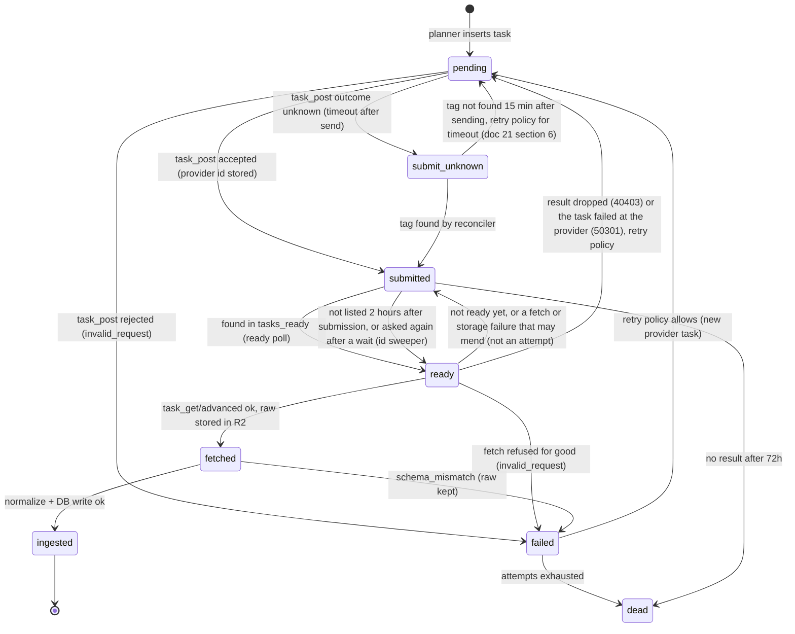

# 06. DataForSEO SEO Integration

Status: Draft for architecture freeze
Last updated: 2026-09-30
Research basis: `research/01-dataforseo-seo.md` (all DataForSEO facts below verified 2026-09-29 unless marked)
Related: [05-provider-integrations.md](05-provider-integrations.md), [09-rank-tracking-methodology.md](09-rank-tracking-methodology.md), [10-serp-feature-tracking.md](10-serp-feature-tracking.md), [21-scheduler-workers.md](21-scheduler-workers.md), [27-cost-model.md](27-cost-model.md)

## 1. Endpoints we use

| Purpose | Endpoint | Mode | Phase |
|---|---|---|---|
| Rank tracking, SERP features, AI Overview | `POST /v3/serp/google/organic/task_post` | Standard queue (task) | 4 |
| Readiness (polling only, [ADR-022](adr/ADR-022-python-backend-simplified-platform.md)) | `GET /v3/serp/google/organic/tasks_ready` | poll | 4 |
| Result fetch | `GET /v3/serp/google/organic/task_get/advanced/{id}` | fetch | 4 |
| On-demand single check ("check now") | `POST /v3/serp/google/organic/live/advanced` (one search a call, $0.002 a page; built in Phase 4, `providers/dataforseo/serp.py`) | Live | 4 |
| Error reconciliation | `POST /v3/serp/google/organic/errors` (tasks errored in past 7 days) | poll, 10/min | 4 |
| Tasks posted in a period, with their tags (resolving unknown submissions) | `POST /v3/serp/id_list` with `include_metadata` (per API; 1,000 ids a call, 10 calls/min, a month back with metadata) | reconciler, off until S-01 | 4 |
| Webhook replay | `POST /v3/appendix/webhook_resend` (up to 100 ids, no double charge) | Not used in V1: no pingback endpoint | n/a |
| Balance, limits, daily spend | `GET /v3/appendix/user_data` (6 calls/min) | ops, every 15 min | 4 |
| Locations, languages | `GET /v3/serp/google/locations`, `/languages` | monthly sync, free | 3 |
| Keyword metrics refresh | `POST /v3/dataforseo_labs/google/keyword_overview/live` (up to 700 keywords) | live | 3 |
| Google Ads search volume (optional cross-check) | `POST /v3/keywords_data/google_ads/search_volume/task_post` (up to 1,000 keywords per task) | standard | 11 |
| Google Ads data freshness | `GET /v3/keywords_data/google_ads/status` | monthly | 3 |
| Keyword difficulty (bulk) | `POST /v3/dataforseo_labs/google/bulk_keyword_difficulty/live` (up to 1,000) | live | 3 |
| Search intent | `POST /v3/dataforseo_labs/google/search_intent/live` (up to 1,000) | live | 3 |
| Discovery | Labs `keyword_ideas`, `keyword_suggestions`, `related_keywords`, `ranked_keywords`, `domain_intersection`, `competitors_domain`, `serp_competitors`; SERP `google/autocomplete` | live | 11 |

We use `task_get/advanced`, never `regular`: regular only parses organic, paid and featured snippets, and we need every SERP feature and the AI Overview.

## 2. Depth strategy (the most important cost decision)

### 2.1 The billing fact

Since 19 September 2025 DataForSEO bills organic SERPs **per page of 10 results**, with `depth` rounded up to the next 10. A top-100 check is 10 pages. The current help-center FAQ (updated 2 July 2026) shows linear pricing (10 x base for top-100); an earlier 25% discount on pages 2 and later is no longer shown and was apparently removed without a dedicated announcement. (Verified; the removal date is inferred from archived copies. Spike S-01 confirms actual billing from the `cost` field.)

| Depth | Pages | Standard | Priority | Live |
|---|---|---|---|---|
| 10 | 1 | $0.0006 | $0.0012 | $0.002 |
| 20 | 2 | $0.0012 | $0.0024 | $0.004 |
| 30 | 3 | $0.0018 | $0.0036 | $0.006 |
| 50 | 5 | $0.003 | $0.006 | $0.010 |
| 100 | 10 | $0.006 | $0.012 | $0.020 |

Tracking 10,000 keywords daily at top-100 on the standard queue costs about $1,800 per month for desktop alone. Most of that buys positions 21 to 100, which carry little traffic and change slowly.

### 2.2 Depth profiles

Each tracked keyword has a **depth profile** (project default, overridable per keyword group or keyword). The profile, not a single `depth`, drives the planner.

| Profile | Daily checks | Weekly deep check | Pages per keyword per month (30 days) | Standard cost per keyword per month (desktop) |
|---|---|---|---|---|
| `light` | depth 10 | depth 100 on the project's deep-check weekday | 25.7 x 1 + 4.33 x 10 = 69 | $0.041 |
| `standard` (**default**) | depth 20 | depth 100 on the deep-check weekday | 25.7 x 2 + 4.33 x 10 = 94.7 | $0.057 |
| `deep` | depth 50 | depth 100 weekly | 25.7 x 5 + 4.33 x 10 = 172 | $0.103 |
| `full` | depth 100 | (not needed) | 30 x 10 = 300 | $0.180 |
| `weekly` | none | depth 100 weekly | 4.33 x 10 = 43 | $0.026 |
| `weekly_light` | none | depth 20 weekly | 4.33 x 2 = 8.7 | $0.005 |

On the deep-check weekday the deep check **replaces** the daily check (it contains the top 20), so no SERP is fetched twice.

What each profile can report is stated explicitly in the UI and API:

- Daily series for `standard` are exact for positions 1 to 20. A keyword outside the top 20 on a daily check is recorded as **"not in top 20"** (`organic_rank = NULL`, `depth_requested = 20`), never as unranked.
- Top-100 counts, "entered top 100" and "lost from top 100" events are computed only from deep checks.
- Charts plot positions 21 to 100 as weekly points and show the daily "beyond top 20" band as a shaded region, not as a line.

This is the depth-aware null rule. It is the reason `seo.domain_rank_observations` stores `depth_requested` on every row. See [09-rank-tracking-methodology.md](09-rank-tracking-methodology.md) section 3.

### 2.3 Stop-on-match (not default)

`stop_crawl_on_match` (up to 10 targets; billed only for pages crawled until a match) makes "where does my domain rank" cheap when the domain ranks high. We do **not** use it by default, because it stops when the first target is found, which truncates competitor coverage and SERP composition below that page. It is available as a per-keyword option (`depth_profile = 'until_own_match_100'`) for large keyword sets where only the owned position matters.

### 2.4 Mobile

Mobile costs the same as desktop per page. Tracking both devices doubles collection cost. Default: desktop only; mobile is enabled per keyword group. A tracked keyword's device is part of its identity, so desktop and mobile are two tracked keywords that share a `seo.keywords` row.

## 3. Request construction

### 3.1 task_post body (per task; up to 100 tasks per POST)

```json
{
  "keyword": "best crm for startups",
  "location_code": 2840,
  "language_code": "en",
  "device": "desktop",
  "os": "windows",
  "depth": 20,
  "priority": 1,
  "load_async_ai_overview": true,
  "group_organic_results": true,
  "calculate_rectangles": false,
  "tag": "i:prod:t:9f2c1a:a:1:r:0192f0a13c447e108a512b7d9c0e4f11"
}
```

| Field | Our rule |
|---|---|
| `keyword` | `seo.keywords.text` as entered (trimmed). Case is preserved because Google can return different SERPs for different casing (observed by an open-source tracker, `research/06-open-source.md`). Max 700 chars (validated). Search operators (`site:` etc.) are rejected at input: they cost 5x and are not rank tracking. Sent with `%` as `%25` and `+` as `%2B`: DataForSEO decodes a `%` followed by two characters and reads `+` as a space. |
| `location_code` | From `core.provider_location_map` for our `location_id`. We use codes, never names (names change). |
| `location_coordinate` | Only for hyperlocal tracking (Phase 15). Organic format is `lat,lng,radius`; the radius unit in the docs is ambiguous, so this needs a spike before use. |
| `language_code` | ISO 639-1 from tracked keyword. |
| `device`, `os` | From tracked keyword. `os` NULL means provider default (`windows` desktop, `android` mobile). |
| `se_domain` | Omitted (provider picks per location) unless the project overrides, for example `google.co.uk` for a UK project tracked from a UK location. |
| `depth` | From depth profile for this check. |
| `priority` | 1 (standard queue) by default; 2 only for schedules with `priority = 'high'` and `provider_mode = 'priority_queue'`. |
| `load_async_ai_overview` | **Always true.** Without it, AI Overviews that Google loads asynchronously come back as `null`, which undercounts AI Overview presence. The surcharge is refunded when no async AIO is present. The billing formula is ambiguous in the docs (additive one base price vs whole-task multiplier); S-01 resolves it, and section 6 shows both cases. |
| `people_also_ask_click_depth` | Not sent on daily checks (no clicks; the documented values are 1 to 4). 1 on deep checks when the project has keyword discovery enabled (adds $0.00015 per click; unperformed clicks refunded). Questions visible without clicking are still captured. |
| `group_organic_results` | true (provider default): nested `related_result` entries are grouped under their parent result. See 5.2. |
| `calculate_rectangles` | false. Pixel position is post-MVP (it adds one base price). |
| `tag` | Reference to our task: `i:<installation>:t:<task id base36>:a:<attempt>:r:<run id, 32 hex>`. Max 255 chars. Echoed back in `tasks_ready`, `id_list` and results, used to map provider tasks to ours without a lookup table. Each part is a check: the installation (`INSTALLATION_ID`, `prod` in production) keeps two installations sharing the account from taking each other's answers; the whole run id is carried because the first digits of a version 7 id are its time, shared by every run of the same minute; the attempt keeps the answer to an earlier submission from being taken for a later one's. |
| `pingback_url`, `postback_url` | Omitted. V1 uses polling only; see 4.2. |

### 3.2 Batching and rate limits

| Limit (verified) | Our setting |
|---|---|
| 2,000 API calls per minute (all endpoints combined, raisable) | Global Redis-backed rate limiter shared by every DataForSEO call on the Taskiq `collect` queue, at 1,000 calls/min (50% headroom for fetches and ops calls) |
| 100 tasks per `task_post` | Always fill batches to 100 where possible; the submitter groups pending tasks by endpoint and priority |
| `tasks_ready`: 20 calls/min, up to 1,000 ids per call, last 3 days | Poll every 60 s per endpoint while any task is `submitted`; no call when none are. A 30 s poll during open windows is not built: the id sweeper bounds what a slower poll could miss |
| Results re-fetchable free for 30 days (HTML 7 days) | Fetch immediately; re-fetch within 30 days is allowed for re-ingest |
| 10 s callback timeout, then task goes to `tasks_ready` | Not relevant: no callback URL is sent, so every task is found through `tasks_ready` or the id sweeper |
| Live: 1 task per call | Used only for "check now" and small backfills |

At 10,000 keywords per day, submission needs 100 POSTs; fetching needs 10,000 GETs. Spread over a 6-hour window that is about 28 calls per minute, 1.4% of the account limit (under 3% of our 1,000 per minute limiter).

## 4. Task lifecycle



### 4.1 Submission

1. Planner has already inserted `ops.collection_tasks` rows in `pending` with `scheduled_for` staggered over the schedule's window ([21-scheduler-workers.md](21-scheduler-workers.md) section 3).
2. The dispatcher ([21-scheduler-workers.md](21-scheduler-workers.md) section 4) groups up to 100 due `pending` tasks for the same endpoint and priority into one `submit_batch` Taskiq task on the `collect` queue carrying their ids; the task locks them with `FOR UPDATE SKIP LOCKED`, checks the shared-fetch cache (identical fingerprint fetched today: mark `skipped_cached`, enqueue an ingest task pointing at the cached raw payload), builds the POST, and calls `task_post`.
3. Response handling per task, matched by the `tag` echoed in the task's `data`, never by position: `status_code 20100` means accepted; store `provider_task_id`, per-task `cost`, set `submitted`. Any other code maps through the table of section 9. A task the answer does not name for certain (an unknown tag, no id, a code that may mean it was created) stays `submit_unknown`.
4. One `ops.provider_cost_events` row per accepted task with `cost_source = 'provider_reported'`.

### 4.2 Readiness: polling only

- **Polling** ([ADR-022](adr/ADR-022-python-backend-simplified-platform.md)): the `ready_poll` tick calls `tasks_ready` every 60 s for each endpoint with tasks `submitted`. For each returned id it parses `tag`, moves the matching task from `submitted` to `ready` with a conditional `UPDATE ... WHERE status = 'submitted'` (a task still waiting out a failed fetch's wait is left alone), and enqueues `fetch_task` on the `collect` queue only when that update changed a row (natural dedupe: an id listed twice is fetched once). It never fetches inline.
- **Why no pingback or postback**: postback POSTs the full gzipped result to our API, which puts large bodies on the API process inside a 10 s timeout. Pingback would add a public endpoint, a Caddy IP allowlist and a route token for a latency gain of at most one poll interval, which no screen needs. Neither is used; no callback URL is sent.
- **Id sweeper**: tasks still `submitted` 2 hours after submission, or whose wait after a failed fetch is over, are fetched directly by id with `task_get` (covers a task not listed, and one whose result was handed over and not stored). Tasks with no result after 72 hours become `dead` and alert.

### 4.3 Fetch and store

1. `task_get/advanced/{id}`.
2. Validate envelope: `status_code 20000` at top level and task level.
3. Write the exact response bytes, zstd-compressed (level 6), to R2 at `raw/v1/serp_raw/dataforseo/serp_google_organic_advanced/YYYY/MM/DD/<sha256>.json.zst` (key scheme `raw/v1/<retention_class>/<provider>/<endpoint_slug>/YYYY/MM/DD/<sha256>.json.zst`, doc 23 section 9.1); register in `ops.raw_payloads` with `retention_class = 'serp_raw'`.
4. Task to `fetched`; insert `ops.fetch_cache` row keyed by request fingerprint and UTC date.
5. Enqueue the `ingest_serp` Taskiq task on the `process` queue with the raw payload id (step 5 of the build order). The local spool of doc 22 is not built: ingest reads the payload from R2 (plan `docs/superpowers/plans/2026-09-30-dataforseo-raw-storage.md`, decision D5), and if R2 fails the fetch is tried again, since DataForSEO keeps results for 30 days.

The task becomes `fetched` with the id of its registered payload. **As built (step 5, rank collection):** the `ops.fetch_cache` row of step 4 is not built (the shared fetch cache is deferred), and step 5 is not a queued job: the ingest is a tick of the worker (`collectors/seo_rank_ingest.py`, doc 21 section 4) that takes `fetched` rank tasks, so a task is ingested within seconds of being fetched and a restart loses no job. A result that is not ready yet, or a fetch or storage failure that may mend, puts the task back to `submitted` without counting an attempt (doc 21 section 8.1).

### 4.4 Ingest

`ingest_serp` runs the pure `normalize()` (section 5) and writes, in one transaction:

1. `seo.serp_snapshots` row
2. `seo.serp_features` rows
3. `seo.domain_rank_observations` rows (own entity + each tracked competitor for this keyword)
4. `ai.observations` + `ai.citations` for the AI Overview (if present)
5. `seo.tracked_keyword_state` upsert
6. `seo.serp_current_results` replace (top 20)
7. task to `ingested`

Then debounced tasks on the `process` queue: `extract_observation` (AIO), `rollup_seo_day` (per project and date, debounce 5 minutes), `evaluate_alerts` (per project, debounce 10 minutes).

**As built (step 5, rank collection).** The ingest writes one transaction per task, in this order and with these differences from the list above (plan `docs/superpowers/plans/2026-10-05-rank-ingest.md`, R17 to R22):

- Item 4 is not written: `ai.*` waits for step 8 (AI analytics), so the AI Overview is kept as a SERP feature (`seo.serp_features`, type `ai_overview`) and its citations as a feature payload; the events `aio_appeared`, `aio_disappeared`, `aio_citation_gained` and `aio_citation_lost` are written from it. The three follow-up jobs are not queued yet; their first readers arrive with the rollups and alerts.
- Items 1 to 3 and 5 to 7 are written together with `seo.rank_events`. The state moves only for a check newer than the one it holds (an out-of-order check writes its snapshot and observations and leaves the state), and a rank is never imputed beyond the depth checked.
- The snapshot's `observed_at` is the provider's time when it is within seven days before and one hour after the fetch, else the fetch time (R19). The request echo in `tasks[].data` (depth, device, language, operating system) gives what was asked; a live answer has the same shape and no tag.
- A payload that is permanently unreadable ends its task as failed with the reason; one that cannot be read from storage or written now waits (R20), so a storage hiccup holds up no other task. A device and operating system that do not belong together fail only that task, not the batch.
- Features are followed on page one only (the tenth organic result's absolute rank is the limit), a grouped sub-result is another URL at its parent's rank, and the AI Overview is cited, not owned (doc 09 section 4, doc 10).

## 5. Normalization rules (parser version 1)

### 5.1 Rank fields: which one is canonical

DataForSEO provides three position-like fields on every SERP item (verified):

| Field | Meaning | Our use |
|---|---|---|
| `rank_group` | Position among items of the same `type`. For `type = 'organic'` it is the organic rank: organic #1 is `rank_group = 1` even below ads and an AI Overview | **Canonical `organic_rank`** |
| `rank_absolute` | Position among all items on the page. Right-column items (desktop knowledge panel, shopping) are numbered separately from 1 | `absolute_rank` (secondary metric) |
| `position` | Alignment: `left` or `right`. **Not a rank** | Ignored for rank; used to exclude right-column items from absolute rank comparisons |

Decision (ADR-007): **organic rank is canonical.** It is what users and every major rank tracker call "position", it does not jump when Google inserts a feature above the results, and it is comparable across providers. Absolute rank is stored and shown as a secondary column, because it explains traffic drops caused by features pushing results down.

"Group rank" in the brief is DataForSEO's `rank_group`; for organic items it is the same as organic rank, so we do not store a third field.

### 5.2 Organic list construction

1. Take items with `type = 'organic'`, in response order.
2. Nested `related_result` entries (grouped results from the same site) are **not** separate ranks. They are recorded as additional URLs of their parent result (same organic rank) in `all_url_ids` for the domain. Rationale: they are displayed as part of the parent listing.
3. Validate that `rank_group` values are 1..N, strictly increasing, without gaps. If not (provider anomaly, duplicate), recompute organic rank from response order, set `rank_recomputed = true` in snapshot extras, and emit a `serp_parser_anomaly` metric.
4. Canonicalize every URL (rules in [14-citation-intelligence.md](14-citation-intelligence.md) section 3). Detect unresolved Google redirect wrappers (`google.com/goto`, `google.com/url`): unwrap when the target is in a query parameter, otherwise keep the wrapper and flag `unresolved_redirect`. (Since August 2026 Google wraps organic links in `google.com/goto`; DataForSEO reports resolving 99.99% of organic results and fixed AIO cases on 28 August 2026, verified.)
5. Duplicate canonical URL within one SERP: keep first occurrence, flag duplicate.
6. Build `organic_url_ids[]`, `organic_domain_ids[]`, `organic_abs_positions[]` in organic rank order.
7. `depth_returned` = number of organic results after steps 1 to 5.

### 5.3 Domain rank resolution

For each entity tracked for this keyword (own + competitors from `core.project_entities`, adjusted by `seo.tracked_keyword_competitors`):

- Match organic results to entity domain rules (path prefix, then host, then registrable domain; same resolver as [13-ai-extraction-engine.md](13-ai-extraction-engine.md) stage 2).
- `organic_rank` = minimum organic rank among matches; `ranking_url_id`, title and snippet from that result; `absolute_rank` from that result.
- `all_organic_ranks[]`, `all_url_ids[]` = every match (for cannibalization and multi-URL analysis); `result_count` = matches.
- No match: `organic_rank = NULL` with `depth_requested` recorded (depth-aware null).

### 5.4 SERP feature mapping

| DataForSEO `type` | Our `feature_type` | Source URLs extracted from | Ownable | Payload kept (<= 4 KB) |
|---|---|---|---|---|
| `ai_overview` | `ai_overview` | `references[]`, then element `links[]`, element `references[]` | yes | `asynchronous_ai_overview`, element count, has_table, has_video |
| `featured_snippet` | `featured_snippet` | `url` | yes | `featured_title`, snippet type (paragraph, list, table) |
| `people_also_ask` | `people_also_ask` | each `expanded_element[].url` | yes | question titles (for discovery), per-question source domain, whether answer is an AIO-style expansion |
| `local_pack` | `local_pack` | item `url` / `domain` where present | yes | business titles, ratings count |
| `knowledge_graph` | `knowledge_graph` | links inside, if any | partial | title, subtitle |
| `top_stories` | `top_stories` | items `url` | yes | item count |
| `video`, `short_videos` | `video` | items `url` | yes | platform domains |
| `images` | `images` | items `url` | yes | item count |
| `discussions_and_forums` | `discussions_and_forums` | items `url` | yes | forum domains |
| `perspectives` | `perspectives` | items `url` | yes | |
| `shopping`, `popular_products`, `commercial_units` | `shopping` | items `url` where present | partial | item count |
| `related_searches`, `people_also_search` | `related_searches` | none | no | query strings (discovery) |
| `twitter` | `social_posts` | items `url` | yes | |
| `answer_box` | `answer_box` | `url` if any | partial | |
| `paid` | `ads` | `url` | yes | count top/bottom (ads are tracked as a feature, not as organic ranks) |
| organic item with `links[]` (sitelinks) | `sitelinks` | parent `url` | yes | sitelink count |
| any other type | `other:<type>` | best effort `url` fields | no | raw type name |

Feature rows are written for every feature present (presence history), not only owned ones. The code list is a registry table (`seo.serp_feature_types`), so a new DataForSEO type is inserted into `seo.serp_feature_types` as `other:<type>` (not ownable) during ingest and appears that way until we add a mapping, and never breaks ingest.

### 5.5 AI Overview

When an `ai_overview` item is present:

| Snapshot field | Value |
|---|---|
| `has_ai_overview` | true |
| `ai_overview_state` | `present` if `asynchronous_ai_overview = false` (cached), `present_async_loaded` if true |

When absent: `has_ai_overview = false`, `ai_overview_state = 'absent'`. Because we always send `load_async_ai_overview: true`, "absent" means Google did not show one to the provider's crawler, not "not loaded". (Historical data collected without the flag, for example from an import, uses `present_not_loaded` semantics where unknown.)

The AI Overview is also written as an AI observation, so SEO and AI analytics share one record instead of two copies:

- `ai.observations`: `engine_code = 'google_ai_overview'`, `observation_class = 'serp_ai'`, `serp_snapshot_id` set, `tracked_keyword_id` set, `query_text` = keyword, `answer_markdown` = `ai_overview.markdown`, `answer_text` = markdown stripped to text, `replicate_index = 1`, same raw payload id as the SERP snapshot.
- `ai.citations`: one per distinct canonical URL across `references[]` (top level and element level), ordered by first appearance; `citation_kind = 'reference_card'` for references, `'inline'` for element `links[]` that are not also references. `first_char_offset` from the markdown link position when present.
- Owned and competitor citation flags on `seo.domain_rank_observations.cited_in_ai_overview` and `ai_overview_citation_position` are computed from the same citations.

AI Overviews nested inside People Also Ask expansions (`people_also_ask_ai_overview_expanded_element`) and knowledge panels are recorded in the PAA feature payload (source domains) in V1, not as separate AI observations. Revisit in Phase 13 if customers need them.

### 5.6 Other result-level fields

| Field | Stored as |
|---|---|
| `datetime` | `observed_at` (provider crawl time; falls back to fetch time) |
| `check_url` | snapshot extras (shown as "open this SERP" link) |
| `se_results_count` | `se_results_count` |
| `item_types` | `item_types` (canonicalized names) |
| `spell` | snapshot extras: autocorrect type and corrected keyword. A `showing_results_for` spell means Google replaced the query; ranks are flagged `query_autocorrected` in the UI |
| `refinement_chips` | feature payload `refinement_chips` (discovery input) |

## 6. Costs

### 6.1 Cost capture

- **At submit:** per-task `cost` from `task_post` response is recorded as the provider-reported cost.
- **Refunds** (unused pages, async AIO surcharge when no async AIO, unperformed PAA clicks) are applied by DataForSEO to the account balance. Whether they are visible per task in `task_get` is not documented (open question for S-01). Reconciliation: every 15 minutes a maintenance task (Taskiq scheduler) reads `appendix/user_data`; daily, it compares the provider's per-day spend with the sum of our cost events for that day and writes adjustment rows to `ops.provider_cost_events` for the difference (`endpoint = 'appendix/user_data'`, `cost_source = 'provider_reported'`, one row per cost workload, split proportionally). The daily difference is a monitored metric.

### 6.2 Cost formulas

```
pages(depth)          = ceil(depth / 10)
serp_cost             = base[mode] * pages(depth)
aio_surcharge         = base[mode] if async AIO fetched (additive reading)
                        OR serp_cost if async AIO fetched (multiplier reading)   -- S-01 decides
paa_cost              = 0.00015 * clicks_performed
base = { standard: 0.0006, priority: 0.0012, live: 0.002 }
```

Monthly per-keyword examples (standard queue, desktop, 30-day month):

| Profile | SERP cost | + AIO surcharge, additive, 20% of checks async | + AIO surcharge, multiplier, 20% of checks async |
|---|---|---|---|
| `light` | $0.041 | $0.045 | $0.049 |
| `standard` | $0.057 | $0.061 | $0.068 |
| `full` | $0.180 | $0.184 | $0.216 |

The share of checks with an async AI Overview is unknown until S-03 measures it; 20% is a placeholder. Full cost scenarios are in [27-cost-model.md](27-cost-model.md).

## 7. Keyword metrics (search volume, CPC, KD, intent)

### 7.1 Source choice

| Option | Cost for 10,000 keywords | Returns | Decision |
|---|---|---|---|
| Labs `keyword_overview` (700 per call) | 15 calls x $0.012 + 10,000 x $0.00012 = **$1.38** | search volume, monthly searches, CPC, competition (float 0..1), competition level, keyword difficulty, intent (`main_intent`, `foreign_intent`), SERP info | **Primary** |
| Google Ads `search_volume` standard (1,000 per task) | 10 x $0.06 = **$0.60** | search volume, monthly searches (up to 4 years), CPC, competition (string), competition index, bids | Optional cross-check; cheaper but no KD or intent |
| Clickstream bulk search volume | $1.32 | clickstream-based volume | Not used in V1 |

Note the type trap (verified): `competition` is a **string** (HIGH/MEDIUM/LOW) in Google Ads endpoints and a **float** in Labs, where the string is `competition_level`. The normalizer maps both to our columns `competition numeric` and `competition_level text`.

Google Ads endpoints fail a whole batch if one keyword is policy-restricted (verified). Labs does not have this problem, which is another reason Labs is primary.

### 7.2 Refresh cadence

- On keyword creation: metrics fetched within 5 minutes (new keywords are batched per minute into one `keyword_overview` call per location/language).
- Monthly refresh: on the 20th of each month (Google Ads data updates mid-month; the `google_ads/status` endpoint is checked first and the refresh waits if `actual_data` is false).
- A new snapshot row is always appended (history is kept), and `is_material_change` is set when volume changes by more than 20% and more than 10 searches, or KD changes by more than 5 points, or intent changes. Materiality drives alerts and "what changed" views, not storage.
- Labs traffic estimates (ETV) change methodology on 1 November 2026 (verified). We do not use Labs ETV in V1; our traffic estimates come from our own CTR model ([09-rank-tracking-methodology.md](09-rank-tracking-methodology.md) section 6).

**As built (step 5, keywords).** The Labs `keyword_overview` live call is in `backend/src/idraft/providers/dataforseo/labs.py`, and the ledger runs it through the `submit_batch` job (doc 21 section 4).
- **Tasks and batches.** A task is one keyword at one location and language. The dispatcher cuts a batch by location and language (the workload's batch key), up to 700 keywords, so one batch is one call. Each call sends `include_serp_info` and `include_clickstream_data` as false, because they cost more and nothing reads them.
- **What is refused before sending.** A request of another endpoint, a task id given twice in a call, and a keyword over 80 characters fail on their own with `invalid_request`, so they cannot fail the 699 others. The workload leaves keywords over 80 characters out of its plans, so they are not asked for again.
- **Escaping.** `%` is sent as `%25` and `+` as `%2B`, as for SERP keywords, because DataForSEO would decode them. Two spellings that Labs reads as one keyword (compared after NFKC, case folding and collapsing spaces) are sent once, and both tasks get the answer.
- **Answers.**
  - Status 40102 ("no results") is read as Labs knowing none of the keywords, not as a failure.
  - A keyword missing from the answer, or named with no value, gets an empty snapshot that is no material change and does not replace the current metrics.
  - A value that is not what Labs documents (a negative volume, a competition above 1, difficulty above 100, an unknown level or intent) is read as missing. Months outside 2000 to 2100 are dropped from `monthly_searches`.
  - `competition` is Labs' float and `competition_level` its string.
- **Cost.** The call's reported cost is split evenly over its tasks in millionths of a dollar, with the remainder on the first, so the shares add up exactly. Each task gets one cost event with `cost_source = 'provider_reported'`, `units = 1` and `price_unit = 'item'`. A cost over $1.00 for one call is not believed, and the run's estimate is charged instead.
- **Failures.** A failed call follows the retry policy for each of its tasks; a timeout counts as an attempt and is sent again, since a live call leaves nothing to fetch. A live task left in `submit_unknown` is sent again after the resolver's grace period whatever `resolve_unknown_submissions` says. An answer that could not be stored is lost, and its tasks are paid for again when sent again.
- **Cadence.**
  - New keywords: the planner's new-keyword step (every 60 seconds) gives a project's keywords with no metrics a run of their own, so their metrics arrive within a minute or two of the keyword being added, not within the 5 minutes above.
  - Monthly: a project's first tracked keyword creates its `keyword_metrics` schedule: monthly on the 20th, 03:00 in the project's time zone, a 2 hour window, provider mode `live`, selector `{"stale_days": 25}`.
  - The `google_ads/status` check before the refresh is not built; the refresh does not wait for `actual_data`.
- **Materiality.** `is_material_change` is true for a keyword's first snapshot and otherwise follows the thresholds above. A reading is judged against the latest non-empty snapshot fetched before it, so an answer ingested late is judged against what came before it.

### 7.3 Freshness caveat for Labs competitor data

Labs SERP-derived datasets (`ranked_keywords`, `domain_intersection`, `competitors_domain`) are refreshed on a 30 to 90 day cycle per query, weekly for some endpoints (verified). They are **discovery inputs only**, never rank tracking. The Discovery inbox shows "data as of" for each suggestion.

## 8. Locations and languages

- Monthly sync of `serp/google/locations` into `core.locations` and `core.provider_location_map` (free endpoint). Russia and Belarus are unsupported by DataForSEO (verified).
- Keyword creation validates that the location supports the requested surfaces (`supports` array), for example the ChatGPT scraper supports country-level locations only.
- Location names are display-only; codes are the key.

## 9. Error handling specifics

| DataForSEO status (verified list) | Kind | Action |
|---|---|---|
| 20000, 20100 | ok | |
| 40006 (more than 100 tasks) | invalid_request | Bug: alert, split batch |
| 40202 (rate limit) | rate_limited | Retry with backoff; halve limiter for 10 minutes |
| 40203 (own cost limit) | account_limit | Pause DataForSEO workloads, alert admins |
| 40209 (too many simultaneous) | concurrency | Retry after 5 s |
| 40403 (results expired) | not_found_expired | Resubmit if run window still open, else mark dead |
| 50301 (third-party source unavailable), HTTP 503 | upstream_unavailable | Retry with backoff per doc 21 section 6 (max 4 attempts), then `dead`. On a fetched task it means the task itself failed: it is submitted again under that policy |
| 401xx (not authorized, account not activated or blocked), HTTP 401 and 403 | auth | Pause provider, alert |
| 402xx other than the codes above (balance, payment), HTTP 402 | payment | Pause provider, alert |
| HTTP 429 | rate_limited | As 40202; a `Retry-After` in whole seconds is the least wait |
| 405xx (invalid field, path or body) | invalid_request | Do not retry, mark task failed |
| 40601, 40602 (task in queue, task being processed) | not an error | `task_get` asked too early: the task stays `submitted` |
| 40102 (no search results) | not an error | A finished, empty result: stored and ingested like any other |
| 5xxxx other than 50301; HTTP 408, 425, and every 5xx but 501, 503 and 505 (a proxy's 520 to 524 among them) | timeout when posting tasks, else provider_error | Posting: the tasks may have been created and charged, so they become `submit_unknown` and are not sent again blind. Reading: retry |
| A timeout, a dropped connection or an unreadable answer after the request was sent | timeout when posting tasks, else provider_error | As the row above. A refused call whose answer still names tasks it created is read task by task, so those are recorded |
| HTTP 400, 413, 422 | invalid_request | Do not retry |
| Any other code or HTTP status | provider_error | Retry with backoff: reading again costs nothing, and a wrong failure cannot be undone |
| No turn under our own limiter within 30 s, the limiter not reachable, or no connection opened to the provider | not_sent | Not sent and not an attempt: retry in 30 s, without slowing the limiter |

HTTP status is 200 for most errors; the real status is in `status_code` at top and task level (verified). The adapter checks both levels. Spike S-01 checks whether any 402xx code refuses one API only (a subscription code such as 40204): if so, it must stop that workload, not pause every DataForSEO workload.

## 10. Terms and data handling

DataForSEO's terms (updated 12 June 2026, verified) contain no clause against storing results, showing them to end users, or reselling them, and no attribution requirement. Clauses 7.1 and 7.2 prohibit using SERP data to compete with or harm search engines and make the customer indemnify DataForSEO for breaches of search engine terms. Before external SaaS launch we obtain written confirmation from DataForSEO that multi-tenant display and resale of derived metrics is permitted (open question Q-03 in [30-risks-open-questions.md](30-risks-open-questions.md)).

Content retention: snippets and titles are stored for tracked entities and the current top 20; full SERPs live in R2 under retention rules ([23-backup-disaster-recovery.md](23-backup-disaster-recovery.md)).

## 11. Spikes required before Phase 4 build

| Id | Question | Pass criterion |
|---|---|---|
| S-01 | Does per-task `cost` at submit reflect depth linearly? Is the async AIO surcharge additive or multiplicative? Are refunds visible per task? Does `tasks_ready` echo `tag`? | Documented answers from the S-01 method in doc 01 section 12 (400 standard tasks), plus 100 tasks at depth 20 for the `standard` profile |
| S-02 | Raw payload size at depth 10, 20, 100 and zstd level 6 ratio | Median compressed size known; storage model in doc 28 updated |
| S-03 | AI Overview presence rate with and without `load_async_ai_overview` on 500 mixed-intent keywords; share of async AIOs | Presence delta measured; async share used in cost model |
| S-15 | Standard queue turnaround distribution by hour of day (UTC) | p50, p95 known; window sizing in doc 21 confirmed |
