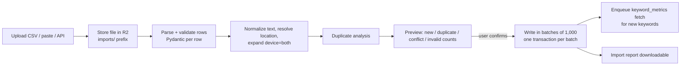

# 08. SEO Keyword System

Status: Draft for architecture freeze
Last updated: 2026-09-30
Related: [04-data-model.md](04-data-model.md) section 7, [06-dataforseo-seo-integration.md](06-dataforseo-seo-integration.md), [09-rank-tracking-methodology.md](09-rank-tracking-methodology.md), [10-serp-feature-tracking.md](10-serp-feature-tracking.md), [15-seo-ai-correlation.md](15-seo-ai-correlation.md)

Traditional rank tracking is a first-class module, not an input to prompt generation. This document covers the keyword inventory, taxonomy, import and export, discovery, competitor tracking, cannibalization, landing-page aggregation and alerts.

## 1. Keyword model

Three layers:

| Layer | Table | Meaning | Scope |
|---|---|---|---|
| Keyword | `seo.keywords` | The query string in a language ("best crm for startups", `en`) | Workspace; shared by projects so metrics are fetched once |
| Tracked keyword | `seo.tracked_keywords` | A keyword measured for a project in one engine, location, language and device | Project |
| Keyword metrics | `seo.keyword_metric_snapshots` (+ `seo.keyword_metrics_current`) | Search volume, CPC, competition, difficulty, intent at a time | Keyword x location x language |

Identity of a tracked keyword is `(project, keyword, engine, location, language, device)` and is immutable. Changing location or device creates a new tracked keyword; the old one can be archived. This keeps each rank series measured under one fixed configuration.

### 1.1 Attributes

| Attribute | Where | Notes |
|---|---|---|
| Text, normalized text | `seo.keywords` | Normalization: Unicode NFKC, lowercase, trim, collapse whitespace. Used for dedupe and matching; the provider receives the original casing |
| Country, location, language, device, OS, engine | `seo.tracked_keywords` | Identity |
| Target URL | `tracked_keywords.target_url_id` | Optional; enables "ranking URL is not target" checks |
| Tags, topics, clusters, products, services, markets, campaigns, personas | `seo.tracked_keyword_terms` | Shared taxonomy with prompts |
| Groups (folders) | `seo.keyword_groups`, `seo.keyword_group_members` | Hierarchical; a keyword can be in several groups |
| Intent, funnel stage | columns | Provider default for intent, manual override |
| Priority (1 to 5), business value | columns | Priority drives schedule selectors and visibility weights |
| Frequency and depth profile | columns | See [06-dataforseo-seo-integration.md](06-dataforseo-seo-integration.md) section 2.2 |
| Source | column | manual, csv_import, api, gsc_import, discovery, bulk_paste |
| Active flag, created_at, created_by | columns | |
| Competitor overrides | `seo.tracked_keyword_competitors` | Include or exclude competitors for this keyword |
| Search volume, CPC, competition, difficulty, trend, seasonality | `seo.keyword_metrics_current` (latest) + snapshots (history) | Seasonality derived from `monthly_searches` (section 6) |
| Volatility, URL stability | derived | [09-rank-tracking-methodology.md](09-rank-tracking-methodology.md) section 4 |

### 1.2 Quotas

`core.workspace_quotas.max_tracked_keywords` counts active tracked keywords (each device/location variant counts once). Imports that would exceed the quota are rejected with a per-row reason before any row is written.

**As built (step 5, keywords).**
- **Quota.** Every way of adding or unarchiving takes a per-workspace lock, counts, and refuses the whole request when it would go over: `422 quota_exceeded` with `limit`, `used` and `requested`, nothing written. `device: 'both'` counts two. The keywords of a deleted project do not count; those of an archived project still do. An import checks again when it is confirmed.
- **Text.** `sightline.keywords.text` decides what a keyword is.
  - *Stored text* is the entry with invisible format characters (zero-width spaces, a byte order mark, direction marks) removed and whitespace trimmed and collapsed. Casing is kept, and the provider receives this text. It is 1 to 700 characters; a control character is refused (`keyword_invalid`).
  - *Normalized text* is NFKC, format characters removed, lower case, whitespace collapsed. It is lower case, not case folded, so "Straße" and "Strasse" stay two keywords. Two entries with the same normalized text and language are one keyword.
  - *Operators* are refused with `search_operator_not_allowed`. They are read on the normalized text, so full-width look-alikes count. An operator is one of `after`, `before`, `cache`, `daterange`, `define`, `ext`, `filetype`, `inanchor`, `info`, `intext`, `intitle`, `inurl`, `link`, `related`, `site` or `source`, then a colon and a value straight after it (`site:acme.com`), or one of the `allinanchor`, `allintext`, `allintitle` and `allinurl` family; "contact info: phone" is ordinary text. A word excluded with a minus after another word ("crm -free") and a pair of quotation marks (an exact phrase) are refused too. A leading minus ("-40 fahrenheit"), a hyphen inside a word ("k-pop") and a single quote mark (an inch sign) pass.
- **Groups.** A group name is 1 to 100 characters with no `/`, and names are unique among siblings without case, roots included. A tree is at most 10 levels deep, and a group's `path` (the names from the root joined by `/`) is at most 2,048 bytes. A group and its members stay in one project. Changes to one project's groups take turns (an advisory lock), so a move is checked against a tree nobody else is changing.
- **Terms.** A tracked keyword holds at most one term of a single-valued vocabulary. The API and the import worker share this rule.

## 2. Taxonomy

The same taxonomy serves keywords and prompts ([04-data-model.md](04-data-model.md) section 5.3):

| Vocabulary kind | Hierarchical | Single-valued per keyword | Example |
|---|---|---|---|
| `topic` | yes | no | CRM > CRM for Startups |
| `cluster` | no | yes | "crm-for-startups" (manual or auto) |
| `product`, `service` | optional | no | "Sales Hub" |
| `market` | optional | no | "US", "DACH" |
| `campaign` | no | no | "Q4 launch" |
| `persona` | no | no | "Founder", "RevOps lead" |
| `tag` | no | no | "comparison", "high-priority" |

Rules:
- Topic filters are subtree-aware: filtering by "CRM" includes "CRM for Startups".
- A keyword in two topics counts in both topic breakdowns; topic rows do not sum to the project total (stated in the UI).
- Auto-clustering (Phase 11): keywords are clustered by SERP overlap (two keywords belong together if at least 4 of their top-10 URLs overlap on the latest checks), producing `cluster` terms with `source = 'auto_cluster'`. Users can accept, rename, or break clusters. SERP-overlap clustering reuses stored snapshots and needs no extra provider calls.

## 3. Keyword creation, import and export

### 3.1 Entry points

| Path | Phase | Notes |
|---|---|---|
| Manual add (single or bulk paste, one keyword per line) | 3 | Bulk paste accepts `keyword<TAB>tags` lines |
| CSV import | 3 | Column mapping UI, validation preview, async processing |
| API import (`POST /v1/workspaces/{ws}/projects/{p}/keyword-imports`) | 3 | Same pipeline as CSV |
| GSC import (queries with impressions above a threshold) | 11 (basic), 12 (full) | From `fp.gsc_search_analytics`; deduped against existing |
| Discovery inbox promotion | 11 | Section 5 |

### 3.2 CSV format

Required: `keyword`. Optional columns (header names case-insensitive):

| Column | Values | Default |
|---|---|---|
| `country` | ISO 3166-1 alpha-2 | project default |
| `location` | location id, or name resolved against `core.locations` | country-level location |
| `language` | ISO 639-1 | project default |
| `device` | desktop, mobile, both | project default (desktop) |
| `tags` | pipe-separated | none |
| `topic` | path `CRM/CRM for Startups` | none |
| `group` | path `Product/Pricing` | none |
| `intent`, `funnel_stage` | enums | provider value later |
| `priority` | 1 to 5 | 3 |
| `target_url` | absolute URL | none |
| `competitors` | pipe-separated competitor names or domains (must exist in project) | project default set |
| `depth_profile` | profile name | project default |

### 3.3 Import pipeline



Duplicate handling (all decided in the preview, per row):

| Case | Detection | Default action |
|---|---|---|
| Exact duplicate of an existing tracked keyword (same identity) | identity match on normalized text | skip; optionally merge new tags and groups into existing |
| Same keyword, different device or location | keyword match, identity differs | create new tracked keyword (it is a different measurement) |
| Case or whitespace variant ("CRM Software" vs "crm software") | normalized match | treated as the same keyword; provider receives the first-entered casing. A warning is shown because Google can differ by casing; user can force a separate keyword in Phase 5 (requires a `case_sensitive` column and a revised unique key on `seo.keywords`, to be added to doc 04 section 7.1 in that phase) |
| Duplicate rows within the file | normalized identity | collapse, union of tags |
| Invalid location or language | resolver fails | reject row with reason |
| Search operators (`site:`, `intitle:`) | regex | reject row (5x cost, not rank tracking) |
| Over 700 characters | length | reject row |

Import jobs are recorded in `seo.keyword_imports` (id, project, source, file object key, row counts by outcome, created_by, status, report object key) so every keyword's origin is auditable.

**As built (step 5, imports).** The API is in [19-api-specification.md](19-api-specification.md) section 3.6.3; the code is `api/imports/`, `collectors/imports.py` (reading), `collectors/import_writer.py` (writing) and `keywords/import_rows.py` (the row rules). Differences from the design above:
- **Sources.**
  - Pasted text: one keyword per line, with the tags after a TAB.
  - JSON rows: up to 10,000.
  - A CSV upload as `multipart/form-data`, up to 50 MB, UTF-8 (a byte order mark is dropped), delimiter comma, semicolon or tab.
  - A source has at most 10,000 rows and 100 columns. The presigned `upload-url` route and XLSX files are not built, and the `competitors` column is not offered.
  - The API stores the source in R2 at `imports/v1/{workspace_id}/{import_id}/source` before it records the import, then returns `202`.
- **Reading.** The worker (tick `keyword_imports`, every 5 seconds) claims the next `uploaded` import with `FOR UPDATE SKIP LOCKED` and reads it in one transaction into `seo.keyword_import_rows`. A file with no keyword column, or tags without a vocabulary to put them in, is `needs_mapping`; the user sends a mapping and the worker reads it again. An unreadable file is `failed` with a code. A source that raises the same error on every try ends as `parse_failed` instead of holding up the queue, and a NUL character in a cell is `cell_invalid`.
- **Preview outcomes.**
  - `new`: the identity is not in the project.
  - `duplicate`: the identity is live in the project (reason `tracked`; action `skip` or `merge`), or repeats an earlier row of the file (`repeated_in_file`; `skip`, its groups and terms are added to the first row).
  - `variant`: the workspace has the keyword typed differently (reason `casing_differs`). The row creates a tracked keyword on the existing keyword, so the provider keeps receiving the first casing; the user may skip it. A casing variant of a keyword the project already tracks is a `duplicate`, not a variant.
  - `conflict`: the identity is archived in the project (reason `archived`; `skip` or `merge`, and merge unarchives it).
  - `invalid`: with a reason code, listed in doc 19 section 3.6.3. Operators, over-long keywords and control characters are among them.
  - `force_separate` (a separate case-sensitive keyword, in the duplicate table above) is refused with `force_separate_not_available`; it waits for Phase 5.
  - A row with `device = both` is two parts of one file row: part 1 desktop, part 2 mobile. Counts and the quota count parts.
- **Confirm.** Confirming checks the quota under the workspace lock: it counts the parts to create and the archived keywords to bring back, and answers `422 quota_exceeded` with `limit`, `used` and `requested` with nothing changed. `duplicate_action: 'merge_terms'` turns tracked duplicates from `skip` to `merge`.
- **Writing.** The worker (tick `keyword_import_writes`, every 5 seconds) writes at most 1,000 parts per transaction, in row order, and records a `result` on each part (`created`, `skipped`, `merged` or `failed` with a `write_error_code`). A restart goes on with the parts that have no result.
  - *Groups and terms.* Each row's group is made along its path, its tags become top-level terms of the tags vocabulary and its topic a path in the topic vocabulary, all with `assigned_by = 'import'`. A row names at most 50 tags. Groups and terms of a batch are made before the quota lock is taken, with a per-batch cache of the siblings read. Terms of a vocabulary deleted since the preview are left out, and a term of a single-valued vocabulary is not added when the keyword holds another.
  - *What a created keyword gets.* The row's priority, depth profile, intent (with `intent_source = 'manual'` unless the intent is `unknown`), funnel stage and target URL, and the project's default frequency. Its `source` is `csv_import`, `bulk_paste` or `api`.
  - *Errors.* An error the database refuses by SQLSTATE class 22, 23, 42 or 0A would come again, so it ends the import as `write_failed`; other errors are tried again.
- **Metrics.** The writer does not queue a metrics fetch. The planner's new-keyword step (doc 21 section 3.1) finds the new tracked keywords within a minute or two and gives them a run of their own.
- **Expiry.** A preview expires 7 days after the import is created. The reading tick ends imports in `uploaded`, `needs_mapping` or `preview_ready` past that time as `expired`.
- **Report.** `GET .../report` answers a CSV built from the rows, not a signed link: `row_no`, `part`, `keyword`, `location_id`, `language_code`, `device`, `outcome`, `reason_code`, `reason`, `action`, `result`, `tracked_keyword_id`, `write_error_code`. A cell that starts with `=`, `+`, `-`, `@`, a tab or a carriage return gets a leading `'`. It is available once the import has rows, also after a failed write.

### 3.4 Export

**As built (step 5, keywords).** Export is not built; it moved to step 7 (SEO analytics), with the rank history worth exporting.

CSV and XLSX exports of: keyword list with attributes; rank history (one row per check, depth-aware null rendered as empty rank plus `depth_requested`); SERP feature history; competitor ranks. Exports over 50,000 rows run async and are delivered as a signed R2 link valid 24 hours.

## 4. Competitor tracking (SEO)

- Default competitor set = project entities with role `competitor` and `track_seo = true`. Up to 10 competitors per project in V1 (UI and cost reasons; all competitor ranks come from the same SERP, so there is no extra provider cost per competitor).
- Per-keyword overrides add or remove competitors.
- **Discovered competitors:** a weekly job ranks domains by SEO SOV ([09-rank-tracking-methodology.md](09-rank-tracking-methodology.md) section 7) across the project's keywords using stored `organic_domain_ids`. Domains in the top 10 that are not tracked appear as suggestions ("appears in top 10 for 38% of your keywords"). No extra collection is needed.
- **Backfill on add:** when a competitor is added, a backfill job derives its historical ranks from stored snapshots (`organic_domain_ids` up to each snapshot's depth) and writes `seo.domain_rank_observations` rows. History for a newly added competitor is therefore available immediately for the retained snapshot period.

Metrics per competitor: average rank, rank distribution, top-3 and top-10 ownership, visibility, SEO SOV, overtakes and losses (from `seo.rank_events`), keyword gap (section 4.1).

### 4.1 Keyword gap

For own entity O and competitor C over the tracked keyword set:

| Segment | Condition (latest check, same depth) |
|---|---|
| Both rank, O ahead | `r_O < r_C` |
| Both rank, C ahead | `r_C < r_O` |
| Only C ranks | `r_C` ranked, `r_O` beyond depth |
| Only O ranks | inverse |
| Neither | both beyond depth |

"Only C ranks" in top 10 is the actionable gap list. Untracked-keyword gap discovery (keywords the competitor ranks for that we do not track) comes from DataForSEO Labs `domain_intersection` in Phase 11 and lands in the discovery inbox, labeled with its data date.

## 5. Keyword discovery inbox

Discovery is separate from tracking. Candidates land in an inbox; nothing is tracked (and paid for daily) until a user promotes it.

```sql
CREATE TABLE seo.keyword_candidates (
    id                 uuid PRIMARY KEY DEFAULT uuidv7(),
    workspace_id       uuid NOT NULL,
    project_id         uuid NOT NULL REFERENCES core.projects(id) ON DELETE CASCADE,
    text               text NOT NULL,
    normalized_text    text NOT NULL,
    language_code      text NOT NULL,
    location_id        integer NOT NULL,
    sources            text[] NOT NULL,        -- {'labs_keyword_ideas','labs_related','paa','autocomplete','related_searches',
                                               --  'gsc','competitor_ranked','domain_intersection','site_crawl','fanout','manual'}
    source_details     jsonb NOT NULL,         -- per source: seed, competitor domain, gsc impressions, fan-out observation ids
    search_volume      integer,
    keyword_difficulty smallint,
    cpc_usd            numeric(10,4),
    intent             text,
    ai_demand_estimate integer,                -- modeled, labeled (doc 07 section 8)
    gsc_impressions_28d integer,
    gsc_avg_position   numeric(6,2),
    competitor_best_rank smallint,
    opportunity_score  numeric(6,3),           -- transparent formula below
    status             text NOT NULL DEFAULT 'new' CHECK (status IN ('new','accepted','rejected','snoozed','tracked')),
    snoozed_until      timestamptz,            -- set with status 'snoozed' (30 days by default, section 5.3); the candidate returns to 'new' after it
    decided_by         uuid,
    decided_at         timestamptz,
    data_as_of         date NOT NULL,          -- freshness of the provider data behind the suggestion
    first_seen_at      timestamptz NOT NULL DEFAULT now(),
    UNIQUE (project_id, normalized_text, language_code, location_id)
);
```

### 5.1 Sources

| Source | Endpoint or data | Cost | Phase |
|---|---|---|---|
| Keyword ideas, suggestions, related keywords | Labs `keyword_ideas`, `keyword_suggestions`, `related_keywords` | $0.012 per task + $0.00012 per item (verified) | 11 |
| People Also Ask questions | stored `people_also_ask` feature payloads from rank checks | free (already collected) | 11 |
| Related searches, refinement chips | stored SERP features | free | 11 |
| Autocomplete | SERP `google/autocomplete` | $0.0006 per standard task (verified) | 11 |
| Competitor ranking keywords | Labs `ranked_keywords` for competitor domains | per item | 11 |
| Domain intersection | Labs `domain_intersection` | per item | 11 |
| Search Console | `fp.gsc_search_analytics` queries with impressions and no tracked keyword | free | 11 |
| Site crawl | crawl of owned sitemap, extract titles/H1 into seed terms | free (our crawler, SSRF-safe) | 15 |
| AI fan-out queries | `ai.fanout_queries` not matched to tracked keywords | free (already collected) | 11 |
| Manual list | upload | free | 11 |

### 5.2 Opportunity score (sorting aid, not a KPI)

```
opportunity = log10(1 + search_volume) * intent_weight * (1 - KD/100) * gap_bonus * gsc_bonus
intent_weight: transactional 1.3, commercial 1.2, informational 1.0, navigational 0.6 (non-brand)
gap_bonus:     1.25 if a tracked competitor ranks top 10, else 1.0
gsc_bonus:     1.2 if the project already has GSC impressions for it, else 1.0
```

The score and its components are visible on every row. It is only a sort order for the inbox.

### 5.3 Inbox actions

Accept (move to accepted list for bulk promotion), Reject (never suggest again for this project), Snooze (30 days), Assign group/tags/topic/intent/priority, Set country/location/device/depth profile, **Promote to tracked** (creates tracked keywords and triggers metrics fetch), **Create prompts** (hands the keyword to prompt suggestion, [11-ai-prompt-system.md](11-ai-prompt-system.md) section 5).

## 6. Search volume history and seasonality

- Metrics refresh cadence and source choice are in [06-dataforseo-seo-integration.md](06-dataforseo-seo-integration.md) section 7.
- Every refresh appends a snapshot. `monthly_searches` (12 months from Labs, up to 48 from Google Ads) is stored as JSON on each snapshot.
- **Trend** = linear regression slope of the last 12 monthly values, normalized by their mean (percent per month).
- **Seasonality index** for month m = `volume_m / mean(volume over last 12 months)`. A keyword is flagged seasonal when max index > 1.5 and min < 0.67.
- Visibility uses the latest annual-average search volume by default (stable), not the current month's (seasonal swings would move visibility without rank changes). A "seasonal volume" option exists in the visibility settings.

## 7. Keyword state and history views

- `seo.tracked_keyword_state` holds current, previous, best, worst ranks, URL, feature flags and staleness for fast tables ([04-data-model.md](04-data-model.md) section 7.6).
- Full history comes from `seo.domain_rank_observations` and is never overwritten.
- Sparklines use the last 30 checks from a covering index `(tracked_keyword_id, entity_id, observed_at DESC) INCLUDE (organic_rank, depth_requested)`.

## 8. SERP feature and AI Overview tracking

Covered in [10-serp-feature-tracking.md](10-serp-feature-tracking.md). The keyword table shows feature icons (present / owned) and an AI Overview column with three states: absent, present (not cited), present and cited (with citation position).

## 9. Cannibalization detector

### 9.1 What we detect

Cannibalization in the narrow, measurable sense: **for one tracked keyword, more than one owned URL competes over time**, and the switching or co-ranking is associated with worse ranks than when one URL ranks alone. We report evidence; we do not claim causation.

### 9.2 Signals per tracked keyword (window: last 30 checks)

| Signal | Definition |
|---|---|
| Distinct owned URLs | count of distinct `ranking_url_id` values among ranked checks |
| URL switch rate | share of consecutive ranked pairs where the ranking URL changed |
| Co-ranking rate | share of checks where `result_count >= 2` (two or more owned URLs in results within depth) |
| Primary URL | URL that ranked most often |
| Rank when primary ranks vs when others rank | median rank for checks where the ranking URL = primary vs not |
| Page overlap (optional) | Jaccard similarity of the tracked keyword sets each competing URL ranks for |

### 9.3 Classification

| Class | Rule (all conditions) | Shown as |
|---|---|---|
| `likely_cannibalization` | distinct owned URLs >= 2 AND URL switch rate >= 0.2 AND median rank when non-primary ranks is at least 3 positions worse than when primary ranks | Warning with evidence table |
| `co_ranking` | co-ranking rate >= 0.5 AND both URLs within top 20 | Info: "two pages rank together" (often fine, e.g. homepage plus product page) |
| `unstable_url` | switch rate >= 0.2 but no rank penalty | Info |
| `none` | otherwise | |

Rules are deliberately conservative; normal ranking variation (one URL occasionally replaced for one day) does not qualify. Thresholds are parameters with defaults, versioned as `cannibalization_v1`. The detector runs nightly as a Taskiq task on the `process` queue and writes `seo.cannibalization_flags (tracked_keyword_id, class, evidence jsonb, computed_at, method_version)`.

UI wording: "Evidence of URL competition" with the table of URLs, dates and ranks, and "Possible causes to check" (similar titles, overlapping content, internal links), labeled as hypotheses.

## 10. Landing page intelligence (SEO side)

Page-level aggregation keyed by owned `core.urls.id`:

| Metric | Definition |
|---|---|
| Tracked keywords ranking | keywords whose ranking URL is this page (latest check) |
| Average rank, rank distribution | over those keywords |
| Top-3 / top-10 counts | |
| Search volume represented | sum of volumes of those keywords |
| Estimated visibility contribution | the page's share of the project's volume-weighted visibility numerator |
| Target-page coverage | keywords whose target URL is this page and which rank with it |
| Rank trend | daily series of average rank over keywords that ranked with this page |

The AI side of the page view (AI citations, AI Overview citations, ChatGPT and Gemini citations, related mentions) and first-party metrics (GSC clicks and impressions) are joined through the same `url_id` in the unified Page Intelligence module ([15-seo-ai-correlation.md](15-seo-ai-correlation.md) section 6).

A nightly rollup `seo.daily_page_metrics (project_id, url_id, metric_date, keywords_ranking, avg_rank, top3, top10, volume, visibility_num)` powers the Landing Pages screen.

## 11. Search volume refresh and new keyword flow

1. Keyword created: `keyword_metrics` task queued (batched per minute). As built: the planner's new-keyword step runs every 60 seconds and records one run per project for keywords with no metrics; one run is one Labs call per location and language (doc 21 section 3.1, doc 06 section 7.2).
2. Tracked keyword created: if its schedule is due today and the window has passed, a one-off check is queued in the standard queue so the user sees a first rank within the day (not in live mode, to control cost; "check now" is explicit).
3. First check arrives: state table populated; `first_check` rank change label.

## 12. Alerts (SEO)

### 12.1 Rule catalog

| Rule type | Parameters | Fires on (event source) |
|---|---|---|
| `rank_drop` | `positions` (default 5), `from_top_n` (optional) | `seo.rank_events` rank_drop with magnitude >= positions |
| `rank_gain` | `positions` | rank_gain |
| `entered_top_n` / `lost_top_n` | `n` in 3, 10, 20, 100 | entered/lost events |
| `lost_ranking` / `new_ranking` | | debounced events |
| `feature_gained` / `feature_lost` | `feature_types` (featured_snippet, PAA, local pack, ...) | feature events |
| `aio_appeared` / `aio_disappeared` | | AIO presence events |
| `aio_citation_gained` / `aio_citation_lost` | | AIO citation events |
| `competitor_overtook` | `competitor_ids` (optional) | overtaken_by events |
| `url_changed` | | url_changed events (excluded for keywords flagged `co_ranking`) |
| `visibility_drop` | `pct` (default 10% relative, 7-day vs prior 7-day) | daily rollup |

Scope filters on every rule: groups, terms, priority threshold, device, location, specific keywords.

### 12.2 Aggregation and anti-spam

- Events are evaluated after each project's daily rollup (debounced), not per SERP, so one algorithm update produces one digest, not 800 emails.
- **Digest modes:** immediate (only for rules marked critical, max 10 notifications per project per hour, then rolled into digest), hourly digest, daily digest (default).
- **Dedupe key** `rule | subject | event_kind | date` prevents repeats within a day.
- **Flapping suppression:** a keyword that fires the same rule type 3 times in 7 days is muted for 7 days with a note in the digest.
- **Anomaly hold:** if the mass-movement anomaly check flags the day ([17-statistical-methodology.md](17-statistical-methodology.md) section 10), alerts for that day are held and a single "possible collection anomaly or algorithm update" notice is sent instead.
- Digest content groups by rule and sorts by priority and search volume, with top 20 items inline and a link to the full list.

Delivery channels: in-app, email, Slack incoming webhook (per rule). Webhook URLs are stored as secrets and validated against the SSRF rules ([24-security.md](24-security.md) section 7.3).
