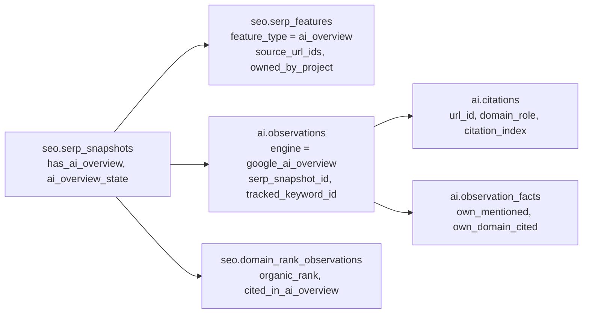

# 10. SERP Feature Tracking

Status: Draft for architecture freeze
Last updated: 2026-09-29
Related: [06-dataforseo-seo-integration.md](06-dataforseo-seo-integration.md) section 5.4 (provider field mapping), [04-data-model.md](04-data-model.md) section 7.4, [09-rank-tracking-methodology.md](09-rank-tracking-methodology.md), [15-seo-ai-correlation.md](15-seo-ai-correlation.md)

## 1. Scope

For every rank check we record which SERP features were present, where they sat on the page, which URLs and domains they referenced, and whether the project or a tracked competitor "owned" them. This gives a history of SERP composition per keyword and ownership per entity.

Tracked by default: AI Overview, featured snippet, People Also Ask, local pack, images, video (including short videos), top stories, knowledge graph, shopping (shopping, popular products, commercial units), discussions and forums, perspectives, related searches, sitelinks, ads, answer box, social posts. Unknown types are stored as `other:<provider type>`.

## 2. Presence vs ownership

| Concept | Definition |
|---|---|
| Present | The feature appears in the SERP of the check |
| Owned by entity E | At least one source URL inside the feature matches E's domain rules |
| Owned position | 1-based position of E's first source URL inside the feature (for example, the second PAA answer, or citation 3 in an AI Overview) |
| Feature position | Absolute rank of the feature block on the page |

Ownership depends on the feature type:

| Feature | Ownable | Ownership rule |
|---|---|---|
| Featured snippet | yes | snippet `url` matches E |
| People Also Ask | yes | any expanded answer `url` matches E; owned position = question index |
| AI Overview | yes | any reference or inline link matches E ("cited in AI Overview"); owned position = citation index |
| Local pack | yes | any business website domain matches E |
| Top stories, video, images, discussions, perspectives, social posts | yes | any item URL matches E |
| Knowledge graph | partial | a link inside the panel matches E (entity panels for the brand itself are detected by title match in Phase 13) |
| Shopping | partial | item URL or merchant domain matches E |
| Sitelinks | yes | E's organic result has sitelinks |
| Ads | yes | an ad URL matches E (paid presence, never counted as organic) |
| Related searches | no | presence only; queries feed discovery |

## 3. Storage

One `seo.serp_features` row per feature occurrence per check ([04-data-model.md](04-data-model.md) section 7.4):

- `feature_type`, `ordinal` (nth occurrence), `rank_absolute`
- `source_url_ids[]`, `source_domain_ids[]` in display order
- `owned_by_project`, `owned_position`, `competitor_entity_ids[]`
- `payload` (<= 4 KB): feature-specific content that is useful and small, for example PAA question texts, featured snippet title and type, AI Overview flags

Content retention: we store short feature text needed for product features (PAA questions for discovery, snippet titles). Long content (full AI Overview text) is stored once in `ai.observations` for the AI Overview, not duplicated in the feature row. Full feature content is in the raw SERP in R2 under the SERP retention policy.

On each check the ingest also updates `seo.tracked_keyword_state.feature_types_present` and `owned_feature_types` for fast table rendering, and writes `feature_gained`, `feature_lost`, `aio_appeared`, `aio_disappeared`, `aio_citation_gained`, `aio_citation_lost` events to `seo.rank_events`.

**As built (step 5, rank collection).** Features are written for the whole depth checked, but the state (`feature_types_present`, `owned_feature_types`) follows page one only (ranks up to the tenth organic result's absolute rank), so it does not change with the depth of the check. The AI Overview is a feature row of type `ai_overview` whose payload holds its state (`present`, `present_async_loaded`, `present_not_loaded`, `absent`) and its cited URLs; it is cited, not owned, so it is not an owned feature type, and `aio_citation_gained` and `aio_citation_lost` follow the citations of checks where it loaded in both. An unknown DataForSEO feature type is stored as `other:<type>`. `ai.*` tables wait for step 8.

## 4. Metrics

| Metric | Formula | Denominator |
|---|---|---|
| Feature presence rate (type f) | checks with f present / checks | checked keywords in scope and period |
| Feature ownership rate (f, entity E) | checks where E owns f / checks with f present | checks with f present |
| Featured snippet ownership | as above, f = featured snippet | |
| AI Overview presence rate | checks with AIO present / checks | |
| AI Overview citation rate (E) | checks where E cited in AIO / checks with AIO present | |
| AIO citation position (E) | median owned position over checks where E cited | |
| Feature share (f) across entities | ownership counts per entity / checks with f present | entities may co-own (PAA, AIO), so shares do not sum to 100% |
| SERP composition trend | presence rate per feature type over time | |
| Pixel displacement proxy | median (absolute rank minus organic rank) of own ranking result | ranked checks |

The pixel displacement proxy tells a user how far features push their result down, without paying for `calculate_rectangles`. True pixel position is post-MVP.

## 5. AI Overview in two contexts, one record

The AI Overview is a SERP feature and an AI answer. It is stored once:

- The **SEO view** reads `serp_features` and `domain_rank_observations.cited_in_ai_overview` next to organic rank for the same check. This is what powers "we rank 2 organically; are we cited in the AI Overview?"
- The **AI view** reads `ai.observations` and `ai.citations` and runs brand extraction over the AIO text, so an AI Overview that names the brand without linking to it is still a mention.
- The feature row and the citation rows are derived from the same raw references in the same transaction, so they cannot disagree. A consistency check in the data quality job asserts that `serp_features.source_url_ids` for `ai_overview` equals the set of `ai.citations.url_id` for the linked observation.

Per keyword, the AIO history table shows: date, device, location, AIO present, own cited (position), competitors cited, number of sources, organic rank at the same check, and a link to the AIO text.

## 6. Location, device and time

- Features are recorded per tracked keyword, so desktop and mobile features are separate series (they differ substantially: local packs and short videos are more common on mobile).
- A feature that appears in some checks and not others is common (Google rotates layouts). Presence rates over a window are more meaningful than single-day presence; the keyword detail view shows a 30-check presence strip per feature type.
- AI Overview presence depends on whether async AIOs are loaded. We always request them ([06-dataforseo-seo-integration.md](06-dataforseo-seo-integration.md) section 3.1), and any imported or historical data collected without that setting is marked so presence rates are not compared across the change.

## 7. What we do not do in V1

- Pixel-accurate position (`calculate_rectangles`): costs one extra base price per check; post-MVP.
- PAA click expansion on daily checks: only on deep checks when discovery is enabled.
- Separate AI observations for AI Overviews nested inside PAA or knowledge panels: recorded in feature payloads only.
- Screenshots of SERPs: not collected; `check_url` lets a user reproduce the query.
