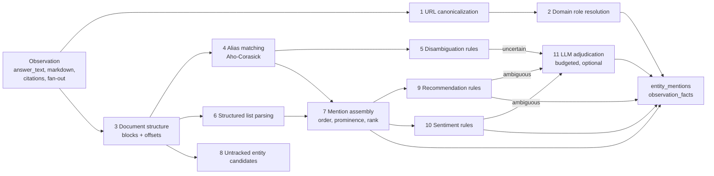

# 13. AI Extraction Engine

Status: Draft for architecture freeze
Last updated: 2026-09-30
Related: [04-data-model.md](04-data-model.md) section 8.5, [14-citation-intelligence.md](14-citation-intelligence.md), [16-metrics-methodology.md](16-metrics-methodology.md), [26-testing-quality.md](26-testing-quality.md)

## 1. Purpose and principles

The extraction engine turns one normalized AI observation (answer text, markdown, citations, fan-out queries) into project-scoped facts: which tracked entities are mentioned, where, in what order, whether they are recommended, with what sentiment, and whether owned or competitor domains are cited.

Principles:

1. **Deterministic first, models last.** Stages run cheapest to most expensive. A paid LLM is called only when earlier stages produce an ambiguous result and the project's classifier budget allows it.
2. **Evidence spans, not booleans.** Every mention stores the character ranges in `answer_text` that support it. The UI highlights them. A reviewer can see exactly why the system said "mentioned".
3. **Versioned and replayable.** Output rows carry a `derivation_id` that pins the extractor code version, the project's entity configuration version, and classifier versions. Changing an alias or upgrading the extractor re-derives history without touching observations.
4. **Unknown is a valid answer.** Ambiguous mentions below the confidence threshold are stored as `uncertain` and excluded from rates by default, with the count shown. Guessing inflates or deflates metrics silently.
5. **Mention and citation are separate facts.** Brand mention is derived from text. Domain citation is derived from the citation list. A domain name written in the text ("see hubspot.com") is a textual mention of the brand, not a citation.

## 2. Pipeline overview



Stages 1 to 10 are pure Python in `backend/src/sightline/extraction`, with no network or database access (import-linter enforces that `extraction` imports nothing internal and does no I/O; [ADR-022](adr/ADR-022-python-backend-simplified-platform.md)). They run as Taskiq tasks on the `process` queue at about 2 to 10 ms per observation. Stage 11 makes provider calls, so it runs on the `collect` queue.

## 3. Inputs

```python
# backend/src/sightline/extraction/inputs.py
from dataclasses import dataclass
from datetime import datetime
from typing import Literal
from uuid import UUID


@dataclass(frozen=True, slots=True)
class CitationInput:
    index: int
    raw_url: str
    url_id: UUID
    domain_id: int
    host: str
    registrable_domain: str
    path: str
    title: str | None
    kind: CitationKind
    first_char_offset: int | None
    answer_block_index: int | None


@dataclass(frozen=True, slots=True)
class ObservationInput:
    id: UUID
    observed_at: datetime
    engine_code: str
    observation_class: Literal["consumer_ui", "official_api", "serp_ai"]
    query_text: str
    answer_text: str | None
    answer_markdown: str | None
    citations: tuple[CitationInput, ...]


@dataclass(frozen=True, slots=True)
class Versions:
    extractor: int
    entity_config: int
    recommendation: int
    sentiment: int


@dataclass(frozen=True, slots=True)
class EntityConfig:
    id: UUID
    role: Literal["own", "competitor", "watch"]
    canonical_name: str
    is_ambiguous: bool
    hints: tuple[str, ...]
    domains: tuple[DomainRule, ...]


@dataclass(frozen=True, slots=True)
class ProjectEntityConfig:
    project_id: UUID
    entity_config_version: int
    entities: tuple[EntityConfig, ...]
    automaton: AliasAutomaton             # compiled from positive aliases
    negative_automaton: AliasAutomaton    # compiled from is_negative aliases


@dataclass(frozen=True, slots=True)
class ExtractionInput:
    observation: ObservationInput
    project_config: ProjectEntityConfig   # compiled, cached per (project, entity_config_version)
    versions: Versions
```

Stages take and return frozen dataclasses rather than Pydantic models: the inputs are built by `collectors` from already-validated rows, and the pure stages stay free of validation overhead. Pydantic is used at the boundaries (provider responses, API contracts, the Stage 11 output).

`entity_config_version` is a per-project counter incremented whenever an entity, alias, entity domain, or project role changes. It is stored in the column `core.projects.entity_config_version` (doc 04 section 4) and copied into `ai.derivations` (section 6).

## 4. Stage details

### Stage 1: URL canonicalization

Canonicalization rules (full list and test vectors in [14-citation-intelligence.md](14-citation-intelligence.md) section 3). Summary:

- Parse with WHATWG URL. Reject non-http(s).
- Unwrap known redirectors without fetching: `google.com/url?q=`, `www.google.com/url?url=`, `bing.com/ck/a?...&u=` (base64 variant), `l.facebook.com/l.php?u=`, `out.reddit.com`, `href.li/?`.
- Lowercase scheme and host; IDNA to punycode; remove default port; remove trailing dot on host.
- Remove fragment, including text fragments (`#:~:text=`), which Google AI surfaces add to citation links.
- Remove tracking parameters: `utm_*`, `gclid`, `gbraid`, `wbraid`, `fbclid`, `msclkid`, `mc_cid`, `mc_eid`, `srsltid`, `_hsenc`, `_hsmi`, `igshid`, `spm`, `yclid`, and host-specific or value-specific parameters (`si`, `ref`, `ref_src`) exactly as in the versioned list of doc 14 section 3.1 step 6, which is authoritative (`utm_source=chatgpt.com` is removed from the canonical URL but **recorded** on the citation as `referral_tag` because it is evidence of the citing surface).
- Sort remaining query parameters; drop empty values.
- Normalize percent-encoding of unreserved characters (RFC 3986 section 6.2.2.2).
- Remove trailing slash on non-root paths.
- `www.` is **kept** in `host` (some sites serve different content), but `registrable_domain` groups it.

Output: `canonical_url`, `url_hash`, `host`, `registrable_domain` (via `publicsuffixlist` with a pinned, bundled Public Suffix List snapshot and no network fetch, private domains enabled so `user.github.io` is its own registrable domain). Built in `sightline/extraction/urls.py`; stage 2 is `sightline/extraction/domains.py`.

### Stage 2: Domain role resolution

For each citation, find the most specific matching rule in the project's domain rules:

1. `path_prefix` match on host + path prefix (for example `medium.com/@acme`, `github.com/acme`)
2. `host` exact match (for example `docs.acme.com` configured separately from `acme.com`)
3. `registrable` match (`acme.com` matches `blog.acme.com`)

Result: `domain_role` in (`own`, `competitor`, `third_party`) and `role_entity_id`. If two entities claim the same domain at the same specificity (misconfiguration), `own` wins and a configuration warning is raised.

Written to `ai.citations.domain_role` at ingest; recomputed by a derivation backfill when domain rules change.

### Stage 3: Document structure

Answer engines return markdown or HTML-derived text with lists, headings, bold names and tables. Structure matters for structured rank and recommendation.

- Parse `answer_markdown` with `markdown-it-py` (CommonMark token stream). If only plain text exists, use a line-based fallback parser (numbered lines, bullets, blank-line paragraphs).
- Produce an ordered list of **blocks**: `{ index, type: 'heading'|'paragraph'|'list_item'|'table_row'|'blockquote'|'code', depth, listId, listOrdered, listItemNumber, text, startOffset, endOffset }`, where offsets are into `answer_text` (plain text is regenerated from the AST so offsets are exact).
- Blocks are **not stored**. They are a deterministic function of `answer_markdown` and the extractor version. The API recomputes them on demand for the answer viewer with the same package (`@repo/extraction/blocks`), and evidence spans stored on mentions use the same offsets, so highlighting always lines up. If the function changes, the change is an extractor version bump and derivations are refreshed.
- Inline citation markers (`[1]`, `【3†source】`, superscripts, inline links) are mapped to citation indexes and attached to the block containing them. This fills `ai.citations.answer_block_index` and `first_char_offset` when the provider did not supply positions.

### Stage 4: Alias matching

- Normalization for matching (applied identically to aliases and text, with an offset map back to original text): Unicode NFKC, case fold (unless the alias is `case_sensitive`), diacritics folded, curly quotes and dashes mapped to ASCII, collapse whitespace, strip zero-width characters.
- Matching uses an Aho-Corasick automaton compiled from all positive aliases of all project entities. One pass over the text finds all candidate spans, O(text length + matches).
- `word_boundary` mode requires Unicode word boundaries on both sides (letters and digits are word characters; `.` `-` `'` are boundaries). Possessives and plural suffixes are allowed after the boundary (`HubSpot's`, `HubSpots`).
- `exact_case` mode compares the original-case text.
- `regex` mode is allowed for power users, compiled with RE2 (`google-re2`), which runs in time linear in the text whatever the pattern, so user-entered patterns cannot backtrack catastrophically.
- Domain-shaped aliases are auto-generated for every entity domain (`acme.com`, `acme.io`), so "visit acme.com" counts as a brand mention.
- **Overlap resolution:** longest match wins (`Salesforce Marketing Cloud` beats `Salesforce` when both are aliases of different entities, for example a product and its parent brand). A product mention also counts toward its parent brand (`parent_entity_id`) with `match_method = 'via_product'`.
- **Negative aliases** (`is_negative`): any positive span fully inside a negative span is dropped (`Apple pie`, `Monday morning`).

As built (`sightline/extraction/text.py` and `aliases.py`, step 4):

- Each original character is normalized on its own (NFKD, combining marks dropped, case folded for the folded text), so every normalized character maps back to exactly the characters it came from. Spans are offsets into the text as given, in code points.
- `exact_case` is a word-boundary match on the original case; `case_sensitive` makes `word_boundary` and `substring` compare case too. A word boundary is anything that is not a letter or digit (so `_` is one), checked only on a side where the alias itself ends in a letter or digit (`C++` matches `C++17`). The suffixes allowed before the boundary are `'s`, `'`, `es` and `s`. Scripts written without spaces need `substring` mode.
- `regex` patterns run on the normalized text with case kept (diacritics folded, one space per run, ASCII quotes and dashes), case-insensitive unless `case_sensitive`; empty matches are ignored. RE2 has no backreferences or lookaround; such a pattern is refused (`422 invalid_regex`).
- Domain-shaped aliases come from each entity domain's host, `www.` left off and punycode shown as Unicode; they match after a `.` (`www.acme.io`) but not before one followed by a letter (`acme.io.evil.com`).
- Several entities matched on exactly the same span all keep it; one entity matched twice on a span keeps the most specific method. Span methods are `alias_exact`, `alias_word`, `alias_substring`, `alias_regex`, `alias_domain` and `via_product`.
- `language_code` on an alias is stored but not used until answers carry a language (step 8).
- Stage 5 is scored per span from the text alone (the signals of the first, third and sixth rows of the table below): a hint counts within 40 tokens either way, a span opens a sentence after `.`, `!`, `?`, `:`, a line break or a list marker, and a domain-shaped alias always scores 0.95. An entity's confidence is its best span's score.

### Stage 5: Disambiguation

For entities flagged `is_ambiguous` or aliases with `requires_context`:

| Signal | Score contribution |
|---|---|
| A disambiguation hint term within 40 tokens or in the same block | +0.35 |
| Span appears as the leading entity of a list item in a list that also contains other tracked entities | +0.35 |
| Span is capitalized mid-sentence (for common-word names) | +0.15 |
| An own/competitor domain of that entity is cited in the same block | +0.25 |
| The prompt text contains a category hint for the entity | +0.10 |
| Span is lowercase in a language where brand is normally capitalized | -0.25 |
| Span is part of a negative-context pattern (for example "on Monday", "an apple") not covered by negative aliases | -0.50 |

Base score 0.30 for ambiguous entities, 0.95 for non-ambiguous. Thresholds:
- `>= 0.70`: accepted (`confidence` = score, clipped to 0.99)
- `0.40 to 0.70`: `uncertain`, sent to Stage 11 if budget allows; otherwise stored as uncertain
- `< 0.40`: discarded, but the span is logged in a debug table for alias tuning (retained 30 days)

The weights are initial values. They are tuned on the gold set in Phase 8 and versioned with the extractor.

### Stage 6: Structured list parsing

We only assign `structured_rank` when the answer clearly contains an ordered list of options.

A block group qualifies as a **ranked list** when all of these hold:
1. It is an ordered markdown list (`1.`, `2.`), or a sequence of headings with ordinal prefixes (`### 1. Acme`), or a table whose first column is a rank number.
2. At least 2 items.
3. At least 50% of items have a recognizable **item subject** in their first 80 characters: a tracked entity match, a bold span, or a linked anchor text.

Each tracked entity that is the **item subject** (its first match in the item starts within the first 80 characters, or it is the bold/linked leading text) gets `structured_rank = item number` (1-based position in the list, not the literal number printed, because engines sometimes restart numbering) and `structured_list_size = item count`.

Unordered bullet lists do **not** produce structured ranks. The entities in them still get `mention_order` and `prominence`. Rationale: a bullet list of "options to consider" carries no ordering claim, and treating bullet position as rank would invent one.

If an answer contains multiple qualifying lists (for example "Best for startups" and "Best for enterprise"), the rank comes from the **first** list in which the entity is an item subject, and `ai.entity_mentions.structured_list_index` records which list it was (doc 04 section 8.5). The Top-3 metric uses that first-list rank.

### Stage 7: Mention assembly

For each entity with at least one accepted span:

| Field | Definition |
|---|---|
| `mention_count` | Accepted spans for the entity (including via product) |
| `first_char_offset` | Start offset of the earliest accepted span |
| `mention_order` | Rank of `first_char_offset` among all tracked entities with accepted mentions (1 = first). Ties impossible (offsets differ) except for overlapping via-product cases, which take the product's order |
| `prominence` | `1 - first_char_offset / max(answer_char_count, 1)`, in [0, 1]. 1.0 = named in the first character; 0.5 = first named halfway through |
| `structured_rank`, `structured_list_size` | From Stage 6, else NULL |
| `evidence_spans` | All accepted span ranges |

Untracked entity mentions (Stage 8) are stored separately and do not affect `mention_order` of tracked entities.

### Stage 8: Untracked entity candidates (competitor discovery)

Goal: surface brands that AI engines mention for the project's prompts but that the project does not track.

Candidate sources, cheapest first:
1. Leading bold or linked text of list items in ranked or unordered lists.
2. Registrable domains of cited `third_party` URLs whose domain category is `vendor_site`.
3. Capitalized multi-token proper-noun spans in list items, found by a rule-based chunker: runs of capitalized tokens (allowing internal lowercase connectors such as "of", "for" and "&"), trimmed of sentence-initial words through a stop list. No language model is loaded in the worker in V1 ([ADR-022](adr/ADR-022-python-backend-simplified-platform.md)); a tagger is reconsidered in Phase 14 only if candidate precision on the gold set is below target.

Candidates are normalized and aggregated per project in:

```sql
CREATE TABLE ai.entity_candidates (
    project_id        uuid NOT NULL,
    workspace_id      uuid NOT NULL,
    normalized_name   text NOT NULL,
    display_name      text NOT NULL,
    first_seen_at     timestamptz NOT NULL,
    last_seen_at      timestamptz NOT NULL,
    observation_count integer NOT NULL,
    prompt_count      integer NOT NULL,
    engines           text[] NOT NULL,
    sample_observation_ids bigint[] NOT NULL,     -- up to 10
    linked_domain_ids integer[] NOT NULL DEFAULT '{}',
    status            text NOT NULL DEFAULT 'new' CHECK (status IN ('new','accepted','ignored')),
    PRIMARY KEY (project_id, normalized_name)
);
```

The Competitor Intelligence screen lists candidates by `prompt_count` with one-click "track as competitor" (creates the entity with the display name as alias and linked domains).

### Stage 9: Recommendation classification

**Definition.** Entity E is *recommended* in an answer if the answer presents E as a suggested choice for the user's stated need: it appears as an item in a list of suggested options, or the text explicitly endorses it for the user's situation, and the endorsement is not negated or conditional-negative. Being mentioned as a baseline, a comparison point, a warning, or in passing is **not** a recommendation.

Rules (per entity, over blocks containing its accepted spans):

| Rule | Result |
|---|---|
| E is an item subject in a ranked or unordered list whose heading or introducing sentence matches a suggestion pattern (`best`, `top`, `recommended`, `options`, `alternatives`, `consider`, `tools you can use`, localized equivalents) | recommended, conf 0.85 |
| Sentence with E matches an endorsement pattern: `I (would )?recommend`, `(is|are) (a|the) (best|great|solid|top) (choice|option|pick)`, `go with`, `your best bet`, `ideal for`, `we suggest` | recommended, conf 0.80 |
| Sentence with E matches a negative pattern: `avoid`, `not recommended`, `(is|are) not (a good|ideal)`, `lacks`, `too expensive for`, `unless` + negative clause | not recommended, conf 0.75 |
| E appears only in comparison baseline patterns (`unlike E`, `compared to E`, `alternative(s) to E`) | not recommended, conf 0.80 |
| E is the subject of the prompt itself (branded prompt such as "Is Acme good?") | handled by sentiment, `is_recommended` = NULL unless an explicit endorsement rule fires |
| None of the above | ambiguous |

Conflicts (positive and negative rules both fire) produce `ambiguous`. Ambiguous items go to Stage 11 if the budget allows, otherwise `is_recommended = NULL`.

Recommendation Rate (metric A5) counts unmentioned observations as not recommended and excludes mentioned but unclassified ones. Recommendation share of mentions (A6) uses only observations where the own entity was mentioned and classified (`n_recommendation_classified` in rollups). The UI shows the classified share. See [16-metrics-methodology.md](16-metrics-methodology.md) section 4.

### Stage 10: Sentiment

**Taxonomy:** `positive`, `neutral`, `negative`, `mixed`, computed per entity per observation over the sentences that mention the entity (entity-level, not document-level).

**V1 approach:** lexicon rules produce a preliminary label with confidence; the default is `neutral` at low confidence. Because rule-based sentiment is weak on nuanced product comparisons, V1 sends own-brand mentions with rule confidence below 0.7 to Stage 11 in batches, within the project's classifier budget. Competitor sentiment is classified only when the project enables it (it multiplies cost by the number of competitors).

**Limitation, stated in the UI:** sentiment of generated text is a coarse signal. We show distributions and example spans, never a single "sentiment score".

### Stage 11: LLM adjudication (budgeted, optional)

Used for: uncertain mentions (Stage 5), ambiguous recommendations (Stage 9), low-confidence sentiment (Stage 10), and claims extraction (post-MVP).

| Setting | V1 value |
|---|---|
| Model | The cheapest current model from an approved provider that supports JSON-schema structured output. Model id is configuration, pinned per classifier version (current candidates are listed in `research/04-official-llm-apis.md`) |
| Batching | Up to 20 items per call; each item is `{item_id, entity_name, category_hint, excerpt (±400 chars around spans), question}` |
| Output | JSON schema: `[{item_id, label, confidence, rationale_span}]`, validated with a Pydantic model; invalid items stay unresolved |
| Safety | No tools, no secrets in prompt, excerpt wrapped in explicit data delimiters; see [24-security.md](24-security.md) section 7.2 |
| Budget | Per project monthly cap (default USD 10) stored as an `ops.budgets` row with workload group `extraction_llm`; when exhausted, items remain unresolved and a notice is shown. LLM domain classification (doc 14 section 4) is recorded as `extraction_llm` platform overhead (no project) |
| Caching | Keyed by `sha256(classifier_version, entity_id, excerpt, question)`; identical excerpts across replicates are classified once |
| Cost metering | Every call writes `ops.provider_cost_events` with `workload = 'extraction_llm'` |

Order of magnitude (Assumption, measure in Phase 8): with 1,000 prompts x 4 engines x 4.33 cycles, about 17,000 observations per month. If 15% need adjudication for one item each and batching gives 20 items per call at roughly 2,000 input and 600 output tokens per call, that is about 130 calls per month, a few US dollars at cheap-model prices.

A local model (for example a small ONNX classifier running in the worker via `onnxruntime`) is **not** in V1. On a 4 GB droplet shared with PostgreSQL it would compete for memory, and its accuracy on this task is unproven. Revisit in Phase 14 if LLM adjudication volume or cost grows beyond budget.

## 5. Outputs

Per observation and project, one transaction writes:

1. `ai.entity_mentions` rows for each tracked entity with accepted or uncertain mentions (`mention_status`; uncertain rows are excluded from rates). Untracked names are not written here; they go to `ai.entity_candidates`.
2. One `ai.observation_facts` row (own-entity summary, competitor arrays, validity flag).
3. Updates to `ai.entity_candidates` (upsert, counters).

The previous current rows for the same `(observation, project)` with an older derivation are flipped to `is_current = false` in the same transaction.

Validity: `observation_facts.is_valid = false` when observation status is `error`, `refused` or `empty`, or when `answer_char_count < 40`, or when the normalizer flagged the response as truncated. Invalid observations count toward collection health, never toward visibility rates.

## 6. Derivations (versioning of extraction output)

```sql
CREATE TABLE ai.derivations (
    id                    integer GENERATED ALWAYS AS IDENTITY PRIMARY KEY,
    project_id            uuid NOT NULL,
    extractor_version     smallint NOT NULL,
    entity_config_version integer NOT NULL,
    recommendation_version smallint NOT NULL,
    sentiment_version     smallint NOT NULL,
    created_at            timestamptz NOT NULL DEFAULT now(),
    UNIQUE (project_id, extractor_version, entity_config_version, recommendation_version, sentiment_version)
);
```

`ai.entity_mentions` and `ai.observation_facts` use `derivation_id` in their primary key instead of a bare `extractor_version` (see [04-data-model.md](04-data-model.md) section 8.5).

Re-derivation triggers:

| Trigger | Scope | Default behavior |
|---|---|---|
| Alias, entity, or role change | Project | Re-derive last 90 days automatically; older on request |
| Extractor upgrade (non-breaking) | All projects | Re-derive last 30 days in background at low priority |
| Extractor upgrade (breaking) | All projects | New derivation for new observations; history re-derived on request per project, with a version boundary marker until done |
| Classifier upgrade | Project | Only re-classify items whose label may change (ambiguous or LLM-labelled) |

Re-derivation reads `answer_text` and citations from PostgreSQL; it does not need R2 unless normalization itself changed (then the observation is re-ingested from the raw payload into a new observation row, and the old row is marked superseded in `ops.derivation_log`).

## 7. Quality targets (measured on the AI gold set)

| Stage | Metric | Target for Phase 8 exit |
|---|---|---|
| Mentions, non-ambiguous entities | Precision / recall | >= 0.99 / >= 0.97 |
| Mentions, ambiguous entities | Precision / recall | >= 0.95 / >= 0.85 |
| Structured rank | Exact match on qualifying lists | >= 0.95 |
| Ranked-list detection | F1 | >= 0.90 |
| Recommendation (rules + LLM) | Accuracy on classified items; coverage | >= 0.85; >= 0.80 of mentions classified |
| Sentiment (own brand) | Macro F1 | >= 0.70 (reported, not gating) |
| Citation canonicalization | Exact canonical URL match | 1.00 on test vectors |
| Domain role | Accuracy | 1.00 on test vectors |

Gold set construction is in [26-testing-quality.md](26-testing-quality.md) section 4.

## 8. Performance budget

| Item | Budget |
|---|---|
| Compiled automaton per project (1,000 aliases) | < 5 MB memory, compile < 50 ms, cached by `(project, entity_config_version)` in an LRU of 50 projects |
| Stages 1 to 10 per observation (10 KB answer) | p95 < 15 ms |
| Throughput per `extract` worker slot | > 50 observations/s |
| Re-derivation of 100,000 observations | < 1 hour at concurrency 2, without blocking live ingest (low priority) |
