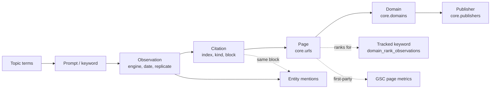

# 14. Citation and Source Intelligence

Status: Draft for architecture freeze
Last updated: 2026-09-29
Related: [04-data-model.md](04-data-model.md) sections 5.1 and 8.4, [13-ai-extraction-engine.md](13-ai-extraction-engine.md), [16-metrics-methodology.md](16-metrics-methodology.md) section 7, [15-seo-ai-correlation.md](15-seo-ai-correlation.md)

## 1. Purpose

Citations are the part of an AI answer a publisher can influence most directly. This module answers: which domains and pages do AI engines cite for our topics, how that changes, where our own pages appear, which sources competitors benefit from, and which publishers are worth pursuing. It works across AI Overview, AI Mode, ChatGPT and Gemini, and joins to organic rankings through the shared URL dictionary.

## 2. Citation data model (summary)

| Entity | Table | Key fields |
|---|---|---|
| Citation (one URL in one answer) | `ai.citations` | observation, `citation_index` (order), `url_id`, `domain_id`, `raw_url`, title, source name, `citation_kind`, `first_char_offset`, `answer_block_index`, `occurrences`, `domain_role`, `role_entity_id`, `referral_tag` |
| Retrieved result (ChatGPT only) | `ai.retrieval_results` | url, `was_cited`, fan-out link |
| Page | `core.urls` | canonical URL, path, domain |
| Domain | `core.domains` | host, registrable domain, default category |
| Publisher | `core.publishers` (new) | organization that owns one or more registrable domains |
| Project source stats | `ai.project_source_stats` (new) | first seen, last seen, occurrence counts per project and URL/domain |
| Daily domain rollup | `ai.daily_domain_citations` | per project, date, engine, domain |

Associated brand claim (which entity a citation supports) is inferred when a citation marker sits in the same answer block as an entity mention: `ai.citation_entity_links (observation_id, observed_at, citation_index, entity_id, derivation_id, method)` with method `same_block` in V1. It is an association, not proof that the source says anything about the entity.

```sql
CREATE TABLE core.publishers (
    id              uuid PRIMARY KEY DEFAULT uuidv7(),
    name            text NOT NULL UNIQUE,       -- 'G2', 'Reddit', 'Forbes', 'Capterra (Gartner)'
    publisher_type  text NOT NULL,              -- mirrors domain categories
    parent_publisher_id uuid REFERENCES core.publishers(id)
);
CREATE TABLE core.publisher_domains (
    publisher_id       uuid NOT NULL REFERENCES core.publishers(id) ON DELETE CASCADE,
    registrable_domain text NOT NULL,
    PRIMARY KEY (publisher_id, registrable_domain)
);

CREATE TABLE ai.project_source_stats (
    project_id        uuid NOT NULL,
    workspace_id      uuid NOT NULL,
    grain             text NOT NULL CHECK (grain IN ('url','domain')),
    ref_id            bigint NOT NULL,          -- url_id or domain_id
    engine_code       text NOT NULL,            -- '*' row holds all-engine totals
    first_seen_at     timestamptz NOT NULL,
    last_seen_at      timestamptz NOT NULL,
    citation_units    integer NOT NULL,
    observations      integer NOT NULL,
    prompts           integer NOT NULL,         -- approximate distinct count maintained by nightly recount
    PRIMARY KEY (project_id, grain, ref_id, engine_code)
);
```

`ai.project_source_stats` is upserted at ingest (first/last seen, counters) and recounted nightly for exact distinct prompt counts.

## 3. URL canonicalization (canonicalizer version 1)

Canonicalization determines whether two citations point at "the same page". It is shared by SERP results, citations, first-party pages and owned-domain matching. All rules are in `packages/extraction/src/url/canonicalize.ts` with a test vector file.

### 3.1 Steps

1. **Parse** with the WHATWG URL parser. Reject schemes other than `http` and `https` (recorded as invalid citation with raw URL kept).
2. **Unwrap redirectors** (no network): Google `/url?q=` and `/url?url=`, Google `/goto` when the destination is present as a parameter, Bing `/ck/a` (`u=` base64 with `a1` prefix), Facebook `l.php?u=`, Reddit `out.reddit.com`, `href.li`, and Vertex AI grounding redirect hosts when their target is decodable. Undecodable wrappers are kept and flagged `unresolved_redirect`.
3. **Scheme** lowercased; `http` and `https` are both allowed. The canonical form keeps the scheme as observed; `url_hash` is computed on the scheme-less form so `http://` and `https://` versions of a page merge.
4. **Host**: lowercase, IDNA to ASCII (punycode), strip trailing dot, drop default port. `www.` is kept in `host` and grouped by `registrable_domain`.
5. **Fragment**: removed entirely, including text fragments `#:~:text=...` (added by Google AI surfaces to citation links).
6. **Query**: remove tracking parameters. List v1: `utm_*`, `gclid`, `gbraid`, `wbraid`, `dclid`, `fbclid`, `msclkid`, `mc_cid`, `mc_eid`, `_hsenc`, `_hsmi`, `hsCtaTracking`, `igshid`, `si` (on youtube.com, youtu.be, spotify.com only), `srsltid`, `yclid`, `ref` and `ref_src` (only when value is a known referrer tag), `spm`, `_ga`, `_gl`, `oly_enc_id`, `oly_anon_id`, `vero_id`, `mkt_tok`. The value of `utm_source` is recorded as `referral_tag` before removal. Remaining parameters are sorted by name; empty values dropped.
7. **Path**: RFC 3986 section 6.2.2 normalizations: uppercase percent-encoding hex, decode percent-encoded unreserved characters, remove dot segments. Empty path becomes `/`. Trailing slash removed on non-root paths (heuristic, documented as unsafe by the RFC; accepted because it merges far more true duplicates than it creates false merges; per-domain exceptions list supported).
8. **Known equivalents** (per-domain rules, v1): `m.` and `mobile.` subdomains on `wikipedia.org` map to the desktop host; `amp/` path suffixes and `?amp=1` on known publishers map to the canonical article; `youtu.be/<id>` maps to `youtube.com/watch?v=<id>`.
9. **Registrable domain** via the Public Suffix List (`tldts`, with private domains enabled so `user.github.io` and `user.substack.com` are separate registrable domains). The PSL snapshot version is pinned and upgraded deliberately (it is part of `canonicalizer_version`).
10. `url_hash = sha256(scheme-less canonical URL)`.

We do not fetch pages to follow HTTP redirects or read `rel=canonical` in V1. That would add network cost, SSRF surface, and time-dependence to ingest. A Phase 13 option resolves `rel=canonical` for **owned** domains only, where we can trust the result, via a periodic owned-sitemap crawl.

### 3.2 Test vectors (excerpt)

| Input | Canonical URL | registrable_domain | referral_tag | flags |
|---|---|---|---|---|
| `https://www.Example.com/Guide/?utm_source=chatgpt.com&b=2&a=1#:~:text=crm` | `https://www.example.com/Guide?a=1&b=2` | `example.com` | `chatgpt.com` | text_fragment_removed |
| `https://www.google.com/url?q=https%3A%2F%2Facme.io%2Fpricing&sa=D` | `https://acme.io/pricing` | `acme.io` | | redirect_unwrapped |
| `https://en.m.wikipedia.org/wiki/Customer_relationship_management` | `https://en.wikipedia.org/wiki/Customer_relationship_management` | `wikipedia.org` | | |
| `https://alice.github.io/post/` | `https://alice.github.io/post` | `alice.github.io` | | |
| `http://ACME.co.uk:80/a/./b/../c` | `http://acme.co.uk/a/c` | `acme.co.uk` | | |
| `https://youtu.be/dQw4w9WgXcQ?si=abc` | `https://youtube.com/watch?v=dQw4w9WgXcQ` | `youtube.com` | | |

## 4. Domain categories

Categories (`core.domain_categories`): `news`, `review_aggregator`, `ugc_forum`, `social`, `video`, `wiki_reference`, `vendor_site`, `marketplace`, `directory`, `government`, `education`, `blog_independent`, `affiliate`, `docs`, `other`.

Classification pipeline (in order, first hit wins):

1. **Tenant override** (`core.workspace_domain_categories`): users can recategorize any domain for their workspace.
2. **Seed list** (`source = 'seed_list'`): a curated list shipped with the app, covering the most-cited domains (initial target: 2,000 domains, built in Phase 13 from the platform's own citation frequency and reviewed manually).
3. **Rules** (`source = 'rule'`): TLD and pattern rules (`.gov` and `.gov.<cc>` government, `.edu` and `.ac.<cc>` education, known forum software paths, `docs.` and `developer.` hosts as docs).
4. **LLM classification** (`source = 'llm'`, budgeted, Phase 13): for unclassified domains with at least 5 citation units platform-wide, classify from the cited page titles and URLs we already have (no crawling), cheap model, JSON output, confidence stored. Low-confidence results stay `other`.

Role (own, competitor, third party) is **not** a category. It is a per-project interpretation stored on the citation.

## 5. Source graph

The graph is relational; we do not introduce a graph database.



Typical traversals (all SQL joins on indexed ids):

| Question | Path |
|---|---|
| Which pages are cited for topic T? | topic terms, prompts, observations, citations, urls |
| Which publishers dominate competitor-recommending answers? | observations where competitor recommended and own not mentioned, citations, domains, publishers |
| Which of our pages are cited, and do they rank? | citations with role own, urls, domain_rank_observations for the same url |
| Does a cited third-party page also rank organically for our keywords? | citations, urls, `seo.serp_snapshots.organic_url_ids` containment (GIN index on the array is **not** added in V1; the query runs per page against recent snapshots of linked keywords) |

## 6. Source intelligence features

| Feature | Definition | Screen |
|---|---|---|
| Top cited domains | C2 in doc 16, per engine and topic, with trend vs previous window | Citation Intelligence |
| Top cited pages | same at URL grain, with title and first/last seen | Citation Intelligence |
| Source share | C1 | Citation Intelligence |
| New and lost sources | C5, C6 with `min_support` | Citation Intelligence, alerts |
| Source category mix | C4 per engine: engines differ (for example, forums vs review sites) | Citation Intelligence |
| Competitor source overlap | C7 | Competitor Intelligence |
| Retrieved but not cited (ChatGPT) | C8: pages ChatGPT looked at but did not cite; own pages in this list are near misses | Prompt Explorer, Page Intelligence |
| Pages repeatedly influencing a topic | URLs cited in at least 25% of observations for a topic in each of the last 4 windows | Topic Explorer |
| Owned page citations | own URLs by citation units, engines, prompts, with organic rank for linked keywords | Page Intelligence |
| Publisher opportunities | section 7 | Citation Intelligence |

## 7. Publisher opportunities (evidence, not causation)

For a project and topic, rank third-party domains by how often they are cited in answers where competitors are visible and we are not:

```
For domain d in topic T over window W:
  A_d = observations citing d where at least one competitor is mentioned and own is not mentioned
  B_d = observations citing d where own is mentioned
  opportunity_d = |A_d| / (|A_d| + |B_d| + 1)       (share of d's appearances in "competitor-only" answers)
  reach_d       = distinct prompts citing d in T
```

The list shows domains with `reach_d >= 3`, sorted by `reach_d * opportunity_d`, with sample observations, the competitor(s) mentioned, the cited page titles, and the domain category. The UI wording: "Sources frequently cited in answers that mention competitors but not you". It never claims that getting featured on that domain will change AI answers.

## 8. Freshness, first seen and last seen

- `first_seen_at` for a project source is the earliest `observed_at` of a citation to it; `last_seen_at` the latest.
- A source is "lost" when not cited for 2 full windows after being cited with `min_support` in the window before (avoids flagging normal rotation).
- For owned pages, "time to first citation" after publication is reported when the page's publication date is known (sitemap `lastmod` or manual), labeled as observational.

## 9. Data quality specifics

| Issue | Handling |
|---|---|
| Duplicate URLs within an answer (Gemini annotations since 2026-07-28, repeated inline links) | Deduped per observation by `url_hash`; `occurrences` counts repeats |
| Citation to a redirector we cannot unwrap | Kept with `unresolved_redirect`; excluded from domain rankings by default (toggle to include) |
| Citation to the engine's own properties (for example `google.com/search?q=` links in AI Mode) | Categorized `other`, flagged `engine_internal`, excluded from source share by default |
| Tracking parameters on owned URLs creating false "new pages" | Removed by canonicalization; referral tag kept |
| Canonicalizer upgrade | New `canonicalizer_version`; `core.url_remap` maps old ids to new; rollups recomputed for the affected window |
