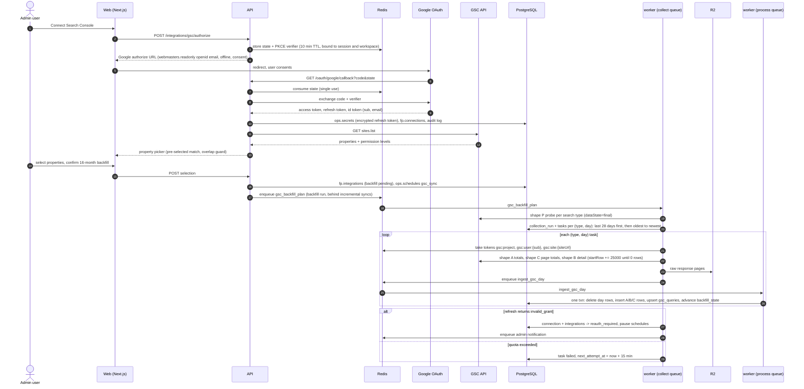

# 18. First-Party Integrations

Status: Draft for architecture freeze
Last updated: 2026-09-30
Research basis: `research/05-first-party.md` (all sources accessed 2026-09-29)
Related: [04-data-model.md](04-data-model.md) sections 5, 9, 10, 11; [24-security.md](24-security.md) sections 5, 6, 13; [03-system-architecture.md](03-system-architecture.md) sections 5, 6, 9; [17-statistical-methodology.md](17-statistical-methodology.md); [05-provider-integrations.md](05-provider-integrations.md) section 7

This document specifies how the platform connects to a customer's own data sources (Google Search Console, Bing Webmaster Tools, GA4, Cloudflare, server logs), what each source can and cannot provide, how data is ingested and stored, and how it feeds analytics without being confused with our synthetic observations.

Labels: **(verified 2026-09-29)** marks a fact read on a primary page in research 05. **UNVERIFIED** marks a claim research 05 could not confirm. **INFERRED** marks our reasoning. **Decision** marks a design choice.

## 1. Principles

1. **Own observation class.** Rows live in `fp`, carry `observation_class = 'first_party'` in API responses, and are never unioned with `consumer_ui`, `official_api` or `serp_ai` observations (doc 04 principle 4, doc 03 invariant 1).
2. **Source labels travel with the number:** `source` (for example `gsc_api`, `gsc_genai_import`, `bing_ai_import`, `ga4_api`, `cloudflare_graphql`, `server_logs`), `data_origin` (`api` or `file_import`) and `data_state`.
3. **Replacement only where the source restates** (doc 04 section 10). An import is replaced only by a newer import with the same property, view and filter.
4. **UI-only data is imported, not scraped.** We accept the customer's export file, keep it as evidence, and record the active filter. We never automate a logged-in browser against Search Console or Bing.
5. **Census, not sample.** GSC, GA4 and Cloudflare counts are the source's totals, so doc 17 binomial intervals do not apply. Bing AI Performance is sampled (verified 2026-09-29) and badged.

## 2. What each source offers

| Source | Data we use | Programmatic access | AI-specific data | AI data access path |
|---|---|---|---|---|
| Google Search Console | Clicks, impressions, position by date, query, page, country, device, search type | Search Analytics API `searchanalytics.query` (verified 2026-09-29) | "Generative AI performance" reports for Search (AI Overviews, AI Mode) and Discover: impressions only, by page, country, device (Search only), date; no queries, no clicks, no position; worldwide since 2026-08-31 (verified 2026-09-29) | **UI export only.** Not in the API `type`, `dimensions` or `searchAppearance` values and not in the BigQuery export schema (verified 2026-09-29). Future API: UNVERIFIED |
| Bing Webmaster Tools | Site traffic, query stats, page stats | JSON API `https://ssl.bing.com/webmaster/api.svc/json/{Method}`; SOAP and POX retired 2026-08-31 (verified 2026-09-29) | "AI Performance" (public preview since 2026-02-10): citations, cited pages, grounding queries (sampled), page-level citations, query to page mapping; Intents, Topics, Citation Share, Compare since 2026-06-16 (verified 2026-09-29) | **CSV and Excel export only**, and exports reflect the currently applied filter (verified 2026-09-29). No method in `IWebmasterApi` (verified absence). API "during 2026": UNVERIFIED |
| GA4 Data API | Sessions, engaged sessions, key events, revenue by source, medium, channel, landing page | `runReport` (verified 2026-09-29) | Default channel "AI Assistant", medium `ai-assistant`, campaign `(ai-assistant)`, announced 2026-05-13; excludes Google AI Overviews and AI Mode, which stay in Organic Search (verified 2026-09-29) | API, through standard dimensions |
| Cloudflare AI Crawl Control | AI crawler requests, status codes, bytes, paths, AI referrals | GraphQL Analytics API, dataset `httpRequestsAdaptiveGroups`, available on all plans (verified 2026-09-29) | Per-zone crawler analytics on all plans; referrals on paid plans only (verified 2026-09-29) | API |
| Cloudflare Radar | Global AI bot trends | Radar API (verified 2026-09-29) | Crawl purpose, crawl-to-refer ratio | API, but licensed CC BY-NC 4.0 (verified 2026-09-29): internal use only, section 8.5 |
| Server logs | Raw crawler and fetcher hits | None; the customer ships logs | User agents plus IP verification | Upload, Logpush, or agent (section 9) |

## 3. Shared infrastructure

### 3.1 Connections and integrations

A **connection** is one credential grant (one Google login, one Bing OAuth grant or API key, one Cloudflare API token). An **integration** is one property on that connection (one GSC property, one GA4 property, one Bing site, one Cloudflare zone). One connection has many integrations. Rate limits, re-auth state and revocation belong to the connection; sync cursors and data belong to the integration. This needs a new table `fp.connections` (DDL in section 12) and a `connection_id` column on `fp.integrations`.

### 3.2 Credentials and OAuth (doc 24 sections 5 and 6)

Doc 24 section 6 controls apply unchanged: PKCE with single-use `state` (Redis, 10-minute TTL), refresh tokens envelope-encrypted in `ops.secrets` (`oauth_refresh_token`; Bing keys and Cloudflare tokens as `provider_api_key`), access tokens in worker memory only, exact-match HTTPS redirect URIs. Additions:

- Only `owner` and `admin` can connect or disconnect; both actions write `ops.audit_logs`.
- **Disconnect** also sets `fp.connections.status = 'revoked'` and disables the schedules.
- **`invalid_grant`** (or the provider equivalent) sets the connection and all its integrations to `reauth_required`, pauses their schedules, and notifies admins. Ingested data stays visible under a "sync paused since <date>" banner.
- **Self-hosted note.** Each installation registers its own OAuth clients in its own Google Cloud project. Every "per project" quota below is per installation, shared by all its workspaces.

Scopes (minimum, read-only):

| Product | Auth | Scopes or permissions |
|---|---|---|
| GSC | OAuth 2.0 | `https://www.googleapis.com/auth/webmasters.readonly` (verified 2026-09-29), plus `openid email` to identify the Google account (stable `sub` for rate-limit keys) |
| GA4 | OAuth 2.0 | `https://www.googleapis.com/auth/analytics.readonly` (INFERRED in research 05; listed in doc 24) |
| Bing | OAuth 2.0 preferred; API key fallback | `Webmaster.read` (verified 2026-09-29). Never `Webmaster.manage` |
| Cloudflare | Customer-created API token | Analytics Read on the selected zones (zone-level permission naming INFERRED), plus Zone Read if the customer wants us to list zones; otherwise the customer pastes zone IDs |

Google app verification: doc 24 plans for Google OAuth app verification before external SaaS launch. Research 05 could not confirm whether `webmasters.readonly` is a sensitive or restricted scope (UNVERIFIED). Internal use inside one Google Workspace organization can run as an "Internal" app without verification (doc 24). Google refresh tokens for External apps in "Testing" publishing status are commonly reported to expire after 7 days (UNVERIFIED in research 05), which would surface as weekly `invalid_grant`; spike FP-S3 confirms this. GSC and GA4 scopes are requested in separate connect flows without `include_granted_scopes`, so each product has its own grant and its own revocation.

### 3.3 Queue, tasks and raw payloads

- All API pulls run as Taskiq tasks on the `collect` queue of the single worker process (doc 03 section 6, [ADR-022](adr/ADR-022-python-backend-simplified-platform.md)), task names `gsc_sync`, `bing_sync`, `ga4_sync`, `cloudflare_sync`, plus `gsc_backfill_plan`. Normalization and database writes run on the `process` queue, task names `ingest_gsc_day`, `ingest_bing`, `ingest_ga4`, `ingest_cloudflare`, `ingest_file_import`, `ingest_log_batch`. Provider calls use one shared `httpx.AsyncClient` per provider; every response is parsed into a Pydantic v2 response model before normalization.
- At most 2 first-party pulls are in flight in V1 (Redis limiter inside the `collect` queue, doc 03). The dispatcher enqueues due incremental sync tasks before backfill tasks (runs with `trigger = 'backfill'`), so a new customer's 16-month backfill never delays another customer's daily sync. The cap is an env variable; raise it to 4 to 6 while many backfills are pending, bounded by the limiters in 4.5.
- Each run is an `ops.collection_runs` row; each unit of replacement is an `ops.collection_tasks` row with `subject_type = 'integration'`, `subject_id = integration_id`, and `idempotency_key = sha256(run_id | integration_id | search_type | metric_date | shape | data_state)`.
- Raw first (doc 03 invariant 4): every API response page is written to R2 (`raw/v1/first_party_raw/<provider>/<endpoint_slug>/YYYY/MM/DD/<sha256>.json.zst`, doc 23 section 9.1) and registered in `ops.raw_payloads` with `retention_class = 'first_party_raw'` and `expires_at = fetched_at + 90 days` (the `first_party_raw` lifecycle rule in doc 23 section 9.2). The normalized tables are lossless relative to the responses (GSC `ctr` is the only dropped field and is derived), so 90 days is ample to re-ingest after a parser fix.
- First-party pulls have no provider charge. Each call writes `ops.provider_cost_events` with `cost_usd = 0` and the task workload (or `first_party` outside a sync task), so the budget group `first_party` and per-project request counts stay complete (doc 04 section 11.4.1). Quota use is tracked in Redis counters (`fp_quota_used:{provider}:{scope}`) and shown on the in-app Operations screen; no metrics are exported (ADR-022).

### 3.4 File import pipeline (UI-only reports and log uploads)

1. **Upload** (max 50 MB compressed; `.csv`, `.xlsx`, `.zip`, `.log`, `.gz`, `.jsonl`). The API streams the file to R2 (`uploads/v1/<workspace>/<sha256>`), registers it in `ops.raw_payloads` (`first_party_raw`; `expires_at` NULL for report files, which are the evidence for their rows, and 7 days for log files), and creates an `fp.file_imports` row.
2. **Filter capture.** The form asks for report kind, property, date range and the filters active in the source UI. The parser also reads any filter sheet in the file; if the two disagree, the import stops at `needs_mapping`. `filter_source` records the origin.
3. **Parser selection** by `header_signature` (sorted, lowercased headers). An unknown signature stops at `needs_mapping` with a 20-row preview; a new parser version (`ops.component_versions`, `import_parser:<report_kind>`) is released by us after review.
4. **Validation:** dates inside the declared range, unique keys, non-negative integers, URLs on the declared host. Exactly 1,000 table rows sets `is_truncated`, the GSC UI table limit (verified 2026-09-29).
5. **Write** in one transaction. An earlier import with the same `(project_id, report_kind, external_property, report_view, filter_hash)` and overlapping dates becomes `superseded`. Re-uploading the same file is a no-op (`UNIQUE (project_id, file_sha256)`).

## 4. Google Search Console (API)

### 4.1 Property selection UX

1. **Project settings > Integrations > Google Search Console > Connect** (owner or admin).
2. **Consent** with `webmasters.readonly openid email`, `access_type=offline`, `prompt=consent` (to receive a refresh token).
3. **Property picker** from `sites.list` (verified 2026-09-29): type (Domain `sc-domain:` or URL-prefix) and permission level. Unverified-user entries are disabled, since `searchanalytics.query` needs read permission (verified 2026-09-29). The property matching the project's primary domain is pre-selected, Domain preferred over URL-prefix.
4. **Overlap guard:** a Domain and a URL-prefix property for the same host in one project trigger a warning; they are never summed.
5. **Backfill options:** default 16 months, all search types with data, with the call and time estimate from 4.3.
6. **Progress panel:** days done per type, provisional days, last error, next sync.

V1 maps one property to one project (`fp.integrations` is unique per workspace and property). Using one property in two projects is open question FP-Q4.

Service-account mode for agencies (the customer adds our service account email as a user on the property) is supported by the OAuth credential types (verified 2026-09-29), but adding a service account as a property user is UNVERIFIED on a current Google page. It ships behind a flag after spike FP-S8.

### 4.2 Query shapes

All calls: `POST https://www.googleapis.com/webmasters/v3/sites/{siteUrl}/searchAnalytics/query`, one day per call (`startDate = endDate`), dates in Pacific Time (verified 2026-09-29). `rowLimit = 25000`, the maximum (verified 2026-09-29).

| Shape | Purpose | `dimensions` | `aggregationType` | Paging | Target table |
|---|---|---|---|---|---|
| P (probe) | Which days have data per type | `[date]`, full 16-month range, one call per type | `byProperty` (`auto` for `discover` and `googleNews`, where `byProperty` is not supported) | none (at most about 490 rows) | none; plans the backfill |
| A (property totals) | Accurate totals including anonymized queries | `[date, country, device]` | `byProperty` (`auto` for `discover`, `googleNews`) | `startRow` until empty | `fp.gsc_property_daily` (new) |
| B (detail) | Query and page analysis | `[date, query, page, country, device]` | `auto` (resolves to by-page) | `startRow` 0, 25000, 50000, ... until a response returns 0 rows | `fp.gsc_search_analytics`, `fp.gsc_queries` |
| C (page totals) | Honest page totals including anonymized-query traffic | `[date, page]` | `byPage` | `startRow` until empty | `fp.gsc_page_daily` |

**Watched pages.** The per-URL feature of [32-page-performance.md](32-page-performance.md) adds shape D, `[date, country, device]` filtered to one watched page (stored in `fp.gsc_watched_page_daily`), and live shapes for queries. It needs only the connection of 4.1, shape A and the freshness rules of 4.4, so it ships before the full ingest below.

Why three daily shapes:
- Grouping by `page` or `query` "may drop some data"; accurate totals need a query without them (verified 2026-09-29). Shape A is the only source for site totals.
- Property aggregation counts one impression per SERP even when two of the site's URLs appear; page aggregation counts each URL (verified 2026-09-29). So the sum of shape C rows is larger than shape A impressions. The UI never sums page rows to produce a site total.
- The API exposes at most about 50,000 rows per day per search type, sorted by clicks (verified 2026-09-29), so shape B normally needs two or three pages and ends with an empty page. A `startRow` beyond the results returns HTTP 200 with zero rows (verified 2026-09-29).

Search types pulled: `web`, `image`, `video`, `news`, `discover`, `googleNews` (verified 2026-09-29). Discover and Google News have no `query` dimension in practice; shape B for them uses `[date, page, country, device]` and writes `query_hash = sha256('')`. Web multimodal is a UI-only search type (launched 2026-09-24) and is not in the API `type` enum (verified 2026-09-29), so it is only available through import.

`searchAppearance` is not pulled in V1. It needs a two-step query (verified 2026-09-29) and has no AI Overview or AI Mode value (verified 2026-09-29), so it adds nothing to AI analysis.

**Hidden query share** (per day, per type): `1 - sum(shape B clicks) / shape A clicks`, reported with impressions as well. This is the anonymized plus truncated share (INFERRED from the verified anonymization rules). Shape B rows omit anonymized queries; chart totals include them unless a query filter is applied (verified 2026-09-29).

### 4.3 Backfill

GSC keeps 16 months (verified 2026-09-29). Our copy is the only long history (doc 04 section 12.1), so backfill starts at connect.

1. **Probe.** Shape P per type. Types with zero impressions over the whole range are skipped. Days with zero impressions for a type are skipped.
2. **Order.** First the most recent 28 days (all active types), so the UI is useful within minutes. Then oldest to newest, because the oldest day falls out of GSC's 16-month window daily and must be captured first.
3. **Per (type, day):** shapes A, C and B, then one `ingest_gsc_day` task that replaces that day's rows in all three tables in one transaction.
4. **Cursor** in `fp.integrations.backfill_state`:

```json
{"gsc": {"version": 1, "range": ["2025-05-29", "2026-09-26"],
         "types": {"web":   {"status": "running", "done_through_oldest": "2025-11-02", "recent_done": true},
                   "image": {"status": "done"}, "news": {"status": "skipped_no_data"}}}}
```

5. **Estimate.** A typical site has 2 to 3 active types. Calls per property are about `active_types x 486 days x (1 + 1 + 2)` plus probes, so 3,900 to 5,900 calls. At the queue's V1 concurrency and 1 to 3 seconds per detail call, one property takes roughly 30 to 90 minutes (INFERRED; measured in spike FP-S4). Load quota, not QPM, is the likely limit: one-day windows are the cheap pattern Google recommends (verified 2026-09-29).
6. Backfill data is fetched with `dataState = final` except for days after the most recent final day, which follow the tiering in 4.4.

### 4.4 Freshness tiers, provisional marking and replacement

`dataState` values: `final` (default, finalized only), `all` (includes fresh data), `hourly_all` (with the `hour` dimension; hourly may be partial). With `all` and grouping by `date`, `metadata.first_incomplete_date` marks where values may still change (all verified 2026-09-29). Final data typically lands after 2 to 3 days (verified 2026-09-29).

| Tier | Days | `dataState` | Stored as | Behavior |
|---|---|---|---|---|
| Final | Every day reported by the final probe | `final` | `data_state = 'final'` | Written once. Rewritten only by a manual re-sync |
| Provisional | From the day after the last final day through yesterday (PT) | `all` | `data_state = 'all'` | Re-pulled every sync; replaced by the final pull once Google finalizes |
| Hourly (optional) | Last 10 days, property totals only | `hourly_all`, `dimensions = [date, hour]` | `fp.gsc_property_hourly` (new) | For "today versus same weekday last week" alerts. API depth is up to 10 days hourly (verified 2026-09-29). Retained 14 days |

Daily sync sequence per integration and active type:

1. Final probe: shape P with `dataState = final` over the last 10 days. Every returned date whose stored `data_state` is not `final` gets a replacement task with `final`.
2. Provisional pull: shapes A, C, B with `dataState = all` for each day after the last final date. The response's `first_incomplete_date` is stored on the task (`ops.collection_tasks` result metadata) and shown in the UI.
3. Replacement transaction per (integration, type, date): `DELETE` then `INSERT` in `fp.gsc_property_daily`, `fp.gsc_page_daily` and `fp.gsc_search_analytics` (one monthly partition), then bump the project's `data_version`. Workers need `DELETE` on these three tables only; this is the documented exception to append-only (doc 04 section 10).

The UI draws provisional days with a hatched fill and the tooltip "Provisional: Google may still revise this day".

### 4.5 Rate limiting

Search Analytics quotas (verified 2026-09-29): 1,200 QPM per site; 1,200 QPM per user; 40,000 QPM and 30,000,000 QPD per project. Load quota is measured in 10-minute chunks (short-term) and 1-day chunks (long-term); page plus query grouping is the most expensive; all quota errors return the same "quota exceeded" message. Google's example: one user "can make up to 1,200 QPM combined to her 3 websites".

**Consequence.** An agency that connects one Google login with 200 properties shares one 1,200 QPM user budget across all 200 (INFERRED). Two workspaces that connect the same property share the site budget.

Redis token buckets (all three must grant a token before a call):

| Bucket key | Default budget | Why this key |
|---|---|---|
| `gsc:project` | 20,000 QPM | 50% of the 40,000 QPM project limit, shared by the whole installation |
| `gsc:user:{google_sub}` | 600 QPM | Keyed by Google account `sub`, not by connection or workspace |
| `gsc:site:{siteUrl}` | 300 QPM | Keyed by the property string, global across workspaces |

A daily counter `gsc:project:qpd` stops new backfill tasks at 80% of 30,000,000 (never expected to bind). Budgets are env-configurable. Headroom is deliberate: the same Google user often runs other tools against the same properties.

### 4.6 Errors and retries

| Condition | Detection | Action |
|---|---|---|
| Quota exceeded (short-term load) | HTTP 429 or 403 with the quota message | Halve the site bucket for 30 minutes; retry the task after 15 minutes (research 05 guidance), then 30, then 60; after 4 attempts mark `failed`; the next sync picks it up |
| Quota exceeded repeatedly in one PT day | 3 quota failures for the same user key within an hour | Pause that user's backfill tasks until 00:05 PT; incremental syncs continue at priority 5 |
| Access token expired | HTTP 401 | Refresh once and retry immediately |
| Refresh fails with `invalid_grant` | Token endpoint error | Connection and its integrations to `reauth_required`; pause schedules; notify admins |
| Property access lost | HTTP 403 without the quota message | Integration to `error`, `last_error = 'permission_revoked'`; notify; other integrations on the connection continue |
| Server error | HTTP 5xx or network timeout | Exponential backoff with full jitter, base 30 s, max 6 attempts |
| Malformed response | Pydantic `ValidationError` on the response model | Task `failed` with the raw payload kept; Sentry event; no partial writes |

### 4.7 Mapping to tables

| API field | Column | Rule |
|---|---|---|
| `keys[date]` | `metric_date` | PT calendar date as returned. Not converted to the project timezone; the UI labels GSC dates "Pacific Time" |
| request `type` | `search_type` | `web`, `image`, `video`, `news`, `discover`, `googleNews` |
| `keys[query]` | `query_hash`, `fp.gsc_queries` | `query_hash = sha256(query exactly as returned)`; `normalized_text` uses the `seo.keywords` normalizer (NFKC, lowercase, collapsed whitespace) |
| `keys[page]` | `url_id` | Canonicalized through `core.urls` (doc 04 section 5.1). If two GSC URLs collapse to one canonical URL for the same key, clicks, impressions and `position_sum` are summed before insert, and the collapse count is logged on the task |
| `keys[country]` | `country_iso3` | Uppercased ISO 3166-1 alpha-3. The unknown-region code GSC uses (believed to be `zzz`, UNVERIFIED) is kept as is |
| `keys[device]` | `device` | `DESKTOP`, `MOBILE`, `TABLET` |
| `clicks`, `impressions` | same | integers |
| `position` | `position_sum` | `position x impressions` (section 10) |
| `ctr` | not stored | always `clicks / impressions` at read time |
| request `dataState` | `data_state` | `final` or `all` |

`fp.gsc_queries` is tenant-scoped (doc 04 section 10; amendment A1 in section 12.2, now applied): query text is customer data, and `matched_keyword_ids` holds workspace-specific keyword ids.

**Bring your own BigQuery export** (post-V1, flagged). For very large properties the customer can grant our service account read access on their Search Console bulk export dataset. The export has no backfill (verified 2026-09-29), so the API still provides history before setup. Export positions are zero-based sums (verified 2026-09-29): `position_sum = sum_position + impressions` for the URL table and `sum_top_position + impressions` for the site table.

### 4.8 Sequence: OAuth connect and backfill



## 5. GSC Generative AI performance report (import)

### 5.1 What exists

- Reports: Search (AI Overviews and AI Mode; Search Labs excluded) and Discover (generative AI features) (verified 2026-09-29).
- Metric: impressions only. Two results from the same site in one generative AI feature count as one impression (Search). Discover counts one impression per result per session (verified 2026-09-29).
- Dimensions: pages, countries, devices (Search only), dates at hourly, daily, weekly or monthly grain; search type filter Web text or Web multimodal; no queries (verified 2026-09-29).
- This data is already included in the overall Web performance totals (verified 2026-09-29). Adding it to GSC API impressions double counts.
- Export: the UI Export button downloads chart and table; the table holds at most 1,000 rows; "~" or "-" values become zeros in Discover downloads (verified 2026-09-29).

### 5.2 Import design

Report kinds `gsc_genai_search` and `gsc_genai_discover`. Accepted views: `dates` (daily grain only; hourly, weekly and monthly exports are rejected with a message asking for daily), `pages`, `countries`, `devices`.

Filter capture (`fp.file_imports.filters`, canonical JSON, hashed into `filter_hash`):

```json
{"surface": "search", "search_type": "web_text",
 "page": {"op": "equals", "value": "https://example.com/pricing"},
 "country": null, "device": null,
 "date_range": {"start": "2026-08-01", "end": "2026-08-31", "grain": "day"}}
```

Whether the export ZIP contains a filters sheet like the standard Performance export is UNVERIFIED; spike FP-S1 captures real files from three properties before the parser is written. Until then the upload form requires the user to declare the filters.

Storage:
- `dates` view rows go to `fp.gsc_generative_ai_daily` (one row per date under the captured filter).
- `pages`, `countries`, `devices` view rows are range aggregates over the export's date range and go to `fp.gsc_generative_ai_breakdown` with `period_start` and `period_end`. They are never spread across days.
- Zeros from Discover exports are displayed as "0 or not reported" because the export turns "~" and "-" into zeros (verified 2026-09-29).

**Ready for an API.** `fp.gsc_generative_ai_daily` already has nullable `url_id`, `country_iso3` and `device` columns and a `data_origin` column. When Google publishes an API, a `gsc_genai_sync` task writes daily rows with `data_origin = 'api'` through a synthetic `fp.file_imports` row with `origin = 'api'`, so provenance stays uniform. Nothing downstream changes.

**Never inferred:** AI Overview or AI Mode clicks, CTR or position. The report has none of them (verified 2026-09-29).

## 6. Bing Webmaster Tools

### 6.1 API

- JSON endpoint only since 2026-08-31. Responses wrap data in `{"d": ...}`, dates use `/Date(ticks)/`, errors are HTTP 400 with `{"ErrorCode": n, "Message": "..."}` (verified 2026-09-29). Quotas and permissions are unchanged by the retirement (verified 2026-09-29), but no rate limit is published (UNVERIFIED).
- OAuth 2.0: authorize at `https://www.bing.com/webmasters/oauth/authorize`, token at `https://www.bing.com/webmasters/oauth/token`, scope `Webmaster.read`, access token `expires_in: 3599`, refresh tokens supported (verified 2026-09-29). The Bing user identifier for the rate-limit key is not documented in research 05; the connection id is used until spike FP-S5 finds one.
- API key fallback: one key per user, valid for all their verified sites (verified 2026-09-29). Stored as `provider_api_key`. The UI warns that regenerating the key in Bing breaks every tool using it.

Methods (all verified 2026-09-29 in the interface listing):

| Method | Cadence | Stored in |
|---|---|---|
| `GetUserSites` | on connect, weekly | site picker, `fp.integrations` |
| `GetRankAndTrafficStats` | daily | `fp.metric_observations`, `source = 'bing_traffic'`, metrics `clicks`, `impressions` |
| `GetQueryStats` | weekly ("The data will be updated every week", verified 2026-09-29) | `source = 'bing_query_stats'`, metrics `clicks`, `impressions`, `impression_position_sum`, `click_position_sum`, `dimension_key = 'query=<hash>'` |
| `GetPageStats` | weekly | `source = 'bing_page_stats'`, same metrics, `url_id` set |
| `GetPageQueryStats` | weekly, top 50 pages by clicks only (no bulk method, verified 2026-09-29) | `source = 'bing_page_query_stats'` |

Bing impressions count each page from the site separately, unlike GSC property aggregation (verified 2026-09-29), so Bing and Google impressions are never compared as like for like. History depth is inconsistent across Bing pages (6 months on the help page, 16 months on the blog, 24 months UNVERIFIED); on connect we request the maximum and record the earliest date returned in `backfill_state.bing.earliest_date`. Pacing: 1 request per second per connection (INFERRED, conservative), `bing:conn:{id}` bucket. Errors: HTTP 400 with an authentication `ErrorCode` sets `reauth_required` (exact codes UNVERIFIED; mapped from observed responses in FP-S5); other 400s fail the task without retry; 5xx and timeouts back off as in 4.6.

### 6.2 AI Performance report (import)

Contents (verified 2026-09-29): Total Citations (visible source references, no placement), Cited Pages, Average Cited Pages, grounding queries (grouped retrieval phrases, not user prompts, and "a sample of overall citation activity"), page-level citations, query to page mapping (one filter at a time), and since 2026-06-16 Intents, Topics, Citation Share, Compare. Surfaces are Copilot, AI summaries in Bing and select partners, aggregated (splitting them is not possible, INFERRED). Refresh is daily. A citation "does not represent traffic, clicks, or user engagement".

Import: report kind `bing_ai_performance`, views `timeseries`, `grounding_queries`, `pages`, `query_pages` (the export of one query's pages or one page's queries), `topic_pages`. Captured filter:

```json
{"date_range": {"start": "2026-09-01", "end": "2026-09-28"},
 "grounding_query": null, "page": "https://example.com/guide", "intent": null, "topic": null}
```

Rows go to `fp.bing_ai_performance` with the filter columns denormalized onto every row. Rules:

1. Exports reflect the active filter (verified 2026-09-29). Rows with different `filter_hash` are never summed or compared as if they covered the same population.
2. Only `timeseries` rows have a `metric_date`. Other views are range aggregates with `period_start` and `period_end`.
3. Every chart and table built from this source carries a "Sampled by Bing" badge, because Bing states that low or infrequent citation activity may not surface and totals may differ across views (verified 2026-09-29).
4. Citation Share is Bing's figure for our site against all sites for the same grounding query (verified 2026-09-29). We show it as imported and never recompute it.
5. Grounding queries can seed prompt discovery (section 11.2) but are labeled "Bing grounding phrase", never "user prompt".
6. Unmapped export columns go to `extra jsonb`, so a later parser version can promote them without a re-upload.

## 7. GA4 Data API and AI referral attribution

### 7.1 Auth and property selection

OAuth with `analytics.readonly` in its own connect flow. Listing properties uses the Analytics Admin API account summaries method (not covered by research 05; UNVERIFIED, confirmed in FP-S6). The picker pre-selects properties whose web stream domain matches the project domain. The schedule timezone is set to the GA4 property timezone, because GA4 `date` values are property-local.

### 7.2 Reports

Two `runReport` requests per property per day, re-pulling the last 3 days each run because recent GA4 days are restated (processing latency is not covered in research 05; measured in FP-S6):

| Report | Dimensions | Metrics | Filter | Stored as |
|---|---|---|---|---|
| R1 source totals | `date`, `sessionSource`, `sessionMedium`, `sessionManualSource`, `sessionDefaultChannelGroup`, `sessionCampaignName` | `sessions`, `engagedSessions`, `keyEvents`, `totalRevenue` | none | `fp.metric_observations`, `source = 'ga4_source_daily'` |
| R2 AI landing pages | `date`, `sessionSource`, `sessionMedium`, `sessionManualSource`, `landingPage` | same | `sessionMedium == "ai-assistant"` OR `sessionSource` in the current rule set's hosts OR `sessionManualSource` in the rule set's UTM values | `fp.metric_observations`, `source = 'ga4_ai_landing_daily'`, `url_id` set |

Dimension and metric names are verified in the API schema (2026-09-29). `conversions` is not used; the current name is `keyEvents`. `landingPage` is used instead of `landingPagePlusQueryString` so query strings (which can hold personal data) are never requested. R1 is unfiltered so a new referrer rule version can be applied to history without a re-pull; R2 depends on the rule set, so a rule version change triggers a 90-day R2 re-pull.

### 7.3 Two classifiers, side by side

`fp.ai_referral_daily` (new) holds the classified series. Each origin row is classified twice:

| Classifier | Definition | Covers |
|---|---|---|
| `ga4_ai_assistant_channel` | `sessionDefaultChannelGroup = 'AI Assistant'` (medium `ai-assistant`). Google's list of recognized assistants is not published (UNVERIFIED); examples named are ChatGPT, Gemini, Claude, Deepseek, Copilot, Grok (verified 2026-09-29) | GA4 rows only |
| `own_rules` | Our versioned `fp.ai_referrer_rules` applied to `sessionSource` (referrer host or UTM source) and `sessionManualSource` | GA4, Cloudflare referrals, server logs |

The UI shows both lines and the difference ("GA4: 412 sessions; our rules: 455; 43 differ, mostly utm_source=chatgpt.com"). Neither is labeled correct. Both exclude Google AI Overviews and AI Mode, which GA4 keeps in Organic Search (verified 2026-09-29), and the chart says so. UNVERIFIED: whether GA4 applied the channel to sessions before 2026-05-13 (the GA4 line may start there), and how it resolves `utm_source=chatgpt.com` without `utm_medium` (FP-S6). Native-app clicks often carry no referrer and land in Direct (INFERRED), so both series are labeled lower bounds.

### 7.4 Referrer rules (seed, `rule_set_version = 1`)

The list is data, not code (INFERRED list from research 05). `ambiguous` rules are excluded from headline totals and shown in the breakdown.

| match_field | match_type | pattern | assistant_code | confidence |
|---|---|---|---|---|
| referrer_host | exact | `chatgpt.com` | chatgpt | high |
| referrer_host | exact | `chat.openai.com` | chatgpt | high |
| referrer_host | exact | `openai.com` | chatgpt | ambiguous |
| referrer_host | suffix | `perplexity.ai` | perplexity | high |
| referrer_host | exact | `gemini.google.com` | gemini | high |
| referrer_host | exact | `bard.google.com` | gemini | high |
| referrer_host | exact | `copilot.microsoft.com` | copilot | high |
| referrer_host | exact | `copilot.cloud.microsoft` | copilot | high |
| referrer_host | exact | `edgeservices.bing.com` | copilot | high |
| referrer_host | exact | `claude.ai` | claude | high |
| referrer_host | exact | `chat.deepseek.com` | deepseek | high |
| referrer_host | exact | `grok.com` | grok | high |
| referrer_host | exact | `x.ai` | grok | ambiguous |
| referrer_host | exact | `meta.ai` | meta_ai | high |
| referrer_host | exact | `chat.mistral.ai` | mistral | high |
| referrer_host | exact | `you.com` | you | high |
| referrer_host | exact | `duckduckgo.com` | duckassist | ambiguous |
| utm_source | exact | `chatgpt.com` | chatgpt | high |
| utm_source | exact | `perplexity` | perplexity | high |
| utm_source | exact | `copilot` | copilot | high |

Precedence: a `utm_source` match wins over a referrer match; exact wins over suffix. `google.com`, `bing.com` and `msn.com` are never AI rules, because Cloudflare maps them to Google and Microsoft referrals that mix classic search with AI (verified 2026-09-29). Each new rule set is a new `ops.component_versions` entry (`component = 'ai_referrer_rules'`); `own_rules` rows are recomputed for all history from R1 and marked `is_current`, so charts show a version boundary marker (doc 17 section 9).

### 7.5 Quota budgeting

Core quotas for a standard property (verified 2026-09-29): 200,000 tokens per property per day, 40,000 per property per hour, **14,000 per project per property per hour**, 10 concurrent requests per property, 10 server errors per project per property per hour, 120 potentially thresholded requests per property per hour. Analytics 360 is ten times higher. Daily quotas reset at midnight Pacific.

- The 14,000 per project per property per hour cap binds first (INFERRED), because every workspace in the installation calls through one Google Cloud project. The per-property day and hour caps are shared with every other tool the customer runs on that property.
- Every request sets `returnPropertyQuota: true`. The worker stores remaining tokens in Redis (`ga4:prop:{id}`) and schedules the next request only if more than 30% of the hourly project-per-property budget remains.
- Target use: incremental sync under 2,000 tokens per property per day; backfill under 7,000 tokens per property per hour (50% of the cap), 14 months in monthly date ranges with daily rows, spread across hours. Actual token cost per request is measured in FP-S6 before the defaults are set.
- Concurrency 1 per property. A circuit breaker stops a property for the rest of the hour after 3 server errors, well under the limit of 10.
- `429 RESOURCE_EXHAUSTED` retries at the top of the next hour (hourly quotas) or at 00:05 PT (daily). `invalid_grant` follows 3.2.

## 8. Cloudflare AI Crawl Control

### 8.1 What is available by plan (verified 2026-09-29)

| Capability | Free | Pro | Business | Enterprise |
|---|---|---|---|---|
| AI crawler detection | User agent only | User agent only | User agent only | Detection IDs with Bot Management |
| `httpRequestsAdaptive` retention / max query window | 7 days / 24 h | 7 days / 7 days | 31 days / 31 days | 90 days / 31 days |
| Referrals (dashboard) and `clientRefererHost_like` filter | No | Yes | Yes | Yes |
| `botDetectionIds_hasany` filter | No | No | No | With Bot Management |

Assuming `httpRequestsAdaptiveGroups` has the same retention as `httpRequestsAdaptive` is INFERRED, so the worker reads the `settings` node (`notOlderThan`, `maxDuration`, `maxPageSize`) per zone on connect and weekly, and uses those values.

### 8.2 Polling

Retention on Free and Pro is 7 days, so we must poll at least daily and keep our own history. **Decision:** poll every 6 hours, pulling each complete UTC hour since the cursor (`backfill_state.cloudflare.last_hour`), in windows no larger than `maxDuration`. If the cursor falls behind `notOlderThan`, the missing hours are lost; the worker records the gap in `backfill_state.cloudflare.gaps` and the UI shades those days as "no data (outside Cloudflare retention)".

Queries per zone (`https://api.cloudflare.com/client/v4/graphql`, `requestSource: "eyeball"`):

| Query | Group by | Filter | Stored as |
|---|---|---|---|
| Q1 crawler volume | `datetimeHour`, `userAgent` (Free to Business) or `botDetectionIds` (Bot Management), `clientRequestHTTPHost`, status bucket via `edgeResponseStatus` ranges | `OR` of `userAgent_like` patterns from `fp.ai_bot_registry` | `fp.metric_observations`, `source = 'cloudflare_ai_crawl'`, metrics `crawl_requests`, `bytes`, dims `bot`, `status_class`, `host` |
| Q2 top paths | date, bot, `clientRequestPath` | same, `limit = maxPageSize` | same source, `url_id` set, daily |
| Q3 AI referrals (paid only) | `datetimeHour`, `clientRefererHost`, `clientRequestPath` | `OR` of `clientRefererHost_like` from `fp.ai_referrer_rules` | `source = 'cloudflare_ai_referral'`, then `fp.ai_referral_daily` (`origin = 'cloudflare'`, `unit = 'requests'`) |

`userAgent` matching is spoofable (verified 2026-09-29); Free and Pro counts are labeled "claimed user agent". Hourly results are summed into UTC dates; a date is `final` only after all 24 hours are stored (amendment A4 adds `data_state` to `fp.metric_observations`).

### 8.3 Rate limits

Default: 300 GraphQL queries per 5 minutes per user. With header `X-Rate-Limit-Type: account-based`: 1 request per second (300 per 5 minutes) per account and per zone; Enterprise defaults 15 rps per account and 10 rps per zone. Up to 10 zones per zone-scoped query (all verified 2026-09-29). We always send the account-based header, batch up to 10 zones of the same token per query, and pace at 0.5 rps per account (`cf:acct:{account_id}` bucket). GraphQL errors arrive in a 200 body; an authentication error sets `reauth_required`; a rate-limit error backs off 60 seconds, then doubles.

### 8.4 Token setup UX

The customer creates a custom API token with Analytics Read on the chosen zones (and optionally Zone Read). We validate by calling the `settings` node for each zone, show the detected plan limits, and store the token as `provider_api_key`. The "AI Crawl Control Read Only" role (verified 2026-09-29) is for their dashboard users, not for our token.

### 8.5 Radar

Radar data is licensed CC BY-NC 4.0 (verified 2026-09-29), and it is global or per vertical, never per customer zone. Commercial display in a paid product needs Cloudflare's permission (INFERRED legal reading). **Decision:** Radar is not ingested into tenant tables and not shown in the product. Our own analysts may use it in internal notebooks for benchmarks. Revisit only with written permission and counsel review.

## 9. Server logs (V1.5, optional)

### 9.1 Shipping options

| Option | Who it suits | Mechanics |
|---|---|---|
| Upload | Small sites, one-off audits | `.log`, `.gz` or `.jsonl` through the file import pipeline (3.4), Nginx or Apache combined format, or JSON lines with a field mapping |
| Cloudflare Logpush | Cloudflare Enterprise zones (plan availability for HTTP request Logpush is not re-verified in research 05) | Customer points Logpush at an R2 bucket they own and grants us read on a prefix; `logs_sync` lists new objects every 15 minutes. Field names of the Logpush dataset are confirmed in FP-S9 |
| Agent | Self-managed servers | We publish a Vector configuration (open-source log shipper) that tails access logs, keeps only lines whose user agent matches the bot registry or whose referrer matches the referrer rules, and posts batches to `POST /api/v1/ingest/logs` authenticated with a workspace API key scoped `fp:logs:write`. API keys are deferred ([ADR-022](adr/ADR-022-python-backend-simplified-platform.md)); this option ships only when they do, and until then self-managed servers use Upload |

Every batch or object becomes an `fp.file_imports` row (`report_kind = 'server_log'`, `origin` in `upload`, `logpush`, `agent`), so log counts have the same provenance as other imports.

### 9.2 Classification and verification

1. **User agent match** against `fp.ai_bot_registry.ua_token` (case-insensitive substring).
2. **IP verification** against cached published lists in `fp.bot_ip_ranges`, refreshed daily by a platform maintenance task (research 05 recommends daily; Bing says so for its list). Lists (all returned HTTP 200 with a `prefixes` array on 2026-09-29): OpenAI `gptbot.json`, `searchbot.json`, `chatgpt-user.json`, `adsbot.json`; Anthropic `claude.com/crawling/bots.json` (one list for all Anthropic bots); Perplexity `perplexitybot.json`, `perplexity-user.json`; Google `common-crawlers.json`, `user-triggered-agents.json`, and the user-triggered fetchers list; Bing `bingbot.json`; Apple `applebot.json`; Common Crawl `ccbot.json`; plus DuckDuckGo and Mistral lists. Amazon's page is HTML, not JSON (verified 2026-09-29), and is not parsed.
3. **Reverse plus forward DNS** as a fallback for Google (`googlebot.com`), Bing (`search.msn.com`), Apple (`applebot.apple.com`) and Common Crawl (`crawl.commoncrawl.org`) when the IP is not in the cached list (verified 2026-09-29). Results are cached per IP for 24 hours; at most 200 lookups per batch; the rest stay `unverified`.
4. **Label:** `verified` (IP in list or DNS confirmed), `spoofed` (operator publishes a list or DNS pattern and the request fails both), `unverified` (no published method, for example Bytespider and Meta, or lookup budget exhausted).
5. Google-Extended and Applebot-Extended are robots.txt tokens only and never appear in logs (verified 2026-09-29); they are not in the registry.

Bot classes (from research 05 section 6.5):

| bot_class | Agents |
|---|---|
| `training` | GPTBot, ClaudeBot, CCBot, Meta-ExternalAgent, Amazonbot, Bytespider |
| `ai_search_index` | OAI-SearchBot, Claude-SearchBot, PerplexityBot, Applebot, Amzn-SearchBot, Meta-WebIndexer |
| `user_triggered_fetch` | ChatGPT-User, Claude-User, Perplexity-User, Google-Agent, Meta-ExternalFetcher, MistralAI-User, DuckAssistBot, Amzn-User |
| `classic_search` | Googlebot, Bingbot (both also feed Google AI features and Copilot grounding; this cannot be separated) |

User-triggered fetches are the closest first-party proxy for "an AI answer used this page right now" (INFERRED), and are presented as that proxy, not as citations.

### 9.3 Aggregation

`ingest_log_batch` parses lines, drops everything that is neither a registry bot nor an AI referral, and aggregates to `fp.log_hits_daily`: one row per (UTC date, bot, verification, URL, status class). URL-level rows are kept for 2xx and 3xx responses, for at most the top 50,000 URLs per integration per day; everything else aggregates under `url_id = 0`, so bots probing random paths cannot flood `core.urls`. Human hits with an AI referrer are counted into `fp.ai_referral_daily` (`origin = 'server_logs'`, `unit = 'requests'`), excluding static asset extensions. IP addresses are never written to PostgreSQL.

## 10. Position handling

**Storage.** Every GSC position is stored as `position_sum = position x impressions` (`numeric(14,2)`), in `fp.gsc_search_analytics`, `fp.gsc_page_daily`, `fp.gsc_property_daily` and `fp.gsc_property_hourly`. Average position over any set of rows is `sum(position_sum) / sum(impressions)`, which re-aggregates exactly across dates, countries and devices (doc 04 rule: sums, never rates). Bing stores `impression_position_sum` and `click_position_sum` the same way.

**What GSC position means (verified 2026-09-29):**
- Chart position is "the average position of the topmost result from your site"; table position is the average for the URL or grouping.
- It is impression-weighted over all real users, locations, devices and SERP layouts, and counts only impressions that happened (a carousel item must be scrolled into view).
- "An AI Overview occupies a single position in search results, and all links in the AI Overview are assigned that same position." A page cited in a top AI Overview can therefore show position 1 in GSC while its organic listing is 8th.
- Position in AI Mode "follows the same methodology as a Google Search results page"; follow-up questions are new queries.

**What our DataForSEO rank means:** one sampled SERP per tracked keyword, location, device and time, non-personalized, with organic rank computed separately from SERP features (doc 04 section 7.5).

**Rules:**
1. The two are separate metrics with separate names: "GSC average position (Google-reported, impression-weighted)" and "Tracked organic rank (sampled)". No blended position exists anywhere.
2. They may appear in the same table as adjacent columns, never on the same axis without both legends, and never subtracted into a "gap" metric.
3. GSC position is hidden when impressions in the window are below 20; the cell shows "low data" with the impression count (Decision; doc 17 honesty rule).
4. Bing average positions are never compared with GSC positions (different impression counting, 6.1).

## 11. How first-party data feeds analytics

### 11.1 Keyword matching

A nightly `match_gsc_queries` task (Taskiq `process` queue) joins `fp.gsc_queries.normalized_text` to `seo.keywords.normalized_text` within the workspace. GSC has no language dimension, so the match uses the project's default language; multilingual projects get a manual override list (FP-Q5). Country comes from the tracked keyword's location mapped to ISO alpha-3. Matched keywords show GSC clicks, impressions, CTR and average position next to tracked rank (section 10 rules).

### 11.2 Discovery

- **Keyword suggestions** (Phase 11): GSC queries with at least 50 impressions in the last 28 days that match no tracked keyword are added to the keyword discovery inbox (`seo.keyword_candidates`, source `gsc`, doc 08 section 5); accepting one creates `seo.tracked_keywords` with `source = 'gsc_import'`.
- **Prompt candidates** (Phase 12): question-shaped GSC queries (starting with how, what, which, why, who, best, or containing "vs", and at least 5 words) and Bing grounding phrases become rows in `ai.prompt_candidates` (doc 11 section 5.2) with `source = 'gsc_query'` or `'bing_query'`; accepting a candidate creates the `ai.prompts` row. They enter the discovery panel only, never the core panel automatically, because they would change the fixed-panel instrument (doc 17 section 2.3).

### 11.3 Page-level join

`fp.gsc_page_daily.url_id`, `fp.gsc_generative_ai_breakdown.url_id`, `fp.bing_ai_performance.url_id`, `fp.log_hits_daily.url_id` and `fp.ai_referral_daily.landing_url_id` all reference `core.urls`, the same ids used by `ai.citations` and `seo.domain_rank_observations`. Page intelligence shows, per URL, synthetic panel citations next to first-party columns, each column with its own source label and window. No combined page score in V1.

### 11.4 Metrics catalog entries

All entries: `observation_class = 'first_party'`, `is_estimate = false`, response includes `source`, `data_origin`, `data_state`, `coverage` (days with data over days in window).

| Metric key | Label in UI | Source | Formula | Caveat shown |
|---|---|---|---|---|
| `fp.gsc_clicks`, `fp.gsc_impressions` | Google Search clicks / impressions | GSC API shape A (site) or C (page) | sums | "Includes AI Overviews and AI Mode; cannot be separated" |
| `fp.gsc_ctr` | Google Search CTR | GSC API | `sum(clicks)/sum(impressions)` | same |
| `fp.gsc_avg_position` | GSC average position | GSC API | `sum(position_sum)/sum(impressions)` | section 10 rules |
| `fp.gsc_hidden_query_share` | Hidden query share | GSC API A and B | `1 - sum(B.clicks)/sum(A.clicks)` | "Anonymized and truncated queries" |
| `fp.gsc_genai_impressions` | Google AI features impressions (imported) | GSC gen AI import | sum of daily rows under one `filter_hash` | "Impressions only; imported file; already inside Web totals" |
| `fp.bing_ai_citations` | Bing AI citations (imported) | Bing AI Performance import | sum over timeseries rows under one `filter_hash` | "Sampled by Bing; not clicks" |
| `fp.bing_ai_cited_pages` | Bing AI cited pages (imported) | same | as exported | same |
| `fp.bing_ai_citation_share` | Bing citation share (imported) | same | as exported, never recomputed | same |
| `fp.ai_referral_sessions` | AI referral sessions | GA4 via `fp.ai_referral_daily` | sum, per classifier | "Two classifiers shown; excludes Google AI Overviews and AI Mode; lower bound" |
| `fp.ai_referral_key_events` | AI referral key events | same | sum per classifier | same |
| `fp.ai_crawl_requests` | AI crawler requests | Cloudflare or logs | sum by bot class | "Claimed user agent" (Cloudflare Free to Business) or verification mix (logs) |
| `fp.ai_user_fetches` | AI user-triggered fetches | logs or Cloudflare | sum where `bot_class = 'user_triggered_fetch'` | "Fetch, not citation" |

These metrics are never inputs to synthetic metrics (mention rate, share of voice, citation rate) and synthetic metrics are never inputs to these. Correlations between them (for example GSC AI feature impressions versus our AI Overview citation rate for the same pages) are descriptive only and carry the doc 17 section 11 "no causal claim" note.

## 12. DDL

### 12.1 New tables

```sql
-- One credential grant. Rate limits, re-auth and revocation live here.
CREATE TABLE fp.connections (
    id               uuid PRIMARY KEY DEFAULT uuidv7(),
    workspace_id     uuid NOT NULL REFERENCES auth.workspaces(id) ON DELETE CASCADE,
    product          text NOT NULL CHECK (product IN ('gsc','ga4','bing_wmt','cloudflare')),
    auth_method      text NOT NULL CHECK (auth_method IN ('oauth','api_key','api_token','service_account')),
    subject_id       text NOT NULL,          -- Google 'sub', Cloudflare token id, or our connection id when unknown (Bing)
    subject_label    text,                   -- email or token name, display only
    credential_ref   uuid REFERENCES ops.secrets(id),   -- NULL only after disconnect deleted the secret (doc 24 section 6)
    scopes           text[] NOT NULL,
    status           text NOT NULL DEFAULT 'active'
                     CHECK (status IN ('active','reauth_required','revoked','error')),
    connected_by     uuid REFERENCES auth.users(id),
    connected_at     timestamptz NOT NULL DEFAULT now(),
    last_refresh_at  timestamptz,
    last_error_code  text,
    CHECK (status = 'revoked' OR credential_ref IS NOT NULL),
    UNIQUE (workspace_id, product, subject_id)
);

-- Provenance for every imported file (and, later, synthetic 'api' pulls of UI-only reports).
CREATE TABLE fp.file_imports (
    id                uuid PRIMARY KEY DEFAULT uuidv7(),
    workspace_id      uuid NOT NULL,
    project_id        uuid NOT NULL REFERENCES core.projects(id) ON DELETE CASCADE,
    integration_id    uuid REFERENCES fp.integrations(id) ON DELETE SET NULL,
    report_kind       text NOT NULL CHECK (report_kind IN ('gsc_genai_search','gsc_genai_discover',
                                                           'bing_ai_performance','server_log')),
    origin            text NOT NULL CHECK (origin IN ('upload','logpush','agent','api')),
    external_property text NOT NULL,         -- property or site the file describes, confirmed by the uploader
    report_view       text,                  -- 'dates','pages','countries','devices','timeseries','grounding_queries',...
    period_start      date,
    period_end        date,
    filters           jsonb NOT NULL DEFAULT '{}',   -- canonical captured filter (sections 5.2, 6.2)
    filter_hash       bytea NOT NULL,        -- sha256(canonical filters json)
    filter_source     text NOT NULL CHECK (filter_source IN ('file_metadata','user_declared','both_matched','not_applicable')),
    original_filename text,
    file_format       text NOT NULL CHECK (file_format IN ('csv','xlsx','zip','log','log_gz','jsonl','jsonl_gz','json')),
    file_sha256       bytea NOT NULL,
    bytes             bigint NOT NULL,
    raw_payload_id    bigint NOT NULL REFERENCES ops.raw_payloads(id),
    header_signature  text,
    parser_version    smallint NOT NULL,
    status            text NOT NULL DEFAULT 'uploaded'
                      CHECK (status IN ('uploaded','needs_mapping','validating','imported','rejected','superseded','deleted')),
    rows_total        integer,
    rows_imported     integer,
    rows_rejected     integer,
    is_truncated      boolean NOT NULL DEFAULT false,   -- e.g. GSC UI table at its 1,000-row limit
    validation_report jsonb NOT NULL DEFAULT '{}',
    superseded_by     uuid REFERENCES fp.file_imports(id),
    uploaded_by       uuid REFERENCES auth.users(id),     -- NULL for logpush, agent, api
    uploaded_at       timestamptz NOT NULL DEFAULT now(),
    imported_at       timestamptz,
    UNIQUE (project_id, file_sha256)
);
CREATE INDEX ON fp.file_imports (project_id, report_kind, external_property, report_view, filter_hash)
    WHERE status = 'imported';

-- GSC shape A: property totals by date, country, device (includes anonymized queries).
CREATE TABLE fp.gsc_property_daily (
    integration_id  uuid NOT NULL,
    metric_date     date NOT NULL,           -- Pacific Time date as reported by GSC
    search_type     text NOT NULL,
    country_iso3    char(3) NOT NULL,
    device          text NOT NULL,
    workspace_id    uuid NOT NULL,
    project_id      uuid NOT NULL,
    clicks          integer NOT NULL,
    impressions     integer NOT NULL,
    position_sum    numeric(14,2) NOT NULL,
    aggregation     text NOT NULL CHECK (aggregation IN ('byProperty','auto')),
    data_state      text NOT NULL CHECK (data_state IN ('final','all')),
    ingested_at     timestamptz NOT NULL DEFAULT now(),
    PRIMARY KEY (integration_id, metric_date, search_type, country_iso3, device)
);

-- Optional hourly property totals (dataState=hourly_all). Retained 14 days.
CREATE TABLE fp.gsc_property_hourly (
    integration_id  uuid NOT NULL,
    metric_hour     timestamp NOT NULL,      -- Pacific Time wall-clock hour as reported
    search_type     text NOT NULL,
    workspace_id    uuid NOT NULL,
    project_id      uuid NOT NULL,
    clicks          integer NOT NULL,
    impressions     integer NOT NULL,
    position_sum    numeric(14,2) NOT NULL,
    is_partial      boolean NOT NULL,        -- at or after metadata.first_incomplete_hour
    ingested_at     timestamptz NOT NULL DEFAULT now(),
    PRIMARY KEY (integration_id, metric_hour, search_type)
);

-- Imported (later API) generative AI impressions at daily grain, under one captured filter.
CREATE TABLE fp.gsc_generative_ai_daily (
    workspace_id      uuid NOT NULL,
    project_id        uuid NOT NULL REFERENCES core.projects(id) ON DELETE CASCADE,
    external_property text NOT NULL,
    surface           text NOT NULL CHECK (surface IN ('search','discover')),
    search_type       text NOT NULL CHECK (search_type IN ('web_text','web_multimodal','all','not_applicable')),
    filter_hash       bytea NOT NULL,
    metric_date       date NOT NULL,          -- Pacific Time date
    dims_key          text NOT NULL DEFAULT '',   -- '' for file imports; 'page=<id>|country=USA' for future API rows
    url_id            bigint,
    country_iso3      char(3),
    device            text,
    impressions       integer NOT NULL CHECK (impressions >= 0),
    data_origin       text NOT NULL CHECK (data_origin IN ('file_import','api')),
    import_id         uuid NOT NULL REFERENCES fp.file_imports(id) ON DELETE CASCADE,
    ingested_at       timestamptz NOT NULL DEFAULT now(),
    PRIMARY KEY (project_id, external_property, surface, search_type, filter_hash, metric_date, dims_key)
);

-- Range aggregates from the Pages, Countries, Devices views of the gen AI export.
CREATE TABLE fp.gsc_generative_ai_breakdown (
    import_id         uuid NOT NULL REFERENCES fp.file_imports(id) ON DELETE CASCADE,
    dimension         text NOT NULL CHECK (dimension IN ('page','country','device')),
    dim_value         text NOT NULL,          -- raw value from the file
    workspace_id      uuid NOT NULL,
    project_id        uuid NOT NULL,
    surface           text NOT NULL CHECK (surface IN ('search','discover')),
    search_type       text NOT NULL,
    filter_hash       bytea NOT NULL,
    period_start      date NOT NULL,
    period_end        date NOT NULL,
    url_id            bigint,                 -- dimension = 'page'
    country_iso3      char(3),                -- dimension = 'country'
    device            text,                   -- dimension = 'device'
    impressions       integer NOT NULL CHECK (impressions >= 0),
    PRIMARY KEY (import_id, dimension, dim_value)
);

-- Bing AI Performance export rows, with the active filter on every row.
CREATE TABLE fp.bing_ai_performance (
    import_id          uuid NOT NULL REFERENCES fp.file_imports(id) ON DELETE CASCADE,
    row_no             integer NOT NULL,       -- line in the source file
    workspace_id       uuid NOT NULL,
    project_id         uuid NOT NULL,
    external_site      text NOT NULL,
    report_view        text NOT NULL CHECK (report_view IN ('timeseries','grounding_queries','pages','query_pages','topic_pages')),
    filter_hash        bytea NOT NULL,
    filter_query       text,
    filter_url_id      bigint,
    filter_intent      text,
    filter_topic       text,
    period_start       date NOT NULL,
    period_end         date NOT NULL,
    metric_date        date,                   -- timeseries rows only
    grounding_query    text,
    url_id             bigint,
    raw_url            text,
    intent             text,
    topic              text,
    citations          integer,
    cited_pages        integer,
    avg_cited_pages    numeric(12,2),
    citation_share_pct numeric(7,4),
    extra              jsonb NOT NULL DEFAULT '{}',   -- unmapped columns
    PRIMARY KEY (import_id, row_no)
);
CREATE INDEX ON fp.bing_ai_performance (project_id, report_view, filter_hash, metric_date);
CREATE INDEX ON fp.bing_ai_performance (url_id) WHERE url_id IS NOT NULL;

-- Versioned AI referrer rules. Global (no workspace_id), seeded by migration.
CREATE TABLE fp.ai_referrer_rules (
    rule_set_version smallint NOT NULL,
    rule_id          smallint NOT NULL,
    match_field      text NOT NULL CHECK (match_field IN ('referrer_host','utm_source')),
    match_type       text NOT NULL CHECK (match_type IN ('exact','suffix')),
    pattern          text NOT NULL,           -- lowercased
    assistant_code   text NOT NULL,
    operator         text NOT NULL,
    confidence       text NOT NULL CHECK (confidence IN ('high','ambiguous')),
    notes            text,
    PRIMARY KEY (rule_set_version, rule_id),
    UNIQUE (rule_set_version, match_field, match_type, pattern)
);

-- Classified AI referral series: GA4 channel and our rules, side by side.
CREATE TABLE fp.ai_referral_daily (
    project_id       uuid NOT NULL REFERENCES core.projects(id) ON DELETE CASCADE,
    integration_id   uuid NOT NULL,
    metric_date      date NOT NULL,           -- GA4 property date; UTC date for Cloudflare and logs
    origin           text NOT NULL CHECK (origin IN ('ga4','cloudflare','server_logs')),
    classifier       text NOT NULL CHECK (classifier IN ('ga4_ai_assistant_channel','own_rules')),
    rules_version    smallint NOT NULL,       -- 0 for the GA4 channel
    assistant_code   text NOT NULL,           -- rule assistant, or lowercased sessionSource for the GA4 channel
    landing_url_id   bigint NOT NULL DEFAULT 0,   -- 0 = all pages
    workspace_id     uuid NOT NULL,
    unit             text NOT NULL CHECK (unit IN ('sessions','requests')),
    sessions         integer,
    engaged_sessions integer,
    key_events       numeric(14,2),
    total_revenue    numeric(14,2),
    requests         bigint,
    is_current       boolean NOT NULL DEFAULT true,
    computed_at      timestamptz NOT NULL DEFAULT now(),
    PRIMARY KEY (project_id, integration_id, metric_date, classifier, rules_version, assistant_code, landing_url_id)
);
CREATE INDEX ON fp.ai_referral_daily (project_id, metric_date) WHERE is_current;

-- Bot registry and published IP ranges. Global.
CREATE TABLE fp.ai_bot_registry (
    bot_code          text PRIMARY KEY,       -- 'gptbot','oai_searchbot','chatgpt_user','claudebot',...
    ua_token          text NOT NULL,          -- case-insensitive substring
    operator          text NOT NULL,
    bot_class         text NOT NULL CHECK (bot_class IN ('training','ai_search_index','user_triggered_fetch','classic_search','other')),
    honors_robots     text NOT NULL CHECK (honors_robots IN ('yes','no','partial','unknown')),
    ip_list_urls      text[] NOT NULL DEFAULT '{}',
    rdns_suffixes     text[] NOT NULL DEFAULT '{}',
    cloudflare_detection_ids integer[] NOT NULL DEFAULT '{}',
    registry_version  smallint NOT NULL,
    is_active         boolean NOT NULL DEFAULT true
);

CREATE TABLE fp.bot_ip_ranges (
    list_url     text NOT NULL,
    cidr         cidr NOT NULL,
    fetched_at   timestamptz NOT NULL,
    list_sha256  bytea NOT NULL,
    PRIMARY KEY (list_url, cidr)
);
CREATE INDEX ON fp.bot_ip_ranges USING gist (cidr inet_ops);

-- Server log aggregates. Partitioned by month.
CREATE TABLE fp.log_hits_daily (
    integration_id    uuid NOT NULL,
    metric_date       date NOT NULL,          -- UTC date of the request
    bot_code          text NOT NULL,          -- fp.ai_bot_registry.bot_code
    verification      text NOT NULL CHECK (verification IN ('verified','unverified','spoofed')),
    url_id            bigint NOT NULL,        -- 0 = non-2xx/3xx or beyond the daily top 50,000
    status_class      text NOT NULL CHECK (status_class IN ('2xx','3xx','4xx','5xx','other')),
    workspace_id      uuid NOT NULL,
    project_id        uuid NOT NULL,
    hits              integer NOT NULL,
    bytes_sent        bigint,
    registry_version  smallint NOT NULL,
    ingested_at       timestamptz NOT NULL DEFAULT now(),
    PRIMARY KEY (integration_id, metric_date, bot_code, verification, url_id, status_class)
) PARTITION BY RANGE (metric_date);
```

Bot class is not stored on `fp.log_hits_daily`; it is joined from `fp.ai_bot_registry`, so a reclassification applies to history. Registry changes are `ops.component_versions` entries with `component = 'ai_bot_registry'`. All tenant tables above get the standard RLS policy (doc 04 section 13).

### 12.2 Amendments to doc 04 (applied; kept as a record)

| Id | Table | Change | Reason |
|---|---|---|---|
| A1 | `fp.gsc_queries` | Add `workspace_id uuid NOT NULL`; primary key becomes `(workspace_id, query_hash)`; enable RLS | Query text is tenant data; `matched_keyword_ids` are workspace ids |
| A2 | `fp.integrations` | Add `connection_id uuid REFERENCES fp.connections(id)`; make `credential_ref` nullable with `CHECK (kind = 'server_logs' OR credential_ref IS NOT NULL)` | Section 3.1; log uploads have no credential |
| A3 | `fp.gsc_page_daily` | Partition by `metric_date` month; register in section 12.1 table | 50,000 pages x 365 days x 2 types is about 36 M rows per year for a large site |
| A4 | `fp.metric_observations` | Add `data_state text NOT NULL DEFAULT 'final' CHECK (data_state IN ('final','provisional'))` and `data_origin text NOT NULL DEFAULT 'api'`; partition by `metric_date` month | Cloudflare partial days, GA4 restated days; Cloudflare path rows grow fast |
| A5 | `fp.metric_observations.source` comment | Values: `bing_traffic`, `bing_query_stats`, `bing_page_stats`, `bing_page_query_stats`, `cloudflare_ai_crawl`, `cloudflare_ai_referral`, `ga4_source_daily`, `ga4_ai_landing_daily` | Replaces `bing_ai_performance` and `ga4_ai_referral`, which now have their own tables |
| A6 | Section 12.1 partition list | Add `fp.log_hits_daily` (indefinite) and `fp.metric_observations` (indefinite) | Volume |

`fp.gsc_search_analytics.data_state` keeps `('final','all')`; hourly data lives only in `fp.gsc_property_hourly`.

## 13. Scheduler entries

One `ops.schedules` row per project and workload, created when the first integration of that kind is connected. Tasks inside a run are staggered across `window_hours`.

| Workload | Cadence | Timezone | Window | Work per integration |
|---|---|---|---|---|
| `gsc_sync` | daily | America/Los_Angeles | 09:00, 4 h | Final probe over last 10 days, final replacements, provisional pulls (4.4). Optional hourly pull: `cron` `0 */4 * * *` when hourly alerts are enabled |
| `bing_sync` | daily | UTC | 07:00, 4 h | `GetRankAndTrafficStats` daily; on `weekday = 1` also `GetQueryStats`, `GetPageStats`, top-page `GetPageQueryStats`; weekly `GetUserSites` |
| `ga4_sync` | daily | GA4 property timezone | 06:00, 6 h | R1 and R2 for the last 3 days; classifier refresh |
| `cloudflare_sync` | `cron` `15 */6 * * *` | UTC | 1 h | Q1 to Q3 for complete hours since cursor; weekly `settings` refresh |

Platform tasks outside `ops.schedules` (Taskiq scheduler maintenance cron jobs): `bot_ip_refresh` daily 04:00 UTC; `logs_sync` every 15 minutes for Logpush integrations; `gsc_property_hourly` prune daily; `match_gsc_queries` nightly after `gsc_sync`. Backfills are runs with `trigger = 'backfill'` and no schedule.

## 14. Privacy and retention

| Data | Retention | Notes |
|---|---|---|
| GSC, Bing, GA4, Cloudflare normalized rows | Indefinite by default; per-workspace setting 16, 25 or 36 months | GSC keeps only 16 months (verified 2026-09-29), so our copy is the long history |
| GSC query text (`fp.gsc_queries`) | Same as above | Can contain names (doc 24 section 13); excluded from support exports unless the customer asks |
| Raw API responses in R2 | 90 days | `first_party_raw`, section 3.3 |
| Imported report files in R2 | As long as their rows exist | They are the evidence; deleted with the import or the workspace |
| Raw server log files | 7 days after parse | Contain human visitor IPs; parsed lines outside the bot and AI-referral filter are dropped at parse time |
| IP addresses from logs | Never stored in PostgreSQL | Verification runs in memory; only the label is kept |
| `fp.gsc_property_hourly` | 14 days | Alert input only |

GA4 requests use no user-level dimensions and no `landingPagePlusQueryString`. For customer first-party data we are a processor; a DPA is needed before external launch (doc 24 section 13). Disconnect keeps data unless "delete imported data" is ticked, which purges the integration's rows by partition-aware batch delete and deletes its imports.

## 15. Phase mapping

| Phase | Scope |
|---|---|
| 11 | GSC basic: OAuth connect, property picker, backfill of `web` only with shapes A, B, C, daily `final` sync, `fp.gsc_queries` matching, keyword suggestions. Purpose: keyword discovery |
| 12 | GSC full: all search types, provisional tiering, replacement, hidden query share, optional hourly. GSC gen AI import. Bing API and AI Performance import. GA4 with both classifiers and referrer rules. Cloudflare GraphQL. Page intelligence first-party columns. Prompt candidates from GSC and Bing |
| V1.5 | Server logs (upload first, then agent, then Logpush). GSC service-account mode. BigQuery bulk export option |
| Not planned | Radar in product (licensing). Browser automation of UI-only reports |

## 16. What first-party data can and cannot tell us

| Question | Can we answer it? | Why |
|---|---|---|
| Clicks and impressions from Google Search per page and query | Yes | GSC API, with anonymized queries missing at query level |
| Clicks from Google AI Overviews or AI Mode | **No** | Included in Web totals with no appearance value or dimension (verified 2026-09-29) |
| Impressions in Google AI features per page, country, device, day | Only if the customer imports exports | UI-only report (verified 2026-09-29) |
| Which queries triggered our AI Overview or AI Mode impressions | **No** | The gen AI report has no query dimension (verified 2026-09-29) |
| CTR of AI Overviews | **No** | No clicks in the gen AI report |
| Our position inside an AI Overview | **No** | All AI Overview links share one position (verified 2026-09-29) |
| How often Copilot and Bing AI cite our pages | Approximately, if imported | Sampled, filter-dependent, Copilot and Bing summaries combined |
| Clicks from Copilot citations | **No** | Citations are not clicks (verified 2026-09-29) |
| Sessions arriving from ChatGPT, Perplexity, Gemini app, Claude | Yes, as a lower bound | Referrer and UTM based; app traffic without referrer lands in Direct (INFERRED) |
| Sessions from Google AI Overviews or AI Mode in GA4 | **No** | Kept in Organic Search (verified 2026-09-29) |
| Which AI crawlers fetch our pages and how often | Yes (Cloudflare, logs) | User agent claims on Cloudflare Free to Business; IP-verified in logs |
| Whether a user-triggered fetch led to a citation or a visit | **No** | Fetch logs carry no answer or user context |
| Real share of AI conversations mentioning us | **No** | No source publishes it (doc 17 section 11) |
| Whether GSC position and our tracked rank agree | Only descriptively | Different definitions (section 10) |

## 17. Open questions and experiments

| Id | Question or experiment | Method | Blocks |
|---|---|---|---|
| FP-S1 | Real layout of GSC gen AI exports (ZIP contents, filters sheet, header names, date formats) for Search and Discover | Export from 3 properties, all views, with and without filters | Gen AI parser (Phase 12) |
| FP-S2 | Real Bing AI Performance CSV and Excel headers per view, including Intents, Topics and Citation Share | Export from 2 sites | Bing parser |
| FP-S3 | Google OAuth verification tier for `webmasters.readonly` and `analytics.readonly`; refresh token lifetime in Testing status | Submit a test app; read the consent screen classification | External launch |
| FP-S4 | Measured GSC throughput and load-quota errors during a 16-month backfill of a 50,000-page site | Backfill with telemetry; tune bucket defaults | Backfill defaults |
| FP-S5 | Bing API history depth, rate limits, auth error codes, user identifier for OAuth grants | Probe on 3 sites | Bing pacing |
| FP-S6 | GA4 token cost per R1 and R2 request; restatement window; classification of `utm_source=chatgpt.com` without medium; Admin API listing | Live property tests | GA4 budgets |
| FP-S7 | `settings` values for `httpRequestsAdaptiveGroups` on Free, Pro, Business zones | Query test zones | Cloudflare windows |
| FP-S8 | Can a service account be added as a GSC property user today | Test on an owned property | Service-account mode |
| FP-S9 | Log volume after bot filtering for a 1 M pageview per month site; Logpush field names | Sample logs | Log pipeline sizing |
| FP-Q4 | Should one GSC property feed two projects in one workspace | Product decision | Unique constraint on `fp.integrations` |
| FP-Q5 | Language assignment for GSC query matching on multilingual sites | Product decision | Keyword matching |
| FP-Q6 | Workspace-specific referrer rules on top of the global set | Product decision | `fp.ai_referrer_rules` shape |
| FP-E1 | Do pages with rising imported GSC AI feature impressions also show rising AI Overview citation rates in our SERP panel? | Descriptive comparison over 8 weeks on 3 projects; no causal claim | Page intelligence design |
| FP-E2 | Do user-triggered fetch counts in logs track ChatGPT and Perplexity referral sessions in GA4? | Weekly correlation on 2 sites with both sources | Whether fetches are a useful proxy |
