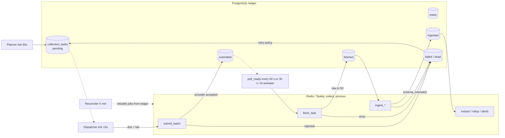

# 21. Scheduler and Workers

Status: Draft for architecture freeze
Last updated: 2026-09-30
Related: [03-system-architecture.md](03-system-architecture.md) sections 5 to 7, [04-data-model.md](04-data-model.md) section 11.2, [05-provider-integrations.md](05-provider-integrations.md), [06-dataforseo-seo-integration.md](06-dataforseo-seo-integration.md), [07-dataforseo-ai-integration.md](07-dataforseo-ai-integration.md), [ADR-022](adr/ADR-022-python-backend-simplified-platform.md)

## 1. Principles

1. **PostgreSQL is the ledger, Redis is the transport.** Every unit of paid work is a row in `ops.collection_tasks` before anything is sent to a provider. Taskiq messages carry task ids, not state. If Redis is wiped, a reconciliation sweep rebuilds all in-flight work from PostgreSQL.
2. **Plan once, submit in batches, fetch on poll.** The planner creates tasks for a whole run in one transaction. A dispatcher submits due tasks in provider-sized batches. Readiness is polling only (section 8.1): `tasks_ready` every 60 s, 30 s while a collection window is open, plus the id sweeper.
3. **Idempotent everywhere.** Planning, submission, fetch, ingest, and rollups can each run twice without double cost or duplicate rows.
4. **Spend is checked before it happens.** Every run gets a cost estimate and a budget check before its first task is submitted.
5. **Two queues.** `collect` (provider calls) and `process` (ingest, extraction, analytics, maintenance) are split by resource profile and consumed by one worker process. Priority is applied by the dispatcher's enqueue order. See [03-system-architecture.md](03-system-architecture.md) section 6.

## 2. Workloads and default cadences

| Workload | Subject | Default cadence | Default window (project local time) | Provider mode |
|---|---|---|---|---|
| `seo_rank` | tracked keyword | daily (depth per profile), deep check on `deep_check_weekday` | 02:00, 6 hours | standard queue |
| `ai_prompt` | prompt version x engine x location x replicate | weekly on the project's AI weekday | 01:00, 8 hours | standard queue |
| `ai_mode_keyword` | tracked keyword (opt-in groups) | weekly | 01:00, 8 hours | standard queue |
| `keyword_metrics` | keyword x location x language | monthly on the 20th, plus on creation | 03:00, 2 hours | live (Labs) |
| `discovery` | seed set (`subject_type = 'seed_set'`) | monthly, or manual | 04:00, 4 hours | live |
| `gsc_sync` | integration | daily | 09:00 America/Los_Angeles, 4 hours ([18](18-first-party-integrations.md) section 13) | API |
| `bing_sync` | integration | daily | 07:00 UTC, 4 hours (doc 18 section 13) | API |
| `ga4_sync` | integration | daily | 06:00 GA4 property timezone, 6 hours (doc 18 section 13) | API |
| `cloudflare_sync` | integration | `cron` `15 */6 * * *` UTC, 1 hour (doc 18 section 13) | per cron | API |
| `ai_benchmark` | prompt x official API engine | weekly (optional, Phase 14) | 03:00, 6 hours | live |

High-priority schedules (for example priority-1 keywords daily at `priority_queue`) are just schedules with `priority = 'high'` and `provider_mode = 'priority_queue'`.

## 3. Planner

The worker process runs a **planner tick every 60 seconds**, holding a Redis lock (`lock:planner`, 55 s TTL) so only one planner runs even when a second `worker` container is running (scaling step 3, [28](28-data-growth-scaling.md) section 7). There is no scheduler container (ADR-022). Each completed tick pings the planner Healthchecks.io check.

### 3.1 Algorithm

```
for schedule in SELECT ... FROM ops.schedules
                WHERE is_active AND next_run_at <= now()
                ORDER BY next_run_at LIMIT 50
                FOR UPDATE SKIP LOCKED:

    window_start = schedule.next_run_at
    window_end   = window_start + schedule.window_hours

    BEGIN
      run = INSERT INTO ops.collection_runs (schedule_id, window_start, ...)
            ON CONFLICT (schedule_id, window_start) WHERE trigger = 'schedule'
            DO NOTHING RETURNING id
      if run is null: move the schedule on and skip (already planned)

      subjects = resolve_selector(schedule)          -- keywords or prompt versions in scope, active only
      tasks    = expand(subjects, schedule)          -- engines x locations x replicates; depth per profile
      estimate = Σ adapter.estimate_cost(task)       -- price book
      if budget_exceeded(project, workload, estimate): run.status = 'budget_blocked'; notify; COMMIT; continue

      INSERT INTO ops.collection_tasks (...) SELECT ... FROM unnest(...)   -- one statement, batched 5,000 rows
        ON CONFLICT (idempotency_key, created_at) DO NOTHING
      UPDATE ops.collection_runs SET status='running', tasks_total=..., estimated_cost_usd=estimate
      UPDATE ops.schedules SET next_run_at = next_occurrence(schedule), last_run_id = run.id
    COMMIT
```

- `next_occurrence` computes the next window start in the schedule's timezone (DST-safe, using the standard library `zoneinfo`).
- Each schedule is planned in its own transaction, so one schedule that cannot be planned is logged, left as it was and tried again on the next tick, and the others go on. The budget check takes a turn per workspace (an advisory lock held to the end of the transaction); a schedule that does not get the turn within the lock timeout is left for the next tick, with the rest of its workspace.
- Only schedules whose workload is registered with this worker and whose cadence has a rule (`daily`, `weekly`, `monthly`) are looked at. A schedule that names a project of another workspace than its own is never planned.
- A schedule whose project is not collecting (paused, archived, deleted, or in a workspace that is not active) lets its windows pass: `next_run_at` moves on and no run is recorded, so nothing is spent and the schedule is at its next window when the project collects again.
- If the worker was down and several occurrences were missed, only the **most recent** missed occurrence is planned (no catch-up storm); earlier ones are recorded as `ops.collection_runs` with status `cancelled` and reason `missed_window`, so gaps are visible. At most the 60 most recent missed windows of a schedule are recorded in one tick.

### 3.2 Selector resolution

| Workload | Selector JSON | Resolves to |
|---|---|---|
| `seo_rank` | `{"all": true}` or `{"groups": [...], "terms": [...], "priority_lte": 2}` | active tracked keywords of the project matching filters and whose depth profile has a check today |
| `ai_prompt` | `{"panels": ["core"], "engines": [...], "priority_subset": "panel:priority"}` | current prompt version of each active prompt that is a member of the panels now |
| `ai_mode_keyword` | `{"groups": [...]}` | tracked keywords in groups |
| `keyword_metrics` | `{"stale_days": 25}` | keywords whose latest metrics snapshot is older than 25 days |

### 3.3 Staggering

Tasks are spread across the window so provider load, our ingest load, and database writes are smooth:

```
offset_seconds(task) = hash32(subject_id || workload) mod (window_hours * 3600 * 0.8)
scheduled_for        = window_start + offset_seconds + replicate_offset
replicate_offset     = (replicate_index - 1) * spacing               (AI only)
spacing              = min(20 minutes, stagger span / replicates)
```

With replicates, the first offset is taken modulo the stagger span less the room the later replicates need, so the last replicate of a subject is still due inside the first 80% of the window. In a window too short to hold the replicates 20 minutes apart they move closer together.

- Using a stable hash of the subject means **a keyword is checked at about the same local time every day**, which removes time-of-day variation from its rank history.
- The last 20% of the window is kept free for retries.

### 3.4 Idempotency keys

```
idempotency_key = sha256( run_id | subject_type | subject_id | engine_code | location_id | replicate_index | depth )
created_at      = date_trunc('month', run.window_start)   -- places a run's tasks in one partition
```

Each field is written with its length in front (`7:seo_abc`) and a missing field as `-`, so a subject id that contains the separator stays one field and no engine is not the same as an empty engine code.

Because `ops.collection_tasks` is partitioned by `created_at` and unique constraints on partitioned tables must include the partition key, the planner sets `created_at` deterministically from the run's window. A second planning attempt for the same run produces the same keys in the same partition and inserts nothing.

## 4. Dispatcher

A **dispatcher tick every 15 seconds** (in the worker process, under lock `lock:dispatcher`) moves due tasks into the `collect` queue:

```sql
SELECT t.id, t.created_at, t.provider_code, t.provider_endpoint, t.project_id
FROM ops.collection_tasks t JOIN ops.collection_runs r ON r.id = t.run_id
WHERE t.status = 'pending' AND t.dispatched_at IS NULL AND t.scheduled_for <= now()
  AND (t.next_attempt_at IS NULL OR t.next_attempt_at <= now())
  AND r.status = 'running'                       -- a cancelled run sends nothing more
  AND t.provider_code <> ALL (:paused_providers)
  AND (t.project_id, t.workload) NOT IN (:scopes_a_budget_holds_back)
ORDER BY t.scheduled_for
LIMIT 2000                                       -- shared out across projects, see below
FOR UPDATE OF t SKIP LOCKED;
```

- **Budget first.** Before it claims anything, the tick lists the projects and workloads that have a task due and checks the budget of each (the month's spend is read once per tick). Work whose budget is used up is left out of the claim, so it stays `pending`, takes nobody's share of the tick, and does not keep the same project's other workloads from being reached. The running runs of a held scope carry `status_reason = 'budget_exceeded'` and the budget's id for as long as the hold lasts.
- Tasks are grouped by `(provider_code, provider_endpoint, priority)` into batches of the provider's `maxTasksPerSubmit` (100 for DataForSEO task endpoints, 1 for live). Priority is `high` for a manual run (someone is waiting), `low` for a backfill, and otherwise the schedule's (`standard` when there is none).
- **Priority:** batches are enqueued in priority order (high, then standard, then discovery and backfills), so high-priority work reaches the head of `collect` first. The dispatcher is the only producer of provider jobs, so this order is the priority mechanism; the broker needs no priority support.
- **Fairness across projects:** each project with due work gets an equal share of the tick's 2,000, and what is left over goes to the projects that have more, up to 500 per project. A large project whose tasks are the oldest cannot take the whole tick from a small one. Taskiq has no group fairness; this SQL-side sharing gives us the property.
- Each batch becomes one `submit_batch` Taskiq message with dedupe key `submit:` + sha256(sorted task ids) (section 5.2). The budget check against `ops.budgets` runs before the message is sent.
- Tasks stay in `status = 'pending'` with `dispatched_at` set, so they are not selected again unless the job fails or the reconciler clears a stale `dispatched_at`.

Why a dispatcher rather than 10,000 delayed queue messages: delayed messages work, but they put the schedule in Redis. With the dispatcher, the schedule stays in PostgreSQL where it is queryable ("what will run in the next hour"), survives Redis loss, and can be rescheduled with one UPDATE.

## 5. Queues and jobs

### 5.1 Taskiq settings

The queue is Taskiq with the Redis stream broker (ADR-022). A Taskiq broker is bound to one queue, so the worker's own entrypoint (`python -m sightline.worker`) starts two receivers in one asyncio process, one per broker, through `taskiq.api.run_receiver_task`, together with the planner and dispatcher ticks and Taskiq's scheduler (`run_scheduler_task`).

| Setting | Value | Why |
|---|---|---|
| Broker | `RedisStreamBroker` from `taskiq-redis` on `redis:8`: one stream and one consumer group per queue, messages acknowledged after the task finishes | The list broker has no acknowledgement and drops a message when a worker dies mid-task; streams redeliver it |
| Queues | `collect` and `process`, one broker each, both received by the one `worker` process | provider I/O and CPU work stay apart without a second container |
| Delivery | at least once: a message can run twice after a crash, so every task is idempotent through its dedupe key and the ledger state it checks first | the ledger decides whether work is still due |
| Concurrency | `collect` 8, `process` 4 (maximum concurrent tasks per queue, set by `COLLECT_CONCURRENCY` and `PROCESS_CONCURRENCY`, doc 22 section 4.4) | `collect` mostly waits on HTTP; `process` parses, extracts and rolls up |
| Rate limit | shared DataForSEO limiter across all `collect` tasks (section 7) | 50% of the account limit |
| Retries | none at the broker: no retry middleware on any task | retries are driven by the ledger (section 6), which knows whether the provider accepted a task |
| Result backend | none | outcomes are recorded in `ops.collection_tasks`, `ops.collection_runs` and cost events |
| Messages | task ids and small keys only, validated with Pydantic models on enqueue and on receipt | state stays in PostgreSQL |
| Dedupe | a Redis key per message (section 5.2), set with `SET NX` before enqueue | replaces broker-level job ids |
| Scheduler | Taskiq's scheduler runs the maintenance cron jobs (section 10) inside the worker, under `lock:taskiq-scheduler` | no scheduler container; a second worker container does not double-fire |
| Lost messages | a message held by a worker that crashed is redelivered by the stream after its idle timeout; a message lost with Redis itself is re-enqueued by the reconciler from the ledger (section 8.2) | nothing lives only in Redis |

No broker retries is deliberate for provider jobs. A blind retry of a `submit_batch` after a timeout could double-submit paid tasks. Retries for provider work are driven by task state in PostgreSQL (section 6), which knows whether the provider accepted the task.

Phase 1 smoke test for Taskiq: two queues in one process at the stated concurrency, graceful shutdown within `stop_grace_period`, scheduled maintenance jobs firing once under the lock, delayed one-off jobs, and reconnection after a Redis restart. If the single-process entrypoint fails it, the first fallback needs no code change: run `worker-collect`, `worker-process` and `scheduler` as three Compose services from the same image with the stock `taskiq worker` and `taskiq scheduler` commands (about 250 MB more RAM). If Taskiq itself fails, the fallback is Celery (ADR-022).

### 5.2 Job catalog

| Queue | Job | Payload | Dedupe key | Notes |
|---|---|---|---|---|
| `collect` | `submit_batch` | `{task_ids, endpoint, priority}` | `submit:<hash>` | shared limiter |
| `collect` | `poll_ready` | `{endpoint}` | `poll:<endpoint>` (TTL 25 s) | enqueued by the tick every 60 s, every 30 s while a collection window is open (section 8.1) |
| `collect` | `fetch_task` | `{provider_task_id, endpoint, task_id}` | `fetch:<provider_task_id>` | |
| `collect` | `live_call` | `{task_id}` | `live:<task_id>` | up to 120 s |
| `collect` | `benchmark_call`, `classify_batch` | `{task_id}` / `{item_ids}` | `bench:<task_id>` / `cls:<hash>` | per-provider token bucket |
| `collect` | `gsc_sync`, `bing_sync`, `ga4_sync`, `cloudflare_sync`, `gsc_backfill_plan` | `{integration_id, date_from, date_to, shape}` | `<kind>:<integration>:<date>:<shape>` | per-integration quotas (first-party integrations) |
| `process` | `ingest_serp`, `ingest_ai`, `ingest_keyword_metrics`, and the first-party ingest jobs of doc 18 section 3.3 (`ingest_gsc_day`, `ingest_bing`, `ingest_ga4`, `ingest_cloudflare`, `ingest_file_import`, `ingest_log_batch`) | `{task_id, raw_payload_id}` | `ingest:<task_id>` | |
| `process` | `extract_observation` | `{observation_id, observed_at, project_id, derivation_id}` | `ext:<obs_id>:<derivation_id>` | |
| `process` | `rederive_range` | `{project_id, from, to, derivation_id}` | `rederive:<project>:<derivation>:<from>` | |
| `process` | `rollup_seo_day`, `rollup_ai_day` | `{project_id, date}` | `rollup:<kind>:<project>:<date>` (TTL 300 s) | debounced: the first producer in a 5 minute window schedules the job 5 minutes out; later producers find the key and skip. One rollup per project runs at a time (`lock:rollup:<project>`) |
| `process` | `refresh_state` | `{tracked_keyword_id}` | `state:<id>` | |
| `process` | `evaluate_alerts` | `{project_id}` | `alerts:<project>` (TTL 600 s) | debounced 10 min |
| `process` | `cost_rollup` | `{date}` | Taskiq scheduler, hourly | |
| `process` | maintenance (section 10) | | Taskiq scheduler | |

Dedupe keys live under the `dedupe:` prefix. The producer sets `dedupe:<key>` with `SET NX` and a TTL (1 hour unless the table says otherwise) and sends the message only if the key was new; the handler deletes the key when it finishes. Handlers are idempotent regardless: each one reads the ledger row first and exits if the work is already done, so a duplicate that slips through costs nothing. All payloads are validated with Pydantic models from the `worker` package on enqueue and on processing.

### 5.3 Queue lifecycle



## 6. Retries, backoff, dead letters

Retry policy is decided by the error kind returned from the adapter ([05-provider-integrations.md](05-provider-integrations.md) section 3.3):

| Kind | Retry? | Backoff | Max attempts | On exhaustion |
|---|---|---|---|---|
| `rate_limited` | yes | 30 s x 2^n + jitter (cap 15 min); limiter halved for 10 min | 6 | `failed`, alert |
| `concurrency` | yes | 5 s + jitter | 10 | `failed` |
| `upstream_unavailable`, `provider_error`, `timeout` | yes | 60 s x 2^n + jitter (cap 30 min) | 4 | `dead`, alert if > 1% of run |
| `not_found_expired` | resubmit as new provider task if window open | none | 1 | `dead` |
| `invalid_request` | no | | | `failed`, task config flagged |
| `auth`, `payment`, `account_limit` | no | | | provider paused for workspace/platform; admins alerted; tasks stay `pending` until resumed |
| `schema_mismatch` (normalize) | no fetch retry; re-ingest after parser fix | | | `failed` with raw kept; parser owners alerted |
| `empty_result` | not an error | | | `ingested` with status `empty` |

- **How attempts are counted.** `attempts` is one number per task: every try that counted, whatever it failed with. A kind's "max attempts" is the number of tries after which a task that fails with that kind is ended, not a count of failures of that kind. A task that waited on `concurrency` four times and then hits a `timeout` is `dead` at once. `auth`, `payment` and `account_limit` do not count: a paused provider is not the task's failure.
- **Backoff.** In `2^n`, n is the number of earlier tries, so the first wait is the base: 30, 60, 120, 240, 480 seconds for `rate_limited` and 60, 120, 240 seconds for provider trouble. With these limits no wait reaches its cap; the caps are the bound that holds if a limit is raised. Jitter adds up to 20%. When the provider names a wait (`retry_after_ms`), the task waits at least that long, up to the cap.
- Retry state lives in `ops.collection_tasks` (`attempts`, `next_attempt_at`, `last_error_*`). A retry puts the task back to `pending` with `next_attempt_at`; the dispatcher picks it up. A retried SERP task submits a **new** provider task (new provider id), and the old one is recorded in `ops.task_attempts` for cost reconciliation.
- **Submit outcome unknown.** If a `submit_batch` call times out or the connection drops after the request was sent, the provider may have accepted (and charged for) the tasks. The tasks move to `submit_unknown`, never straight back to `pending`. The reconciler resolves them: it lists recently created provider tasks (DataForSEO `id_list` for the endpoint and time range, 10 calls per minute, or `tasks_ready` once they complete) and matches them by our `tag`. Matches become `submitted` with their provider task id; tasks still unmatched after 15 minutes return to `pending` for a new submission. Spike S-01 verifies that `id_list` returns the `tag` (if not, matching uses keyword, location, device and submission time). This rule is what makes provider submission at-most-once in practice.
- **Dead letters** are tasks in status `dead`. They are listed in the Operations screen with error, attempts and raw error body, and can be requeued manually (`POST /v1/workspaces/{workspace_id}/tasks/{task_id}/requeue`, or in bulk `POST /v1/workspaces/{workspace_id}/tasks/requeue`; permission `tasks:requeue`; doc 19 section 3.11.4). The route is under the workspace path so the tenancy rule of doc 24 section 4 holds.
- A run finishes when all its tasks are terminal (`ingested`, `failed`, `dead`, `cancelled`, `skipped_cached`). Status is `completed` if the tasks that collected nothing (failed, dead and cancelled) are under 2% of tasks, otherwise `completed_with_errors`. A run that was started with no tasks, because its schedule selected nothing, completes on the next sweep.
- A task left `submit_unknown` (the process died mid-call, or the answer was lost) keeps its run open. Until the provider can be asked which tasks it has, such a task ends as `dead` with `submission_never_confirmed` once the provider's results would have expired (72 hours; 76 for LLM Responses).
- The pending tasks of a run that is cancelled are not sent: the dispatcher and the submit handler both check that the run is still `running`, and the reconciler cancels what is left with `run_ended`.

## 7. Provider rate limiting and concurrency

| Mechanism | Scope | Implementation |
|---|---|---|
| Shared DataForSEO limiter | all DataForSEO calls from `collect` tasks: max 1,000 per 60 s | Redis Lua token bucket (`rl:` prefix) in the `worker` package, taken before every call |
| Token bucket per endpoint family | for endpoints with their own limits (`tasks_ready` 20/min, `user_data` 6/min, `errors` 10/min, Google Ads live 12/min) | same Redis Lua token bucket, one key per endpoint family |
| Concurrency caps | LLM Responses and Labs: 30 simultaneous at the provider (verified) | `collect` concurrency is 8 in total, far below |
| Dynamic backoff | on `rate_limited`, halve limiter for 10 min | limiter override key in Redis |
| Per-integration quotas | GSC: 1,200 QPM per site and per user, 30M/day per project; GA4: 14,000 tokens/hour per project per property (verified, see doc 18) | token buckets keyed by Google user, site, property |

## 8. Readiness and reconciliation (Redis loss and stuck work)

### 8.1 Readiness: polling only

There is no pingback endpoint (ADR-022). A submitted task becomes ready through one of two paths:

1. **`tasks_ready` poll.** The tick enqueues `poll_ready` per endpoint every 60 seconds, and every 30 seconds while any collection window is open. The job calls `tasks_ready` (20 calls per minute at the provider, within the endpoint bucket of section 7) and enqueues `fetch_task` for each ready id.
2. **Id sweeper.** Tasks older than the window (still `submitted` 2 hours after submission) are fetched directly by provider task id with `task_get` ([06](06-dataforseo-seo-integration.md) section 4.2). This covers anything `tasks_ready` did not list. It runs as reconciler step 2 below.

### 8.2 Reconciler

The worker runs a **reconciler every 5 minutes** (a Taskiq scheduled job on `process`, section 10):

1. Tasks `pending` with `dispatched_at` older than 10 minutes and no live dedupe key: clear `dispatched_at` (the dispatcher will pick them up).
2. Tasks `submitted` older than 2 hours: enqueue `fetch_task` directly (the id sweeper of section 8.1).
3. Tasks `submitted` older than 72 hours (76 hours for DataForSEO LLM Responses standard tasks, which the provider documents as taking up to 72 hours): mark `dead`.
4. Tasks `fetched` older than 10 minutes with no ingest message: enqueue `ingest_*`.
5. Observations with no current facts for the project's current derivation (after 15 minutes): enqueue `extract_observation`.
6. Dates with ingested data newer than the rollup's `computed_at`: enqueue rollups.

After a full Redis loss, steps 1 to 6 restore all in-flight work within one reconciler cycle, with no duplicate provider spend: tasks already accepted by the provider have `provider_task_id` and are fetched, not resubmitted.

## 9. Freshness and staleness

| Condition | Flag | Surface |
|---|---|---|
| Tracked keyword with no successful check for 36 hours (daily profile) or 9 days (weekly) | `tracked_keyword_state.is_stale = true` | Rank tracker shows stale badge; ops alert if > 5% of project keywords stale |
| Prompt-engine pair with no valid observation in 9 days (weekly cadence) | stale in prompt state view | Prompt Explorer badge; ops alert if > 5% |
| Schedule whose `next_run_at` is more than 1 hour in the past | `failed_schedule` | ops alert (planner stuck) |
| Run in `running` beyond `window_end + 6h` | `overdue_run` | ops alert |

## 10. Maintenance jobs (Taskiq scheduler)

All jobs below run on the `process` queue, scheduled by Taskiq's scheduler inside the worker under `lock:taskiq-scheduler`. The daily jobs ping one shared `maintenance` Healthchecks.io check on success and `ops_health` pings its own (ADR-022), so a job that stops running is reported by the missing ping.

| Job | Schedule (UTC) | Action |
|---|---|---|
| `reconcile` | every 5 min | section 8.2 |
| `ensure_partitions` | daily 00:10 | `SELECT ops.maintain_partitions()`: every table in `ops.partitioned_tables`, 3 months ahead ([04-data-model.md](04-data-model.md) section 12.2) |
| `retention_drop` | daily 00:30 | drop expired partitions per retention table ([04-data-model.md](04-data-model.md) section 12.1); prune non-current derivations older than 90 days |
| `raw_retention` | daily 01:00 | delete R2 objects whose `ops.raw_payloads.expires_at` passed (batched, 1,000 per call) |
| `cost_reconcile` | daily 00:45 | provider daily spend vs our cost events ([06-dataforseo-seo-integration.md](06-dataforseo-seo-integration.md) section 6.1) |
| `balance_check` | every 15 min | `appendix/user_data`; alert when balance < 14 days of trailing spend |
| `price_book_drift` | monthly, 1st 02:00 | actual vs price book deviation check |
| `location_sync` | monthly, 2nd 03:00 | provider location lists |
| `analyze_hot_partitions` | daily 04:00 | `ANALYZE` current month partitions of hot tables |
| `refresh_domain_roles` | on change + nightly | `REFRESH MATERIALIZED VIEW CONCURRENTLY core.project_domain_roles` |
| `ops_health` | every 5 min | disk, queue depths (lengths of `collect` and `process`), stale ratios, collection window overruns; emits alerts ([25-observability.md](25-observability.md)) |
| `ops_health_hourly` | hourly | spend anomaly, provider error rates, reconciliation drift, cost vs budget ([25-observability.md](25-observability.md)) |
| `dq_daily` | daily 05:00 | data quality monitors and flags ([26-testing-quality.md](26-testing-quality.md) section 9) |
| `r2_config_audit` | monthly, 1st 03:30 | compare live R2 lifecycle rules with `infra/r2/*.json`; alert on drift ([23-backup-disaster-recovery.md](23-backup-disaster-recovery.md)) |
| `bot_ip_refresh`, `logs_sync`, `match_gsc_queries`, `gsc_property_hourly` prune | per [18-first-party-integrations.md](18-first-party-integrations.md) section 13 | first-party platform jobs (daily 04:00, every 15 min, nightly after `gsc_sync`, daily) |

## 11. Manual and on-demand runs

- **Check now (keyword):** creates a run with `trigger = 'manual'` and one task in `live` mode (DataForSEO live endpoint). Counts against the project's daily manual-run limit and budget ([24-security.md](24-security.md) section 8). Result typically in under 10 seconds; the API returns a run id and the UI polls the run.
- **Run prompt now:** same pattern with AI live endpoints (up to 120 s); the UI shows progress.
- **Backfill:** `trigger = 'backfill'` for historical re-ingest from R2 or for a new competitor's historical ranks (no provider cost: re-derivation from stored snapshots, since `organic_domain_ids` contains all domains for depth-checked SERPs).

## 12. Process lifecycle

- The worker is one process. On `SIGTERM` it stops taking messages from `collect` and `process`, stops the planner and dispatcher ticks and the Taskiq scheduler, waits for in-flight tasks, releases its locks and exits. `stop_grace_period` is 150 s because `live_call` tasks take up to 120 s (doc 22 section 4.1).
- A deploy restarts the worker once, together with `api` and before `web` (doc 22 section 8.3). Messages wait in Redis during the restart. A task interrupted by a crash or an OOM kill is not relied on to come back from the broker: its ledger row stays in `pending` (dispatched), `submitted` or `fetched`, and the reconciler (section 8.2) re-enqueues it.
- The ticks are stateless between runs (all state in PostgreSQL and Redis locks with TTLs), so restarting the worker is always safe and a killed worker cannot hold a lock for more than its TTL.

## 13. Capacity check (V1 target load)

| Load | Tasks/day | Provider calls/min (avg over window) | Ingest writes |
|---|---|---|---|
| 5,000 keywords daily, standard profile | 5,000 SERP tasks | 50 submits + 5,000 fetches over 6 h: about 14/min | 5,000 snapshots, about 30,000 rank rows, 20,000 feature rows per day |
| 1,000 prompts weekly, V1 default design (about 3.4 tasks per prompt, doc 27 section 4.1) | about 3,400 tasks/week, concentrated in one 8 h window | about 7/min on the weekly run day | about 3,400 observations, about 27,000 citations per week |
| Total peak | | under 100/min, 5% of the DataForSEO account limit | under 50 rows/s sustained |

These rates are low for PostgreSQL on the target droplet; the binding constraint is disk growth, analyzed in [28-data-growth-scaling.md](28-data-growth-scaling.md).
