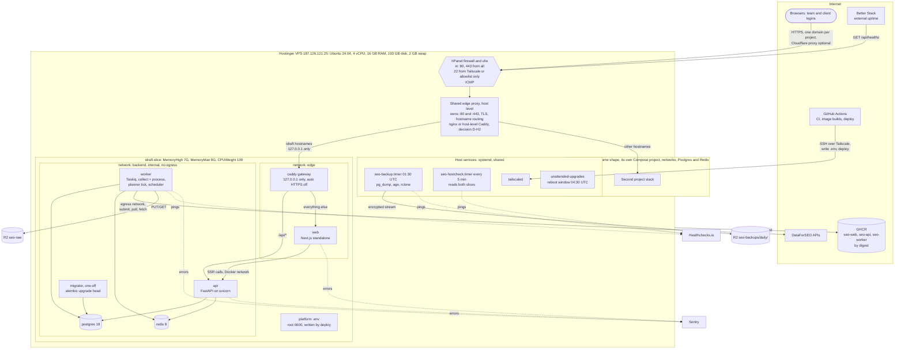
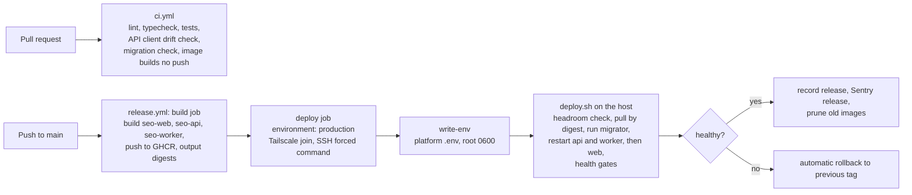

# 22. Infrastructure and DevOps

Status: Draft for architecture freeze (Phase 0)
Last updated: 2026-10-31 (host changed to a shared Hostinger VPS, ADR-023)
Owner: Platform / DevOps
Research basis: [research/08-infra-methodology.md](../research/08-infra-methodology.md) (accessed 2026-09-29)
Related: [03-system-architecture.md](03-system-architecture.md) sections 5, 6, 10; [04-data-model.md](04-data-model.md) sections 11.3, 12, 13; [23-backup-disaster-recovery.md](23-backup-disaster-recovery.md); [24-security.md](24-security.md) sections 5, 9, 11; [25-observability.md](25-observability.md); [28-data-growth-scaling.md](28-data-growth-scaling.md); [ADR-022](adr/ADR-022-python-backend-simplified-platform.md); [ADR-023](adr/ADR-023-shared-hostinger-vps.md); locked diagram [diagrams/architecture-locked.html](diagrams/architecture-locked.html)

This document is the build sheet for the production host. Every config block is meant to be copied into `infra/` and committed. Numbers labelled "(verified 2026-09-29)" come from primary sources recorded in research doc 08. Numbers labelled "estimate" are arithmetic or engineering judgement and must be replaced by measurements from the Phase 0 spikes. Numbers labelled "(measured 2026-10-31)" were read from the live host.

Where the build stands: the live host (Hostinger VPS 187.126.121.25) currently runs idraft under systemd with a hand-built nginx and a Postgres 18 on `127.0.0.1:5433` (the system Postgres 16 on 5432 is not used by idraft). The Docker Compose design in this document is the target. The cutover is planned in `docs/superpowers/plans/2026-10-28-production-runtime.md`. Until then, sections 4 to 8 describe what the cutover builds, and sections 3, 9.5 and 10 hold the budgets that the cutover must respect.

## 1. Scope and fixed decisions

Values in this section are fixed by [ADR-022](adr/ADR-022-python-backend-simplified-platform.md), which amends [ADR-002](adr/ADR-002-single-host-compose.md), and for the host by [ADR-023](adr/ADR-023-shared-hostinger-vps.md). The original plan assumed one DigitalOcean droplet used only by idraft; ADR-023 replaced it because idraft runs on a Hostinger VPS shared with a second project.

| Area | Decision | Notes |
|---|---|---|
| Host | One Hostinger VPS (187.126.121.25) shared with a second project: Ubuntu 24.04, 4 vCPU, 16 GB RAM (15.6 GiB visible), 193 GB disk, 2 GB swap (measured 2026-10-31) | idraft's share is 8 GB RAM (soft limit 7 GB) and fair-share CPU (2 vCPU guaranteed, up to 4 when the neighbour is idle), enforced by `idraft.slice` (section 5.4). Moving idraft to its own 16 GB or 32 GB VPS is a planned scaling step (section 11, runbook 12.4). |
| OS | Ubuntu 24.04 LTS (installed on the host; supported by Docker Engine) | |
| Network edge | Hostinger hPanel firewall (off-host; verify in hPanel that the plan includes it) plus `ufw` on the host (sections 6.1 and 6.4) | Inbound: 80 and 443 from anywhere, SSH restricted, everything else closed. Published container ports bypass `ufw`, so no container publishes on a public address. Cloudflare proxied DNS in front of the edge proxy is optional (static asset caching, DDoS protection) and changes nothing inside the host. |
| Host-level backups | Hostinger snapshots or backups, whatever the plan includes (verify in hPanel), plus a manual snapshot before every risky change | A second, host-level copy, never the only one. The database-aware copy is the nightly dump to R2 (doc 23). |
| Not used | Managed PostgreSQL or Redis, Kubernetes, Vercel, any cloud provider API or CLI | |
| Runtime | Docker Engine + Compose plugin | Containers: `caddy`, `web`, `api`, `worker`, `postgres`, `redis`, plus the one-off `migrator` that runs `alembic upgrade head` during deploy. No scheduler container, no worker split. |
| Edge proxy | One host-level proxy shared by both projects owns ports 80 and 443, terminates TLS and routes by hostname. Implementation is open decision D-H2 in doc 30: today's nginx, or a host-level Caddy | It forwards idraft's hostnames to the gateway below, overwrites `X-Forwarded-For` with the real client address and sets `X-Forwarded-Proto`. It is not part of idraft's Compose project. |
| Application gateway | Caddy 2 (latest 2.11.4, verified 2026-09-29), the `caddy` service, bound to `127.0.0.1` only, automatic HTTPS off | Routes `/api/*` to `api` and everything else to `web`. No CORS, one cookie, no staging API. Official `caddy:2` image pinned by digest. |
| Backend runtime | Python 3.13, FastAPI, Pydantic v2, uvicorn; package manager `uv`. Images `seo-api` and `seo-worker`, built from `backend/` in CI | `api` serves `/api/v1`. `worker` runs Taskiq with the `collect` and `process` queues, the planner tick and Taskiq's scheduler. |
| Web runtime | Next.js with `output: 'standalone'`, one Node process. Image `seo-web`, built from `apps/web` in CI | Server components call `api` over the Docker network. |
| Database | Official `postgres:18` image (18.6 current, verified 2026-09-29) | Volume at `/var/lib/postgresql`, `shm_size: 256mb`. No published port. |
| Queue store | Official `redis:8` image (8.10.2 current, verified 2026-09-29). Valkey 9 (`valkey/valkey:9`, 9.1.2, BSD-3, verified 2026-09-29) is a drop-in alternative | `maxmemory 256mb`, `noeviction`, AOF on (`everysec`), ACL users. No published port. Transport, rate limiter, locks and session cache; nothing lives only in Redis. |
| Domain | One domain, `<domain>`, served by the edge proxy, which forwards it to the gateway. The production domain is `idraft.ai` (decided 2026-10-27): the web app, the API under `/api` and the Google OAuth redirect URIs all use `https://idraft.ai` | The edge proxy owns certificate issuance and renewal (HTTP-01 on port 80 or a DNS challenge). With Cloudflare proxying on, use SSL mode Full (strict) and confirm a certificate renewal succeeds. |
| Object storage | Cloudflare R2: `seo-raw` (raw payloads, zstd JSON) and `seo-backups` (encrypted dumps under `daily/`, 30-day lifecycle rule) | Separate API tokens per bucket. |
| Platform secrets | `/etc/seo-platform/.env`, root-owned, mode 0600, written by the deploy workflow from GitHub Actions environment secrets | No SOPS, no age for secrets (section 7). age is still used to encrypt backups. |
| Monitoring (infra) | Sentry (Python and Next.js SDKs), Healthchecks.io heartbeats, one Better Stack free uptime check, the in-app Operations screen, and a host check timer (section 9) | No Prometheus, Alloy, Grafana or `/metrics`. Application observability is in doc 25. |

Monthly run cost for this document's scope (ADR-023): **H** + R2 about $1 + $0 for Sentry, Healthchecks and Better Stack on free tiers = **H + about $1 per month**. H is idraft's half (50%) of the Hostinger VPS invoice. The owner enters the amount from the invoice; it is not recorded here and the plan's price and included snapshot features are to be verified in hPanel.

## 2. Deployment diagram



Network rules this diagram encodes:

- Only `caddy` publishes a port, and only on `127.0.0.1` (default `127.0.0.1:8088`, set by `GATEWAY_PORT`). Ports 80 and 443 belong to the shared edge proxy, which neither project owns in its Compose file, because a port can be bound once. No container publishes a metrics port. `postgres` and `redis` are attached only to `backend`, which is declared `internal: true`, so they have no route to the internet in either direction.
- Every Compose service runs inside `idraft.slice` (`cgroup_parent`, section 4.1), so the memory cap and CPU weight of section 3.3 cover the whole stack, including one-off `migrator` runs.
- `api` and `worker` are also attached to `egress` (a normal bridge) because they call DataForSEO, R2, Sentry, Healthchecks and the email provider. `api` also sits on `edge` so Caddy and `web` can reach it. `web` sits on `edge` only: it talks to `api` and to Sentry, never to PostgreSQL or Redis.
- SSH reaches the host over Tailscale. The hPanel and `ufw` rules for port 22 are either removed or restricted to a short break-glass allowlist (section 6.1). The second project has its own deploy user and its own Compose project; nothing of idraft's is reachable from it except through the edge proxy.

## 3. Host sizing and resource budget

### 3.1 RAM budget

The host has 4 vCPU and 16 GB RAM (15.6 GiB visible, measured 2026-10-31) and is shared with a second project (ADR-023). idraft's share is **8 GB RAM**, capped by `idraft.slice` (`MemoryHigh=7G`, `MemoryMax=8G`, section 5.4), and the host keeps about 1 GB for the kernel, systemd, sshd, the edge proxy, dockerd and journald. The figures below use the **baseline profile** (`profiles/8gb.env`, section 4.2): the former "8 GB profile". `mem_limit` values are kernel cgroup ceilings, not reservations: they make a runaway process fail inside its own container instead of pushing the slice into swap. The 4 GB profile survives only for laptops and CI.

| Component | Steady RAM | Compose `mem_limit` | Notes |
|---|---|---|---|
| Host reserve, outside the slice: kernel, systemd, journald, sshd, containerd, dockerd, tailscaled, fail2ban, edge proxy | about 1 GB | n/a | shared by both projects; the whole idle host measured 1.06 GB on 2026-10-31 |
| `caddy` (gateway) | 40 MB | 128m | |
| `web` | 150 to 250 MB | 384m | one Node process, heap capped (section 3.2); measured about 170 MB idle |
| `api` | 120 to 200 MB | 384m | one uvicorn process; measured about 165 MB idle |
| `worker` | 150 to 300 MB | 768m | `collect` 8 plus `process` 4 concurrent tasks; payload parsing is the peak |
| `postgres` | 2.3 to 2.8 GB | 3000m | `shared_buffers = 2GB` plus backends and autovacuum (section 4.2); a burst can reach the limit |
| `redis` | 100 to 256 MB | 512m | `maxmemory 256mb`; the limit leaves room for the AOF rewrite fork |
| `migrator` (during deploy only) | short-lived | 256m | exits after `alembic upgrade head` |
| **Total steady in the slice** | **about 2.9 to 3.8 GB** (2,860 to 3,846 MB) | | arithmetic: 40 + 150 + 120 + 150 + 2,300 + 100 = 2,860 MB low; 40 + 250 + 200 + 300 + 2,800 + 256 = 3,846 MB high |
| **Sum of `mem_limit` values** | **5,176 MB** (5,432 MB while `migrator` runs) | | 128 + 384 + 384 + 768 + 3,000 + 512; leaves about 1.6 to 1.8 GB under `MemoryHigh` for page cache of logs and volumes, tmpfs and runtime overhead |
| Slice limits | `MemoryHigh` 7 GB, `MemoryMax` 8 GB | | steady use is about 41 to 54% of `MemoryHigh` (2.9 / 7 and 3.8 / 7) |
| Swap file | 2 GB, `vm.swappiness=10` | | shared by both projects; a safety net only (section 5.2) |

Page cache is charged to the container that causes it, so PostgreSQL's file cache lives inside its 3000m limit together with `shared_buffers`. The memory the kernel can use as cache for the database is therefore about 3,000 minus 2,048 minus backend memory, not the 5 GB that `effective_cache_size` states (a planner hint only; listed in section 13).

Alert on the slice at 70% of 8 GB (5.6 GB) for a week, or swap in steady use, and treat either as a trigger to move to a dedicated VPS (scaling step 1, section 11).

### 3.2 Memory-related container settings

- `oom_score_adj`: `postgres` -500, `redis` -300, `caddy` -200, `api` 0, `web` 100, `worker` 300. If `idraft.slice` reaches `MemoryMax`, the kernel kills inside the slice, the worker first (whose interrupted work the reconciler recovers from the ledger) and the database last. If the whole host runs out of memory, the same scores apply across both projects, so `postgres` is still the last to go.
- `web` is the only Node process: `NODE_OPTIONS=--max-old-space-size=256` keeps V8 garbage collection ahead of its 384m limit.
- There is no other per-process heap or CPU tuning. PostgreSQL memory is set in `postgresql.conf` (section 4.2) and Redis memory in `redis.conf` (section 4.3).

### 3.3 Shares of the host, CPU fair share and the neighbour

| Slice | `MemoryHigh` (soft) | `MemoryMax` (hard) | `CPUWeight` | CPU under contention | CPU when the neighbour is idle |
|---|---|---|---|---|---|
| `idraft.slice` | 7G | 8G | 100 | 2 vCPU (100 of 200 weight on 4 vCPU) | up to all 4 vCPU |
| Second project slice (proposed; its owner sets the values) | 6G | 6.5G | 100 | 2 vCPU | up to all 4 vCPU |
| Host reserve (system services, edge proxy) | none | none | default (100 in `system.slice`) | small | |
| Swap | | | | 2 GB file, shared, `swappiness=10` | |

Hard limits add up to 8 + 6.5 + 1 reserve = 15.5 GB of the 15.6 GiB visible, so the two hard caps cannot together exceed the machine. There is no `CPUQuota`: a hard CPU cap would waste the idle half (ADR-023). `CPUWeight` only decides who wins when both slices want more than their share. Memory is capped hard because memory pressure takes both projects down; CPU is shared by weight.

**What happens when the neighbour misbehaves**

| Neighbour behaviour | Effect on idraft | Protection | Response |
|---|---|---|---|
| Memory leak inside its own slice | none beyond its own OOM kills at its `MemoryMax` | slice caps | none for idraft |
| Memory use outside any slice (a host-level process, a runaway cron job) | host `MemAvailable` falls, page cache shrinks, swap fills, both projects slow down; the OOM killer may fire host-wide | `oom_score_adj` keeps `postgres` last | alert on host `MemAvailable` (section 9.4), runbook 12.9 |
| CPU spin or fork storm | idraft keeps its 2 guaranteed vCPU through `CPUWeight`; latency rises when both slices are busy | `CPUWeight=100` | runbook 12.9: `systemctl set-property` on the neighbour's slice |
| Disk fill | not isolated: `postgres` and Redis fail at the first write error | host disk alerts at 70% and 85% (section 9.4), ballast file, idraft budget of 90 GB (section 9.5) | runbook 12.6 and 12.9 |
| Disk I/O saturation | slower queries and fsyncs | not isolated in V1 (`IOWeight` helps only with an I/O scheduler that supports it; not set) | measure first, runbook 12.9 |
| Firewall or SSH change that locks out the host or opens ports | an idraft incident | rules documented in section 6, per-project deploy users | restore from the recorded rule set; hPanel console as last resort |
| Reboot or Docker daemon restart | both stacks restart | `live-restore` keeps containers running across `dockerd` restarts | the maintenance window is agreed with the neighbour (section 6.3) |

## 4. Service configuration

### 4.1 docker-compose.yml

File: `infra/compose/docker-compose.yml`. The deploy script (section 8.3) runs Compose as root with three env files: `/etc/seo-platform/.env` (platform secrets, section 7), `/opt/seo-platform/release.env` (the three image digests and `RELEASE_SHA`) and `infra/compose/profiles/<size>.env` (sizing values). Compose uses them only for interpolation: each service receives exactly the keys its `environment:` block names. Sizing values default to the baseline profile (`profiles/8gb.env`, the 8 GB share of ADR-023); `profiles/4gb.env` exists for laptops and CI only and also sets `PG_CONF=postgresql.4gb.conf`. Every service sets `cgroup_parent: idraft.slice` (defined in section 5.4), which puts the whole stack under the memory cap and CPU weight of section 3.3. This needs Docker's systemd cgroup driver, the default on Ubuntu 24.04 with cgroup v2 (check with `docker info | grep -i cgroup`). A move to a dedicated VPS (runbook 12.4) keeps the same Compose file and slice, or drops `cgroup_parent` there if no neighbour exists.

```yaml
name: seo

x-logging: &logging
  driver: json-file
  options:
    max-size: "10m"
    max-file: "5"
    compress: "true"

x-logging-app: &logging-app
  driver: json-file
  options:
    max-size: "50m"
    max-file: "8"
    compress: "true"

x-app: &app
  restart: unless-stopped
  cgroup_parent: idraft.slice       # memory cap and CPU weight of the shared host (section 5.4)
  init: true
  user: "10001:10001"
  read_only: true
  tmpfs:
    - /tmp:size=256m,mode=1777
  cap_drop: [ALL]
  security_opt: ["no-new-privileges:true"]
  pids_limit: 512
  env_file:
    - ./config/app.env            # non-secret settings, committed to git
  logging: *logging-app

x-backend-deps: &backend-deps
  postgres: { condition: service_healthy }
  redis: { condition: service_healthy }

services:
  caddy:
    image: caddy:2@sha256:${CADDY_DIGEST:?}
    container_name: seo-caddy
    restart: unless-stopped
    cgroup_parent: idraft.slice
    ports:
      # Application gateway on loopback only. The shared host-level edge proxy owns 80 and 443
      # and forwards idraft's hostnames here (ADR-023). Never bind this to 0.0.0.0.
      - "127.0.0.1:${GATEWAY_PORT:-8088}:80"
    environment:
      DOMAIN: ${DOMAIN:?}
    volumes:
      - ./Caddyfile:/etc/caddy/Caddyfile:ro
      - caddy_data:/data
      - caddy_config:/config
    cap_drop: [ALL]
    cap_add: [NET_BIND_SERVICE]
    security_opt: ["no-new-privileges:true"]
    mem_limit: ${CADDY_MEM:-128m}
    oom_score_adj: -200
    ulimits: { nofile: { soft: 65536, hard: 65536 } }
    networks:
      edge:
        ipv4_address: 172.30.20.10
    logging: *logging

  web:
    <<: *app
    image: ${WEB_IMAGE:?set WEB_IMAGE to ghcr.io/<org>/seo-web@sha256:<digest>}
    container_name: seo-web
    command: ["node", "server.js"]
    tmpfs:
      - /tmp:size=256m,mode=1777
      - /app/.next/cache:size=128m,uid=10001,gid=10001
    environment:
      RELEASE_SHA: ${RELEASE_SHA:?}
      NODE_ENV: production
      PORT: "3000"
      HOSTNAME: "0.0.0.0"
      API_INTERNAL_URL: http://api:8000/api/v1
      NODE_OPTIONS: "--max-old-space-size=${WEB_HEAP_MB:-256}"
      SENTRY_DSN: ${SENTRY_DSN_WEB:?}
    depends_on:
      api: { condition: service_healthy }
    healthcheck:
      # /web-healthz is a route handler that returns 200 without calling the API
      test: ["CMD", "node", "-e", "fetch('http://127.0.0.1:3000/web-healthz').then(r => process.exit(r.ok ? 0 : 1)).catch(() => process.exit(1))"]
      interval: 15s
      timeout: 3s
      retries: 3
      start_period: 20s
    stop_grace_period: 20s
    mem_limit: ${WEB_MEM:-384m}
    oom_score_adj: 100
    networks:
      edge:
        ipv4_address: 172.30.20.11

  api:
    <<: *app
    image: ${API_IMAGE:?set API_IMAGE to ghcr.io/<org>/seo-api@sha256:<digest>}
    container_name: seo-api
    command:
      - uvicorn
      - idraft.api.main:create_app
      - --factory                    # settings are read when the app is built, never at import
      - --no-access-log              # the API writes its own request line with the route template
      - --no-server-header
      - --host=0.0.0.0
      - --port=8000
      - --proxy-headers
      - --forwarded-allow-ips=172.30.20.10,172.30.20.11   # caddy and web only
      - --timeout-graceful-shutdown=25
    depends_on: *backend-deps
    environment:
      RELEASE_SHA: ${RELEASE_SHA:?}
      PROCESS_ROLE: api
      DATABASE_URL: ${DATABASE_URL_API:?}
      DB_POOL_SIZE: "10"
      DB_STATEMENT_TIMEOUT: "15s"
      REDIS_URL: ${REDIS_URL_APP:?}
      SENTRY_DSN: ${SENTRY_DSN_BACKEND:?}
      EMAIL_API_KEY: ${EMAIL_API_KEY:?}
      TOTP_ENCRYPTION_KEY: ${TOTP_ENCRYPTION_KEY:?}   # base64 of 32 random bytes; see section 7
    healthcheck:
      test: ["CMD", "python", "-c", "import sys, urllib.request; sys.exit(0 if urllib.request.urlopen('http://127.0.0.1:8000/api/readyz', timeout=3).status == 200 else 1)"]
      interval: 10s
      timeout: 5s
      retries: 3
      start_period: 20s
    stop_grace_period: 30s
    mem_limit: ${API_MEM:-384m}
    oom_score_adj: 0
    networks: [edge, backend, egress]

  worker:
    <<: *app
    image: ${WORKER_IMAGE:?set WORKER_IMAGE to ghcr.io/<org>/seo-worker@sha256:<digest>}
    container_name: seo-worker        # remove before running a second worker container (scaling step 3)
    command: ["python", "-m", "idraft.worker"]
    depends_on: *backend-deps
    environment:
      RELEASE_SHA: ${RELEASE_SHA:?}
      PROCESS_ROLE: worker
      COLLECT_CONCURRENCY: "8"
      PROCESS_CONCURRENCY: "4"
      DATABASE_URL: ${DATABASE_URL_WORKER:?}
      DB_POOL_SIZE: "8"
      DB_STATEMENT_TIMEOUT: "120s"
      REDIS_URL: ${REDIS_URL_APP:?}
      # Empty until the provider account and bucket exist: the worker then registers no
      # provider and calls nothing. Set together; the worker refuses DataForSEO without R2.
      DATAFORSEO_LOGIN: ${DATAFORSEO_LOGIN:-}
      DATAFORSEO_PASSWORD: ${DATAFORSEO_PASSWORD:-}
      R2_RAW_ENDPOINT: ${R2_RAW_ENDPOINT:-}        # https://<account id>.r2.cloudflarestorage.com
      R2_RAW_BUCKET: seo-raw
      R2_RAW_ACCESS_KEY_ID: ${R2_RAW_ACCESS_KEY_ID:-}
      R2_RAW_SECRET_ACCESS_KEY: ${R2_RAW_SECRET_ACCESS_KEY:-}
      RESOLVE_UNKNOWN_SUBMISSIONS: "false"         # true once spike S-01 confirms id_list returns tags
      INSTALLATION_ID: prod                        # in every provider tag; required in production with DataForSEO; a restored copy runs with another
      HC_PLANNER_URL: ${HC_PLANNER_URL:?}
      HC_MAINTENANCE_URL: ${HC_MAINTENANCE_URL:?}
      HC_OPS_HEALTH_URL: ${HC_OPS_HEALTH_URL:?}
      SENTRY_DSN: ${SENTRY_DSN_BACKEND:?}
      EMAIL_API_KEY: ${EMAIL_API_KEY:?}
      # Reserved: the spool is not built. Raw payloads go straight to R2, and an R2 outage
      # delays fetching (DataForSEO keeps results 30 days) instead of filling a local disk.
      SPOOL_DIR: /var/spool/seo
      SPOOL_MAX_BYTES: "5368709120"   # 5 GiB, see disk budget
      HEARTBEAT_FILE: /tmp/heartbeat
    volumes:
      - spool:/var/spool/seo
    healthcheck:
      test: ["CMD", "python", "-m", "idraft.worker.healthcheck", "/tmp/heartbeat", "60"]
      interval: 15s
      timeout: 3s
      retries: 4
      start_period: 30s
    stop_grace_period: 150s           # live_call tasks can take up to 120 s
    mem_limit: ${WORKER_MEM:-768m}
    oom_score_adj: 300
    networks: [backend, egress]

  migrator:
    <<: *app
    image: ${API_IMAGE:?}             # the api image carries Alembic and the migrations
    profiles: ["tools"]               # never started by `up`; run with `docker compose run --rm migrator`
    restart: "no"
    command: ["python", "-m", "idraft.db.migrate"]   # needs only DATABASE_URL; takes an advisory lock; logs JSON
    depends_on: *backend-deps
    environment:
      RELEASE_SHA: ${RELEASE_SHA:?}
      PROCESS_ROLE: migrator
      DATABASE_URL: ${DATABASE_URL_MIGRATOR:?}
    networks: [backend]
    mem_limit: 256m
    healthcheck: { disable: true }

  postgres:
    image: postgres:18@sha256:${POSTGRES_DIGEST:?}
    container_name: seo-postgres
    restart: unless-stopped
    cgroup_parent: idraft.slice
    shm_size: 256mb
    stop_signal: SIGINT               # fast shutdown: roll back open transactions, checkpoint, exit
    stop_grace_period: 120s
    command:
      - postgres
      - -c
      - config_file=/etc/postgresql/postgresql.conf
      - -c
      - hba_file=/etc/postgresql/pg_hba.conf
      - -c
      - ident_file=/etc/postgresql/pg_ident.conf
    environment:
      POSTGRES_DB: seo
      POSTGRES_USER: postgres
      POSTGRES_PASSWORD: ${PG_SUPERUSER_PASSWORD:?}
      POSTGRES_INITDB_ARGS: "--encoding=UTF8 --locale=C.UTF-8"
      PG_API_PASSWORD: ${PG_API_PASSWORD:?}             # read by initdb/10-roles.sh on first start only
      PG_WORKER_PASSWORD: ${PG_WORKER_PASSWORD:?}
      PG_MIGRATOR_PASSWORD: ${PG_MIGRATOR_PASSWORD:?}
    volumes:
      - pgdata:/var/lib/postgresql    # PG 18 image layout: PGDATA=/var/lib/postgresql/18/docker
      - ./postgres/${PG_CONF:-postgresql.conf}:/etc/postgresql/postgresql.conf:ro   # baseline; 4gb.env selects postgresql.4gb.conf
      - ./postgres/pg_hba.conf:/etc/postgresql/pg_hba.conf:ro
      - ./postgres/pg_ident.conf:/etc/postgresql/pg_ident.conf:ro
      - ./postgres/initdb:/docker-entrypoint-initdb.d:ro
    healthcheck:
      test: ["CMD", "pg_isready", "-U", "postgres", "-d", "seo"]
      interval: 10s
      timeout: 5s
      retries: 6
      start_period: 60s
    mem_limit: ${PG_MEM:-3000m}
    oom_score_adj: -500
    security_opt: ["no-new-privileges:true"]
    networks:
      backend:
        ipv4_address: 172.30.10.10
    logging: *logging

  redis:
    image: redis:8@sha256:${REDIS_DIGEST:?}   # drop-in: valkey/valkey:9 with command valkey-server
    container_name: seo-redis
    restart: unless-stopped
    cgroup_parent: idraft.slice
    command: ["redis-server", "/usr/local/etc/redis/redis.conf"]
    environment:
      REDISCLI_AUTH: ${REDIS_PASSWORD_HEALTHCHECK:?}   # the healthcheck user may only run PING
    volumes:
      - redisdata:/data
      - ./redis/redis.conf:/usr/local/etc/redis/redis.conf:ro
      - /etc/seo-platform/redis/users.acl:/usr/local/etc/redis/users.acl:ro
    healthcheck:
      test: ["CMD-SHELL", "redis-cli --no-auth-warning --user healthcheck ping | grep -q PONG"]
      interval: 10s
      timeout: 3s
      retries: 6
    stop_grace_period: 30s
    mem_limit: ${REDIS_MEM:-512m}
    oom_score_adj: -300
    security_opt: ["no-new-privileges:true"]
    networks:
      backend:
        ipv4_address: 172.30.10.11
    logging: *logging

networks:
  edge:
    driver: bridge
    ipam:
      config:
        - subnet: 172.30.20.0/24
  egress:
    driver: bridge
  backend:
    driver: bridge
    internal: true
    ipam:
      config:
        - subnet: 172.30.10.0/24

volumes:
  pgdata: {}
  redisdata: {}
  caddy_data: {}
  caddy_config: {}
  spool: {}
```

Notes on the file:

- Caddy is the only service with a published port, and it is bound to `127.0.0.1`. No container publishes a metrics port: there is no `/metrics` endpoint (ADR-022). With `userland-proxy: false` the edge proxy's connection reaches Caddy through Docker NAT, so Caddy sees the source address of the `edge` bridge gateway (172.30.20.1), not `127.0.0.1`; the Caddyfile trusts both (section 4.5). Confirm the address Caddy logs as `remote_ip` on the first deploy.
- `cgroup_parent: idraft.slice` is set on every service (through the `x-app` anchor for `web`, `api`, `worker` and `migrator`, and explicitly on `caddy`, `postgres` and `redis`). A service without it would escape the memory cap and be counted against the host.
- Platform secrets come from `/etc/seo-platform/.env` through interpolation (`${NAME:?}`), so each service receives only the keys its `environment:` block names, and a missing key stops `docker compose` before any container changes. Section 7.3 explains why this replaces the earlier tmpfs secret files.
- `migrator` runs from the `seo-api` image, which contains Alembic and the migrations, and is on `backend` only. It never needs the internet.
- `postgres` and `redis` get fixed addresses in `172.30.10.0/24` so `pg_hba.conf` can name the subnet. `caddy` and `web` get fixed addresses in `172.30.20.0/24` so uvicorn trusts `X-Forwarded-For` from exactly those two containers.
- The worker image's Dockerfile creates `/var/spool/seo` owned by uid 10001. Docker copies that ownership into the empty `spool` named volume on first use, which the read-only, non-root worker needs.
- Each release has three images, `seo-web`, `seo-api` and `seo-worker`, each pinned by digest in `release.env`. `seo-api` and `seo-worker` are two targets of the same `backend/` Dockerfile that share every layer except the default command, so both run identical Python code for a release.
- The `web` container overrides the shared `tmpfs` list to add a writable `.next/cache` (image optimization and fetch cache) on an otherwise read-only filesystem.

### 4.2 PostgreSQL 18 configuration (baseline profile, 8 GB share)

File: `infra/compose/postgres/postgresql.conf`. This is the baseline profile of ADR-023, the former "8 GB profile": container `mem_limit` 3000m, `shared_buffers` 2 GB, `effective_cache_size` 5 GB, `work_mem` 16 MB, `maintenance_work_mem` 256 MB, `max_connections` 80. Memory values follow the PostgreSQL docs and wiki guidance quoted in research 08 section 3.8 (`shared_buffers` about 1/4 of RAM, `effective_cache_size` 1/2 to 3/4), applied to idraft's 8 GB share: 2 GB is 25% of the share, and the other containers (Redis, `web`, `api`, `worker`, about 0.5 to 1.0 GB together) sit beside it in the slice.

The laptop and CI profile is `postgres/postgresql.4gb.conf`, selected by `profiles/4gb.env` (`PG_CONF`, `PG_MEM=1400m`, `WORKER_MEM=512m`). It differs from the file below only in these values: `max_connections = 60`, `shared_buffers = 768MB`, `effective_cache_size = 1536MB`, `work_mem = 8MB`, `maintenance_work_mem = 128MB`. It is not used in production.

```conf
# ---- connections ----
listen_addresses = '*'                  # container interface only; no published port
port = 5432
max_connections = 80                    # pools: api 10, worker 8, migrator 2, backup 2, admin 5 (27 in use at most);
                                        # headroom for a second worker container (scaling step 3)
superuser_reserved_connections = 3
password_encryption = scram-sha-256

# ---- memory ----
shared_buffers = 2GB
huge_pages = off                        # THP is disabled on the host; no explicit huge pages
effective_cache_size = 5GB              # planner hint; container page cache is bounded by mem_limit (section 3.1)
work_mem = 16MB
hash_mem_multiplier = 2.0
maintenance_work_mem = 256MB
autovacuum_work_mem = 64MB
temp_file_limit = 4GB                   # one runaway sort cannot fill the disk

# ---- asynchronous I/O (PG 18) ----
io_method = worker                      # default; io_uring is blocked by Docker's default seccomp profile
io_workers = 3
effective_io_concurrency = 16           # PG 18 default, fine for SSD
maintenance_io_concurrency = 16

# ---- WAL and checkpoints ----
wal_level = replica                     # keeps the pgBackRest upgrade path open (doc 23 section 13)
wal_compression = zstd
max_wal_size = 2GB
min_wal_size = 256MB
checkpoint_completion_target = 0.9
checkpoint_timeout = 15min
archive_mode = off                      # V1: no WAL archiving, RPO 24 h (doc 23)

# ---- planner ----
random_page_cost = 1.1
default_statistics_target = 100
jit = off                               # OLTP plus small analytics; JIT compile cost rarely pays off on shared vCPU

# ---- storage ----
default_toast_compression = lz4         # PG 19 default; set explicitly on 18

# ---- autovacuum ----
autovacuum_max_workers = 3
autovacuum_naptime = 30s
autovacuum_vacuum_scale_factor = 0.05
autovacuum_analyze_scale_factor = 0.05
autovacuum_vacuum_insert_scale_factor = 0.05
autovacuum_vacuum_cost_limit = 1000

# ---- safety timeouts (role-level overrides in section 4.2.3) ----
idle_in_transaction_session_timeout = 60s
lock_timeout = 0
statement_timeout = 0

# ---- observability ----
shared_preload_libraries = 'pg_stat_statements'
pg_stat_statements.max = 5000
pg_stat_statements.track = top
track_io_timing = on
track_functions = pl
log_destination = 'stderr'
logging_collector = off                 # Docker captures stderr
log_line_prefix = '%m [%p] %q%u@%d app=%a '
log_min_duration_statement = 500ms
log_autovacuum_min_duration = 10s
log_checkpoints = on
log_lock_waits = on
log_temp_files = 64MB
log_connections = off
log_disconnections = off

# ---- locale and time ----
timezone = 'UTC'
log_timezone = 'UTC'
datestyle = 'iso, mdy'
lc_messages = 'C.UTF-8'
```

`CREATE EXTENSION pg_stat_statements;` runs in the first migration together with the other contrib extensions listed in doc 04 section 2 (`citext`, `pg_trgm`, `pgcrypto`, `btree_gist`). All ship in the official image.

#### 4.2.1 pg_hba.conf and pg_ident.conf

```conf
# infra/compose/postgres/pg_hba.conf
# TYPE  DATABASE  USER      ADDRESS           METHOD
local   all       postgres                    peer
local   seo       backup                      peer map=backup_map
local   all       all                         reject
host    seo       app_api,app_worker,migrator  172.30.10.0/24  scram-sha-256
host    all       all       0.0.0.0/0         reject
host    all       all       ::/0              reject
```

```conf
# infra/compose/postgres/pg_ident.conf
# MAPNAME     SYSTEM-USERNAME  PG-USERNAME
backup_map    postgres         backup
```

The backup script runs `docker exec -u postgres seo-postgres pg_dump -U backup ...` over the Unix socket. Peer authentication with the `backup_map` identity map means the backup role has no password to store or rotate, and it can only be used by someone who can already exec into the container.

#### 4.2.2 Roles

Created by `infra/compose/postgres/initdb/10-roles.sh`, which the PostgreSQL image runs once, as the superuser, when the data directory is first initialised. It reads `PG_API_PASSWORD`, `PG_WORKER_PASSWORD` and `PG_MIGRATOR_PASSWORD` from its environment (section 4.1) and fails if one is missing. The script also makes `migrator` the owner of the database, revokes everything on the database and `CREATE` on `public` from `PUBLIC`, grants `CONNECT` to the three other roles, and creates `pg_stat_statements` (not a trusted extension, so the superuser creates it; migrations create the trusted ones).

Migrations never create or alter a role: `migrator` is not a superuser and has no `CREATEROLE`. Revision `0002` checks that `app_api` and `app_worker` exist and stops with "database roles are missing" when they do not, so a cluster initialised without the script fails at deploy, not at the first request. On a cluster that already has data the script does not run again; apply its SQL by hand as `postgres` (a role change is a runbook step, section 12).

The same script, unchanged, is mounted into the test containers, the development stack and the image smoke test, so a role cannot differ between them and production. The four roles are fixed by ADR-022; summary, consistent with doc 24 section 9 and doc 04 section 13:

| Role | Attributes | Grants | Role-level settings |
|---|---|---|---|
| `migrator` | LOGIN; not a superuser | owns the database and schemas `core`, `seo`, `ai`, `fp`, `ops`, `auth`; DDL | `lock_timeout = '2s'`, `statement_timeout = '15min'` |
| `app_api` | LOGIN, NOBYPASSRLS | used by `api`: the table and column grants of doc 04 section 13.1 (RLS enforced on tenant tables) | `statement_timeout = '15s'`; the application also sets `lock_timeout = '3s'` on each connection, so a request that cannot get a row lock is answered `409 conflict` and not left to time out |
| `app_worker` | LOGIN, BYPASSRLS | used by `worker`: the table and column grants of doc 04 section 13.1; `pg_read_all_stats` | `statement_timeout = '120s'` |
| `backup` | LOGIN, BYPASSRLS; no password | `pg_read_all_data` (read-only) | none (a dump can take many minutes) |

The api is the only process that serves users, so it is the one RLS guards. The worker bypasses RLS because the planner, dispatcher, reconciler, rollups and purge read across workspaces by design; it is never reachable from a request, every task row carries its `workspace_id`, and the cross-tenant suite runs the worker tasks for two workspaces (doc 04 section 13). Partition creation is DDL and goes through `ops.maintain_partitions()`, a `SECURITY DEFINER` function owned by `migrator` that takes no arguments and works through a registry table (doc 04 section 12.2).

`backup` needs `BYPASSRLS`: `pg_dump` sets `row_security = off` and aborts with "query would be affected by row-level security policy" when a non-bypassing role reads an RLS table. Without it, the nightly dump fails on the first tenant table.

### 4.3 Redis 8 configuration

File: `infra/compose/redis/redis.conf`. Values follow the Redis persistence and admin pages (research 08 section 5.2) and ADR-022 (`maxmemory 256mb`, `noeviction`, AOF on).

```conf
bind 0.0.0.0                     # only reachable on the internal backend network
port 6379
protected-mode yes
aclfile /usr/local/etc/redis/users.acl

# memory: queue messages, locks and limiter state must never be evicted
maxmemory 256mb
maxmemory-policy noeviction

# persistence: AOF every second with RDB preamble, plus periodic RDB
appendonly yes
appendfsync everysec
aof-use-rdb-preamble yes
auto-aof-rewrite-percentage 100
auto-aof-rewrite-min-size 64mb
save 900 1 300 100
dir /data

# hardening
enable-debug-command no
enable-module-command no
enable-protected-configs no

# diagnostics
latency-monitor-threshold 100
slowlog-log-slower-than 10000
slowlog-max-len 256
tcp-keepalive 300
```

ACL file, rendered by `deploy.sh` from the platform `.env` into `/etc/seo-platform/redis/users.acl` (owned by uid 999, the `redis` user in the official image, mode 0400). Passwords are stored as SHA-256 hashes (`#<hex>`), never in plaintext:

```text
user default off
user app on #<sha256-of-app-password> resetkeys ~collect ~process ~taskiq:* ~dedupe:* ~cache:* ~rl:* ~lock:* ~sess:* ~oauth:* resetchannels +@all -@dangerous +info +client|setname +client|getname
user healthcheck on #<sha256-of-healthcheck-password> resetkeys resetchannels -@all +ping
user admin on #<sha256-of-admin-password> ~* &* +@all
```

- This implements doc 24 section 9 ("requirepass" plus disabled dangerous commands). With an ACL file, the `default` user is switched off instead of setting `requirepass`; every client authenticates as a named user. `FLUSHALL`, `FLUSHDB`, `CONFIG`, `DEBUG`, `KEYS` and `SHUTDOWN` fall under `@dangerous` and are denied to `app`.
- `+info` and `+client|setname` are re-allowed because the Redis client library runs `INFO` and names its connections. The worker's queue tests read this rule from this document and run the queues, the claims of left messages, the scheduler and its lock as a user made from it (`tests/worker/test_queues.py`), so a key or command the worker needs and the rule does not allow fails the build, not the deployment. The worker does not use the lock key of `taskiq-redis` (`autoclaim:*`): it claims left messages itself (doc 21 section 5.1).
- The app uses these keys: the Taskiq queue streams `collect` and `process`, `taskiq:` (reserved for Taskiq; the scheduled jobs are read from the code, not from Redis), `dedupe:` (enqueue dedupe keys and the claims of scheduled runs, doc 21 sections 5.2 and 10), `cache:` (5 minute API cache, doc 03 section 7.4), `rl:` (rate limits), `lock:` (planner, dispatcher, scheduler and rollup locks), `sess:` (60 s session read-through cache) and `oauth:` (OAuth state for first-party integrations).
- Valkey 9 reads the same directives; switch by changing the image and the command to `valkey-server`.

### 4.4 Worker concurrency and connection pools

Consistent with doc 03 section 6 and doc 21 section 5.1. Concurrency is set per queue through the environment variables in section 4.1; both queues are consumed by the one `worker` process.

| Queue | Concurrency | Jobs | Profile | DB connections | CPU note |
|---|---|---|---|---|---|
| `collect` | 8 | `submit_batch`, `poll_ready`, `fetch_task`, `live_call`; later LLM and first-party syncs | HTTP wait, gunzip, zstd compress, R2 PUT | shares the worker pool of 8 | about 10 ms CPU per task |
| `process` | 4 | ingest, extraction, rollups, alerts, maintenance, `ops_health` | R2 GET, JSON parse, validate, bulk insert; SQL rollups | shares the worker pool of 8 | main CPU consumer; one Python process, so about one core of Python work at a time |

Rules:

- The worker holds up to 12 concurrent tasks on a pool of 8 connections. Provider tasks touch the database briefly (status update, cost event); a task that needs a connection waits on the pool, not on the queue. `process` concurrency (4) is well under the pool size, so an ingest transaction never waits for a connection held by another ingest.
- CPU-bound steps (JSON parsing, extraction) run off the event loop (`asyncio.to_thread`), so `collect` tasks keep making progress during an ingest burst.
- Raising any concurrency value requires checking `max_connections` (80) and the RAM table in section 3.1. The first thing to raise under backlog is `process` from 4 to 6; that is the start of scaling step 3 (section 11), and a second worker container comes after it.
- On `SIGTERM` the worker stops taking messages, waits for in-flight tasks, releases its locks and exits (doc 21 section 12). `stop_grace_period` (150 s) is longer than the longest task timeout (120 s for `live_call`), so a deploy does not interrupt work in normal operation; anything interrupted by a crash is re-enqueued from the ledger by the reconciler.

### 4.5 Caddyfile

File: `infra/compose/Caddyfile`. This Caddy is the application gateway behind the shared edge proxy (ADR-023). One site on one domain: Caddy routes `/api/*` to `api` and everything else to `web` (ADR-022). It speaks plain HTTP on the loopback-published port; TLS, certificates and ports 80 and 443 belong to the edge proxy. Automatic HTTPS is off, so Caddy never tries an ACME challenge and never binds a public port.

```caddyfile
{
	auto_https off
	admin localhost:2019
	servers {
		# Trust X-Forwarded-For only from the edge proxy: loopback, plus the edge bridge
		# gateway, which is the source address Caddy sees for a connection that came through
		# the published port (section 4.1). Anything else is untrusted and its header is replaced.
		trusted_proxies static 127.0.0.1/8 ::1/128 172.30.20.1/32
		client_ip_headers X-Forwarded-For
		timeouts {
			read_header 10s
			read_body 30s
			write 90s
			idle 120s
		}
		max_header_size 32KB
		protocols h1
	}
}

(security_headers) {
	header {
		Strict-Transport-Security "max-age=31536000; includeSubDomains"
		X-Content-Type-Options "nosniff"
		Referrer-Policy "no-referrer"
		X-Frame-Options "DENY"
		-Server
		-X-Powered-By
	}
}

(proxy_retry) {
	# One api and one web container: hold requests through a restart of a few seconds.
	lb_try_duration 10s
	lb_try_interval 250ms
	transport http {
		dial_timeout 2s
		response_header_timeout 60s
	}
}

http://{$DOMAIN} {
	import security_headers
	encode zstd gzip

	log {
		output stdout
		format json
	}

	# Named matchers keep these handle blocks in the order written; the bare handle runs last.

	# Internal endpoints are never served publicly.
	@internal path /api/readyz /api/internal/*
	handle @internal {
		respond 404
	}

	# Bulk imports (CSV of keywords or prompts): larger bodies allowed.
	@imports path_regexp imports ^/api/v1/workspaces/[^/]+/(imports|keywords/import|prompts/import)(/|$)
	handle @imports {
		request_body {
			max_size 10MB
		}
		reverse_proxy api:8000 {
			import proxy_retry
		}
	}

	# The API: JSON with a 1 MB body cap. The path is passed through unchanged; FastAPI serves /api/v1.
	@api path /api/*
	handle @api {
		request_body {
			max_size 1MB
		}
		reverse_proxy api:8000 {
			import proxy_retry
		}
	}

	# Everything else: the Next.js app.
	handle {
		request_body {
			max_size 1MB
		}
		reverse_proxy web:3000 {
			import proxy_retry
		}
	}
}
```

Notes:

- One origin: no CORS, one cookie (`__Host-session`, `HttpOnly`, `Secure`, `SameSite=Lax`, `Path=/`), no staging API (ADR-022).
- Rate limiting is not done in Caddy. The official `caddy:2` image has no rate-limit module, and doc 24 section 10 requires official images only. The API enforces all limits in doc 24 section 8 with Redis-backed counters. Caddy contributes body caps and blocks internal paths.
- Caddy's access logs redact `Authorization`, `Cookie` and `Set-Cookie` by default (`log_credentials` is off unless enabled). There is no public callback route, so no path needs a filter.
- The edge proxy must overwrite `X-Forwarded-For` with the connecting client address (not append to a client-supplied value) and set `X-Forwarded-Proto: https`. Caddy accepts the header only from the trusted sources in the global options; from anyone else it uses the socket address. With nginx the edge block needs `proxy_set_header X-Forwarded-For $remote_addr;`; with a host-level Caddy it is the default behaviour of `reverse_proxy` with no upstream trust. Test it: `curl -H 'X-Forwarded-For: 1.2.3.4' https://<domain>/api/healthz` must log the real address, not 1.2.3.4.
- uvicorn trusts `X-Forwarded-For` only from `caddy` and `web` (`--forwarded-allow-ips`, section 4.1). `web` forwards the client address it received from Caddy on its server-side API calls, so rate limiting and audit logs see the real client IP. The sign-in throttle (20 failures per 15 minutes per address, doc 24 section 2) depends on this: if every request appeared to come from one container address, twenty wrong passwords from anyone would lock sign-in for everyone. For the same reason `web` does not call sign-in, register or the email-request routes server side; the browser calls them.
- `/api/healthz` stays public; Better Stack polls it. It is liveness only: `200 {"status":"ok"}` when the process answers, with no release, hostname or database call ([19](19-api-specification.md) section 3.12 owns both routes). `/api/readyz` (used by the container healthcheck and the deploy script) checks PostgreSQL, Redis and that the schema is at the revision the build expects, reports booleans only, and is not exposed.
- If the optional Cloudflare proxy is turned on, the edge proxy (not Caddy) must trust Cloudflare's published address ranges and take the client address from `CF-Connecting-IP`, then set `X-Forwarded-For` from it, in the same change. Otherwise rate limits and the sign-in throttle see Cloudflare edge addresses instead of clients, and one edge address can then lock out every user behind it.
- HTTP/3 and HSTS preload decisions belong to the edge proxy. The gateway keeps its `Strict-Transport-Security` header, which is harmless when the edge adds the same value.

## 5. Host configuration

### 5.1 Docker daemon

File: `/etc/docker/daemon.json`. Docker's `json-file` driver defaults to unlimited log size (`max-size` -1, verified 2026-09-29), which eventually fills the disk. `"ip": "127.0.0.1"` makes any `ports:` entry without an explicit address bind to loopback, so an accidental `"5432:5432"` stays local.

```json
{
  "log-driver": "json-file",
  "log-opts": {
    "max-size": "10m",
    "max-file": "5",
    "compress": "true"
  },
  "ip": "127.0.0.1",
  "live-restore": true,
  "no-new-privileges": true,
  "userland-proxy": false,
  "default-ulimits": {
    "nofile": { "Name": "nofile", "Soft": 65536, "Hard": 65536 }
  },
  "features": { "buildkit": true }
}
```

- `live-restore` keeps containers running while `dockerd` restarts (manual engine upgrades), so an engine upgrade does not restart PostgreSQL.
- `userland-proxy: false` makes published ports use iptables NAT only. Traffic from the edge proxy over the loopback port arrives from the `edge` bridge gateway address (section 4.1); the real client address travels in `X-Forwarded-For`, set by the edge proxy.
- Log settings are applied at container creation. After changing them, run `docker compose up -d --force-recreate`.
- `daemon.json` is host-wide and the second project's containers use it too. Before applying it on the shared host, check that the other project publishes no port that relies on the default `0.0.0.0` binding (the `"ip": "127.0.0.1"` default would move it to loopback), and agree the log limits with its owner. `live-restore` means `dockerd` restarts do not stop either project.

### 5.2 Kernel settings, THP and swap

`/etc/sysctl.d/60-seo-platform.conf`:

```conf
# Redis: allow fork for AOF rewrite and RDB save without ENOMEM (Redis admin guide)
vm.overcommit_memory = 1
# Keep swap for cold pages only
vm.swappiness = 10
# Listen backlog for Caddy, uvicorn, Node and Redis (Redis warns when below its tcp-backlog of 511)
net.core.somaxconn = 1024
net.ipv4.tcp_max_syn_backlog = 2048
# Reboot 10 s after a kernel panic instead of hanging until someone notices
kernel.panic = 10
```

Transparent Huge Pages off (Redis admin guide; also avoids latency spikes in PostgreSQL). `/etc/systemd/system/disable-thp.service`:

```ini
[Unit]
Description=Disable Transparent Huge Pages
DefaultDependencies=no
After=sysinit.target local-fs.target
Before=docker.service

[Service]
Type=oneshot
RemainAfterExit=yes
ExecStart=/bin/sh -c 'echo never > /sys/kernel/mm/transparent_hugepage/enabled && echo never > /sys/kernel/mm/transparent_hugepage/defrag'

[Install]
WantedBy=basic.target
```

Swap: a 2 GiB file with low swappiness. The live host already has 2 GB of swap and it is shared by both projects (swap is not per project); bootstrap creates the file only when `swapon --show` is empty.

```bash
swapon --show | grep -q . || {
  fallocate -l 2G /swapfile
  chmod 600 /swapfile
  mkswap /swapfile
  swapon /swapfile
  echo '/swapfile none swap sw 0 0' >> /etc/fstab
}
```

Swap is a safety net for short spikes (an AOF rewrite fork during an ingest burst, the migrator running during a deploy). Swap in steady use, by either project, is a warning, and in steady use by idraft it is a step 1 trigger (section 11); it is not a normal operating state. The sysctl file affects the whole host, so `vm.overcommit_memory = 1` and `vm.swappiness = 10` apply to the neighbour too; confirm with its owner before applying them (the first is required by Redis, and the second only reduces swapping).

`vm.overcommit_memory = 1` is what Redis requires, but PostgreSQL's own docs prefer mode 2 so the OOM killer never targets the postmaster. We accept mode 1 because every container has a cgroup memory limit and sits in a capped slice (an overrun kills a process inside that container or slice, not a random host process) and `postgres` has the lowest `oom_score_adj`. This trade-off is listed in section 13.

### 5.4 systemd slice for the idraft share

File: `/etc/systemd/system/idraft.slice`, installed from `infra/systemd/idraft.slice` by the bootstrap script (step 15).

```ini
[Unit]
Description=idraft resource share (ADR-023)
Before=slices.target

[Slice]
MemoryAccounting=yes
CPUAccounting=yes
IOAccounting=yes
MemoryHigh=7G
MemoryMax=8G
CPUWeight=100
```

- `MemoryHigh=7G` is the soft limit: above it the kernel throttles and reclaims inside the slice before anything is killed. `MemoryMax=8G` is the hard limit: above it the kernel kills a process in the slice, by `oom_score_adj` (section 3.2).
- `CPUWeight=100` is the default weight. The second project's slice has the same weight, so under contention each gets half of the 4 vCPU, and an idle slice leaves its share to the other. There is no `CPUQuota`.
- Apply and check: `systemctl daemon-reload`, then `systemctl start idraft.slice`, `systemctl show idraft.slice -p MemoryHigh -p MemoryMax -p CPUWeight`, and after a deploy `systemd-cgls /idraft.slice` must list every `seo-*` container scope.
- Change a limit without a reboot: `systemctl set-property idraft.slice MemoryHigh=6G` (writes a drop-in under `/etc/systemd/system.control/`). Record the change in the repo (`infra/systemd/idraft.slice`) the same day.
- The unit file must exist before any container starts. Without it, systemd creates an unconfigured `idraft.slice` on demand with no limits and the cap silently does not apply, so `deploy.sh` checks in step 1 that `systemctl show idraft.slice -p MemoryMax` reports 8 GB and aborts when it does not.

### 5.3 Log rotation and retention

| Log source | Mechanism | Limit | Approximate retention |
|---|---|---|---|
| Container stdout/stderr, default | `daemon.json` json-file | 10 MB x 5 files, compressed | days to weeks, by volume |
| `web`, `api`, `worker` | per-service `logging` in Compose (section 4.1) | 50 MB x 8 files, rotated files compressed (about 90 MB on disk per service) | about 14 days at expected volume, size-capped |
| journald (host services, backup, kernel) | `/etc/systemd/journald.conf.d/60-seo.conf` | `SystemMaxUse=500M`, `MaxRetentionSec=14day` | 14 days |
| PostgreSQL | stderr to Docker | as containers | as containers |
| Caddy access log | stdout to Docker | as containers | as containers |

Docker rotation is size-based, not time-based. Doc 24 section 11 states "about 14 days at expected volume, size-capped"; at V1 volumes the sizes above hold at least 14 days of structured JSON at info level (estimate: a worker logging 1 KB per job for 20,000 jobs per day writes 20 MB per day uncompressed, so 400 MB of raw log per service lasts about 20 days). The host check (section 9.2) reports the age of the oldest retained log line per container weekly so the budget can be adjusted. There is no log shipping (ADR-022): logs are read with `docker compose logs`, and anything that must outlive rotation belongs in Sentry or the database.

## 6. Host security

Doc 24 section 9 summarises these controls; this section is the implementation.

### 6.1 Hostinger hPanel firewall and ufw

Two layers, both owned jointly with the second project because the host is shared: the Hostinger VPS firewall in hPanel (off-host; whether the plan includes it and how many rules it allows: verify in hPanel) and `ufw` on the host (section 6.4). The rule set below is the same in both, so either one alone still protects the host. The rules are recorded in `infra/security/firewall-rules.md`, and a change by either project is announced to the other, because a wrong rule is an incident for both.

| Direction | Protocol / port | Source / destination | Why |
|---|---|---|---|
| Inbound | TCP 80 | all | ACME HTTP-01 and HTTP to HTTPS redirect, handled by the edge proxy |
| Inbound | TCP 443 | all | Web apps and APIs over HTTPS (browsers, Better Stack) |
| Inbound | UDP 443 | all | HTTP/3, only if the edge proxy enables it (D-H2) |
| Inbound | ICMP | all | path MTU discovery, ping from uptime monitor |
| Inbound | TCP 22 | **not present** in steady state (the `ufw` rule is `allow in on tailscale0`) | SSH goes over Tailscale (section 6.2) |
| Inbound | TCP 22 | break-glass: one or two static team IPs, added by runbook, removed afterwards | Tailscale outage |
| Inbound | anything else | none | the hPanel default must be deny; check that the plan's default is not "allow all" |
| Outbound | all | all | provider APIs, R2, GHCR, apt, Tailscale |

Tailscale works without inbound rules (it uses outbound UDP and relays). Direct connections are faster with inbound UDP 41641, but that rule is optional and not added in V1.

Last-resort access when both Tailscale and the allowlist fail: the Hostinger hPanel browser terminal or VPS console (verify in hPanel that the plan offers it). The `deploy` user has a strong password for console login only (sshd refuses passwords); it is stored in the team password manager.

### 6.2 SSH hardening and Tailscale

`/etc/ssh/sshd_config.d/10-hardening.conf`:

```conf
PasswordAuthentication no
KbdInteractiveAuthentication no
PermitRootLogin no
PubkeyAuthentication yes
AuthenticationMethods publickey
AllowUsers deploy <other-project-deploy-user>
MaxAuthTries 3
LoginGraceTime 20
X11Forwarding no
AllowAgentForwarding no
AllowTcpForwarding no
PermitTunnel no
ClientAliveInterval 60
ClientAliveCountMax 3
```

- OpenSSH 9.8 and later enable `PerSourcePenalties` by default (verified 2026-09-29), which throttles addresses that fail authentication. Ubuntu 24.04 ships an older OpenSSH 9.6 series (check with `ssh -V` during bootstrap), so assume the setting is absent and rely on fail2ban (section 6.5) as the throttle.
- The host has one `sshd` and one `AllowUsers` list. Each project has its own deploy user (idraft: `deploy`; the other project: its own name, listed above) with its own `authorized_keys`, its own sudoers file and its own CI key. Neither user may read the other's `/etc/<project>` directory or `.env`. `AllowUsers` is a host-wide file, so a change to it is announced to both projects.
- Ubuntu uses socket-activated sshd (`ssh.socket`). The port stays 22; changing it would mean editing the socket unit and gains nothing when the port is not public.
- `AllowTcpForwarding no`: there is no database tunnel. PostgreSQL is reached with `docker exec` (section 12.5).
- `deploy` is idraft's only login user. It belongs to the `docker` group, which is root-equivalent; that is accepted and documented, since the account is only reachable over Tailscale with a hardware-backed or passphrase-protected key. On a shared host this has a consequence: the `docker` group sees every container on the host, so a member can stop or inspect the other project's containers, and the other project's deploy user (if it is in the same group) can do the same to idraft's. Mitigation: keep the group to the two deploy users, name containers with the project prefix (`seo-*`), and treat either account as root on the shared host (section 13).
- `/etc/sudoers.d/seo-deploy` lets `deploy` run exactly two commands as root without a password: `/opt/seo-platform/bin/deploy.sh` and `/opt/seo-platform/bin/write-env`. Both need root because `/etc/seo-platform/.env` is root-owned with mode 0600 (section 7).
- CI uses a separate key in `~deploy/.ssh/authorized_keys` restricted to one command:

```text
restrict,command="/opt/seo-platform/bin/deploy-entry" ssh-ed25519 AAAA... github-actions-deploy
```

`deploy-entry` reads `SSH_ORIGINAL_COMMAND` and accepts only three commands: `write-env` (the platform `.env` on stdin, section 7.2), `deploy <web@sha256:digest> <api@sha256:digest> <worker@sha256:digest> <git-sha>`, or `rollback`. It validates every argument against strict regexes and calls `write-env` or `deploy.sh` through sudo. A leaked CI key can replace the platform `.env` and deploy images from our registry; it cannot run a shell or read the file back.

Tailscale: `tailscale up --ssh=false --advertise-tags=tag:seo-prod`, with an ACL allowing `group:ops` and `tag:ci` to reach `tag:seo-prod:22` only. CI joins the tailnet as an ephemeral node through the official Tailscale GitHub Action with an OAuth client scoped to `tag:ci`.

### 6.3 Unattended upgrades with a reboot window

`unattended-upgrades` is pre-installed and applies security updates through `apt-daily-upgrade.timer` (verified 2026-09-29). Overrides in `/etc/apt/apt.conf.d/52seo-unattended-upgrades`:

```text
Unattended-Upgrade::Automatic-Reboot "true";
Unattended-Upgrade::Automatic-Reboot-WithUsers "true";
Unattended-Upgrade::Automatic-Reboot-Time "04:30";
Unattended-Upgrade::Remove-Unused-Kernel-Packages "true";
Unattended-Upgrade::Remove-Unused-Dependencies "true";
Unattended-Upgrade::SyslogEnable "true";
```

`/etc/apt/apt.conf.d/20auto-upgrades`:

```text
APT::Periodic::Update-Package-Lists "1";
APT::Periodic::Unattended-Upgrade "1";
APT::Periodic::AutocleanInterval "7";
```

`systemctl edit apt-daily-upgrade.timer` so upgrades install at 03:30 UTC and any required reboot happens the same night at 04:30 UTC. 04:25 to 04:50 UTC daily is a standing maintenance window in Better Stack, and the Healthchecks grace times are longer than a reboot, so a reboot does not page (doc 25):

```ini
[Timer]
OnCalendar=
OnCalendar=*-*-* 03:30
RandomizedDelaySec=15m
```

Timeline each night (UTC): 01:30 backup (doc 23), 03:30 to 03:45 upgrades, 04:30 reboot only if `/var/run/reboot-required` exists. Docker packages come from the Docker apt origin, which is not in `Allowed-Origins`, so the engine is upgraded manually in the monthly maintenance window (runbook 12.8). A reboot takes 60 to 120 s; `restart: unless-stopped` brings the stack back, the reconciler re-enqueues interrupted work from the ledger, and DataForSEO tasks completed during the reboot are picked up by the `tasks_ready` poll. Tenants whose collection window covers 04:30 UTC see those tasks finish a few minutes later; nothing is lost. Updates and the reboot apply to the whole host, so the 03:30 and 04:30 windows are agreed with the second project, and a reboot also restarts its stack.

### 6.4 Host firewall (ufw) and its limit with Docker

`ufw` is enabled on the host as the second layer behind the hPanel firewall, with default deny incoming and default allow outgoing:

```bash
ufw default deny incoming
ufw default allow outgoing
ufw allow 80/tcp
ufw allow 443/tcp
ufw allow 443/udp                      # only if the edge proxy serves HTTP/3
ufw allow in on tailscale0 to any port 22 proto tcp
# break-glass, added by runbook and removed afterwards:
# ufw allow from <team ip> to any port 22 proto tcp
ufw enable
```

`ufw` filters traffic to host processes (sshd, the edge proxy, Tailscale). It does not filter Docker's published ports: Docker NATs them before `ufw`'s INPUT chain (verified 2026-09-29), so a container that publishes `0.0.0.0:5432` would be open even with a deny-all `ufw`. That is why the container-side controls stay mandatory: no published port except the gateway on `127.0.0.1`, `"ip": "127.0.0.1"` in `daemon.json`, and the `internal: true` backend network. The edge proxy is a host process, not a container, so `ufw` does cover ports 80 and 443. The monthly port scan (section 8.6) tests the result from outside. The second project's containers are held to the same published-port rule.

### 6.5 fail2ban decision

Installed with the `sshd` jail only (`backend = systemd`, `maxretry = 5`, `bantime = 1h`, `bantime.increment = true`). It costs about 35 MB. In steady state SSH is not reachable from the internet, so the jail rarely fires; it exists for the break-glass case when port 22 is opened to an allowlist, as the throttle that OpenSSH 9.6 lacks (section 6.2), and to stay consistent with doc 24 section 9. It is a host-wide service shared with the second project. No Caddy jail: HTTP abuse is handled by API rate limits, and parsing Docker JSON logs from fail2ban adds a moving part for little gain.

### 6.6 Bootstrap script outline

File: `infra/bootstrap.sh`, idempotent, run once as root through the hPanel console or first SSH session, then never again (configuration changes go through git and the deploy path). It is written for a fresh VPS, which is the case when idraft moves to its own host (runbook 12.4). On the live shared host, which was built by hand, run it in `--check` mode first: every step that would change host-wide state the second project depends on (`daemon.json`, sysctl, `AllowUsers`, `ufw`, the swap file, the edge proxy) prints a diff and waits for confirmation instead of applying. Steps:

1. **Preconditions.** Abort unless Ubuntu 24.04, x86_64, 8 GiB or more RAM, running as root. `set -euo pipefail`, log to `/var/log/seo-bootstrap.log`.
2. **Base packages.** `apt-get update && apt-get -y full-upgrade`; install `ca-certificates curl gnupg jq unattended-upgrades fail2ban zstd rsync`.
3. **Users.** Create `deploy` (no password SSH, console password from the password manager), add authorized keys for the ops team and the restricted CI key, `chmod 700 ~deploy/.ssh`.
4. **SSH.** Write `10-hardening.conf`, run `sshd -t`, `systemctl reload ssh`.
5. **Kernel.** Write the sysctl file and `sysctl --system`; install and enable `disable-thp.service`; create the 2 GiB swap file only if the host has no swap (section 5.2).
6. **journald.** Write the 500 MB / 14 day cap; `systemctl restart systemd-journald`.
7. **Docker Engine.** Add Docker's apt repository and key per the official Ubuntu instructions; install `docker-ce docker-ce-cli containerd.io docker-buildx-plugin docker-compose-plugin`; write `daemon.json`; `systemctl restart docker`; add `deploy` to `docker`.
8. **Tailscale.** Install from Tailscale's apt repository; `tailscale up --auth-key=<one-time key> --advertise-tags=tag:seo-prod`.
9. **Unattended upgrades.** Write the two apt files and the timer override; `unattended-upgrade --dry-run -v` must succeed.
10. **fail2ban.** Write `/etc/fail2ban/jail.d/sshd.local`; enable.
11. **Tools.** Install pinned binaries with checksum verification into `/usr/local/bin`: `age` (1.3.2, verified 2026-09-29; backup encryption only), `rclone` (1.75.1, verified 2026-09-29).
12. **Directories.** `/opt/seo-platform/{bin,src,releases}` owned by `deploy`; `/etc/seo-platform` and `/etc/seo-platform/redis` root 0750; `/var/lib/seo-hostcheck`; `/var/lib/seo-ballast` with a 1 GiB ballast file (`fallocate -l 1G`) that can be deleted to buy space in a disk-full incident (runbook 12.6).
13. **Backup recipients.** Write `/etc/seo-platform/backup-recipients.txt` (public key only, doc 23 section 5) and `/etc/seo-platform/rclone.conf` (root 0400). No secrets key is installed: the platform `.env` arrives with the first deploy (section 7).
14. **Repository.** Clone the repo read-only with a deploy key into `/opt/seo-platform/src`.
15. **Host units.** Install from `infra/systemd/`: `idraft.slice` (section 5.4), `seo-backup.service` + `.timer`, `seo-hostcheck.service` + `.timer`; `systemctl daemon-reload`; start the slice and enable the timers.
16. **Sudo rule.** Write `/etc/sudoers.d/seo-deploy` (section 6.2) and check it with `visudo -c`.
17. **Firewall and snapshots.** Apply the `ufw` rules of section 6.4, then remind the operator to set the hPanel firewall rules of section 6.1, to verify with an external port scan that only 80 and 443 are open, to enable whatever snapshot or backup feature the Hostinger plan offers (verify in hPanel) and to take a first manual snapshot.
18. **First deploy.** Hand over to the normal deploy path (section 8), which writes `/etc/seo-platform/.env`, pulls the three images by digest, initialises PostgreSQL, runs migrations and starts the stack.
19. **Verification.** `curl -fsS https://<domain>/api/healthz`, `docker compose ps` all healthy, `systemctl list-timers | grep seo`, trigger `systemctl start seo-backup.service` once and confirm the Healthchecks ping.

Measured target: steps 1 to 17 in under 15 minutes on a fresh VPS. This number feeds the full-restore RTO in doc 23 section 11.

## 7. Environment and secrets flow

ADR-022 and doc 24 section 5.1 set the policy: platform secrets are GitHub Actions environment secrets in the `production` environment, and the deploy workflow writes them to `/etc/seo-platform/.env` on the host (root-owned, mode 0600; the second project keeps its own file in its own directory). There is no SOPS and no age for secrets; age is still used to encrypt backups (doc 23). This section implements the policy.

### 7.1 Files

| File | In git | Content |
|---|---|---|
| `infra/compose/config/app.env` | yes, plaintext | non-secret settings: `APP_ENV=production`, `APP_ORIGIN` (the one domain), `REGISTRATION` (`invited`, the default, or `open`), `EMAIL_PROVIDER=resend`, `EMAIL_FROM` (a sender on the verified domain; the api refuses to start with the local placeholder when the provider is `resend`), `BREACHED_PASSWORD_CHECK` (default on; off only where the host has no route to the Pwned Passwords API), R2 bucket names and endpoint, log level, feature flags, Sentry environment. The api refuses to start in production with the console email sender, and refuses it for any origin that is not a local address even when `APP_ENV` is missing |
| `infra/compose/required-secrets.txt` | yes, plaintext | the names (never the values) of every key the platform `.env` must contain |
| GitHub Actions `production` environment secrets | no | the values of all platform secrets (doc 24 section 5.1 list) |
| `/etc/seo-platform/.env` | no | all platform secrets as dotenv, root 0600, written on every deploy |
| `/etc/seo-platform/redis/users.acl` | no | Redis ACL with hashed passwords, rendered from the `.env` by `deploy.sh`, uid 999, mode 0400 |
| `/etc/seo-platform/rclone.conf` | no | backup bucket credentials, root 0400, used only by the host backup unit |
| `/etc/seo-platform/backup-recipients.txt` | no | age public key for backup encryption (doc 23 section 5) |

Each service gets the minimum it needs. This map is the `environment:` blocks of section 4.1 in one place:

```yaml
web:       [SENTRY_DSN_WEB]
api:       [DATABASE_URL_API, REDIS_URL_APP, SENTRY_DSN_BACKEND, EMAIL_API_KEY, TOTP_ENCRYPTION_KEY]
worker:    [DATABASE_URL_WORKER, REDIS_URL_APP, DATAFORSEO_LOGIN, DATAFORSEO_PASSWORD,
            R2_RAW_ENDPOINT, R2_RAW_ACCESS_KEY_ID, R2_RAW_SECRET_ACCESS_KEY, HC_PLANNER_URL, HC_MAINTENANCE_URL,
            HC_OPS_HEALTH_URL, SENTRY_DSN_BACKEND, EMAIL_API_KEY]
migrator:  [DATABASE_URL_MIGRATOR]
postgres:  [PG_SUPERUSER_PASSWORD, PG_API_PASSWORD, PG_WORKER_PASSWORD, PG_MIGRATOR_PASSWORD]
redis:     [REDIS_PASSWORD_HEALTHCHECK]                     # container healthcheck only
redis ACL: [REDIS_PASSWORD_APP, REDIS_PASSWORD_HEALTHCHECK, REDIS_PASSWORD_ADMIN]   # hashed into users.acl by deploy.sh
```

Keys arrive with the features that need them: the Google OAuth client secret and the key-encryption keys with first-party integrations (Phase 12, where envelope encryption of tenant credentials also arrives), and the LLM API keys with official API benchmarks. The backup R2 credentials are never in the `.env`. They live in `/etc/seo-platform/rclone.conf`, used only by the host backup unit, so no container can reach the backup bucket.

### 7.2 Writing the file at deploy

The `deploy` job of `release.yml` (section 8.2) runs in the `production` GitHub environment, so it is the only job that can read these secrets. On every deploy:

1. The job renders a dotenv file on the runner with `umask 077`, taking exactly the names listed in `required-secrets.txt` from the environment secrets, and fails if one is missing or empty.
2. It streams the file over SSH to the forced command `write-env` (section 6.2). `write-env` runs as root through sudo, rejects any line that is not `NAME=value`, writes `/etc/seo-platform/.env.tmp` with owner root and mode 0600, and renames it into place (atomic).
3. The runner deletes its copy.
4. `deploy.sh` then checks the file against the release's `required-secrets.txt` before touching any container, and renders the Redis ACL with `sha256sum` of each Redis password.

The file is on persistent disk, so nothing needs rendering after a reboot: `restart: unless-stopped` brings the stack back with the configuration Docker already holds. A secret change ships as a normal deploy.

### 7.3 Why Compose interpolation instead of `env_file`

Earlier drafts mounted per-process secret files from tmpfs, for two reasons: nothing decrypted should touch persistent disk, and secrets should stay out of `docker inspect`. With the platform `.env` on disk by decision (ADR-022), the first reason no longer applies, and tmpfs bundles with a boot-time renderer would be machinery with no benefit.

One part of the old reasoning is still valid and shapes the Compose file: `env_file: /etc/seo-platform/.env` would copy every secret into every container. Compose therefore reads the file only for interpolation (`--env-file`), and each service's `environment:` block names the keys it needs. `web` gets no backend credentials, and `api` never sees the DataForSEO password or the R2 keys.

The values do land in each container's configuration (`docker inspect` and `/var/lib/docker/containers/<id>/config.v2.json`). Both are readable only by root and members of the `docker` group, who can already read `/etc/seo-platform/.env`, so this exposes nothing new. The config loader in the `config` package validates every setting at start, and a process refuses to start on invalid config.

## 8. CI/CD

Nothing is built on the host: its CPU and memory are shared with another project. GitHub Actions runs lint, typecheck and tests, builds the three images, pushes them to GHCR, and deploys over SSH by digest: pull, run `migrator`, restart `api` and `worker`, then `web`. Rollback is the previous tag (ADR-022).

### 8.1 Pipeline overview



### 8.2 GitHub Actions

`.github/workflows/ci.yml` (runs on every pull request and on `main`):

```yaml
name: ci
on:
  pull_request:
  push:
    branches: [main]
permissions:
  contents: read
concurrency:
  group: ci-${{ github.ref }}
  cancel-in-progress: true
jobs:
  backend:
    runs-on: ubuntu-24.04
    timeout-minutes: 30
    defaults:
      run: { working-directory: backend }
    steps:
      - uses: actions/checkout@v5
      - uses: astral-sh/setup-uv@v6
      - run: uv sync --frozen
      - run: uv run ruff check .
      - run: uv run ruff format --check .
      - run: uv run mypy src
      - run: uv run lint-imports            # import-linter purity contracts (doc 03 section 4)
      - run: uv run pytest                  # Testcontainers starts postgres:18 and redis:8
      - name: Migration check (lock_timeout 2s against synthetic fixture, doc 04 section 14)
        run: uv run pytest -m migration_check
      - name: Export the OpenAPI document
        run: uv run python -m idraft.api.openapi > ../apps/web/openapi.json
      - uses: actions/upload-artifact@v4
        with: { name: openapi, path: apps/web/openapi.json }
      - name: Audit production dependencies
        run: |
          uv export --frozen --no-dev --format requirements-txt > "$RUNNER_TEMP/requirements.txt"
          uvx pip-audit --strict -r "$RUNNER_TEMP/requirements.txt"

  web:
    needs: backend
    runs-on: ubuntu-24.04
    timeout-minutes: 30
    defaults:
      run: { working-directory: apps/web }
    steps:
      - uses: actions/checkout@v5
      - uses: actions/download-artifact@v4
        with: { name: openapi, path: apps/web }
      - uses: pnpm/action-setup@v4
      - uses: actions/setup-node@v5
        with: { node-version: 24, cache: pnpm, cache-dependency-path: apps/web/pnpm-lock.yaml }
      - run: pnpm install --frozen-lockfile
      - name: Regenerate the API client; any drift from the committed client fails the build
        run: pnpm run generate:api && git diff --exit-code -- openapi.json src/lib/api
      - run: pnpm lint
      - run: pnpm typecheck
      - run: pnpm test                      # Vitest
      - run: pnpm audit --prod --audit-level high

  images:
    needs: [backend, web]
    runs-on: ubuntu-24.04
    strategy:
      matrix:
        include:
          - { image: seo-web, context: apps/web, target: runner }
          - { image: seo-api, context: backend, target: api }
          - { image: seo-worker, context: backend, target: worker }
    steps:
      - uses: actions/checkout@v5
      - uses: docker/setup-buildx-action@v3
      - name: Build image (no push)
        uses: docker/build-push-action@v6
        with:
          context: ${{ matrix.context }}
          file: ${{ matrix.context }}/Dockerfile
          target: ${{ matrix.target }}
          push: false
          cache-from: type=gha,scope=${{ matrix.image }}
          cache-to: type=gha,mode=max,scope=${{ matrix.image }}
```

The Playwright key flows (doc 26) run against the Compose stack built from these images; their job is specified in doc 26 and not repeated here.

`.github/workflows/release.yml` (on push to `main` after `ci` succeeds, and on manual dispatch for rollbacks):

```yaml
name: release
on:
  workflow_run:
    workflows: [ci]
    types: [completed]
    branches: [main]
  workflow_dispatch:
    inputs:
      action:
        type: choice
        options: [deploy, rollback]
        default: deploy
permissions:
  contents: read
  packages: write
jobs:
  build:
    if: >-
      (github.event_name == 'workflow_run' && github.event.workflow_run.conclusion == 'success') ||
      (github.event_name == 'workflow_dispatch' && inputs.action == 'deploy')
    runs-on: ubuntu-24.04
    env:
      SHA: ${{ github.event.workflow_run.head_sha || github.sha }}
      REGISTRY: ghcr.io/${{ github.repository_owner }}
    outputs:
      web: ${{ steps.web.outputs.digest }}
      api: ${{ steps.api.outputs.digest }}
      worker: ${{ steps.worker.outputs.digest }}
    steps:
      - uses: actions/checkout@v5
        with: { ref: "${{ env.SHA }}" }
      - uses: docker/setup-buildx-action@v3
      - uses: docker/login-action@v3
        with: { registry: ghcr.io, username: "${{ github.actor }}", password: "${{ secrets.GITHUB_TOKEN }}" }
      - id: web
        uses: docker/build-push-action@v6
        with:
          context: apps/web
          file: apps/web/Dockerfile
          target: runner
          push: true
          tags: ${{ env.REGISTRY }}/seo-web:${{ env.SHA }}
          build-args: RELEASE_SHA=${{ env.SHA }}
          provenance: mode=max
          sbom: true
          cache-from: type=gha,scope=seo-web
      - id: api
        uses: docker/build-push-action@v6
        with:
          context: backend
          file: backend/Dockerfile
          target: api
          push: true
          tags: ${{ env.REGISTRY }}/seo-api:${{ env.SHA }}
          build-args: RELEASE_SHA=${{ env.SHA }}
          provenance: mode=max
          sbom: true
          cache-from: type=gha,scope=seo-api
      - id: worker
        uses: docker/build-push-action@v6
        with:
          context: backend
          file: backend/Dockerfile
          target: worker
          push: true
          tags: ${{ env.REGISTRY }}/seo-worker:${{ env.SHA }}
          build-args: RELEASE_SHA=${{ env.SHA }}
          provenance: mode=max
          sbom: true
          cache-from: type=gha,scope=seo-worker

  deploy:
    needs: build
    if: >-
      always() && (needs.build.result == 'success' ||
      (github.event_name == 'workflow_dispatch' && inputs.action == 'rollback'))
    runs-on: ubuntu-24.04
    environment: production            # holds the platform secrets; optional required reviewer
    concurrency: { group: deploy-production, cancel-in-progress: false }
    timeout-minutes: 20
    permissions:
      contents: read
      packages: read
    env:
      SHA: ${{ github.event.workflow_run.head_sha || github.sha }}
      REGISTRY: ghcr.io/${{ github.repository_owner }}
    steps:
      - uses: actions/checkout@v5
        with: { ref: "${{ env.SHA }}" }
      - uses: tailscale/github-action@v3
        with:
          oauth-client-id: ${{ secrets.TS_OAUTH_CLIENT_ID }}
          oauth-secret: ${{ secrets.TS_OAUTH_SECRET }}
          tags: tag:ci
      - name: Prepare SSH
        env:
          SSH_KEY: ${{ secrets.DEPLOY_SSH_KEY }}
          KNOWN_HOSTS: ${{ secrets.DEPLOY_KNOWN_HOSTS }}
        run: |
          install -m 700 -d ~/.ssh
          printf '%s\n' "$SSH_KEY" > ~/.ssh/id_ed25519 && chmod 600 ~/.ssh/id_ed25519
          printf '%s\n' "$KNOWN_HOSTS" > ~/.ssh/known_hosts
      - name: Write /etc/seo-platform/.env
        env:
          SECRETS_JSON: ${{ toJSON(secrets) }}
        run: |
          umask 077
          # render-env.py prints NAME=value for each name in required-secrets.txt and exits non-zero if one is missing.
          python3 infra/scripts/render-env.py infra/compose/required-secrets.txt > "$RUNNER_TEMP/platform.env"
          ssh deploy@seo-prod write-env < "$RUNNER_TEMP/platform.env"
          rm -f "$RUNNER_TEMP/platform.env"
      - name: Deploy by digest, or roll back to the previous tag
        env:
          WEB: ${{ env.REGISTRY }}/seo-web@${{ needs.build.outputs.web }}
          API: ${{ env.REGISTRY }}/seo-api@${{ needs.build.outputs.api }}
          WORKER: ${{ env.REGISTRY }}/seo-worker@${{ needs.build.outputs.worker }}
          ACTION: ${{ inputs.action || 'deploy' }}
        run: |
          if [ "$ACTION" = rollback ]; then CMD="rollback"; else CMD="deploy $WEB $API $WORKER $SHA"; fi
          # The registry token travels on stdin, is used for one docker login, then discarded.
          printf '%s' "${{ secrets.GITHUB_TOKEN }}" | ssh deploy@seo-prod "$CMD"
```

The host never stores a long-lived registry credential: each deploy logs in with the job's short-lived `GITHUB_TOKEN` (`packages: read`), pulls, and logs out. Images are tagged with the git SHA and deployed by digest. A rollback redeploys the previous release's tag from images already present locally (the last three releases are kept), so it works even if GitHub is down; in that case run `sudo /opt/seo-platform/bin/deploy.sh rollback` over SSH.

### 8.3 Server-side deploy script

`/opt/seo-platform/bin/deploy.sh deploy <web@digest> <api@digest> <worker@digest> <git-sha>` runs as root (through the sudo rule of section 6.2, because it reads `/etc/seo-platform/.env`) and performs, in order, aborting on the first failure. Every `docker compose` call below carries the three `--env-file` flags of section 4.1.

1. **Lock and headroom.** `flock -n /run/seo-deploy.lock` so two deploys never overlap. Then check the shared host before changing anything: `idraft.slice` is configured (`systemctl show idraft.slice -p MemoryMax` reports 8 GB, section 5.4), host `MemAvailable` is above 1 GB and the root filesystem is below 85% (the critical thresholds of section 9.4, which count both projects). Abort with the reason otherwise; an operator can override with `--force` after reading runbook 12.9. A deploy must not start a migration on a host that the neighbour has already pushed to its limit.
2. **Validate.** Each image matches `^ghcr\.io/<org>/seo-(web|api|worker)@sha256:[a-f0-9]{64}$` for its own slot; SHA matches `^[a-f0-9]{40}$` and `git merge-base --is-ancestor <sha> origin/main` succeeds after `git fetch`.
3. **Pull.** `docker login ghcr.io --password-stdin`, `docker pull` for the three digests, `docker logout ghcr.io`.
4. **Check out config.** `git -C /opt/seo-platform/src checkout --detach <sha>`; Compose files, Caddyfile and Postgres config now match the release.
5. **Check secrets.** Every name in the release's `required-secrets.txt` is present and non-empty in `/etc/seo-platform/.env` (written by the workflow just before, section 7.2); render `/etc/seo-platform/redis/users.acl`.
6. **Write release env.** `/opt/seo-platform/release.env.next` with `WEB_IMAGE`, `API_IMAGE`, `WORKER_IMAGE`, `RELEASE_SHA` and the pinned digests for Caddy, Postgres and Redis.
7. **Infrastructure services.** `docker compose up -d postgres redis caddy` (no-op unless their digest or config changed; a Postgres minor upgrade restarts it here, which is the only planned DB downtime, about 10 to 30 s). If the Caddyfile changed, `docker compose exec caddy caddy reload --config /etc/caddy/Caddyfile`. The edge proxy is not touched by this deploy; a change to idraft's hostname routing is a separate, reviewed change to the shared edge configuration. If the Redis ACL changed, `ACL LOAD`.
8. **Migrations.** If a pending migration contains the marker `-- requires-backup`, first run `systemctl start seo-backup.service` and abort unless it succeeds (doc 23 section 13.1). Then open a 20-minute maintenance window row in `ops.maintenance_windows` (doc 25) and run `docker compose run --rm migrator`, which runs `alembic upgrade head` as the `migrator` role with `lock_timeout = 2s`. Migrations must be backward compatible with the currently running code (expand, migrate, contract; doc 04 section 14), so old containers keep working while the new schema is live. Failure here aborts before any app container changes.
9. **Restart api and worker.** `docker compose up -d --no-deps api worker`. Compose stops each old container with `SIGTERM`: uvicorn drains in-flight requests, the worker finishes in-flight tasks within `stop_grace_period`, and queued messages wait in Redis for seconds. Section 8.4 describes the gap.
10. **Restart web.** Once `api` is `healthy`: `docker compose up -d --no-deps web`.
11. **Health gates.** Within 120 s: all containers `healthy`; `https://<domain>/api/healthz` returns 200 and `docker inspect` shows the `api`, `worker` and `web` containers running the image digests of this release (the health routes reveal no release, doc 19 section 3.12); `https://<domain>/` answers with a page or the sign-in redirect; the worker heartbeat is fresh; no new Sentry issues tagged with this release in the first 2 minutes (checked through the Sentry API, warning only).
12. **Commit.** Close the maintenance window; `mv release.env.next release.env`; append `<utc> <sha> <web digest> <api digest> <worker digest>` to `/opt/seo-platform/releases.log`; create the Sentry release; `docker image prune` keeping the images referenced by the last three lines of `releases.log`.
13. **On failure after step 9.** Automatically run the rollback procedure (section 8.5) and exit non-zero, which fails the GitHub job.

`deploy.sh bootstrap <web@digest> <api@digest> <worker@digest> <git-sha>` runs steps 1 to 7 only and starts no application containers; the disaster-recovery runbook uses it before restoring the database (doc 23 section 11). An operator runs it over SSH; the CI forced-command wrapper of section 6.2 still accepts only `write-env`, `deploy` and `rollback`.

### 8.4 Restarts on one host

There is one `api` container and one `web` container. A deploy restarts each in place; it does not start a second instance beside the old one.

1. **`api`.** On `SIGTERM` uvicorn stops accepting connections and finishes in-flight requests (up to 25 s), then the new container starts and passes `/api/readyz` within a few seconds. Requests that arrive during the gap fail at dial time and Caddy retries them for up to 10 s (`lb_try_duration`), so most wait briefly instead of failing.
2. **`worker`.** Collection pauses for the restart. Messages wait in Redis and the planner tick resumes when the new process takes its lock.
3. **`web`.** Restarted last, after `api` is healthy, with the same Caddy retry behaviour.

Expected user impact: a pause of a few seconds on requests that land in the gap; a request in flight on the old container completes during the drain. Long-running requests do not exist by design (collection is asynchronous, doc 03 section 7). A second `api` container is scaling step 4 (section 11), taken only after profiling.

### 8.5 Rollback

| Situation | Action | Time |
|---|---|---|
| Deploy failed health gates | Automatic: `deploy.sh` re-runs steps 6 to 11 with the previous line of `releases.log` (the previous tag and its recorded digests). Migrations are not reverted. | 1 to 2 min |
| Bad release found later | GitHub: run `release` workflow with `action=rollback`; or on the host: `sudo /opt/seo-platform/bin/deploy.sh rollback` | 1 to 2 min |
| Bad migration | Production migrations are forward-only (doc 04 section 14). Write a forward fix and deploy it. Because of expand/contract, the previous code still runs against the new schema, so a code rollback is safe while the fix is prepared. | 15 to 60 min |
| Data damaged by a migration or job | Partial restore from the nightly dump (doc 23 section 12) | hours |

Rollback never reverts `postgres`, `redis` or `caddy` image digests automatically. A PostgreSQL minor version is not downgraded; Redis and Caddy digests can be reverted by editing the pin and redeploying.

### 8.6 Scheduled pipelines

| Workflow | Schedule | Purpose |
|---|---|---|
| `port-scan.yml` | 1st of month | `nmap -Pn -p-` against the VPS's public IP from a GitHub runner; fails unless exactly 80/tcp and 443/tcp are open (doc 24 section 14). The scan covers both projects, so a port opened by the other project also fails it; an intentional extra port goes into the allowlist file in the same change |
| Renovate | weekly | Dependency (uv and pnpm) and base-image digest PRs with a 3-day minimum release age (doc 24 section 10) |

There is no CI restore workflow (ADR-022). The restore test is a scripted drill (`restore-verify.sh` into a temporary container) run monthly on the host (inside `idraft.slice`, so it counts against idraft's share) and recorded (section 12.8, doc 23).

## 9. Infrastructure monitoring

Scope here is the host, containers, disk and memory. Application errors, heartbeats and the Operations screen are in [25-observability.md](25-observability.md).

### 9.1 No on-box metrics agent

Grafana Alloy, Grafana Cloud, the `container-stats` timer and the per-service `/metrics` ports are removed (ADR-022, which supersedes ADR-021). Host signals come from the `seo-hostcheck` timer (section 9.2); application signals come from Sentry, Healthchecks.io and the in-app Operations screen, which reads `ops.collection_tasks`, `ops.collection_runs` and `ops.cost_daily`. Logs stay on the host and are read with `docker compose logs`.

### 9.2 Who watches what

| Signal | Detector | Channel |
|---|---|---|
| VPS, edge proxy or gateway down, TLS broken | Better Stack free: one HTTPS check on `/api/healthz` every 30 s from outside | email, Slack |
| `idraft.slice` memory and events; host-wide memory, swap, disk, inodes, load and OOM kills (both projects); container health and restarts; pending reboot | `seo-hostcheck.timer` every 5 min pings Healthchecks (success or `/fail` with a reason) | Healthchecks email, Slack |
| Planner tick alive | the worker pings Healthchecks from the planner tick | Healthchecks |
| Maintenance jobs and the `ops_health` SQL checks | the worker pings Healthchecks after each successful run | Healthchecks |
| Backup and the monthly restore drill | Healthchecks (doc 23) | Healthchecks |
| Queue depth, stale data, DB size, window overruns | `ops_health` checks (section 9.3) | Operations screen + Sentry message |
| Application errors and performance | Sentry (Python and Next.js SDKs, 10% performance sampling) | email, Slack |

Healthchecks free (Hobbyist) allows 20 checks (verified 2026-09-29). The checks named in this document are `backup-nightly`, `restore-drill`, `planner-tick`, `maintenance`, `ops-health` and `host-health`; the full list is in doc 25.

`seo-hostcheck.sh` (host, root, every 5 min) evaluates two scopes. **Host-wide, both projects:** root filesystem use, inode use, `MemAvailable`, swap used, load average, CPU use and steal since the last run (from `/proc/stat`), OOM kills in the last 10 minutes (`journalctl -k --since -10min | grep -c 'Out of memory'`), and whether `/var/run/reboot-required` has been present for more than 48 h. **idraft only:** `idraft.slice` memory (`/sys/fs/cgroup/idraft.slice/memory.current`), its `memory.events` counters (`high`, `max`, `oom_kill`) and `memory.pressure`, the disk used by idraft's volumes, images and logs (section 9.5), containers not `healthy`, container restart count increase and memory against `mem_limit` (`docker inspect`, `docker stats --no-stream`). It also reads the neighbour's slice `memory.current` and `cpu.stat` (read-only) and puts them in the ping body, so an incident note shows who was using what. It keeps a small state file under `/var/lib/seo-hostcheck` for the conditions that need history, including the share of samples with swap in use over the last 7 days, the slice-above-70% days and the count of host `MemAvailable` dips below 2 GB per week (the step 1 triggers). It pings `/fail` with a one-line reason for any critical condition and `/` otherwise, with warnings in the ping body.

An on-box check cannot report that the VPS itself is down; Better Stack (external) and Healthchecks (dead-man pings) cover that.

### 9.3 In-app ops checks (`ops_health`, every 5 minutes)

These run as the `ops_health` maintenance job on the `process` queue, scheduled by Taskiq's scheduler inside the worker (doc 21 section 10), because they need database and queue knowledge. Detailed definitions are in doc 25.

- `pg_database_size('seo')` against the scaling triggers and the disk budget: notice at 20 GB (step 1, move to a dedicated VPS), warn at 45 GB and critical at 60 GB (the PostgreSQL ceiling of the shared host's disk budget, section 9.5), and notice at 100 GB (step 2 on a dedicated host, doc 28 section 7).
- PostgreSQL buffer cache hit ratio from `pg_stat_database` (`blks_hit / (blks_hit + blks_read)`), tracked daily; under 99% for a week is a supporting signal for step 1 (and a trigger for step 2 on a dedicated host).
- Lengths of the `collect` and `process` queues, and the age of the oldest dispatched task still waiting in `ops.collection_tasks`.
- Collection windows that overrun (runs not finished by `window_end`); twice in a month is the step 3 trigger.
- Stale data: no successful check for 36 hours (daily) or 9 days (weekly), per doc 21 section 9; AI schedules without observations in their window.
- Local spool size (raw payloads waiting for R2) against `SPOOL_MAX_BYTES`.
- Dead-letter count growth.

### 9.4 Alert thresholds (host and containers)

All rows are evaluated by `seo-hostcheck.sh` at each 5-minute run unless the last column says otherwise. "Consecutive" means consecutive runs. Rows in the first block are host-wide and count both projects; rows in the second block are idraft's own slice and containers. A host-wide critical is an incident for idraft even when the cause is the neighbour (runbook 12.9).

Host-wide (both projects):

| Metric | Warning | Critical | Evaluated |
|---|---|---|---|
| Root disk used (193 GB: 135 GB / 164 GB) | 70% | 85% | each run |
| Inodes used | 70% | 85% | each run |
| Host CPU (all 4 vCPU) | 85% | 95% | 2 consecutive runs |
| CPU steal (the hypervisor shares the physical CPU) | 10% | 25% | 6 consecutive runs |
| Load average (5 min, 4 vCPU) | 3.5 | 6.0 | 3 consecutive runs |
| `MemAvailable` (of 15.6 GiB) | below 2 GB | below 1 GB | 2 consecutive runs |
| Swap used (2 GB, shared) | above 256 MB | above 1 GB | 6 consecutive runs |
| OOM kill anywhere on the host | 1 in the neighbour's slice | any in `idraft.slice`, or any outside both slices | each run |
| Reboot pending | 48 h | 7 days | each run |
| TLS certificate expiry (edge proxy) | 14 days | 7 days | Better Stack, daily |

idraft only:

| Metric | Warning | Critical | Evaluated |
|---|---|---|---|
| `idraft.slice` memory (`memory.current`, of 8 GB) | above 70% (5.6 GB) | above `MemoryHigh` (7 GB) | 2 consecutive runs; warning for a week is the step 1 trigger |
| `idraft.slice` `memory.events` | `high` counter increased | `max` or `oom_kill` counter increased | each run |
| `idraft.slice` memory pressure (`some avg60`, estimate) | above 10% | above 25% | 3 consecutive runs |
| idraft disk (volumes, images, logs; budget 90 GB) | 65 GB | 80 GB | each run |
| PostgreSQL data (`pg_database_size`) | 45 GB | 60 GB | `ops_health` (section 9.3) |
| Container memory vs `mem_limit` | 90% | OOM kill event | 2 consecutive runs / each run |
| Container restarts | 1 unexpected restart | 3 in 15 min | rolling |
| Container unhealthy | 1 run | 2 consecutive runs | each run |

The 70% and 7 GB rows and the host `MemAvailable` row restate the revisit triggers of ADR-023, so a sustained warning there opens the step 1 planning ticket (section 11). The host load warning of 3.5 on 4 vCPU is the same trigger: more than three occurrences of 15 minutes above it in a week.

CPU steal is worth watching on a virtualised VPS: sustained steal above 25% means the hypervisor is not giving us the vCPU we pay for. The fix is a Hostinger support ticket, a different plan, or moving to a dedicated VPS (step 1), not tuning. High host CPU with low steal and a busy neighbour slice is the fair-share case of section 3.3.

### 9.5 Disk budget

The VPS has one 193 GB disk shared by the host and both projects (8.3 GB used on 2026-10-31, measured). Host-wide thresholds are 70% (135 GB) for warning and 85% (164 GB) for critical, and they count both projects. **idraft's planning budget is 90 GB**; the arithmetic is visible below so the second project's owner can set a budget against the same disk:

| Part of the 193 GB disk | Budget | Control |
|---|---|---|
| Host: OS and packages 5, swap file 2, journald 0.5, margin 2.5 | 10 GB | unattended-upgrades removes old kernels; `SystemMaxUse=500M`; swap is shared |
| Second project (planning figure; its owner confirms) | 93 GB | its own budget and alerts |
| **idraft** | **90 GB** | rows below |
| Total | 10 + 93 + 90 = 193 GB | |

idraft's 90 GB:

| Consumer | Budget | Control |
|---|---|---|
| Docker images (last 3 releases of web, api and worker; Postgres, Redis, Caddy) | 4 GB | prune after deploy |
| Container logs (6 containers) | 1.5 GB | json-file rotation |
| Ballast file | 1 GB | deleted only during a disk-full incident |
| Redis AOF + RDB | 0.5 GB | 256 MB maxmemory, AOF rewrite |
| Raw payload spool (R2 outage buffer) | 5 GB cap | `SPOOL_MAX_BYTES`; collection pauses when full. Not built yet: fetches wait for R2 instead |
| PostgreSQL WAL | 3 GB | `max_wal_size = 2GB` |
| PostgreSQL temp files | up to 4 GB transient | `temp_file_limit` |
| **Subtotal excluding table data** | **19 GB** | 4 + 1.5 + 1 + 0.5 + 5 + 3 + 4 |
| **PostgreSQL data + indexes** | **warning at 45 GB, critical at 60 GB** | 19 + 60 = 79 GB, which leaves 11 GB (12% of 90) for `REINDEX`, `pg_repack`-style maintenance and growth between alerts |
| Backups | 0 | streamed straight to R2, never staged on disk |

idraft alert lines follow from the table: **warning at 65 GB** (19 + 45 = 64, rounded up) and **critical at 80 GB** (19 + 60 = 79, rounded up), measured by `seo-hostcheck` as the sum of idraft's volumes, images and container logs. The step 1 move to a dedicated VPS fires at a database size of 20 GB (section 11), long before the 60 GB shared-disk ceiling, in every scenario of section 10.5; the ceiling is the backstop if the move is postponed. The 100 GB database trigger of step 2 applies on a dedicated host, whose disk size is to be verified in hPanel before that point. A 90 GB budget is a planning split, not a quota: nothing enforces it except the alerts, and a neighbour that exceeds its own budget can still fill the disk (runbook 12.9).

## 10. Capacity analysis: is one server sufficient?

### 10.1 Workload scenarios

| Scenario | SEO | AI | Derived volume |
|---|---|---|---|
| A | 1,000 keywords, daily, depth 100 | 1,000 prompts per week x 4 engines x 3 replicates | 30,000 SERPs/month; 12,000 answers/week (about 52,000/month) |
| B | 5,000 keywords daily | same | 150,000 SERPs/month; 52,000 answers/month |
| C | 10,000 keywords daily | same | 300,000 SERPs/month; 52,000 answers/month |

If "1,000 AI prompts per week" means 1,000 answers per week (one engine, one replicate), divide every AI figure below by 12. The conclusion does not change.

The analysis is for idraft's share of the shared Hostinger VPS (ADR-023): 8 GB RAM (soft limit 7 GB), 2 guaranteed vCPU of 4 (up to 4 when the neighbour is idle), and a 90 GB disk budget (section 9.5). The scenario definitions are unchanged from the original single-droplet analysis.

### 10.2 Assumptions (all estimates; replace with Phase 0 spike measurements S-02, S-04, S-09)

| Id | Assumption | Basis |
|---|---|---|
| A1 | Depth-100 advanced SERP JSON: 250 KB raw, 45 KB after zstd level 6 | doc 04 DM-2 expects 30 to 60 KB compressed |
| A2 | AI answer payload: 60 KB raw, 15 KB compressed | doc 04 DM-3; answer text 2 to 12 KB plus citations and metadata |
| A3 | CPU per SERP, end to end: 10 ms fetch path (gunzip, SHA-256, zstd, R2 PUT), 40 ms ingest in Python (R2 GET and decompress 2 ms, JSON parse 3 ms, Pydantic validation 10 ms, canonicalising about 150 URLs 2 ms, row building and driver serialisation 10 ms, overhead), 20 ms in PostgreSQL. Total 70 ms; **planning figure 100 ms** | estimate carried over from the earlier budget; JSON parsing and Pydantic v2 validation run in compiled code, and spike S-02 replaces the figure with a measurement |
| A4 | CPU per AI answer: 10 ms fetch, 30 ms ingest, 40 ms extraction (alias matching of about 20 entities over 2 to 12 KB), 20 ms PostgreSQL. **Planning figure 150 ms** | |
| A5 | Row writes per SERP: about 45 (1 snapshot, 8 features, 6 domain rank rows, about 10 new URLs, 1 state update, 20 current results, 4 task status updates, raw payload, fetch cache, cost event) | doc 04 sections 7, 11 |
| A6 | Row writes per AI answer: about 40 (observation, 15 citations, 5 fan-out queries, 10 retrieval results, 6 mentions, 1 fact row, bookkeeping) | doc 04 section 8 |
| A7 | PostgreSQL bytes per SERP including indexes: 7 KB (snapshot 1.8 KB + index; features 2 KB; domain rank rows 1.5 KB; AI Overview observation and citations for 40% of SERPs 0.8 KB; bookkeeping 0.6 KB) | doc 04 section 7.3 gives 1.3 to 1.8 KB per snapshot before indexes |
| A8 | PostgreSQL bytes per AI answer including indexes: 11 KB (answer text after lz4 about 3 KB, citations 2.7 KB, fan-out and retrieval 2 KB, mentions and facts 1.2 KB, indexes 1.5 KB) | research 08 section 3.10 row sizes |
| A9 | First-party data (2 GSC properties, GA4, Bing): 0.15 GB per month | 25,000 GSC rows per property per day at about 100 bytes |
| A10 | Constant background load (API traffic, server rendering in `web`, planner tick, autovacuum, Caddy): 0.1 vCPU | small team, tens of dashboard users |
| A11 | Bloat and free space factor on PostgreSQL size: 1.15 | append-mostly tables, monthly partitions |

### 10.3 CPU

Daily capacity: the guaranteed share is 2 vCPU x 86,400 s = 172,800 CPU-seconds (under full contention with the neighbour, `CPUWeight` 100 against 100, section 3.3). With an idle neighbour idraft may use up to 4 vCPU, or 345,600 CPU-seconds, so the percentages below are against the worst case.

| Item | A | B | C |
|---|---|---|---|
| SERP processing (x 100 ms) | 100 s | 500 s | 1,000 s |
| AI processing, daily average (1,715 answers x 150 ms) | 257 s | 257 s | 257 s |
| Rollups and alert evaluation | 50 s | 100 s | 150 s |
| Background (0.1 vCPU all day) | 8,640 s | 8,640 s | 8,640 s |
| **Total per day** | **about 9,050 s (5.2%)** | **about 9,500 s (5.5%)** | **about 10,050 s (5.8%)** |
| Worst hour: all SERPs of the day land in one hour | 0.03 vCPU | 0.14 vCPU | 0.28 vCPU |
| Worst window: the weekly AI batch (12,000 answers) in 6 h | 0.08 vCPU | 0.08 vCPU | 0.08 vCPU |

Ingest ceiling: the worker is one Python process, so its Python-side work uses about one core at a time, which the guaranteed 2 vCPU still provide while PostgreSQL, `api` and `web` share the other core. At about 50 ms of Python CPU per SERP it can ingest about 20 SERPs per second (72,000 per hour). Scenario C's worst hour is 10,000 SERPs, a 7x margin. Total daily use is 5.2% to 5.8% of the guaranteed 172,800 s (9,050 / 172,800 = 5.2%; 9,500 / 172,800 = 5.5%; 10,050 / 172,800 = 5.8%). CPU is not the constraint in any scenario, even if the per-item estimates are off by 3x and the neighbour is busy all day. What changes against the old droplet is the variance, not the mean: the shared hypervisor and the neighbour make latency less predictable, which is why steal and load are alerted (section 9.4).

### 10.4 Database writes

| Item | A | B | C |
|---|---|---|---|
| SERP row writes per day (x 45) | 45,000 | 225,000 | 450,000 |
| Average over a 6 h collection window | 2 rows/s | 10 rows/s | 21 rows/s |
| Worst hour (all SERPs in one hour) | 13 rows/s | 63 rows/s | 125 rows/s |
| Commits per second in the worst hour (about 5 per SERP) | 1.4 | 7 | 14 |
| Weekly AI batch in 6 h (12,000 x 40 rows) | 22 rows/s | 22 rows/s | 22 rows/s |
| WAL per day (about 30 KB per SERP with `wal_compression`) | 30 MB | 150 MB | 300 MB |

A PostgreSQL 18 instance on SSD handles thousands of small commits per second; 150 rows per second is far below that. `max_wal_size = 2GB` means checkpoints are driven by `checkpoint_timeout` (15 min), not WAL volume. The shared disk is the new variable: disk I/O is not isolated between the projects (section 3.3), so a neighbour's heavy write job can slow idraft's fsyncs. At these write rates this shows as latency, not as lost throughput; `track_io_timing` and `log_checkpoints` (section 4.2) are how it is noticed.

### 10.5 Storage growth

| Per month | A | B | C |
|---|---|---|---|
| PostgreSQL: SERPs (x 7 KB) | 0.21 GB | 1.05 GB | 2.10 GB |
| PostgreSQL: AI answers (52,000 x 11 KB) | 0.57 GB | 0.57 GB | 0.57 GB |
| PostgreSQL: first-party | 0.15 GB | 0.15 GB | 0.15 GB |
| **PostgreSQL growth per month** | **0.93 GB** | **1.77 GB** | **2.82 GB** |
| PostgreSQL size at 12 months (x 1.15, plus 0.5 GB base) | 13 GB | 25 GB | 39 GB |
| PostgreSQL size at 24 months | 26 GB | 49 GB | 78 GB |
| Month when PostgreSQL passes 20 GB (step 1 trigger) | about 19 | about 10 | about 6 |
| Month when PostgreSQL reaches 45 GB (warning on the shared disk) | about 42 | about 22 | about 14 |
| Month when PostgreSQL reaches 60 GB (critical on the shared disk) | about 56 | about 29 | about 19 |
| Month when PostgreSQL reaches 100 GB (step 2 trigger, on a dedicated host) | about 93 | about 49 | about 31 |
| R2 `seo-raw`: SERP payloads (x 45 KB) | 1.4 GB | 6.8 GB | 13.5 GB |
| R2 `seo-raw`: AI payloads (x 15 KB) | 0.8 GB | 0.8 GB | 0.8 GB |

The month figures solve size(m) = 0.5 GB + m x (monthly growth x 1.15): 1.07, 2.04 and 3.24 GB per month for A, B and C. For example, scenario B reaches 20 GB at (20 - 0.5) / 2.04 = month 9.6, so month 10, and scenario C reaches 60 GB at (60 - 0.5) / 3.24 = month 18.4, so month 19.

R2 retention per class and its cost are in doc 23 sections 9 and 14. Shared fetches (doc 04 section 11.3) reduce SERP payload volume when several projects track the same keyword and location.

### 10.6 Memory pressure

Memory does not grow with write volume but with the read working set. The hot set is current-state tables, rollups and the last 7 to 14 days of partitions. In scenario C, 90-day domain rank history is about 5.4 million rows (10,000 keywords x 6 entities x 90 days), roughly 1.5 GB with indexes, which now fits in `shared_buffers` (2 GB) with about 0.5 GB to spare, where the old 4 GB profile (768 MB) could not hold it. The working set outgrows the cache when the hot set passes about 2 GB of shared buffers plus roughly 0.5 to 0.9 GB of page cache left inside the 3000m container (section 3.1), for example when scenario C's rank history, the last 14 days of partitions and the rollups are read together. Dashboards stay fast because they read rollups, but ad hoc 90-day drill-downs beyond that read from disk. The slice has room to grow the database container (the sum of limits is 5.2 GB of the 7 GB soft limit), but raising `PG_MEM` and `shared_buffers` takes memory from the neighbour's side of the host, so it is a step 1 conversation, not a local change. The 20 GB database trigger (step 1, section 11) fires first in every scenario (section 10.5), and the "cache hit ratio under 99% for a week" signal is the backstop if the working set grows faster than the database. The binding memory limit is therefore the 8 GB share itself, not the host's 16 GB.

### 10.7 Verdict

| Scenario | Is the 8 GB, 2 vCPU share of the shared VPS sufficient? | Binding constraint | Expected action |
|---|---|---|---|
| A | Yes, for at least 24 months (the database is about 26 GB at month 24, under the 60 GB critical line) | the 20 GB database trigger at month 19, a policy line; the hardware does not bind within 24 months. The shared disk would bind at month 56 | step 1 (dedicated 16 GB VPS) around month 19, earlier if the memory or load triggers fire |
| B | Yes, for about 10 months on the share; the disk would allow about 29 | the 20 GB database trigger at month 10, then the 90 GB disk budget (60 GB database) at month 29 | step 1 around month 10; step 2 (dedicated 32 GB VPS or the database on its own host) around month 49 |
| C | Yes, for about 6 months on the share; the disk would allow about 19 | the 20 GB database trigger at month 6, then the disk budget at month 19; memory next (hot set against the 2 GB `shared_buffers`) | step 1 around month 6; step 2 around month 31 |

CPU, write throughput and network are not constraints in any scenario: CPU stays near 6% of the guaranteed 2 vCPU. What binds is database size, first against the 20 GB trigger (which exists so that the move happens as a plan) and then against the disk budget. Memory is the next constraint after that, not the first, because the working set of scenario C fits in `shared_buffers` for now. Compared with the old single droplet (4 GB, 80 GB disk) the verdicts improve for A and B on the time axis only because the trigger is 20 GB instead of 10 GB; they worsen on the shared-host risk (section 13), which no scenario figure captures. If the Phase 0 spikes measure payloads or row sizes more than 50% above these assumptions, recompute this table before committing to scenario C on the shared host.

## 11. Scaling triggers

Step numbers match doc 03 section 10 and doc 28 section 7, and trigger values are the canonical ones in doc 28 section 7, fixed by ADR-022 and, for steps 1 and 2, amended by ADR-023 (ClickHouse: doc 28 section 8). The original steps 1 and 2 (resize the droplet, attach a Volume) no longer exist; the same numbers now mean "dedicated 16 GB VPS" and "dedicated 32 GB VPS or database on its own host". This table adds how each trigger is measured on this host. A fired trigger opens a planning ticket, not an emergency.

| Step | Change | Trigger (any one; values from doc 28 section 7) | Measured by |
|---|---|---|---|
| 1 | Move idraft to its own dedicated 16 GB VPS (provision, run `infra/bootstrap.sh`, restore the latest R2 dump, switch DNS; runbook 12.4). The baseline profile carries over unchanged and the 8 GB cap can be relaxed there | Any one of the revisit triggers of ADR-023: `idraft.slice` memory above 70% of 8 GB for a week, or swap in steady use; host `MemAvailable` under 2 GB more than twice a week; host load average above 3.5 for 15 minutes more than three times a week; the idraft database over 20 GB; the other project needing more than its half; the tool offered to outside customers (step 6). Supporting signal: PostgreSQL buffer cache hit ratio under 99% for a week | hostcheck slice and host samples over 7 days (section 9.4); `ops_health`: `pg_database_size` and `pg_stat_database` (`blks_hit / (blks_hit + blks_read)`) |
| 2 | Move to a dedicated 32 GB VPS (same procedure as step 1, with `PG_MEM`, `shared_buffers` and `effective_cache_size` raised in a new profile file), or put PostgreSQL on its own host (private networking or a firewall allowlist between the two; verify in hPanel what the plan offers) | On the dedicated 16 GB VPS: swap in steady use, buffer cache hit ratio under 99% for a week, or the database over 100 GB (doc 28 section 7). The disk size of the dedicated host is verified in hPanel before this point | `ops_health` (`pg_database_size`, cache hit ratio), hostcheck disk and swap use |
| 3 | Raise worker concurrency (`process` first, section 4.4); then a second `worker` container against the same PostgreSQL and Redis | The collection window overruns twice in a month | `ops_health` over `ops.collection_runs` (runs not finished by `window_end`), Operations screen |
| 4 | Profile the query first; a second `api` container behind Caddy is the last resort | API p95 over 300 ms on the overview with rollups in place | Sentry performance (10% sampling) |
| 5 | Add ClickHouse fed by batch export or CDC; PostgreSQL remains the ledger | Any two of the five conditions in doc 28 section 8 for 30 days (for example observation rows above 500 million and dashboard p95 above 1 s after rollup and index tuning) | `pg_class.reltuples` sum, doc 25 |
| 6 | API keys, envelope encryption of tenant credentials, PITR, GFS backups | The tool is offered to outside companies | business decision |

Host incidents are not scaling triggers, but they usually point at one: an OOM kill of `postgres` or `api` in `idraft.slice`, or host `MemAvailable` critical more than twice a week, means step 1 is due; CPU steal above 25% on several days a week means a support ticket with Hostinger or step 1 (section 9.4). The triggers measure the whole host, not only idraft, so the cause may be the neighbour: the first response is runbook 12.9, and step 1 is the answer when the neighbour's behaviour is not fixable.

Step 1 is a planned move, not an emergency: the stack is Compose, the data is in nightly dumps in R2, and the move needs a provisioned VPS, about 15 minutes of bootstrap (section 6.6) and a restore (doc 23 section 11). Plan it when the first trigger fires, not when the last one does.

A contractual RPO below 24 hours is the trigger for PITR with pgBackRest and WAL archiving (doc 23 section 13); it arrives with step 6 unless a contract requires it earlier.

## 12. Runbooks

All commands run as `deploy` in `/opt/seo-platform/src/infra/compose` with `C="sudo docker compose --env-file /etc/seo-platform/.env --env-file /opt/seo-platform/release.env --env-file profiles/8gb.env"` (the baseline profile; `4gb.env` is for laptops and CI only). Compose needs root because it reads `/etc/seo-platform/.env` for interpolation; an operator's sudo asks for the `deploy` password. `ops` below stands for the ops CLI in the worker container: `$C exec worker python -m idraft.worker.cli`.

### 12.1 Restart a service

```bash
$C ps                                   # current state and health
$C restart worker                       # SIGTERM, waits stop_grace_period, starts again
$C logs --since 10m -f worker           # watch it come back
```

- `api` and `web`: `$C restart api` leaves a gap of a few seconds; Caddy holds requests for up to 10 s (`lb_try_duration`), so most wait instead of failing (section 8.4).
- `postgres`: `$C restart postgres` causes 10 to 30 s of API errors and failed tasks, which are retried from the ledger (doc 21 section 6). Check `$C logs postgres` for "database system is ready to accept connections".
- `redis`: the worker and api reconnect automatically; API requests using the cache fall through to PostgreSQL. AOF reload takes seconds, and the reconciler re-enqueues anything lost.
- After any restart: `$C ps` shows `healthy` for all.

### 12.2 Run a migration outside a deploy

Only for a migration already merged to `main` (for example a re-run after a lock timeout):

```bash
$C run --rm migrator alembic current
$C run --rm migrator alembic upgrade head
```

If it fails with `lock_timeout`, find the blocker with `SELECT pid, state, query_start, query FROM pg_stat_activity WHERE wait_event_type = 'Lock' OR state = 'idle in transaction';`, wait for the job to finish or pause the relevant queue (`ops queue pause process`), then retry. Never raise `lock_timeout` in production without a review.

### 12.3 Rotate secrets

Platform secrets are GitHub Actions `production` environment secrets; a deploy rewrites `/etc/seo-platform/.env` from them (section 7.2). "Update the secret" below means edit it in the GitHub environment.

| Secret | Procedure |
|---|---|
| Provider keys, Sentry, email | Create the new value at the provider; update the secret; re-run the `release` workflow. Revoke the old value after the deploy is healthy. |
| R2 raw bucket token | Create a new token scoped to `seo-raw` (Object Read & Write); update the secret; deploy; delete the old token in the Cloudflare dashboard. |
| R2 backup token (host) | Create a new token scoped to `seo-backups`; edit `/etc/seo-platform/rclone.conf` as root; run `systemctl start seo-backup.service`; confirm the Healthchecks ping; delete the old token. |
| PostgreSQL role passwords | Update the secret (`PG_API_PASSWORD` and `DATABASE_URL_API`, `PG_WORKER_PASSWORD` and `DATABASE_URL_WORKER`, or the `migrator` pair); in the same maintenance window run `ALTER ROLE <role> PASSWORD '<new>';` as `postgres` for the role being rotated (`app_api`, `app_worker` or `migrator`), then deploy. Existing connections keep working; new connections use the new password. Tasks that fail between the `ALTER` and the deploy are retried from the ledger. |
| Redis ACL passwords | Update the secret; deploy (renders a new `users.acl` and runs `ACL LOAD`); the deploy recreates the app containers with the new `REDIS_URL_APP`. |
| Deploy SSH key, Tailscale OAuth client | Generate the new credential; add it on the host or in Tailscale; update the secret; run a deploy; remove the old credential. |
| Backup age keys | Doc 23 section 5.4. |

Key-encryption keys (`KEK_vN`) arrive with envelope encryption of tenant credentials in Phase 12 (ADR-022 deferred list); doc 24 section 5.2 holds their rotation procedure.

### 12.4 Move idraft to a dedicated VPS (step 1, or step 2 with a larger plan)

Prerequisites: a fired trigger (section 11), a new Hostinger VPS of 16 GB (step 1) or 32 GB (step 2) ordered in hPanel with the same Ubuntu 24.04 image (plan and price: verify in hPanel), and a recent successful nightly dump in R2. The old stack keeps serving until DNS switches, so the move needs no old-host downtime except the final data sync.

1. **Provision.** Add the new VPS to the Tailscale tailnet by hand, or let bootstrap do it (step 8 of section 6.6). Take a manual snapshot of the old host first.
2. **Bootstrap.** Clone the repo, run `infra/bootstrap.sh` as root. The slice unit is installed but its limits are set for the whole VPS (`MemoryHigh`/`MemoryMax` raised, or `cgroup_parent` left in place with a larger cap). Decide the edge proxy: on a dedicated host the gateway can own ports 80 and 443 with `auto_https` on, or keep the same edge proxy design as the old host.
3. **Profile.** For 16 GB keep the baseline profile (`profiles/8gb.env`). For 32 GB commit `infra/compose/profiles/32gb.env` with raised `PG_MEM`, `shared_buffers` (about 8 GB) and `effective_cache_size`, and select it in `deploy.sh`.
4. **Secrets and first deploy.** Run the normal deploy path (section 8.3): it writes `/etc/seo-platform/.env` from the GitHub `production` environment, pulls the images by digest and initialises an empty PostgreSQL. Use `deploy.sh bootstrap` if the database is restored before the application starts (doc 23 section 11).
5. **Final sync and restore.** Announce a short maintenance window. On the old host: `ops queue pause collect`, wait for the queues to drain, then `systemctl start seo-backup.service` for a last dump. On the new host: restore that dump from R2 (`restore-verify.sh` in restore mode, doc 23 section 11). Typical size at the 20 GB trigger is 20 GB of database, so allow the restore time measured in the last monthly drill.
6. **Verify.** `$C ps` all healthy, `curl -fsS https://<domain>/api/healthz` against the new IP with `--resolve <domain>:443:<new ip>`, sign in, open the Operations screen, compare row counts of the largest tables with the old host.
7. **Switch DNS.** Lower the TTL a day ahead (to 300 s), then point the A record at the new IP, with the old IP kept alive for the TTL. Resume collection on the new host (`ops queue resume collect`); remember `INSTALLATION_ID`: the restored copy keeps `prod`, and the old host must stay paused until it is retired, so two installations never submit provider tasks at once.
8. **Retire.** After 7 days with no traffic on the old edge proxy: stop idraft's stack on the old host (`$C down`, never `down -v` before the new host has run one full backup cycle), remove `idraft.slice` and idraft's volumes, hand the freed share back to the neighbour, and update doc 28 section 7 and this document's budgets.

Measured downtime target: under 30 minutes from pausing collection to the first request on the new host, dominated by the dump and restore of the database at its size at that time.

### 12.5 Open a PostgreSQL shell

```bash
docker exec -it seo-postgres psql -U postgres -d seo              # superuser, local socket
docker exec -it -e PGOPTIONS="-c default_transaction_read_only=on" seo-postgres psql -U postgres -d seo   # read-only session for ad hoc analysis
```

PostgreSQL has no published port and there is no database tunnel container. Ad hoc analysis runs through `psql` on the host; for larger exports, use `\copy` to a file under `/tmp` and fetch it with `scp`.

### 12.6 Recover from a full disk

Symptoms: PostgreSQL `PANIC: could not write to file`, Redis `MISCONF` or AOF write errors, queue writes failing, Docker unable to start containers.

1. **Buy room immediately.** `rm /var/lib/seo-ballast/ballast` frees 1 GiB.
2. **Find the consumer.** `df -h /`, `df -i /`, `docker system df -v`, `du -xh --max-depth=2 /var/lib/docker | sort -h | tail`, `journalctl --disk-usage`, `du -sh /var/lib/docker/volumes/seo_spool/_data`.
3. **Safe cleanups, in this order:**
   - Journal: `journalctl --vacuum-size=200M`.
   - An oversized container log: `truncate -s 0 "$(docker inspect --format '{{.LogPath}}' seo-worker)"`.
   - Old images not referenced by the last three releases: `deploy.sh prune-images`.
   - Spool: only files whose SHA-256 is already registered in `ops.raw_payloads` with `storage = 'r2'`: `ops spool gc --dry-run`, then without `--dry-run`.
   - PostgreSQL: drop partitions past retention (`ops retention apply --dry-run` first); drop non-current extractor versions older than 90 days (doc 04 section 12.1).
4. **Never** delete files under `pg_wal`, never run `VACUUM FULL` on a full disk (it needs free space equal to the table), never delete Redis AOF files by hand.
5. **Restart what failed.** `$C restart postgres` if it stopped; for Redis, once space exists: `$C exec redis redis-cli --user admin BGREWRITEAOF`.
6. **Restore the ballast** (`fallocate -l 1G /var/lib/seo-ballast/ballast`) once usage is below 70%.
7. **Structural fix.** If idraft is above its 65 GB warning line (section 9.5) after cleanup, bring step 1 forward (dedicated VPS, section 11) and write a post-incident note. If the disk is full because of the neighbour, follow runbook 12.9 first: the cleanups above only free idraft's own files.

### 12.7 Drain or pause collection

`ops queue pause collect` stops new provider calls (tasks stay `pending` in `ops.collection_tasks`); `ops queue resume collect` restarts them. Use before planned PostgreSQL maintenance. Paused queues are listed on the Operations screen and alert after 2 hours so a pause is never forgotten.

### 12.8 Monthly maintenance window

First Tuesday of the month, 05:00 UTC, 30 minutes, announced to the second project because a Docker Engine upgrade and any reboot touch both stacks: upgrade Docker Engine packages (`apt-get install --only-upgrade docker-ce docker-ce-cli containerd.io docker-compose-plugin docker-buildx-plugin`; `live-restore` keeps containers up), merge Renovate PRs for the Caddy, Postgres and Redis digests (a PostgreSQL minor upgrade restarts the database for 10 to 30 s), check `ssh -V`, review the hostcheck warnings of the past month and the disk budget, and run the monthly restore drill (`restore-verify.sh` into a temporary container, doc 23) and record the result.

### 12.9 Neighbour incident: the other project is eating the host

Symptoms: a host-wide alert (`MemAvailable`, load, disk, swap, steal; section 9.4) while `idraft.slice` itself is within its limits; slow API responses with normal idraft logs; the `memory.events` counters of `idraft.slice` flat. Work as `deploy` unless a command says root. Do not stop, restart or signal the neighbour's containers or processes without its owner's agreement, except where step 6 says it is an emergency.

1. **Confirm it is host-wide and not idraft.** `uptime`; `free -m`; `df -h /`; `cat /sys/fs/cgroup/idraft.slice/memory.current /sys/fs/cgroup/idraft.slice/memory.events`; the hostcheck ping body lists both slices' memory and CPU.
2. **See who uses what.** `systemctl status idraft.slice` and the neighbour's slice; `systemd-cgtop -m -n 1` (memory by slice) and `systemd-cgtop -n 1` (CPU); `sudo docker stats --no-stream` (all containers on the host, both projects; idraft's are `seo-*`); `ps -eo pid,user,pcpu,pmem,cmd --sort=-pcpu | head -15`.
3. **Read the logs.** `journalctl -k --since -30min | grep -i -E 'out of memory|oom|killed process'` shows which cgroup lost a process; `journalctl -u docker --since -30min`; `sudo journalctl --disk-usage`; `docker compose logs --since 30m` for idraft's services.
4. **Disk.** `df -h /; df -i /; sudo du -xh --max-depth=2 /var/lib/docker | sort -h | tail`. Compare with idraft's 90 GB budget (section 9.5): `sudo du -sh /var/lib/docker/volumes/seo_*`. If the disk is full and the cause is the neighbour, free idraft's ballast (runbook 12.6, step 1) to keep PostgreSQL alive and contact the owner.
5. **Protect idraft first.** Confirm `postgres` still has `oom_score_adj` -500 (`cat /proc/$(pgrep -o postgres)/oom_score_adj`). If memory is the problem and the neighbour will not act, pause idraft's own heavy work to shrink the load: `ops queue pause collect` (runbook 12.7) and, if swap is thrashing, `$C stop worker`. Queues wait in Redis and the reconciler recovers anything interrupted.
6. **Throttle the neighbour (with its owner's agreement, or as an emergency when the host is unreachable).** CPU: `sudo systemctl set-property <neighbour>.slice CPUWeight=20` (lets idraft win under contention without stopping anything; undo with `CPUWeight=100`). Memory: `sudo systemctl set-property <neighbour>.slice MemoryHigh=<value>` reclaims and throttles it before its `MemoryMax`. Hard stop only in an emergency, when ssh and the API are failing: `docker stop <container>` for the named runaway container. Write down every change and the time.
7. **Recover.** Once `MemAvailable`, load and disk are back below the warning lines for 30 minutes, resume `ops queue resume collect`, check `$C ps` all healthy and that the stale-data check recovers on the Operations screen.
8. **Afterwards.** A post-incident note with the cause, what was throttled, what idraft lost, and whether a revisit trigger of ADR-023 was met (section 11). A second incident in a month is a reason to move to a dedicated VPS (step 1), or to tighten the neighbour's slice limits with its owner.

## 13. Concerns and cross-document adjustments

> **Concerns (no fixed decision changed)**
>
> 1. **Platform secrets sit on disk and pass through CI.** ADR-022 replaces SOPS files decrypted to tmpfs with a root-only `/etc/seo-platform/.env` written from GitHub Actions environment secrets. The GitHub `production` environment now holds production secrets, and they appear in container config on the host (section 7.3). Accepted for V1; the controls are the 0600 root-owned file, the forced-command SSH key, Tailscale-only SSH and GitHub environment protection.
> 2. **No public callback route.** Readiness is polling only (ADR-022), so the tokenized, IP-allowlisted pingback route and its Caddy rules are gone. Rate limiting stays in the API with Redis, because the official Caddy image has no rate-limit module and doc 24 section 10 allows official images only.
> 3. **Docker socket and monitoring.** Doc 24 section 9 forbids mounting the Docker socket into containers. No monitoring agent runs on the host or in a container (ADR-022); the host check is a root systemd timer that reads container state with `docker inspect` (section 9.2).
> 4. **Log retention is size-based.** Doc 24 section 11 promises 14 days of logs on the host. json-file rotation cannot guarantee a time window. The sizes in section 5.3 are chosen to hold about 14 days at V1 volume; a weekly check reports actual retention. Doc 24 section 11 now says "about 14 days at expected volume, size-capped".
> 5. **Redis `requirepass`.** Doc 24 section 9 says Redis requires a password. With an ACL file the default user is disabled and every client uses a named user with a hashed password. Same intent, different mechanism; doc 24 section 9 now describes the ACL mechanism.
> 6. **`vm.overcommit_memory = 1`** is required by Redis but PostgreSQL's docs prefer strict overcommit. Mitigated with per-container memory limits and `oom_score_adj`; revisit when PostgreSQL moves to its own host (step 2) or idraft to a dedicated VPS (step 1), where mode 2 becomes possible. On the shared host the sysctl also applies to the neighbour (section 5.2).
> 7. **Shared and virtualised vCPU.** The 4 vCPU are shared with the second project and with the hypervisor's other tenants. Steal time and load are monitored (section 9.4); a Hostinger ticket or step 1 is the fix if steal becomes chronic.
> 8. **Database size, not CPU, limits scenario C.** At 10,000 keywords daily with the AI workload, PostgreSQL passes the 20 GB step 1 trigger around month 6 and the 60 GB shared-disk ceiling around month 19 (section 10.5). Plan the move to a dedicated VPS for the first half of year 1 if scenario C is the plan.
> 9. **Tailscale is a third party in the SSH path.** A Tailscale outage falls back to the break-glass allowlist rule or the hPanel console (section 6.1). Its free-plan user limits were not verified in research 08; confirm before relying on it for more than a few engineers.
> 10. **Two application roles.** Resolved on 2026-09-30: `app_api` is subject to RLS and `app_worker` bypasses it (section 4.2 and doc 04 section 13). Nothing to confirm.
> 11. **Host check heartbeat.** ADR-022 names Healthchecks.io for the planner tick, backups, maintenance and the `ops_health` checks. This doc keeps the existing `seo-hostcheck` timer and its `host-health` check as well, because without a metrics agent it is the only source for the swap, memory and disk signals that the step 1 and step 2 triggers depend on.
> 12. **Shared host blast radius (ADR-023).** The VPS is a single point of failure and now also a shared one: a mistake by the second project (fork bomb, disk fill, bad firewall or `daemon.json` change, reboot, a `docker` group member running the wrong command) is an idraft incident, and the reverse is true. Mitigations: `idraft.slice` memory cap and CPU weight (section 5.4), disk alerts that count both projects (section 9.4), per-project deploy users and Compose projects, `oom_score_adj` protecting `postgres`, R2 dumps that do not depend on the host, and runbook 12.9. What is not isolated: disk space, disk I/O and the `docker` group (root-equivalent for the whole host). Accepted for V1; a second incident in a month is a reason to take step 1.
> 13. **Hostinger plan details are unverified.** The price (and so H in section 1), the included snapshots or backups and their retention, in-place plan upgrade, the hPanel firewall's rule limits and default, the console access, outbound network limits and the disk size of a dedicated plan are not recorded in these docs. They are open items for the owner (doc 30) and are marked "verify in hPanel" wherever they are used. No section depends on a snapshot being the only copy.
> 14. **Edge proxy is an open decision (D-H2).** Ports 80 and 443 are owned by one host-level proxy, either today's nginx or a host-level Caddy (doc 30). The choice affects who renews certificates, how `X-Forwarded-For` is set (section 4.5), whether HTTP/3 is served, and who may reload it. Until it is decided, nothing in this document assumes more than: it terminates TLS, routes by hostname, overwrites `X-Forwarded-For` with the real client address, and forwards idraft's hostnames to `127.0.0.1:${GATEWAY_PORT}`. A change to its configuration is a change to both projects.
> 15. **`effective_cache_size = 5GB` exceeds the container's cache.** The baseline profile (ADR-023) sets it for an 8 GB share, but `postgres` runs in a 3000m container whose limit also covers page cache, so the memory available as cache is about 0.5 to 0.9 GB beyond `shared_buffers = 2GB` (section 3.1). It is a planner hint and does no harm, but it can favour index scans that miss cache. Measure the buffer cache hit ratio (section 9.3) in the first weeks; if it is poor, raise `PG_MEM` within the slice (the sum of limits has about 1.8 GB spare) or lower the hint.
> 16. **The gateway sees the bridge address, not loopback.** The Caddyfile trusts `172.30.20.1` as well as loopback because Docker NAT rewrites the source address of the edge proxy's connection (section 4.1). If a deploy changes the `edge` subnet, update `trusted_proxies` in the same change, or the real client address is lost and the sign-in throttle (doc 24 section 2) collapses to one address.
