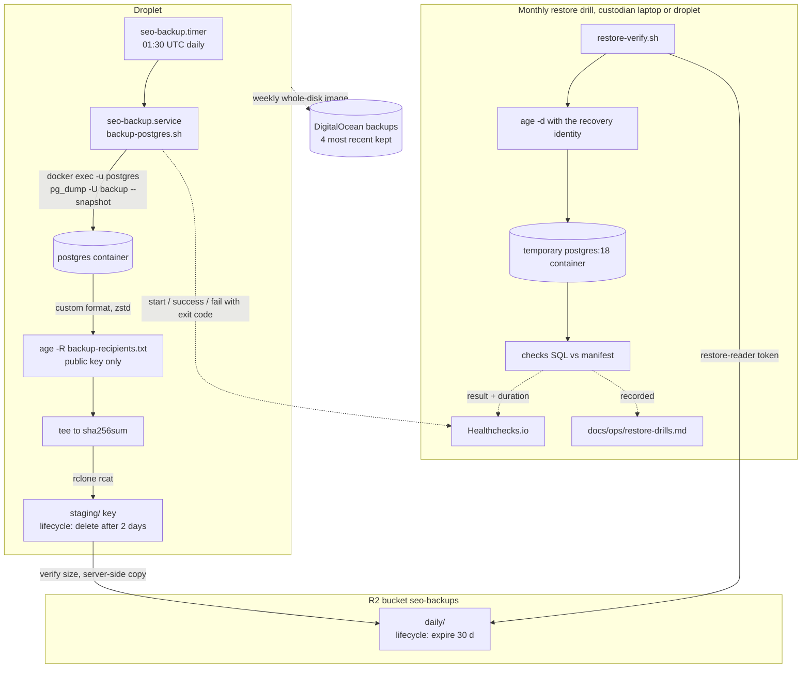

# 23. Backup and Disaster Recovery

Status: Draft for architecture freeze (Phase 0)
Last updated: 2026-09-30
Owner: Platform / DevOps
Research basis: [research/08-infra-methodology.md](../research/08-infra-methodology.md) sections 2 and 4 (accessed 2026-09-29)
Related: [ADR-022](adr/ADR-022-python-backend-simplified-platform.md) (amends ADR-013); [04-data-model.md](04-data-model.md) sections 11.2, 11.3, 12; [22-infrastructure-devops.md](22-infrastructure-devops.md); [24-security.md](24-security.md) sections 5, 13, 14; [28-data-growth-scaling.md](28-data-growth-scaling.md)

## 1. Scope and principles

This document covers how every piece of state is protected, how we prove backups restore, and how we rebuild the platform from nothing. It implements the V1 decisions of [ADR-022](adr/ADR-022-python-backend-simplified-platform.md):

- Nightly logical backup: `pg_dump -Fc` with zstd compression, encrypted with age to one offline recipient pair (only the public key is on the host), streamed with `rclone rcat` to the R2 bucket `seo-backups` under `daily/`. Scheduled by a systemd timer, watched by Healthchecks.io.
- Retention: a 30-day lifecycle rule on `daily/`. No GFS promotion and no bucket lock.
- Second copy: DigitalOcean weekly droplet backups are enabled. They are whole-disk images held by a different provider, out of reach of the R2 tokens on the host.
- A scripted restore drill (`restore-verify.sh` into a temporary PostgreSQL container on the droplet or a laptop), run monthly by a custodian and recorded in the drill log. No CI restore workflow and no separate `restore-test` identity.
- No point-in-time recovery (PITR) in V1. The upgrade path is pgBackRest with WAL archiving. WAL-G is excluded: its `wal-push` hangs against R2 (issue #2550, open, verified 2026-09-29).
- Redis is not backed up as a source of truth. The PostgreSQL task ledger (`ops.collection_tasks`) can rebuild every queue.
- Raw provider payloads in the R2 bucket `seo-raw` are the primary and only copy, for every class including `ai_raw`.

Principles:

1. **A backup that has not been restored is a hope, not a backup.** Every month the scripted drill restores the latest dump and checks it against values recorded at dump time.
2. **The production host can write backups but cannot read them.** It holds only the age public key. A compromised droplet cannot decrypt past dumps.
3. **A second copy lives with a different provider.** Without bucket locks, a stolen `backup-writer` token could delete dumps in R2. The droplet holds no DigitalOcean API token, so it cannot delete the weekly droplet images.
4. **Nothing is staged on local disk.** Dumps stream from `pg_dump` to R2. The 80 GB disk budget (doc 22 section 9.5) reserves nothing for backups.
5. **Measure RTO, do not assume it.** The monthly drill and the quarterly game day record actual durations.

## 2. Recovery objectives (V1)

| Data | RPO | RTO | Mechanism | Notes |
|---|---|---|---|---|
| PostgreSQL (ledger, all tenant data) | 24 h (nightly dump at 01:30 UTC; worst case about 24.5 h including dump time) | 4 h for a full rebuild on a new droplet at up to 30 GB of data; 8 h above that | nightly dump; DigitalOcean weekly image as the fallback (up to 7 days old) | Collected observations in the gap can be re-ingested from `seo-raw` (section 11 step 13), so the effective loss is mostly configuration edits made after the last dump |
| PostgreSQL, single project or table | 24 h | 2 h | partial restore (section 12) | |
| Raw payloads, `seo-raw` | 0 (written before normalisation, doc 03 invariant 4) | n/a | R2 durability is the only protection for every class | section 9 |
| Redis | not applicable (not a source of truth) | 15 min | AOF on the volume; otherwise start empty and reconcile from the ledger | section 10 |
| Platform secrets | 0 | 15 min | GitHub Actions environment secrets; the deploy workflow rewrites `/etc/seo-platform/.env` | doc 24 section 5.1 |
| Configuration (Compose, Caddyfile, Postgres config, systemd units) | 0 | 15 min | git | |
| TLS certificates | n/a | 5 min | Caddy re-issues on the new host | Let's Encrypt limits are not a concern for one hostname |
| Monitoring history | not protected | n/a | disposable | Sentry and Healthchecks keep their own history; logs stay on the droplet (doc 25 section 3.4) |

**Why RPO 24 h is acceptable for V1.** The platform is built for one agency and its clients. Most tenant state is collected data, which lands in R2 before PostgreSQL and can be replayed. What is truly lost in a 24 h gap is human input: new keywords, prompt edits, alias changes, alert acknowledgements. When a customer contract needs a smaller RPO, section 13 is the upgrade.

**Raw payloads have no second copy.** `seo-raw` is where provider responses live after collection; PostgreSQL holds only normalised facts and a pointer. Risks and mitigations:

| Risk | Impact | Mitigation |
|---|---|---|
| Leaked worker R2 token deletes or overwrites objects (R2 has no object versioning, verified 2026-09-29) | Loss of re-parse ability for affected history; PostgreSQL facts unaffected | Token scoped to `seo-raw` only; object keys are content hashes (overwrite with different content is detectable by SHA-256 mismatch); the worker code has no delete path outside the retention job |
| Wrong lifecycle rule deletes a class early | Silent loss of old payloads | Lifecycle rules are managed in code (`infra/r2/lifecycle-seo-raw.json`), reviewed in PRs, and audited monthly by the `maintenance` queue job that compares the live configuration with the file (doc 03 section 6) |
| Bug in a retention or GC job | Deletes payloads still referenced | GC deletes only keys whose `ops.raw_payloads.expires_at` has passed, and never touches `raw/v1/ai_raw/` |
| Cloudflare account compromise or R2 regional incident | All raw payloads unavailable or lost | Accepted for V1 ([ADR-022](adr/ADR-022-python-backend-simplified-platform.md)). PostgreSQL keeps the normalised SERP and AI facts; the loss is the ability to re-parse and re-extract old payloads, which for `ai_raw` cannot be re-collected. A second copy of `ai_raw` is reconsidered when the tool is offered to outside companies (the ADR-022 revisit trigger) |

## 3. What is protected, and how

| Asset | Location | Backup | Restore source |
|---|---|---|---|
| PostgreSQL database `seo` | droplet volume `pgdata` | nightly `pg_dump -Fc -Z zstd` + `pg_dumpall --globals-only`; DigitalOcean weekly image | `seo-backups/daily/`; DigitalOcean backup image |
| Roles | PostgreSQL | globals dump + `infra/compose/postgres/initdb/10-roles.sh` in git | git + globals dump |
| Whole droplet disk (all Docker volumes, `/etc/seo-platform`) | droplet | DigitalOcean weekly backups, the four most recent images kept | DigitalOcean backup image |
| Redis | droplet volume `redisdata` | none (AOF for convenience) | rebuild from `ops.collection_tasks` |
| Raw payloads | `seo-raw` | none (single copy) | `seo-raw` |
| Local spool (payloads waiting for R2) | droplet volume `spool` | none; drained to R2 within minutes | re-fetch from provider if lost |
| Compose files, configs, systemd units, scripts | git | GitHub | git clone |
| Platform secrets | GitHub Actions environment `production`; written to `/etc/seo-platform/.env` on deploy | GitHub | re-run the deploy workflow |
| Backup age identity (private) | offline only | two custodians (section 5) | custodians |
| R2 lifecycle configuration | Cloudflare | `infra/r2/*.json` in git | re-apply with the S3 API or wrangler |
| Cloudflare, DigitalOcean and GitHub account access | providers | hardware security keys for two admins | account recovery |

## 4. Backup lifecycle



## 5. Encryption with age

### 5.1 Recipient

Every dump is encrypted to one recipient, the public half of one offline key pair (age 1.3.2 current, verified 2026-09-29):

| Recipient | Type | Private key held by | Used for |
|---|---|---|---|
| `recovery` | post-quantum hybrid ML-KEM-768 + X25519 (`age1pq1...`, supported since age 1.3.0) | two custodians, offline | monthly restore drill, disaster recovery, partial restores |

`/etc/seo-platform/backup-recipients.txt` on the droplet contains only that public key:

```text
# recovery (offline, custodians A and B), created 2026-10-01
age1pq1...
```

The post-quantum recipient protects dumps that contain customer data against "collect now, decrypt later": anyone who copies a dump today keeps it long after the 30-day lifecycle removes it from R2.

The droplet holds no age private key at all. Platform secrets are a different mechanism (`/etc/seo-platform/.env` written by the deploy workflow, doc 24 section 5.1).

### 5.2 Key generation

On an offline machine (a laptop booted from a live USB with networking disabled), with age 1.3.2 installed from a checksum-verified release:

```bash
umask 077
age-keygen -pq -o recovery.key          # prints the age1pq1... public key; check `age-keygen --help` for the flag in the installed version
age-keygen -y recovery.key > recovery.pub
# Passphrase-protected copy of the recovery identity for the password manager attachment:
age -p -o recovery.key.age recovery.key
```

### 5.3 Custody

| Copy | Holder | Form |
|---|---|---|
| Recovery identity, primary | Custodian A (for example the CTO) | password manager vault item "SEO backup recovery key", shared only with custodian B |
| Recovery identity, secondary | Custodian B (for example the ops lead) | same vault item (shared), plus a printed copy in a sealed envelope in a separate physical location |
| Recovery identity, passphrase copy | vault attachment `recovery.key.age` | passphrase stored in a different vault item than the key |

Rules: two named custodians at all times; when one leaves, rotate (section 5.4) within 7 days. Every monthly drill exercises the identity, and a custodian check happens every quarter at the game day: each custodian decrypts a test file encrypted to the recovery public key.

### 5.4 Rotation

1. Generate the new identity offline (section 5.2).
2. Replace the old public key in `backup-recipients.txt` with the new one; commit the change to `infra/` and deploy it to the host. Run `systemctl start seo-backup.service` and confirm the new dump decrypts with the new identity.
3. Keep the old identity in custody until every dump created before step 2 has expired (30 days in R2; DigitalOcean images do not contain dumps), then destroy it. If the rotation is because the old identity leaked, treat all dumps encrypted to it as exposed and follow the incident process in doc 24.

## 6. Nightly PostgreSQL backup

### 6.1 Design

- **Consistent checks.** The script opens a `REPEATABLE READ` transaction as `backup`, exports its snapshot with `pg_export_snapshot()`, computes row counts and checksums inside that snapshot, then runs `pg_dump --snapshot=<id>`. The manifest values therefore describe exactly the data in the dump, and the restore drill can demand exact equality (section 8).
- **Staging before promotion.** If `pg_dump` dies halfway, `rclone rcat` sees end of input and would happily store a truncated object. The script therefore uploads to `staging/`, checks every pipeline stage's exit status and the uploaded size, and only then copies the object server-side into `daily/`. A truncated upload never appears under `daily/`.
- **Manifest last.** The `.manifest.json` object is written after the dump and globals objects are in `daily/`. Consumers (restore drill, runbooks) ignore any dump without a manifest.
- **Resource use.** `pg_dump` runs inside the `postgres` container (its CPU and memory limits apply). `age`, `sha256sum` and `rclone` run in the backup unit's cgroup with a 512 MB memory cap. rclone uploads with 16 MB parts and concurrency 2, so it buffers at most about 32 MB, and the maximum object size is 160 GB (10,000 parts).

The backup unit has its own two root-only files, written by the deploy workflow from GitHub Actions environment secrets next to `/etc/seo-platform/.env` (doc 24 section 5.1). They are separate from `.env` so the application containers never receive the `backup-writer` token.

Configuration file `/etc/seo-platform/backup.env` (root, 0400):

```bash
HC_URL=https://hc-ping.com/<uuid-of-backup-check>
REMOTE=r2-backups:seo-backups
RECIPIENTS=/etc/seo-platform/backup-recipients.txt
PG_CONTAINER=seo-postgres
PG_DB=seo
MIN_BYTES=1048576
ANOMALY_RATIO=0.5
```

`/etc/seo-platform/rclone.conf` (root, 0400; token "backup-writer", Object Read & Write on `seo-backups` only):

```ini
[r2-backups]
type = s3
provider = Cloudflare
access_key_id = <backup-writer key id>
secret_access_key = <backup-writer secret>
region = auto
endpoint = https://<ACCOUNT_ID>.r2.cloudflarestorage.com
acl = private
no_check_bucket = true
```

### 6.2 Script

File: `infra/scripts/backup-postgres.sh`, installed to `/opt/seo-platform/bin/`. Check SQL: `infra/sql/backup-checks.sql` (section 8.2), installed to `/opt/seo-platform/sql/`.

```bash
#!/usr/bin/env bash
# Nightly logical backup of PostgreSQL to Cloudflare R2.
# Exit codes: 0 ok | 2 config error | 3 dump or upload failed | 4 verification failed | 5 size anomaly (backup kept)
set -Eeuo pipefail
shopt -s inherit_errexit
umask 077

readonly CONFIG_FILE=/etc/seo-platform/backup.env
readonly CHECKS_SQL=/opt/seo-platform/sql/backup-checks.sql

die() { local code=$1; shift; printf 'ERROR: %s\n' "$*" >&2; exit "$code"; }
log() { printf '%s %s\n' "$(date -u +%H:%M:%S)" "$*"; }

[[ -r $CONFIG_FILE ]] || die 2 "missing $CONFIG_FILE"
# shellcheck source=/dev/null
source "$CONFIG_FILE"
: "${HC_URL:?HC_URL must be set}" "${REMOTE:?}" "${RECIPIENTS:?}" "${PG_CONTAINER:?}" "${PG_DB:?}"
: "${MIN_BYTES:=1048576}" "${ANOMALY_RATIO:=0.5}"
export RCLONE_CONFIG=/etc/seo-platform/rclone.conf
[[ -r $RECIPIENTS && -r $CHECKS_SQL ]] || die 2 "recipients or checks SQL missing"
grep -q 'AGE-SECRET-KEY' "$RECIPIENTS" && die 2 "recipients file contains a private key"
for bin in docker age rclone jq curl sha256sum; do command -v "$bin" >/dev/null || die 2 "missing $bin"; done

TS=$(date -u +%Y%m%dT%H%M%SZ); readonly TS
WIN_END=$(date -u +%F); readonly WIN_END  # checks cover the last full UTC day
WIN_START=$(date -u -d "$WIN_END - 1 day" +%F); readonly WIN_START
readonly BASE="seo-${TS}"
readonly DUMP_OBJ="${BASE}.pgdump.age" GLOBALS_OBJ="${BASE}.globals.sql.age" MANIFEST_OBJ="${BASE}.manifest.json"
readonly STAGING="${REMOTE}/staging" DAILY="${REMOTE}/daily"
readonly RCLONE_FLAGS=(--s3-chunk-size 16M --s3-upload-concurrency 2 --low-level-retries 10 --stats 0)

WORK=$(mktemp -d /run/seo-backup/work.XXXXXX); readonly WORK
readonly LOG="${WORK}/backup.log"
exec > >(tee -a "$LOG") 2>&1
STAGED=()
START_EPOCH=$(date +%s)

hc_ping() {  # $1: "start", "" (success) or an exit code
  curl -fsS -m 10 --retry 5 --retry-connrefused -o /dev/null \
       --data-binary @<(tail -c 10000 "$LOG" 2>/dev/null || true) \
       "${HC_URL}${1:+/$1}" || printf 'WARN: healthchecks ping failed\n' >&2
}

on_exit() {
  local rc=$1
  if [[ -n ${PSQL_PID:-} ]]; then kill "$PSQL_PID" 2>/dev/null || true; fi
  for obj in "${STAGED[@]}"; do
    rclone deletefile "${STAGING}/${obj}" 2>/dev/null || true
  done
  if (( rc == 0 )); then log "backup ok"; hc_ping ""; else log "backup failed rc=$rc"; hc_ping "$rc"; fi
  rm -rf -- "$WORK"
  exit "$rc"
}
trap 'on_exit $?' EXIT

# Reads stdin, uploads to staging/<object>, records sha256 and byte count. Runs in a pipeline subshell.
upload_stream() {
  local object=$1 sha_fifo="${WORK}/${1}.sha.fifo" cnt_fifo="${WORK}/${1}.cnt.fifo" rc=0
  mkfifo "$sha_fifo" "$cnt_fifo"
  sha256sum < "$sha_fifo" | cut -d' ' -f1 > "${WORK}/${object}.sha256" & local sha_pid=$!
  wc -c < "$cnt_fifo" | tr -d ' ' > "${WORK}/${object}.bytes" & local cnt_pid=$!
  tee "$sha_fifo" "$cnt_fifo" | rclone rcat "${RCLONE_FLAGS[@]}" "${STAGING}/${object}" || rc=$?
  wait "$sha_pid" || { if (( rc == 0 )); then rc=1; fi; }
  wait "$cnt_pid" || { if (( rc == 0 )); then rc=1; fi; }
  return "$rc"
}

check_pipeline() {  # $1: label, rest: PIPESTATUS values
  local label=$1; shift
  local s; for s in "$@"; do (( s == 0 )) || die 3 "$label pipeline failed, statuses: $*"; done
}

read_artifact() {  # $1: object, $2: sha256|bytes
  local v; v=$(<"${WORK}/${1}.${2}") || die 4 "no $2 for $1"
  [[ $2 == sha256 && $v =~ ^[0-9a-f]{64}$ ]] || [[ $2 == bytes && $v =~ ^[0-9]+$ ]] || die 4 "bad $2 for $1: $v"
  printf '%s' "$v"
}

remote_size() { rclone lsjson --stat "$1" | jq -r '.Size'; }

hc_ping start
log "backup ${BASE} starting"

# 1. Snapshot session: export a snapshot and compute checks inside it.
coproc PSQL { docker exec -i -u postgres "$PG_CONTAINER" psql -U backup -d "$PG_DB" -X -q -A -t -v ON_ERROR_STOP=1; }
printf '%s\n' "BEGIN ISOLATION LEVEL REPEATABLE READ, READ ONLY;" "SELECT pg_export_snapshot();" >&"${PSQL[1]}"
IFS= read -r -t 60 SNAPSHOT <&"${PSQL[0]}" || die 3 "could not export snapshot"
[[ $SNAPSHOT =~ ^[0-9A-F-]+$ ]] || die 3 "unexpected snapshot id: $SNAPSHOT"
printf '\\set win_start %s\n\\set win_end %s\n' "'$WIN_START'" "'$WIN_END'" >&"${PSQL[1]}"
cat "$CHECKS_SQL" >&"${PSQL[1]}"
IFS= read -r -t 900 CHECKS_JSON <&"${PSQL[0]}" || die 3 "checks query failed"
jq -e . >/dev/null <<<"$CHECKS_JSON" || die 3 "checks output is not JSON"
log "snapshot ${SNAPSHOT} exported, checks computed"

# 2. Dump in the same snapshot, encrypt, upload to staging.
STAGED+=("$DUMP_OBJ")
set +e
docker exec -u postgres "$PG_CONTAINER" \
    pg_dump -U backup -d "$PG_DB" --format=custom --compress=zstd:level=6 \
            --snapshot="$SNAPSHOT" --lock-wait-timeout=120s --no-password \
  | age -R "$RECIPIENTS" \
  | upload_stream "$DUMP_OBJ"
st=("${PIPESTATUS[@]}")
set -e
check_pipeline "dump" "${st[@]}"

# The snapshot transaction can end now.
printf '%s\n' "COMMIT;" '\q' >&"${PSQL[1]}"
wait "$PSQL_PID" 2>/dev/null || true
PSQL_PID=""

# 3. Globals (roles without passwords, role settings).
STAGED+=("$GLOBALS_OBJ")
set +e
docker exec -u postgres "$PG_CONTAINER" \
    pg_dumpall -U backup -l "$PG_DB" --globals-only --no-role-passwords --no-password \
  | age -R "$RECIPIENTS" \
  | upload_stream "$GLOBALS_OBJ"
st=("${PIPESTATUS[@]}")
set -e
check_pipeline "globals" "${st[@]}"

# 4. Verify uploads.
DUMP_SHA=$(read_artifact "$DUMP_OBJ" sha256);  DUMP_BYTES=$(read_artifact "$DUMP_OBJ" bytes)
GLOB_SHA=$(read_artifact "$GLOBALS_OBJ" sha256); GLOB_BYTES=$(read_artifact "$GLOBALS_OBJ" bytes)
(( DUMP_BYTES >= MIN_BYTES )) || die 4 "dump too small: ${DUMP_BYTES} bytes"
[[ $(remote_size "${STAGING}/${DUMP_OBJ}") == "$DUMP_BYTES" ]] || die 4 "remote size mismatch for dump"
[[ $(remote_size "${STAGING}/${GLOBALS_OBJ}") == "$GLOB_BYTES" ]] || die 4 "remote size mismatch for globals"

# 5. Size anomaly against the previous daily manifest (more than 50% drop).
ANOMALY=false
PREV_MANIFEST=$(rclone lsf "$DAILY" --files-only --include '*.manifest.json' | sort | tail -n 1 || true)
if [[ -n $PREV_MANIFEST ]]; then
  PREV_BYTES=$(rclone cat "${DAILY}/${PREV_MANIFEST}" | jq -r '.dump.bytes')
  if [[ $PREV_BYTES =~ ^[0-9]+$ ]] && (( PREV_BYTES > 0 )) \
     && awk -v n="$DUMP_BYTES" -v p="$PREV_BYTES" -v r="$ANOMALY_RATIO" 'BEGIN { exit !(n < p * r) }'; then
    ANOMALY=true
    log "SIZE ANOMALY: ${DUMP_BYTES} bytes vs previous ${PREV_BYTES}"
  fi
fi

# 6. Promote staging -> daily (server-side copies), then write the manifest last.
for obj in "$DUMP_OBJ" "$GLOBALS_OBJ"; do
  rclone copyto "${STAGING}/${obj}" "${DAILY}/${obj}" || die 3 "promotion of ${obj} failed"
done
PG_IMAGE=$(docker inspect --format '{{.Image}}' "$PG_CONTAINER")
jq -n \
  --arg ts "$TS" --arg host "$(hostname)" --arg snapshot "$SNAPSHOT" --arg image "$PG_IMAGE" \
  --arg dump "$DUMP_OBJ" --arg dsha "$DUMP_SHA" --argjson dbytes "$DUMP_BYTES" \
  --arg glob "$GLOBALS_OBJ" --arg gsha "$GLOB_SHA" --argjson gbytes "$GLOB_BYTES" \
  --argjson duration "$(( $(date +%s) - START_EPOCH ))" --argjson anomaly "$ANOMALY" \
  --arg recipients "$(grep -v '^#' "$RECIPIENTS" | tr '\n' ' ')" \
  --argjson checks "$CHECKS_JSON" --arg checks_sql "$(base64 -w0 "$CHECKS_SQL")" \
  '{format_version: 1, created_at: $ts, host: $host, snapshot: $snapshot, postgres_image: $image,
    dump: {key: $dump, sha256: $dsha, bytes: $dbytes, format: "pg_dump custom, zstd level 6, age"},
    globals: {key: $glob, sha256: $gsha, bytes: $gbytes},
    recipients: $recipients, duration_s: $duration, size_anomaly: $anomaly,
    checks: $checks, checks_sql_b64: $checks_sql}' \
  > "${WORK}/${MANIFEST_OBJ}"
rclone copyto "${WORK}/${MANIFEST_OBJ}" "${DAILY}/${MANIFEST_OBJ}" || die 3 "manifest upload failed"

# 7. Retention is the 30-day lifecycle rule on daily/ (section 7.2); the script never deletes or promotes dumps.
log "dump ${DUMP_BYTES} bytes sha256 ${DUMP_SHA} in $(( $(date +%s) - START_EPOCH )) s"
[[ $ANOMALY == true ]] && exit 5
exit 0
```

Notes:

- `upload_stream` runs as the last element of a pipeline, so it executes in a subshell. That is why `STAGED` is appended before each pipeline, and why the checksum and byte count travel through files in `$WORK` (tmpfs).
- `set +e` around each pipeline plus `check_pipeline` reports which stage failed (`pg_dump`, `age` or the upload) in the log sent to Healthchecks, instead of a bare non-zero exit.
- The trap deletes staging objects on every exit path. After a successful run they are deleted too; the promoted copies are independent objects.
- A size anomaly still keeps the backup: a large legitimate purge (workspace deletion, retention change) also shrinks the dump. The failure ping forces a human to look.
- `pg_dumpall --no-role-passwords` reads `pg_roles` instead of `pg_authid`, which a non-superuser can do. Passwords come from `/etc/seo-platform/.env` during a restore. Phase 1 check: confirm `pg_dumpall --globals-only` runs as `backup` on 18.6.

### 6.3 systemd units

`/etc/systemd/system/seo-backup.service`:

```ini
[Unit]
Description=Nightly PostgreSQL logical backup to R2
Requires=docker.service
After=docker.service network-online.target
Wants=network-online.target

[Service]
Type=oneshot
ExecStart=/opt/seo-platform/bin/backup-postgres.sh
RuntimeDirectory=seo-backup
RuntimeDirectoryMode=0700
Environment=HOME=/run/seo-backup XDG_CACHE_HOME=/run/seo-backup/cache
TimeoutStartSec=3h
Nice=10
IOSchedulingClass=best-effort
IOSchedulingPriority=7
MemoryMax=512M
NoNewPrivileges=yes
ProtectSystem=strict
ProtectHome=yes
ReadWritePaths=/run
PrivateTmp=yes
# Exit 5 (size anomaly) is reported to Healthchecks by the script; do not also mark the unit failed.
SuccessExitStatus=5
```

`/etc/systemd/system/seo-backup.timer`:

```ini
[Unit]
Description=Run the PostgreSQL backup nightly at 01:30 UTC

[Timer]
OnCalendar=*-*-* 01:30:00 UTC
RandomizedDelaySec=5min
AccuracySec=1min
Persistent=true

[Install]
WantedBy=timers.target
```

`Persistent=true` runs a missed backup at the next boot (for example if the droplet was powered off at 01:30). The Healthchecks check uses the cron schedule `30 1 * * *`, timezone UTC, grace 2 hours, so a missed or hung run alerts by 03:30 UTC.

Manual run: `systemctl start seo-backup.service && journalctl -u seo-backup -n 50 --no-pager`.

## 7. R2 layout, retention and the second copy

### 7.1 Bucket `seo-backups`

```text
seo-backups/
  staging/                                   in-flight uploads; deleted by the script; lifecycle 2 days
  daily/seo-20261001T013012Z.pgdump.age
  daily/seo-20261001T013012Z.globals.sql.age
  daily/seo-20261001T013012Z.manifest.json
  pgbackrest/                                future PITR repository (section 13); no lifecycle rule
```

### 7.2 Retention

| Copy | Where | Retention | Copies kept | Oldest restore point |
|---|---|---|---|---|
| Nightly dump | `seo-backups/daily/` | 30-day lifecycle rule | 30 (31 while R2 deletes within its 24 h window) | 30 days |
| Weekly droplet image | DigitalOcean backups | managed by DigitalOcean | the 4 most recent | about 4 weeks |

There is no GFS promotion: no weekly or monthly tier and no server-side copies between prefixes ([ADR-022](adr/ADR-022-python-backend-simplified-platform.md)). The oldest restore point is 30 days, which also bounds how long a deleted workspace stays in backups (doc 24 section 13). Longer retention is a trigger item in doc 28, needed only for a public offering.

Lifecycle configuration, source of truth `infra/r2/lifecycle-seo-backups.json`, applied through the S3 API (`PutBucketLifecycleConfiguration` is supported on R2, verified 2026-09-29) with a temporary admin token:

```json
{
  "Rules": [
    { "ID": "staging-2d",   "Status": "Enabled", "Filter": { "Prefix": "staging/" }, "Expiration": { "Days": 2 } },
    { "ID": "daily-30d",    "Status": "Enabled", "Filter": { "Prefix": "daily/" },   "Expiration": { "Days": 30 } },
    { "ID": "abort-mpu-1d", "Status": "Enabled", "Filter": { "Prefix": "" },
      "AbortIncompleteMultipartUpload": { "DaysAfterInitiation": 1 } }
  ]
}
```

```bash
aws s3api put-bucket-lifecycle-configuration \
  --endpoint-url "https://${CF_ACCOUNT_ID}.r2.cloudflarestorage.com" --region auto \
  --bucket seo-backups --lifecycle-configuration file://infra/r2/lifecycle-seo-backups.json
aws s3api get-bucket-lifecycle-configuration --endpoint-url "https://${CF_ACCOUNT_ID}.r2.cloudflarestorage.com" \
  --region auto --bucket seo-backups
```

`wrangler r2 bucket lifecycle add|set|list` (verified 2026-09-29) is the alternative; whichever tool is used, the JSON file in git is authoritative and the monthly audit job compares it with the live configuration.

Rules to remember (verified 2026-09-29): objects are typically removed within 24 hours of expiry; if a transition and an expiry fall on the same day, expiry wins. `pgbackrest/` must never get a lifecycle rule: pgBackRest manages its own expiry, and deleting WAL under it breaks PITR (research 08 section 2.5).

### 7.3 Bucket locks and the second copy

No bucket locks ([ADR-022](adr/ADR-022-python-backend-simplified-platform.md)). The protection they gave against a stolen `backup-writer` token is replaced by a second copy the droplet cannot reach: **DigitalOcean weekly droplet backups**.

- Enabled on the droplet (`doctl compute droplet-action enable-backups <droplet-id>`, or `--enable-backups` at creation). DigitalOcean takes one whole-disk image a week and keeps the four most recent. Cost: 20% of the droplet price, $4.80 per month on the $24 droplet.
- The image includes the Docker volumes (`pgdata`, `redisdata`, `spool`) and `/etc/seo-platform`. It is taken from a running system, so PostgreSQL treats it as a crash and replays WAL on first start; this is the normal crash-recovery path, exercised at the game day (section 16).
- The droplet has no DigitalOcean API token, so nothing running on it can delete or alter the images. Account access needs a hardware security key (section 3).
- It is the fallback, not the primary restore path: it can be up to 7 days old, and it is not encrypted with our key. Use it when the R2 dumps are gone or unusable (section 11, path B).

### 7.4 Tokens

| Token | R2 permission | Scope | Stored |
|---|---|---|---|
| `backup-writer` | Object Read & Write | `seo-backups` | droplet `/etc/seo-platform/rclone.conf` (root, 0400) |
| `restore-reader` | Object Read only | `seo-backups` | password manager, custodians only; used for the monthly drill and for disaster recovery |
| `raw-worker` | Object Read & Write | `seo-raw` | `/etc/seo-platform/.env`, read by `worker` and `api` |
| Admin | Admin Read & Write | account | never stored; created in the dashboard for a configuration change and deleted afterwards |

An object token cannot change lifecycle rules. Only an admin token can, and none exists at rest.

## 8. Integrity verification and monthly restore drill

### 8.1 Layers of verification

| Check | When | Where | Detects |
|---|---|---|---|
| Every pipeline stage exit status (`pipefail` + `PIPESTATUS`) | nightly | droplet | `pg_dump`, `age` or upload failure |
| Uploaded size equals bytes streamed; minimum size | nightly | droplet | truncated or empty uploads |
| Size drop above 50% vs previous dump | nightly | droplet | accidental mass deletion, wrong database, broken dump |
| SHA-256 of the encrypted object recorded in the manifest | nightly | droplet | later corruption or tampering |
| SHA-256 re-computed after download | monthly drill | laptop or droplet | storage corruption, overwrite |
| Decryption with the recovery identity | monthly drill | laptop or droplet | wrong recipient, broken encryption, lost or wrong offline key |
| `pg_restore --list` parses the table of contents | monthly drill | temporary container | unreadable archive |
| Full `pg_restore --exit-on-error` | monthly drill | temporary container | any object that fails to restore |
| Exact match of counts and checksums with the manifest | monthly drill | temporary container | silent data loss inside a technically valid dump |
| Freshness of the newest observation | monthly drill | temporary container | backups of a database that stopped collecting |
| Newest DigitalOcean backup image is under 8 days old | monthly drill | `doctl` | weekly droplet backups disabled or failing |
| Both custodians decrypt with the recovery identity | quarterly | custodian laptops | one custodian's copy lost or wrong |

The production droplet cannot run the decrypting checks by itself, by design: it has no private key. The drill therefore needs a custodian, who either runs it on a laptop or supplies the identity to the droplet for the length of one run (section 8.3).

### 8.2 Check SQL

`infra/sql/backup-checks.sql` returns one JSON line. The backup runs it inside the exported snapshot; the restore drill runs the identical text (embedded base64 in the manifest as `checks_sql_b64`) against the restored database. A CI test runs the file against a freshly migrated schema, so a migration that renames a referenced table fails the build instead of the next drill. Tables from later phases are added to the file by the migration that creates them (doc 04 section 14 deploys schema incrementally).

```sql
SELECT json_build_object(
  'win_start', :'win_start',
  'win_end',   :'win_end',
  'counts', json_build_object(
    'auth.workspaces',         (SELECT count(*) FROM auth.workspaces),
    'core.projects',           (SELECT count(*) FROM core.projects),
    'core.entities',           (SELECT count(*) FROM core.entities),
    'core.urls',               (SELECT count(*) FROM core.urls),
    'seo.tracked_keywords',    (SELECT count(*) FROM seo.tracked_keywords),
    'ai.prompt_versions',      (SELECT count(*) FROM ai.prompt_versions),
    'ops.schedules',           (SELECT count(*) FROM ops.schedules),
    'ops.collection_tasks_open', (SELECT count(*) FROM ops.collection_tasks
                                  WHERE status IN ('pending','submit_unknown','submitted','ready','fetched')),
    'seo.serp_snapshots_win',  (SELECT count(*) FROM seo.serp_snapshots
                                WHERE observed_at >= :'win_start'::date AND observed_at < :'win_end'::date),
    'seo.domain_rank_observations_win', (SELECT count(*) FROM seo.domain_rank_observations
                                WHERE observed_at >= :'win_start'::date AND observed_at < :'win_end'::date),
    'ai.observations_win',     (SELECT count(*) FROM ai.observations
                                WHERE observed_at >= :'win_start'::date AND observed_at < :'win_end'::date),
    'ai.citations_win',        (SELECT count(*) FROM ai.citations
                                WHERE observed_at >= :'win_start'::date AND observed_at < :'win_end'::date),
    'ops.raw_payloads_win',    (SELECT count(*) FROM ops.raw_payloads
                                WHERE fetched_at >= :'win_start'::date AND fetched_at < :'win_end'::date)
  ),
  'freshness', json_build_object(
    'seo_max_observed_at', (SELECT max(observed_at) FROM seo.serp_snapshots
                            WHERE observed_at >= :'win_start'::date - 7),
    'ai_max_observed_at',  (SELECT max(observed_at) FROM ai.observations
                            WHERE observed_at >= :'win_start'::date - 7),
    'active_schedules',    (SELECT count(*) FROM ops.schedules WHERE is_active)
  ),
  'checksums', json_build_object(
    'core.projects', (SELECT md5(coalesce(string_agg(
        id::text || '|' || workspace_id::text || '|' || slug::text || '|' || status, ',' ORDER BY id), ''))
      FROM core.projects),
    'seo.tracked_keywords', (SELECT md5(coalesce(string_agg(
        id::text || '|' || keyword_id::text || '|' || location_id || '|' || device || '|' || config_version,
        ',' ORDER BY id), ''))
      FROM seo.tracked_keywords),
    'ai.prompt_versions', (SELECT md5(coalesce(string_agg(
        id::text || '|' || encode(text_hash, 'hex'), ',' ORDER BY id), ''))
      FROM ai.prompt_versions),
    'seo.serp_snapshots_win', (SELECT md5(coalesce(string_agg(
        id::text || '|' || tracked_keyword_id::text || '|' || raw_payload_id::text, ',' ORDER BY id), ''))
      FROM seo.serp_snapshots
      WHERE observed_at >= :'win_start'::date AND observed_at < :'win_end'::date)
  ),
  'schema_version', (SELECT version_num FROM ops.alembic_version),
  'server_version', current_setting('server_version'),
  'db_size_bytes',  pg_database_size(current_database())
)::text;
```

Window counts use the last full UTC day, so partition pruning keeps the query cheap even at hundreds of millions of rows. The `md5()` here is a change detector, not a security control. `ops.alembic_version` assumes Alembic is configured with `version_table_schema='ops'` and a single head revision.

### 8.3 Monthly restore drill

The weekly GitHub Actions restore workflow and its `restore-test` identity are removed ([ADR-022](adr/ADR-022-python-backend-simplified-platform.md)). In their place a custodian runs one script once a month, in the first week, and records the result. The script restores the newest dump into a temporary PostgreSQL container and compares it with the manifest; it never touches the production database.

Procedure (30 to 60 minutes, mostly waiting):

1. Take the `restore-reader` token and the recovery identity from the password manager.
2. Run the script where it fits:
   - **Laptop (default).** Docker, bash 4 or newer, `age`, `rclone`, `jq` and GNU coreutils installed (on macOS, Homebrew `bash` and the `coreutils` package with its `gnubin` directory on `PATH`). The identity never leaves the custodian's machine.
   - **Droplet.** Allowed while free disk is at least 6 times the dump size and no collection window is open. Copy the identity to `/run/seo-restore/identity` (tmpfs) over SSH, run with `WORK_BASE=/var/lib/seo-restore`, then `shred -u /run/seo-restore/identity`. The temporary container is capped at 1 GB of memory so it cannot starve the production PostgreSQL.
3. Check the second copy: `doctl compute droplet backups <droplet-id>` must list an image less than 8 days old.
4. Record the run in the runbook's drill log, `docs/ops/restore-drills.md` (one table row: date, custodian, where it ran, dump key, result and exit code, restore seconds, total seconds, date of the newest DigitalOcean image) and commit it. The script prints the row.

The drill starts no worker. A worker started against a restored copy (a fuller rehearsal, or a staging copy) runs with `DATAFORSEO_LOGIN` and `DATAFORSEO_PASSWORD` empty, or with an `INSTALLATION_ID` of its own, never `prod`. The restored ledger holds production's task ids and runs, and the installation in every tag is what keeps such a copy from sending production's tasks again or taking production's results from the shared account. The worker refuses to start in production with DataForSEO credentials and no `INSTALLATION_ID` set.

```bash
export RCLONE_CONFIG_R2_TYPE=s3 RCLONE_CONFIG_R2_PROVIDER=Cloudflare RCLONE_CONFIG_R2_REGION=auto \
       RCLONE_CONFIG_R2_NO_CHECK_BUCKET=true \
       RCLONE_CONFIG_R2_ENDPOINT="https://<ACCOUNT_ID>.r2.cloudflarestorage.com" \
       RCLONE_CONFIG_R2_ACCESS_KEY_ID="<restore-reader key id>" \
       RCLONE_CONFIG_R2_SECRET_ACCESS_KEY="<restore-reader secret>"
AGE_IDENTITY_FILE="$HOME/secure/recovery.key" \
PG_IMAGE="postgres:18@sha256:<digest pinned in the compose file>" \
HC_URL="https://hc-ping.com/<uuid-of-restore-drill-check>" \
  infra/scripts/restore-verify.sh r2:seo-backups/daily
```

`infra/scripts/restore-verify.sh`:

```bash
#!/usr/bin/env bash
# Monthly restore drill. Restores the newest dump into a temporary PostgreSQL container and compares it
# with the manifest. Runs on a custodian laptop or on the droplet; never touches the production database.
# Exit codes: 2 usage or config | 10 no or stale backup | 11 checksum | 12 archive unreadable | 13 restore failed | 14 mismatch | 15 not fresh
set -Eeuo pipefail
shopt -s inherit_errexit
umask 077

SRC=${1:?usage: restore-verify.sh <remote:bucket/prefix>}
: "${AGE_IDENTITY_FILE:?path to the recovery identity}" "${PG_IMAGE:?}"
[[ -r $AGE_IDENTITY_FILE ]] || { printf 'ERROR: cannot read %s\n' "$AGE_IDENTITY_FILE" >&2; exit 2; }
for bin in docker age rclone jq curl sha256sum base64; do
  command -v "$bin" >/dev/null || { printf 'ERROR: missing %s\n' "$bin" >&2; exit 2; }
done
HC_URL=${HC_URL:-}                       # optional: the restore-drill Healthchecks check
REPORT=${REPORT:-$PWD/restore-report.json}
MAX_BACKUP_AGE_H=${MAX_BACKUP_AGE_H:-30}
FRESHNESS_H=${FRESHNESS_H:-26}
SCRATCH_MEM=${SCRATCH_MEM:-1g}
SCRATCH_MAINT_MEM=${SCRATCH_MAINT_MEM:-256MB}
WORK=$(mktemp -d -p "${WORK_BASE:-${TMPDIR:-/tmp}}")
CONTAINER="restore-verify-$$"
START=$(date +%s)
declare -A T=()                       # phase durations in seconds

log() { printf '%s %s\n' "$(date -u +%H:%M:%S)" "$*" | tee -a "$WORK/summary.txt"; }
die() { local c=$1; shift; log "FAIL($c): $*"; exit "$c"; }
phase() { T[$1]=$(( $(date +%s) - ${2} )); }
hc_ping() {  # $1: "/start", "" (success) or "/<exit code>"
  [[ -n $HC_URL ]] || return 0
  curl -fsS -m 10 --retry 5 -o /dev/null --data-binary @"$WORK/summary.txt" "${HC_URL}${1}" || true
}

on_exit() {
  local rc=$? result total
  docker rm -f "$CONTAINER" >/dev/null 2>&1 || true
  result=$([[ $rc == 0 ]] && echo pass || echo fail)
  total=$(( $(date +%s) - START ))
  jq -n --arg result "$result" --argjson rc "$rc" \
        --arg manifest "${MANIFEST:-}" --argjson total "$total" \
        --argjson phases "$(for k in "${!T[@]}"; do printf '{"%s":%s}\n' "$k" "${T[$k]}"; done | jq -s 'add // {}')" \
        '{result: $result, exit_code: $rc, manifest: $manifest, total_s: $total, phases_s: $phases}' > "$REPORT" || true
  # One row for docs/ops/restore-drills.md; the custodian adds the DigitalOcean image date.
  printf '| %s | %s | %s | %s | %s (%s) | %s | %s | |\n' "$(date -u +%F)" "${USER:-unknown}" "$(hostname)" \
         "${DUMP_KEY:-none}" "$result" "$rc" "${T[restore]:-n/a}" "$total"
  if (( rc == 0 )); then hc_ping ""; else hc_ping "/$rc"; fi
  rm -rf -- "$WORK"
  exit "$rc"
}
trap on_exit EXIT
touch "$WORK/summary.txt"
hc_ping "/start"

# 1. Latest complete backup = newest manifest.
t=$(date +%s)
MANIFEST=$(rclone lsf "$SRC" --files-only --include '*.manifest.json' | sort | tail -n 1)
[[ -n $MANIFEST ]] || die 10 "no manifest under $SRC"
rclone cat "$SRC/$MANIFEST" > "$WORK/manifest.json"
DUMP_KEY=$(jq -r .dump.key "$WORK/manifest.json")
EXPECT_SHA=$(jq -r .dump.sha256 "$WORK/manifest.json")
CREATED=$(jq -r .created_at "$WORK/manifest.json")
CREATED_EPOCH=$(date -u -d "$(sed -E 's/^(....)(..)(..)T(..)(..)(..)Z$/\1-\2-\3 \4:\5:\6/' <<<"$CREATED")" +%s)
AGE_H=$(( ($(date +%s) - CREATED_EPOCH) / 3600 ))
(( AGE_H <= MAX_BACKUP_AGE_H )) || die 10 "newest backup is ${AGE_H} h old"
log "testing $DUMP_KEY (${AGE_H} h old, $(jq -r .dump.bytes "$WORK/manifest.json") bytes)"

# 2. Download and verify SHA-256 of the encrypted object.
rclone copyto "$SRC/$DUMP_KEY" "$WORK/dump.age"
printf '%s  %s\n' "$EXPECT_SHA" "$WORK/dump.age" | sha256sum -c --quiet || die 11 "sha256 mismatch"
phase download "$t"

# 3. Decrypt with the recovery identity. The identity file is read in place, never copied into $WORK,
#    so it is not visible inside the scratch container.
t=$(date +%s)
age -d -i "$AGE_IDENTITY_FILE" -o "$WORK/dump.pgdump" "$WORK/dump.age" || die 12 "decryption failed"
rm -f "$WORK/dump.age"
phase decrypt "$t"

# 4. Temporary PostgreSQL (durability off: this instance is thrown away; no network; memory capped).
docker run -d --name "$CONTAINER" --network none --memory "$SCRATCH_MEM" --shm-size=256m \
  -e POSTGRES_PASSWORD=restore-only -e POSTGRES_DB=seo \
  -v "$WORK:/restore:ro" "$PG_IMAGE" \
  -c fsync=off -c full_page_writes=off -c synchronous_commit=off \
  -c max_wal_size=2GB -c maintenance_work_mem="$SCRATCH_MAINT_MEM" -c default_toast_compression=lz4 >/dev/null
for _ in $(seq 1 60); do docker exec "$CONTAINER" pg_isready -U postgres -d seo -q && break; sleep 2; done
docker exec "$CONTAINER" pg_isready -U postgres -d seo -q || die 13 "temporary postgres did not start"

# 5. Archive readable, roles present.
docker exec "$CONTAINER" pg_restore --list /restore/dump.pgdump > "$WORK/toc.txt" || die 12 "pg_restore --list failed"
TOC_ENTRIES=$(grep -cv '^;' "$WORK/toc.txt")
(( TOC_ENTRIES > 100 )) || die 12 "table of contents has only ${TOC_ENTRIES} entries"
docker exec -i "$CONTAINER" psql -U postgres -d seo -X -q -v ON_ERROR_STOP=1 \
  < infra/sql/roles-restore.sql || die 13 "role creation failed"

# 6. Full restore.
t=$(date +%s)
docker exec "$CONTAINER" pg_restore -U postgres -d seo --jobs=2 --exit-on-error /restore/dump.pgdump \
  || die 13 "pg_restore failed"
phase restore "$t"

# 7. Same checks, same window, same SQL text as at dump time.
t=$(date +%s)
jq -r .checks_sql_b64 "$WORK/manifest.json" | base64 -d > "$WORK/checks.sql"
docker exec -i "$CONTAINER" psql -U postgres -d seo -X -q -A -t -v ON_ERROR_STOP=1 \
  -v win_start="$(jq -r .checks.win_start "$WORK/manifest.json")" \
  -v win_end="$(jq -r .checks.win_end "$WORK/manifest.json")" \
  < "$WORK/checks.sql" > "$WORK/restored.json" || die 14 "checks query failed on restored database"
FILTER='{counts, checksums, freshness, schema_version}'
if ! diff <(jq -S "$FILTER" <<<"$(jq .checks "$WORK/manifest.json")") <(jq -S "$FILTER" "$WORK/restored.json") > "$WORK/diff.txt"; then
  log "$(head -c 3000 "$WORK/diff.txt")"
  die 14 "restored data differs from manifest"
fi

# 8. Freshness: an active platform must have observed something within 26 h of the dump.
ACTIVE=$(jq -r .freshness.active_schedules "$WORK/restored.json")
if (( ACTIVE > 0 )); then
  NEWEST=$(jq -r '[.freshness.seo_max_observed_at, .freshness.ai_max_observed_at] | map(select(. != null)) | max // empty' "$WORK/restored.json")
  [[ -n $NEWEST ]] || die 15 "no observations in the last 8 days despite ${ACTIVE} active schedules"
  LAG_H=$(( (CREATED_EPOCH - $(date -u -d "$NEWEST" +%s)) / 3600 ))
  (( LAG_H <= FRESHNESS_H )) || die 15 "newest observation is ${LAG_H} h older than the dump"
fi
phase checks "$t"

log "PASS: ${TOC_ENTRIES} TOC entries, restore ${T[restore]} s, total $(( $(date +%s) - START )) s"
```

`infra/sql/roles-restore.sql` (to be written with the restore drill in plan 6; its role list must match `infra/compose/postgres/initdb/10-roles.sh`) creates the four database roles of ADR-022 as `NOLOGIN` with the same attributes (`app_api` without `BYPASSRLS`, `app_worker` with `BYPASSRLS`, `migrator` as owner, `backup` read-only with `BYPASSRLS`), so ownership and the table and column grants in the dump apply cleanly. It deliberately does not set passwords.

**Disk and memory.** The drill needs about 6 times the dump size free (encrypted file, decrypted file, restored data). On the droplet that fits while the dump is small; when `dump.bytes` in the manifest exceeds 2 GB, run the drill on a laptop, or on a temporary `s-4vcpu-8gb` droplet ($0.07143/hour, verified 2026-09-29) created with `doctl` and destroyed afterwards. A 90-minute drill there costs about $0.11.

**Reminder.** The optional `HC_URL` points at the `restore-drill` Healthchecks check (period 31 days, grace 3 days). A successful run pings it; a month without a drill makes it late, which is the alert that the manual drill stopped happening (section 15).

**Trend.** `restore-report.json` and the drill log record download, decrypt, restore and check durations. The restore phase duration is the main input for the RTO estimate in section 11; if it grows past 90 minutes, revisit the RTO target or move to pgBackRest (physical restores do not rebuild indexes).

## 9. Raw payload bucket `seo-raw`

Doc 04 section 11.3 registers every payload in `ops.raw_payloads` with a `retention_class` of `serp_raw`, `ai_raw`, `first_party_raw` or `error`, and an `expires_at`. R2 lifecycle rules work on key prefixes, so the retention class must be part of the key.

### 9.1 Object key layout

```text
raw/v1/<retention_class>/<provider>/<endpoint_slug>/<yyyy>/<mm>/<dd>/<sha256>.json.zst
raw/v1/serp_raw/dataforseo/serp_google_organic_advanced/2026/09/29/9f86d0...0f00a08.json.zst
raw/v1/ai_raw/dataforseo/chatgpt_llm_scraper/2026/09/29/2c26b4...e7ae.json.zst
```

Doc 04 section 11.3 uses this layout. Since `object_key` is stored per row, no other schema change is needed. The date path also lets the disaster-recovery replay (section 11 step 13) list payloads fetched after a given backup.

### 9.2 Retention per class

| Class | Content | Retention | Storage class | Why |
|---|---|---|---|---|
| `serp_raw` | DataForSEO SERP `task_get/advanced` responses | 400 days (13 months plus margin), then delete | Standard | PostgreSQL keeps the normalised SERP facts indefinitely. Raw SERPs are needed to re-parse recent history after a parser fix and to compare the same month year over year. |
| `ai_raw` | consumer UI, AI Mode and official API answers with citations and fan-out | indefinite | Standard | Irreplaceable: past AI answers cannot be re-collected, and re-extraction with a better extractor is a product feature (doc 04 section 8.5). |
| `first_party_raw` | GSC, GA4, Bing and Cloudflare API responses | 90 days | Standard | The normalised rows in `fp.*` are the long-term copy; raw is kept for debugging ingest bugs. |
| `error` | error bodies and malformed responses above 2 KB (smaller ones are `pg_inline`) | 30 days | Standard | debugging only |

Why not move `serp_raw` to Infrequent Access: IA saves $0.005 per GB-month (verified 2026-09-29), which for a 45 KB object is about $0.0000027 over its remaining year of life. Each `LifecycleStorageTierTransition` is a Class A operation at $4.50 per million, about $0.0000045 per object (verified 2026-09-29). For objects this small the transition costs more than it saves, and IA adds retrieval fees and a 30-day minimum. Revisit only if average object size grows past about 100 KB.

`infra/r2/lifecycle-seo-raw.json`:

```json
{
  "Rules": [
    { "ID": "serp-raw-400d",        "Status": "Enabled", "Filter": { "Prefix": "raw/v1/serp_raw/" },        "Expiration": { "Days": 400 } },
    { "ID": "first-party-raw-90d",  "Status": "Enabled", "Filter": { "Prefix": "raw/v1/first_party_raw/" }, "Expiration": { "Days": 90 } },
    { "ID": "error-30d",            "Status": "Enabled", "Filter": { "Prefix": "raw/v1/error/" },           "Expiration": { "Days": 30 } },
    { "ID": "abort-mpu-1d",         "Status": "Enabled", "Filter": { "Prefix": "" },
      "AbortIncompleteMultipartUpload": { "DaysAfterInitiation": 1 } }
  ]
}
```

No rule touches `raw/v1/ai_raw/`. There is no `canary/` prefix: the nightly contract-drift canary was dropped (doc 26 section 3.3). The ingest code sets `ops.raw_payloads.expires_at` to `fetched_at` plus the class retention, so the API can say "raw payload expired on <date>" instead of returning a storage error, and the maintenance job can reconcile registry rows with R2. A payload is registered once per class and hash. When the same bytes come again and their object has used more than a day of its life, the object is written again under its key (the lifecycle rule counts from the last write) and `expires_at` moves to the new end. Objects are zstd frames with a content checksum, and a read is checked against the registered sha256. The reconciliation also removes objects no row names: two workers storing the same new bytes across midnight each write one, and in `ai_raw` nothing else would remove the second.

### 9.3 Workspace purge interaction

Doc 24 section 13 hard-purges a deleted workspace after 30 days, including R2 objects referenced only by that workspace. The purge job deletes those keys directly; with no bucket lock nothing delays the deletion. The purge is complete when every key is gone; the audit log records the completion date.

### 9.4 Locks on `seo-raw`

None. ADR-022 removed bucket locks from both buckets. What protects raw payloads instead: the `raw-worker` token is scoped to `seo-raw` only, object keys are content hashes, the only delete paths in code are the retention GC (expired rows only, never `ai_raw`) and the workspace purge, and lifecycle rules are versioned in `infra/r2/` and audited monthly.

### 9.5 Second copy of `ai_raw`

None in V1. ADR-022 dropped the weekly replica to a second Cloudflare account, together with its bucket, tokens and workflow. `ai_raw` is a single copy like every other class. The risk is accepted because PostgreSQL keeps the extracted facts (mentions, citations, fan-out), so losing `ai_raw` removes re-extraction of history, not the history itself. Reconsider when the tool is offered to outside companies.

## 10. Redis recovery

Redis holds the Taskiq queues (`collect`, `process`), rate-limit counters, locks (including the planner tick lock) and the session read-through cache (60 s TTL). None of it is a source of truth (doc 04 principle 1; ADR-022: nothing lives only in Redis). AOF with `everysec` is kept because restarting with queues intact is faster than rebuilding.

| Scenario | Effect | Recovery |
|---|---|---|
| Container restart or host reboot | AOF replays; at most about 1 s of writes lost | automatic; messages lost in flight are re-enqueued from the ledger by the reconciler |
| AOF corrupt at startup (Redis refuses to start) | queues unavailable | `docker compose run --rm --entrypoint redis-check-aof redis --fix /data/appendonlydir/<manifest>`; if that fails, move the AOF directory aside and start empty |
| Volume lost, or new droplet after a disaster | empty Redis | start empty, then reconcile (below) |

Reconciliation from the ledger, `sightline queue-reconcile` (also run automatically by the worker at startup when it finds the queues empty while PostgreSQL has non-terminal tasks). `sightline` is the backend's admin CLI, run as `docker compose run --rm worker sightline <command>`:

1. **Scheduled jobs.** Nothing to restore. The Taskiq scheduler reads its maintenance schedule from code at boot, and the planner tick re-acquires its Redis lock.
2. **Tasks.** Select `ops.collection_tasks` rows in non-terminal states from the retained partitions:
   - `pending`: clear `dispatched_at` so the dispatcher re-enqueues due tasks on its next tick (doc 21 section 4).
   - `submitted`: enqueue `poll_ready`; DataForSEO's `tasks_ready` lists tasks completed in the previous 3 days and not yet collected (verified in research 01), and each found id becomes a `fetch_task`.
   - `ready`: enqueue `fetch_task`.
   - `fetched`: enqueue the matching `ingest_*` job (the payload is already in R2 and `ops.raw_payloads`).
   - `pending` with `next_attempt_at`: enqueue with the remaining delay. `submit_unknown`: left to the reconciler's tag match (doc 21 section 6).
   Task ids are deterministic per ledger row (`submit:<hash>`, `fetch:<provider_task_id>`, `ingest:<task_id>`, doc 21 section 5.2) and every handler re-checks the row's status before acting, so running reconcile twice, or while some messages survived, creates no duplicate work.
3. **Derived work.** Enqueue `rollup_seo_day`, `rollup_ai_day` and `evaluate_alerts` for every project and date touched in the last 48 hours (debounced jobs, cheap to repeat).
4. **Caches.** Nothing to do: the session cache and rate-limit counters refill on demand. Login throttling counters reset, which is acceptable for minutes.

Expected time: under 5 minutes for a day's worth of tasks. The runbook step is part of section 11.

## 11. Full restore runbook: new droplet to serving traffic

Use when the droplet is lost, the disk is corrupt, or the host is compromised. Roles: an incident lead (runs the runbook), a custodian (holds the recovery identity and the `restore-reader` token), and someone who can run the deploy workflow in GitHub (can be the same person). Preparation that makes this fast, done once in advance: a DNS TTL of 300 s on the site's A record, or a DigitalOcean Reserved IP attached to the droplet (pricing not verified in research 08; check before adopting); `doctl` authenticated on two laptops; this runbook printed.

Time estimates assume a dump of about 5 GB (PostgreSQL about 25 GB, doc 22 section 10.5 scenario A at month 24 or B at month 12). Scale the restore steps linearly for other sizes.

**Path A: rebuild from the newest R2 dump (default).**

| # | Step | Commands / detail | Estimate |
|---|---|---|---|
| 0 | Declare the incident, pick the restore point | Newest manifest in `daily/` unless corruption is suspected to predate it; then pick an older daily (30 are kept). If the R2 dumps are gone or unusable, switch to path B. Record the choice in the incident channel. | 10 min |
| 1 | Contain | If the old host is compromised: power it off (keep it for forensics; do not destroy), revoke `backup-writer`, `raw-worker`, DataForSEO and LLM keys and put the new values into the GitHub Actions environment, rotate the Tailscale node key. If it is merely dead, skip. | 0 to 15 min |
| 2 | Create the droplet | `doctl compute droplet create seo-prod-2 --size s-2vcpu-4gb --image ubuntu-26-04-x64 --region <region> --ssh-keys <ids> --tag-names seo-prod --enable-backups --wait` (the tag attaches the Cloud Firewall; `--enable-backups` turns on the weekly images). | 3 min |
| 3 | Bootstrap | Doc 22 section 6.6 (host bootstrap: packages, Docker, firewall, users, swap, systemd units). | 15 min |
| 4 | Secrets | Point the deploy workflow at the new host (deploy host and SSH key in the GitHub environment) and run its "write secrets" step: it writes `/etc/seo-platform/.env` (root, 0600), `backup.env` and `rclone.conf` from the environment secrets. No key needs to be pasted by hand. | 10 min |
| 5 | Pull the release, start data services only | On the host: `docker compose pull` for the last released image tag (the latest successful deploy run in GitHub), then `docker compose up -d postgres redis`. Do not run `migrator` and do not start `api`, `worker` or `web`. The Postgres entrypoint initialises an empty cluster, the empty `seo` database and the roles. | 10 min |
| 6 | Fetch and verify the dump | With the `restore-reader` token in a temporary rclone config: `rclone copyto r2:seo-backups/daily/<base>.pgdump.age /var/lib/seo-restore/dump.age` and the manifest; `sha256sum` must equal `dump.sha256`. | 5 min |
| 7 | Decrypt | Custodian copies the recovery identity into `/run/seo-restore/identity` (tmpfs) over SSH; `age -d -i /run/seo-restore/identity -o /var/lib/seo-restore/dump.pgdump /var/lib/seo-restore/dump.age`; `shred -u /run/seo-restore/identity`; delete `dump.age`. Alternative for small dumps: decrypt on the custodian's laptop and stream (`rclone cat ... \| age -d -i key \| ssh deploy@new 'cat > /var/lib/seo-restore/dump.pgdump'`), so the identity never reaches any server. | 10 min |
| 8 | Restore | `docker cp /var/lib/seo-restore/dump.pgdump seo-postgres:/tmp/`; temporarily `ALTER SYSTEM SET maintenance_work_mem = '512MB'; ALTER SYSTEM SET max_wal_size = '8GB'; SELECT pg_reload_conf();`; `docker exec -u postgres seo-postgres pg_restore -d seo --jobs=2 --exit-on-error /tmp/dump.pgdump`; then `ALTER SYSTEM RESET ALL; SELECT pg_reload_conf();`. Durability settings stay on: this is production. | 30 to 45 min |
| 9 | Globals drift check | Decrypt `<base>.globals.sql.age` and compare role attributes and `ALTER ROLE ... SET` lines with the roles created by initdb (`app_api`, `app_worker`, `migrator`, `backup`); apply differences. | 5 min |
| 10 | Statistics | `docker exec -u postgres seo-postgres vacuumdb -d seo --analyze-in-stages --jobs=2` (planner statistics are not in a logical dump). | 15 min |
| 11 | Verify the data | Run the manifest's checks SQL (base64 in the manifest) with its window; counts and checksums must equal the manifest (as in the monthly drill). | 5 min |
| 12 | Migrate to the current release | `docker compose run --rm migrator` (runs `alembic upgrade head`; a no-op if the dump is already at the release's revision). | 2 min |
| 13 | Replay the gap from R2 | Keep collection paused (`COLLECTION_PAUSED=true` in `/etc/seo-platform/.env`). Run `sightline raw-replay --since <manifest.created_at minus 1 h>`: lists `raw/v1/*/*/*/<yyyy>/<mm>/<dd>/` for each day since the dump, skips SHA-256 values already in `ops.raw_payloads`, re-registers the rest, and enqueues ingest. Workers write the task identity (idempotency key, workspace, project, subject) as R2 object metadata at upload time, so replay can attribute payloads without the lost `ops.collection_tasks` rows. Replayed payloads also repopulate `ops.fetch_cache` so today's runs do not buy the same SERPs twice. | 15 to 45 min |
| 14 | Rebuild queues | `sightline queue-reconcile` (section 10). | 5 min |
| 15 | Start the application | `docker compose up -d caddy api worker web`; remove `COLLECTION_PAUSED` (GitHub environment, redeploy); all containers `healthy`. | 5 min |
| 16 | Move traffic | Reassign the Reserved IP, or update the site's A record. There is one domain, so one record moves both the app and the API. Caddy obtains a certificate within 1 to 2 minutes of DNS pointing at the host. Readiness is polling only, so no provider callback depends on the address; tasks that completed during the outage are found by the `tasks_ready` poll and the id sweeper. | 5 to 15 min |
| 17 | Validate | `https://<domain>/api/healthz` returns 200; log in (the `__Host-session` cookie is set); open a project and compare headline numbers with the last known values (screenshots in the incident channel); Better Stack green; `systemctl start seo-backup.service` and see the Healthchecks success ping; confirm `doctl compute droplet get <id> --format Features` lists `backups`. | 15 min |
| 18 | Aftercare | Tell users which window of edits was lost (between `manifest.created_at` and the failure); run the restore drill (section 8.3) against the first dump from the new host; write the post-incident review with measured step times; destroy the old droplet once forensics are done. | later |

**Total for steps 0 to 17: about 2.5 to 3.5 hours**, inside the 4-hour RTO for databases up to about 30 GB. At 60 GB and above, step 8 alone takes 1.5 to 2 hours and the RTO becomes 6 to 8 hours; that is one of the reasons to adopt pgBackRest before then (section 13).

**Path B: restore from a DigitalOcean weekly image.** Use only when the R2 dumps are missing, deleted or fail verification. The restore point is up to 7 days old.

1. `doctl compute droplet backups <old-droplet-id>` to list images; `doctl compute droplet create seo-prod-2 --size s-2vcpu-4gb --image <backup-image-id> --region <region> --ssh-keys <ids> --tag-names seo-prod --enable-backups --wait`. If the old droplet still exists, "Restore from backup" in the control panel does the same in place.
2. Before starting the application, set `COLLECTION_PAUSED=true` and run the deploy workflow's "write secrets" step so `/etc/seo-platform/.env` holds current (and, after a compromise, rotated) values.
3. `docker compose up -d postgres redis`. PostgreSQL replays WAL from the crash-consistent image; check `docker compose logs postgres` for "database system is ready to accept connections".
4. Continue with path A at step 12 and run through step 18. Steps 6 to 11 do not apply: the image is a physical copy, so there is no dump to fetch and planner statistics are already present. The replay in step 13 uses the image's timestamp as `--since` and covers up to 7 days of raw payloads.

## 12. Partial restore: one project or one table

First check whether a restore is needed at all:

| Situation | Action without a restore |
|---|---|
| Project, keyword or prompt deleted in the UI | Configuration entities are soft-deleted (`deleted_at`, doc 04 section 2). Undelete with the admin CLI within the 30-day purge window. |
| Wrong derived values (extraction, rollups, ownership columns) | Re-derive from observations and raw payloads: re-extraction writes a new `extractor_version`; rollups are rebuilt; ownership columns are recomputed with a `ops.derivation_log` entry (doc 04 section 7.4). |
| Current-state tables wrong | `SELECT ops.rebuild_current_state(<project_id>);` |

When rows are truly gone (a bad migration, a buggy purge, a manual `DELETE`):

1. **Pick the dump** taken before the damage, from `daily/`. Only 30 days of dumps exist; damage older than that cannot be undone from backups.
2. **Restore it into a scratch instance**, never into production: a temporary `s-4vcpu-8gb` droplet ($0.07143/hour, verified 2026-09-29) or the custodian's laptop with Docker. Decrypt with the recovery identity (section 11 step 7). For one table, restore the schema and only that table's data:

   ```bash
   pg_restore --section=pre-data -d seo dump.pgdump
   pg_restore -l dump.pgdump | grep -E 'TABLE DATA (seo|ai|core|ops) (tracked_keywords|serp_snapshots_p202609)' > selection.list
   pg_restore -L selection.list --data-only -d seo dump.pgdump
   ```

   For partitioned tables, select the partitions (for example `serp_snapshots_p202609`) that cover the damaged dates.
3. **Bring the scratch schema to production's migration level**: run the current `migrator` image against the scratch database, so column lists match exactly.
4. **Stage in production.** As `migrator` in production, create a staging schema and the target tables: `CREATE SCHEMA restore_tmp; CREATE TABLE restore_tmp.tracked_keywords (LIKE seo.tracked_keywords INCLUDING DEFAULTS);`.
5. **Copy the rows across**, filtered to the tenant or project, in binary COPY through the `pg-tunnel` (doc 22 section 12.5):

   ```bash
   psql "$SCRATCH_URL" -c "\copy (SELECT * FROM seo.tracked_keywords WHERE project_id = '<id>') TO STDOUT (FORMAT binary)" \
   | psql "$PROD_MIGRATOR_URL" -c "\copy restore_tmp.tracked_keywords FROM STDIN (FORMAT binary)"
   ```

6. **Merge in dependency order, in one transaction**, with `ON CONFLICT DO NOTHING` so rows that survived are untouched. Tables with `GENERATED ALWAYS AS IDENTITY` keys (observations, tasks, raw payloads) need `INSERT ... OVERRIDING SYSTEM VALUE` to keep their original ids, which other rows reference. Order for a whole project:
   `core.projects` > `core.entities`, `core.entity_aliases`, `core.entity_domains`, `core.project_entities` > `core.taxonomy_vocabularies`, `core.taxonomy_terms` > `seo.keywords`, `seo.tracked_keywords`, `seo.tracked_keyword_config_history`, groups and terms > `ai.prompts` (its `current_version_id` FK is deferrable), `ai.prompt_versions`, panels and memberships > `ops.schedules` > `seo.serp_snapshots`, `seo.serp_features`, `seo.domain_rank_observations` > `ai.observations`, `ai.citations`, `ai.fanout_queries`, `ai.retrieval_results`, `ai.entity_mentions`, `ai.observation_facts`.
   Global dictionaries (`core.urls`, `core.domains`) are never deleted, so referenced ids already exist in production.
7. **Re-derive**: `REFRESH MATERIALIZED VIEW CONCURRENTLY core.project_domain_roles;`, `ops.rebuild_current_state(<project_id>)`, and enqueue rollups for the restored date range.
8. **Record and clean up**: an `ops.audit_logs` entry (`action = 'data.partial_restore'`, source dump key, tables, row counts), then `DROP SCHEMA restore_tmp CASCADE;` and destroy the scratch instance.

Estimate: 1 to 2 hours, mostly steps 2 and 6.

## 13. PITR: V1 limitations and the pgBackRest upgrade

### 13.1 What V1 cannot do

- Restore to an arbitrary time. The only restore points are the nightly dumps (about 01:30 UTC). A bad migration at 14:05 can be undone only to 01:30 the same day, plus the raw-payload replay of collected data.
- Mitigation in V1: the deploy workflow runs `systemctl start seo-backup.service` and waits for success before it runs `migrator`, whenever a pending Alembic revision contains the marker `requires-backup` (destructive changes, large rewrites). This turns the worst known case into a minutes-old restore point.
- Restore time grows with data size because a logical restore rebuilds every index.

### 13.2 When to upgrade

Adopt pgBackRest when any of these holds: a customer contract or SLA needs RPO below 24 hours; the nightly dump takes more than 60 minutes; the measured restore phase in the monthly drill exceeds 90 minutes; PostgreSQL moves to its own droplet (doc 03 step 2), which is the natural time to change the image.

Tool choice (verified 2026-09-29): pgBackRest 2.59.2 works against R2 with path-style addressing; WAL-G 3.0.9 hangs on `wal-push` against R2 (issue #2550, open); Barman cloud does not directly support third-party S3 vendors and lacks zstd for base backups. pgBackRest also brings `verify`, block incremental backups and asynchronous archiving.

### 13.3 Configuration

The `archive_command` runs inside the Postgres container, so the image must contain pgBackRest: `FROM postgres:18` plus `apt-get install pgbackrest` from the PGDG repository, built in CI and pinned by digest. This departs from doc 04 section 2's goal of running the stock image; it is accepted only at this upgrade.

`/etc/pgbackrest/pgbackrest.conf` inside the container (secrets injected from `/etc/seo-platform/.env` as `PGBACKREST_REPO1_S3_KEY`, `PGBACKREST_REPO1_S3_KEY_SECRET` and `PGBACKREST_REPO1_CIPHER_PASS` environment variables, never written into the config):

```ini
[global]
repo1-type=s3
repo1-s3-endpoint=<ACCOUNT_ID>.r2.cloudflarestorage.com
repo1-s3-bucket=seo-backups
repo1-s3-region=auto
repo1-s3-uri-style=path
repo1-path=/pgbackrest
repo1-cipher-type=aes-256-cbc
repo1-retention-full-type=count
repo1-retention-full=4
repo1-retention-diff=7
repo1-bundle=y
repo1-block=y
compress-type=zst
compress-level=3
archive-async=y
archive-push-queue-max=4GiB
spool-path=/var/spool/pgbackrest
process-max=2
start-fast=y
log-level-console=info
log-level-file=off

[seo]
pg1-path=/var/lib/postgresql/18/docker
pg1-socket-path=/var/run/postgresql
```

`postgresql.conf` additions:

```conf
archive_mode = on
archive_command = 'pgbackrest --stanza=seo archive-push %p'
archive_timeout = 300        # a WAL segment at least every 5 minutes: RPO about 5 min on a quiet system
wal_level = replica          # already set in V1
```

Operations:

- `pgbackrest --stanza=seo stanza-create`, then `pgbackrest --stanza=seo check`.
- systemd timers on the host: full backup Sunday 02:30 UTC, differential Monday to Saturday 02:30 UTC (`docker exec -u postgres seo-postgres pgbackrest --stanza=seo --type=diff backup`), `pgbackrest verify` weekly. Each pings its own Healthchecks check.
- An `ops_health` check alerts when `pg_stat_archiver.last_archived_time` is older than 10 minutes or `failed_count` increases.
- The `pgbackrest/` prefix gets no lifecycle rule (section 7.2); pgBackRest's own retention expires old backups and WAL.
- `archive-push-queue-max = 4GiB` makes pgBackRest drop WAL rather than let `pg_wal` fill the disk if R2 is unreachable for a long time. That breaks the PITR chain until the next full backup, which is the right trade on an 80 GB disk; it alerts through the archiver check.
- Quarterly PITR drill: restore to a timestamp into a scratch instance with `pgbackrest --stanza=seo --type=time --target='<ts>' --target-action=promote restore`. R2 restores with many small files are slow (pgBackRest issue #2782); bundling mitigates it, and the drill measures it.

Trade-offs to accept consciously:

- pgBackRest encryption is symmetric. The cipher passphrase must be on the server to push WAL, so a compromised host can read the PITR repository. The nightly age-encrypted logical dump stays as an independent path the server cannot read.
- The token pgBackRest uses must be able to delete (for expiry). A stolen token can delete PITR history and the R2 dumps; the DigitalOcean weekly images remain.

## 14. Backup size projections and R2 costs

### 14.1 Dump size

Assumption: a `pg_dump -Fc` with zstd level 6 is about 20% of the on-disk database size. Indexes are not dumped (roughly a third of on-disk size for this schema) and table data compresses about 3 to 4x. Measure the real ratio from the first month of manifests (`dump.bytes` against `checks.db_size_bytes`).

Database sizes from doc 22 section 10.5:

| Scenario | DB at 12 months | Dump at 12 months | DB at 24 months | Dump at 24 months |
|---|---|---|---|---|
| A (1,000 keywords daily + AI) | 13 GB | 2.6 GB | 26 GB | 5.2 GB |
| B (5,000 keywords daily + AI) | 25 GB | 5.0 GB | 49 GB | 9.8 GB |
| C (10,000 keywords daily + AI) | 39 GB | 7.8 GB | 78 GB (after step 2) | 15.6 GB |

### 14.2 Stored backup volume (30 dailies)

Thirty copies near the current dump size. DigitalOcean weekly images are not stored in R2 and are priced separately (section 14.4).

| Scenario | Stored at 12 months | Stored at 24 months |
|---|---|---|
| A | 30 x 2.6 = about 78 GB | 30 x 5.2 = about 156 GB |
| B | 30 x 5.0 = about 150 GB | 30 x 9.8 = about 294 GB |
| C | 30 x 7.8 = about 234 GB | 30 x 15.6 = about 468 GB |

### 14.3 Raw payload volume

| Scenario | `serp_raw` steady state (400 days) | `ai_raw` at 12 / 24 months |
|---|---|---|
| A | 18 GB | 9.6 / 19 GB |
| B | 89 GB | 9.6 / 19 GB |
| C | 177 GB | 9.6 / 19 GB |

### 14.4 Monthly cost

R2 Standard storage $0.015 per GB-month, 10 GB-month free per month, egress free, Class A $4.50 per million and Class B $0.36 per million with 1 million and 10 million free per month (all verified 2026-09-29). Billing rounds up to whole GB-months.

| Scenario | At 12 months: backups + raw | R2 total at 12 months | R2 total at 24 months |
|---|---|---|---|
| A | (78 + 18 + 10) - 10 free = 96 GB | **about $1.45** | (156 + 18 + 19 - 10) x 0.015 = **about $2.75** |
| B | (150 + 89 + 10) - 10 = 239 GB | **about $3.60** | (294 + 89 + 19 - 10) x 0.015 = **about $5.90** |
| C | (234 + 177 + 10) - 10 = 411 GB | **about $6.20** | (468 + 177 + 19 - 10) x 0.015 = **about $9.80** |

In the first months, before dumps and raw payloads grow, R2 costs about $1 or less (the figure used in ADR-022 and doc 27 section 2).

DigitalOcean weekly droplet backups cost 20% of the droplet price whatever the data size: $4.80 per month on the $24 droplet, $9.60 after a resize to the $48 droplet (doc 27 section 1).

Operations stay inside the free tier: scenario C writes about 350,000 raw objects a month (Class A), the nightly dump uses about 350 multipart parts (about 10,000 Class A a month), and ingest reads each raw object once (Class B). Daily Infrequent Access transitions were rejected in section 9.2.

The largest lever if cost matters: a shorter lifecycle on `daily/` (14 days instead of 30 roughly halves backup storage). That changes a locked value in ADR-022, so it needs an ADR amendment, and it is not worth doing below about $10 per month.

## 15. Alerting matrix

| Condition | Detector | Configuration | Severity | First response |
|---|---|---|---|---|
| Nightly backup did not run | Healthchecks dead-man | cron `30 1 * * *` UTC, grace 2 h | critical | `systemctl status seo-backup.timer`; run the service manually; read `journalctl -u seo-backup` |
| Backup failed: config (exit 2) | Healthchecks `/fail` (exit code in URL, log tail in body) | same check | critical | fix `/etc/seo-platform` files (rerun the deploy workflow's secrets step); rerun |
| Backup failed: dump or R2 upload (exit 3) | Healthchecks `/fail`; log names the failing stage (`pg_dump`, `age`, upload, promotion) | same check | critical | upload stage: check R2 status and `backup-writer` token validity; dump stage: `docker logs seo-postgres`; rerun the same day |
| Backup verification failed (exit 4) | Healthchecks `/fail` | same check | critical | compare staging object size with log; rerun; if repeated, treat as R2 incident |
| Backup size drop above 50% (exit 5) | Healthchecks `/fail`; manifest `size_anomaly: true` | same check | warning, same business day | check for legitimate purges (workspace deletion, retention job); if none, investigate as possible data loss before the older dumps expire |
| Backup duration above 60 min | Healthchecks run duration (start to success), reviewed monthly; `duration_s` in manifests | monthly review | info | scaling step 2 / pgBackRest trigger (section 13.2) |
| Monthly restore drill overdue | Healthchecks dead-man on `restore-drill` | period 31 days, grace 3 days | warning | a custodian runs the drill (section 8.3) |
| Monthly restore drill failed (exit 10 to 15) | Healthchecks `/fail` from the script; the drill log row | same check | critical (11, 12, 13: backup integrity incident); warning (10, 14, 15: investigate) | read `restore-report.json` and the script output; rerun; exit 14 means the dump differs from its own manifest: stop trusting that dump and test the previous one |
| Restore phase above 90 min | `restore-report.json` and drill log trend | monthly review | info | revisit RTO, consider pgBackRest |
| DigitalOcean weekly image missing or older than 8 days | drill step 3 (`doctl compute droplet backups`) | monthly | warning | re-enable backups on the droplet; open a DigitalOcean ticket if an image failed |
| R2 unreachable for raw writes | `ops_health` check on spool size (doc 25 alert 40) | warning above 1 GB, critical above 4 GB (cap 5 GB) | warning / critical | check Cloudflare status; collection pauses automatically at the cap |
| Lifecycle rule drift | monthly `maintenance` job compares live config with `infra/r2/*.json` (doc 25 alert 41) | monthly | warning | re-apply from git with an admin token |
| Custodian check overdue | quarterly game day calendar | quarterly | info | schedule it |

Healthchecks checks used by this document: `backup-nightly` and `restore-drill` (2 of the 20 on the free plan; the full list is in doc 25 section 12). pgBackRest (section 13.3) adds three more when adopted; see doc 25 section 12.

## 16. Quarterly DR game day

Two hours, first week of each quarter, run by someone other than the person who last ran it where the team allows. Record every step time in the game-day log (`docs/ops/gameday-<yyyy-qn>.md`).

Preparation:
- [ ] Pick a scenario (rotate): full droplet loss from the R2 dump (path A); full droplet loss from a DigitalOcean image (path B); accidental deletion of one project's observations; corrupt newest dump (use the previous one); R2 backup token leaked and dumps deleted; Redis volume lost; custodian unavailable (the second custodian runs the restore).
- [ ] Confirm the latest monthly drill passed (drill log) and note its restore duration.

Keys and access:
- [ ] Each custodian decrypts a test file encrypted to the recovery public key (`age -d -i ...`) and confirms the printed copy location.
- [ ] Two people can run the deploy workflow and edit the GitHub Actions environment secrets.
- [ ] `doctl`, Tailscale and GitHub access work from two laptops.

Exercise (scenario "full droplet loss", the default every other quarter):
- [ ] Follow section 11 on a throwaway droplet (`seo-gameday`, tag `seo-gameday` with its own firewall), against the real `seo-backups` bucket with the `restore-reader` token.
- [ ] Use a test hostname (`gameday.<domain>`) for step 16 so production DNS is untouched.
- [ ] Run `sightline raw-replay` for the last 24 hours in dry-run mode and check the count against production.
- [ ] Run `sightline queue-reconcile` against the restored database with a scratch Redis; confirm queued message counts match non-terminal tasks.
- [ ] Measure: time to first healthy `/api/healthz`, time to verified data (step 11), total.

Configuration audit:
- [ ] Lifecycle rules match `infra/r2/*.json`; `wrangler r2 bucket lock list` shows no lock on either bucket.
- [ ] Token inventory matches section 7.4; delete unused tokens.
- [ ] `backup-recipients.txt` on the host contains exactly the one expected public key.
- [ ] DigitalOcean backups are enabled on the droplet and the newest image is under 8 days old.
- [ ] Healthchecks checks exist with the right schedules and notify at least two people.

Close-out:
- [ ] Destroy the game-day droplet (cost about $0.15 for two hours).
- [ ] Compare measured times with the RTO; update section 11 estimates.
- [ ] File issues for every step that was unclear, slow or wrong; update this document.

## 17. Concerns and cross-document adjustments

> **Concerns (no fixed decision changed)**
>
> 1. **The restore drill is manual and needs a custodian.** ADR-022 removed the weekly CI restore workflow and the `restore-test` identity, which closes the old concern that a decryption key lived in GitHub. The new risk is that a manual drill stops happening. Mitigation: the `restore-drill` Healthchecks check goes late after 31 days, the drill log is committed to the repository, and the game day checks it.
> 2. **No bucket lock.** A stolen `backup-writer` token, or a compromised droplet, can delete every dump in R2. The droplet cannot touch the DigitalOcean weekly images, so the worst case is a restore point up to 7 days old plus the raw-payload replay (section 11, path B). Accepted in ADR-022.
> 3. **Raw object key layout.** Resolved: per-class lifecycle rules need the retention class in the key, `raw/v1/<retention_class>/<provider>/<endpoint_slug>/...` (section 9.1); docs 04, 06, 07 and 18 now use it.
> 4. **Replay after disaster needs R2 object metadata.** To re-ingest payloads collected after the last dump, workers must store task identity as object metadata at upload time (section 11 step 13). This is a requirement for the `storage` package and doc 21.
> 5. **pgBackRest needs a custom Postgres image** (now noted in doc 04 section 2 and ADR-013) and a server-held symmetric cipher passphrase (section 13.3), which departs from doc 04's stock-image goal and from principle 2 of this document for the PITR path. Accepted only when the upgrade is triggered; the age-encrypted logical dump remains the protected path.
> 6. **Raw payloads have one copy, including `ai_raw`.** Accepted for V1 (sections 2 and 9.5).
> 7. **Backup retention and privacy.** Deleted workspaces remain in encrypted dumps for up to 30 days and in DigitalOcean weekly images for up to 4 weeks. This matches doc 24 section 13 and must be stated in the privacy policy.
> 8. **DigitalOcean images are not encrypted with our key.** They contain the database files and `/etc/seo-platform/.env`. Their protection is DigitalOcean account security (hardware keys for two admins, section 3).
