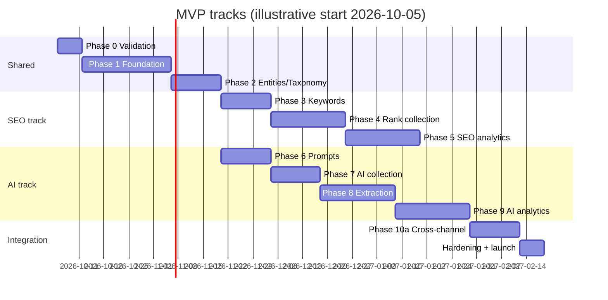

# 29. Phase Roadmap

Status: Draft for architecture freeze; Phases 0 and 1 follow [ADR-022](adr/ADR-022-python-backend-simplified-platform.md) (architecture locked 2026-09-30)
Last updated: 2026-09-30
Related: every document; spikes S-01 to S-16 defined in [01-research-findings.md](01-research-findings.md) section 12 "Experiments required in Phase 0"; checklist in [31-implementation-checklist.md](31-implementation-checklist.md)

## 1. Summary

| Phase | Name | MVP? | Depends on | Estimate (engineer-weeks) |
|---|---|---|---|---|
| 0 | Research validation and architecture freeze | MVP | none | 1 |
| 1 | Platform foundation | MVP | 0 | 3.5 |
| 2 | Brands, entities, domains, taxonomy | MVP | 1 | 3 |
| 3 | SEO keyword system | MVP | 2 | 4 |
| 4 | SEO rank collection | MVP | 3 | 6 |
| 5 | SEO analytics | MVP | 4 | 6 |
| 6 | AI prompt system | MVP | 2 | 3 |
| 7 | AI collection | MVP | 6, 4 (shared DataForSEO plumbing) | 4 |
| 8 | AI extraction | MVP | 7 | 6 |
| 9 | AI analytics | MVP | 8 | 5 |
| 10 | SEO and AI integration (MVP slice: 10a) | MVP (10a) | 5, 9 | 4 (10a) + 3 (10b) |
| 11 | Keyword and prompt discovery | Post-MVP | 10a | 5 |
| 12 | First-party integrations | Post-MVP | 1, 10a | 6 |
| 13 | Source intelligence | Post-MVP | 9 | 4 |
| 14 | Advanced statistics and benchmarks | Post-MVP | 9 | 4 |
| 15 | Advanced intelligence | Post-MVP | 10b, 13, 14 | 8+ |

**MVP total:** about 45.5 engineer-weeks. [ADR-022](adr/ADR-022-python-backend-simplified-platform.md) cut Phase 0 from 3 to about 1 week and Phase 1 from 6 to about 3.5 engineer-weeks; Phases 2 to 10a keep their scope. With three engineers (one backend/data, one backend/collection, one full-stack/frontend) working two tracks after Phase 2 (SEO track: 3, 4, 5; AI track: 6, 7, 8, 9), the MVP is about 19.5 calendar weeks including Phase 0, integration and hardening (about 18.5 weeks after Phase 0), matching the chart below. Estimates are planning numbers, not commitments; the estimates for Phases 2 to 10a are re-checked at the end of Phase 1.

### 1.1 Build order (set 2026-09-30)

The product owner's rule: build what makes the product show data first, and move everything that is optional at the start into one hardening step before launch. The table above gives scope, dependencies and estimates. This section gives the order of work, and it wins where the two differ. The chart above still shows the dependencies; with one backend builder the two tracks run one after the other.

| Step | Work | Phase | Why it sits here |
|---|---|---|---|
| 1 | Workspaces, projects, membership and permission checks on every route; invitations (create and accept only) | 1 | Every row of data belongs to a project, and a person joins by invitation |
| 2 | Worker, the two queues, the task ledger, the budget check before each dispatch | 1 | Nothing is collected without it, and the budget check protects provider spend |
| 3 | DataForSEO client and rate limiter, raw payload storage in R2, the Phase 0 test runs | 0 and 1 | Needs a funded DataForSEO account and the two R2 buckets |
| 4 | Brands, entities, domains, locations, taxonomy | 2 | Keywords and prompts are judged against them |
| 5 | Keywords, then rank collection | 3 and 4 | First real data |
| 6 | Droplet, Compose stack, deploy workflow, nightly backups | 1 (infra) | Rank history only builds on a server that runs every day, so the deploy comes as soon as collection works |
| 7 | SEO analytics | 5 | Internal alpha at the end of this step |
| 8 | Prompts, AI collection, extraction, AI analytics | 6 to 9 | AI alpha at the end of this step |
| 9 | The SEO and AI matrix | 10a | Joins both tracks |
| 10 | Launch hardening: the deferred list below | 1 and launch | Optional while the users are the internal team |
| 11 | Discovery, first-party integrations, source intelligence, advanced statistics | 11 to 15 | Post-MVP, unchanged |

**Deferred to step 10.** Each item keeps its specification; only its place in the order changed.

- Two-factor. Enrolment, sign-in with a code and recovery codes are built and stay in the API, for any user who turns them on. Blocking an owner or admin who has not enrolled (`two_factor_enrollment_required`, [19-api-specification.md](19-api-specification.md) section 2.1 rule 6) and the enrolment screens wait. Until then a password is enough for every role.
- Invitations beyond create and accept: resend, cancel, decline, and the public preview of an invitation.
- The general request limit (600 per minute per user) and `GET /api/v1/roles`. The sign-in throttle is built and stays on.
- The email outbox in the worker, the purge of expired sessions and used tokens, and the retention jobs.
- Change of email address and the disable-user route.
- Routes to read the audit log and to manage quotas and budgets. Audit rows are written from the start, and the budget check is part of step 2.
- Heartbeats, the uptime check, runbooks, the monthly restore drill, Renovate and secret scanning. Sentry and the nightly backup arrive with step 6.
- Refactors with no change in behaviour (review log items F21 and F22).

**Never deferred.** Tenant isolation (row-level security and the cross-tenant test suite), the sign-in throttle, the session and cookie rules, secret handling, and the budget check. At the deploy: the firewall, no published database or Redis port, and encrypted nightly backups.

## 2. Definition of Done (applies to every phase)

- Migrations applied in CI on an empty database and on the synthetic fixture database; no lock over 2 s on large tables.
- Backend: `uv run ruff check` and `uv run pytest` (unit and integration) pass. Web: `pnpm lint`, `pnpm typecheck`, `pnpm test` and `pnpm build` pass; coverage targets from [26-testing-quality.md](26-testing-quality.md) met for touched packages.
- New routes have declared permissions and are covered by the cross-tenant test suite.
- New metrics are defined in doc 09 or 16 with method version; the API returns the `MetricValue` contract.
- Observability: new jobs record duration and outcome on the task ledger (or the job's own table) and send a Healthchecks heartbeat if scheduled; new failure modes report to Sentry or are explicitly accepted.
- Docs updated (the relevant numbered doc and, if a decision changed, an ADR).
- Deployed to production droplet behind a feature flag if user-facing; runbook entry for any new operational procedure.
- No placeholder code, no TODO without an issue link.

## 3. Phases

### Phase 0: Research validation and architecture freeze

**Objective:** Replace the assumptions in this documentation with measurements, then freeze schema and contracts for Phases 1 to 5. Scope per [ADR-022](adr/ADR-022-python-backend-simplified-platform.md).

| Area | Content |
|---|---|
| Features | None user-facing |
| Work | Put the repository under git and commit the baseline; fund DataForSEO and create the R2 buckets; spikes S-01 to S-06 (DataForSEO: SERP task flow and billing, payload sizes, AI Overview async behaviour, ChatGPT and Gemini scraper payloads, replicate independence, AI Mode; docs 06, 07), S-09 (synthetic 12-month dataset) and S-11 (canonicalizer on real URLs); capture provider fixtures with schema hashes; measure payload sizes; resolve billing ambiguities. S-07 (Better Auth) and S-08 (BullMQ load) are dropped; S-10 (restore drill) becomes Phase 1 work; S-12 to S-16 run before the phase that needs them |
| Database | Draft migrations for Phase 1 to 5 tables applied to a scratch DB for S-09 |
| Backend | Spike scripts in `spikes/` (not production code), fixture capture tool |
| Frontend | Clickable wireframes for Overview, Rank Tracker, Prompt Explorer, Matrix (low fidelity) |
| Infra | Scratch droplet (destroyed after); R2 buckets `seo-raw` and `seo-backups` created with lifecycle rules (30-day rule on `seo-backups/daily/`); no bucket lock |
| Tests | Fixture registry seeded with real responses (SERP depths 10/20/100, AIO cached/async/absent, ChatGPT, Gemini, AI Mode) |
| Acceptance criteria | S-01 to S-06, S-09 and S-11 each have a written result in `docs/spikes/S-xx.md`; price book seeded with confirmed billing; cost model (doc 27) and growth model (doc 28) updated with measured numbers; ADRs accepted; open questions Q-01 to Q-06 and Q-08, Q-09 in doc 30 answered or explicitly deferred |
| Risks | DataForSEO billing differs from docs (budget impact); scraper login-state or location behavior undermines representativeness claims (wording changes); one week leaves little slack (a spike that overruns continues alongside Phase 1 foundation work, which does not depend on its numbers) |
| DoD | Architecture freeze meeting signs off docs 04, 05, 12, 19 (Phase 1 to 5 scope) |

### Phase 1: Platform foundation

**Objective:** A secure, deployable, observable, backed-up empty platform with tenancy, on the stack locked by [ADR-022](adr/ADR-022-python-backend-simplified-platform.md).

| Area | Content |
|---|---|
| Features | Sign-up, sign-in, email verification, password reset, TOTP 2FA (opt-in; enforcement for owner and admin is deferred, section 1.1), workspaces, invitations, roles, projects CRUD, audit log. Google sign-in, API keys and the Idempotency-Key header are deferred |
| Dependencies | Phase 0 |
| Database | PostgreSQL 18 through SQLAlchemy 2 (async, asyncpg) with Alembic migrations (SQL in `op.execute` allowed); schemas `auth`, `core`, `ops`; `auth` tables for users, sessions, verification and reset tokens, workspaces, memberships and invitations (`auth.api_keys` may exist without routes); `core.projects`, `core.workspace_quotas`, `ops.budgets`, `ops.audit_logs`, `ops.component_versions`, `ops.providers`, `ops.provider_price_book`, `ops.raw_payloads`, `ops.schedules`, `ops.collection_runs`, `ops.collection_tasks`, `ops.provider_cost_events`, `ops.cost_daily`; `ops.ensure_monthly_partitions`; RLS helper and policies; roles `app_api` (api, subject to RLS), `app_worker` (worker, bypasses RLS, never reachable from a request), `migrator` (owner), `backup` (read-only). `ops.secrets` waits for Phase 12 and `ops.fetch_cache` for Phase 11 or later |
| Backend | One Python 3.13 project in `backend/` (FastAPI, Pydantic v2, uvicorn, `uv`) with two entrypoints, api and worker; layout `backend/src/sightline/{api, worker, domain, extraction, providers, collectors, db, storage, config}` with purity rules enforced by import-linter; settings validated at start; structured JSON logs; Sentry. API at `/api/v1`: own auth module (argon2id passwords, opaque session ids in `auth.sessions` with a 60 s Redis read-through cache, `__Host-session` cookie, email verification and password reset with hashed tokens, invitations, roles per doc 24 section 3, TOTP with pyotp), tenancy dependency with `set_config('app.workspace_id', ...)` per transaction, permission checks, problem+json errors, rate limiting, request ids, SameSite=Lax plus an Origin check on state-changing requests; OpenAPI 3.1 generated by FastAPI. Worker: Taskiq with the Redis broker, queues `collect` (concurrency 8, shared rate limiter) and `process` (concurrency 4) in one process; planner tick under a Redis lock; dispatcher with budget check; reconciler; Taskiq scheduler for maintenance cron jobs (no workloads yet). Storage (R2 client, zstd, raw payload writer and reader); provider adapter contract; DataForSEO HTTP client with rate limiter and error taxonomy (no workloads yet) |
| Frontend | Next.js (App Router, TypeScript, pnpm) in `apps/web/`, `output: 'standalone'`, self-hosted as the `web` container; server components call the API over the Docker network. Auth screens (including TOTP enrolment), workspace/project switcher, settings (members, roles, projects), empty Overview shell, design system setup (shadcn/ui on Tailwind v4); typed client generated from the OpenAPI document with `openapi-typescript` plus `openapi-fetch`, regenerated in CI and committed (doc 19) |
| Infra | Production droplet (2 vCPU, 4 GB, 80 GB, Ubuntu 26.04), bootstrap script, 2 GB swap; Docker Compose with `caddy`, `web`, `api`, `worker`, `postgres` (`postgres:18`), `redis` (`redis:8`) and a one-off `migrator` running `alembic upgrade head`; Caddy routes `/api/*` to `api` and everything else to `web` on one domain (no CORS); DO Cloud Firewall, SSH hardening, unattended upgrades; platform secrets in `/etc/seo-platform/.env` (root-owned, 0600) written by the deploy workflow from GitHub Actions environment secrets; GitHub Actions CI/CD (lint, typecheck, tests, build the three images, push to GHCR by digest, SSH deploy: pull, run `migrator`, restart `api` and `worker`, then `web`; rollback to the previous tag); backups (nightly `pg_dump -Fc`, zstd, age, `rclone` to R2 `seo-backups/daily/` with a 30-day lifecycle rule), DigitalOcean weekly droplet backups enabled, monthly scripted restore drill (`restore-verify.sh`, S-10); Sentry (Python and Next.js SDKs, 10% performance sampling), Healthchecks.io heartbeats (planner tick, backups, maintenance, `ops_health`), one Better Stack uptime check; Docker json-file log rotation |
| Tests | pytest with Testcontainers (`postgres:18`, `redis:8`): auth flows, permission coverage test, cross-tenant suite, RLS tests, Alembic migration check in CI, import-linter contracts, Taskiq smoke test (enqueue on both queues, retry by error class, worker restart, reconciler after a Redis flush), generated-client drift check; Vitest and Playwright scaffolding in `apps/web`; first restore drill run and recorded |
| Acceptance criteria | A user can sign up, verify email, sign in, create a workspace and project, invite a member with a role and call `GET /api/v1/me`; a second workspace cannot read the first's project (404); the nightly backup lands in R2 encrypted and the first restore drill passes and is recorded; deploy from main to production in under 10 minutes with migrations; a forced failure reaches Sentry and a missed heartbeat alerts from Healthchecks; Taskiq passes its smoke test or Celery is adopted; steady RAM within 2.1 to 2.8 GB |
| Risks | Taskiq maturity (fallback: Celery, decided by the smoke test); own auth module is security-critical code (security checklist, tests for token hashing, session revocation and TOTP); two toolchains in one repo; no preview deployments with self-hosted Next.js (Playwright against the Compose stack in CI instead) |
| DoD | Section 2 plus: security checklist items for Phase 1 in doc 31 ticked |

### Phase 2: Brands, entities, domains, taxonomy

**Objective:** The shared vocabulary that SEO and AI both depend on.

| Area | Content |
|---|---|
| Features | Entity editor (own brand, competitors, products), aliases with match modes and negative aliases, entity domains with scopes, project roles, taxonomy vocabularies and terms (tree), alias test tool (paste an answer, see highlighted matches) |
| Database | `core.domains`, `core.domain_categories` (seed), `core.urls`, `core.url_remap`, `core.locations`, `core.provider_location_map`, `core.entities`, `core.entity_aliases`, `core.entity_domains`, `core.project_entities`, `core.project_domain_roles` (materialized view), `core.taxonomy_vocabularies`, `core.taxonomy_terms`, `core.publishers`, `core.publisher_domains` |
| Backend | URL canonicalizer v1 with test vectors (doc 14 section 3); domain resolver; alias automaton compiler (used later by extraction, built now for the test tool); location sync job (DataForSEO locations, free) |
| Frontend | Onboarding steps 1 to 3 (project, domains, competitors), entities screen, taxonomy screen |
| Tests | Canonicalizer property tests and vectors; resolver specificity tests; automaton tests (overlap, negatives, possessives) |
| Acceptance criteria | A project has an own brand with domains and 5 competitors; the alias test tool highlights correct spans on 20 sample answers from Phase 0 fixtures; locations searchable |
| Risks | Alias semantics too complex for users (mitigate with presets and the test tool) |

### Phase 3: SEO keyword system

**Objective:** Manage tracked keywords at scale, with metrics.

| Area | Content |
|---|---|
| Features | Add keywords (single, bulk paste), CSV import with preview and duplicate handling, groups, tags/topics assignment, depth profiles, schedules, keyword metrics (volume, CPC, KD, intent) on creation and monthly, export |
| Database | `seo.keywords`, `seo.tracked_keywords`, `seo.tracked_keyword_config_history`, `seo.keyword_groups`, `seo.keyword_group_members`, `seo.tracked_keyword_terms`, `seo.tracked_keyword_competitors`, `seo.keyword_metric_snapshots`, `seo.keyword_metrics_current`, `seo.keyword_imports` |
| Backend | Keyword APIs; import pipeline (R2 upload, parse, preview, confirm); Labs `keyword_overview` adapter and `keyword_metrics` workload through the full task ledger; schedules API; quota checks |
| Frontend | Rank Tracker table shell (keywords, metrics, no ranks yet), import wizard, groups sidebar, keyword settings |
| Tests | Import duplicate matrix (doc 08 section 3.3), Labs adapter contract tests, quota enforcement |
| Acceptance criteria | Import 5,000 keywords from CSV in under 2 minutes with a correct preview; metrics appear within 5 minutes; cost events recorded and visible in a basic costs table |
| Risks | Labs type traps (competition string vs float); Google Ads batch failure mode (not used as primary) |

### Phase 4: SEO rank collection

**Objective:** Reliable daily rank collection with SERP features and AI Overview, stored immutably.

| Area | Content |
|---|---|
| Features | Scheduled rank checks by depth profile, "check now" (live), SERP snapshots, feature tracking, AI Overview capture (as SERP feature and AI observation), competitor ranks, current state, rank events |
| Database | `seo.serp_snapshots`, `seo.serp_features`, `seo.serp_feature_types` (seed), `seo.domain_rank_observations`, `seo.tracked_keyword_state`, `seo.serp_current_results`, `seo.rank_events`; `ai.engines` (seed), `ai.observations`, `ai.citations` (for AIO), `ops.derivation_log`; `dispatched_at` and `ops.task_attempts` |
| Backend | DataForSEO SERP adapter (submit, `tasks_ready` polling every 60 s and every 30 s while a collection window is open, sweeper, fetch, normalize v1 per doc 06 section 5); ingest transaction; planner/dispatcher for `seo_rank` with staggering and fairness; retry policy; reconciliation; cost capture and daily reconciliation with `user_data`; competitor backfill job from stored snapshots |
| Frontend | Rank Tracker with current rank, change, URL, features, AIO state, competitor columns, sparkline; Keyword Detail v1 (rank history with depth bands, SERP snapshot viewer from R2, features strip, AIO history) |
| Infra | Spool tmpfs; R2 lifecycle for `serp_raw` |
| Tests | SERP parser gold set (doc 26 section 4); feature mapping; AIO parsing (cached, async, absent); idempotency (double planning, duplicate `tasks_ready` entries, Redis flush); retry per error kind; load test with 10,000 recorded payloads |
| Acceptance criteria | 5,000 keywords collected daily for 14 consecutive days with at least 98% of checks ingested within window + 6 h; zero duplicate snapshots; SEO gold set passes 100% on rank extraction and features; per-keyword cost matches the price book within 5% after reconciliation |
| Risks | Standard-queue turnaround spikes (window sizing); Google SERP changes (schema hash check in the test suite, `schema_mismatch` rate); async AIO billing surprise (budget alerts) |

### Phase 5: SEO analytics

**Objective:** The rank tracking product users can run their SEO on.

| Area | Content |
|---|---|
| Features | Overview (SEO side), distribution, visibility (both variants), estimated clicks (labeled), SEO SOV, competitor views, keyword gap, landing pages (SEO), cannibalization flags, SEO alerts with digests, exports |
| Database | `seo.daily_project_metrics`, `seo.daily_page_metrics`, `seo.cannibalization_flags`, `ops.ctr_curves` (seed `ctr_v1`), `ops.alert_rules`, `ops.alert_events` |
| Backend | Rollup jobs; metric service returning `MetricValue`; alert evaluation with dedupe, digests, flapping suppression, anomaly hold; email, Slack incoming-webhook and custom webhook delivery (custom webhooks HMAC-signed, doc 19 section 5); cannibalization detector; export jobs |
| Frontend | Overview (SEO), Rank Tracker filters and saved views, Keyword Detail complete, Landing Pages, Competitors (SEO), Alerts screens, Costs screen v1 |
| Tests | Metric regression dataset (frozen expected outputs); depth-aware null cases; alert spam tests (algorithm update simulation) |
| Acceptance criteria | All SEO metrics in doc 09 available via API and UI with denominators; overview p95 under 300 ms on production data; a simulated mass movement produces one digest, not hundreds of alerts |
| Risks | CTR curve disputes (methodology page and version boundary support) |

### Phase 6: AI prompt system

**Objective:** Manage prompts as versioned measurement instruments.

| Area | Content |
|---|---|
| Features | Prompts CRUD with metadata, versions, change kinds, core/discovery/custom panels with membership history and lock, branded detection, prompt lint rules, bulk import, engine configuration per project, AI schedules |
| Database | `ai.prompts`, `ai.prompt_versions`, `ai.prompt_panels`, `ai.panel_memberships`, `ai.prompt_terms`, `ai.project_engines`, `core.keyword_prompt_links` (manual and generated links only in this phase) |
| Backend | Prompt APIs, version rules, panel membership rules and audit, template-based keyword-to-prompt generation (no LLM yet) |
| Frontend | Prompt list, prompt editor with lint hints, panels screen with sizing guidance (static until Phase 9 measures flip rates) |
| Tests | Versioning invariants, panel history exclusion constraint, branded detection |
| Acceptance criteria | 1,000 prompts imported into a core panel with topics; version change creates a new version and audit entry; locked panel rejects editor changes |

### Phase 7: AI collection

**Objective:** Collect consumer-surface answers reliably and store them fully.

| Area | Content |
|---|---|
| Features | Weekly AI runs for ChatGPT, Gemini, AI Mode (prompt and optional keyword runs), replicates, run-prompt-now, raw preservation |
| Database | `ai.fanout_queries`, `ai.retrieval_results`, `superseded_by` columns; `provider_extras` |
| Backend | DataForSEO LLM Scraper (ChatGPT, Gemini) and AI Mode adapters; normalizers v1 (doc 07 section 5) incl. ads exclusion and refusals; planner expansion (engines x locations x replicates) with replicate spacing; cost capture |
| Frontend | Observation list and answer viewer (raw text, citations, no extraction yet), run status |
| Tests | Normalizer fixtures for each engine; ads-in-markdown handling (S-04 outcome); refusal detection |
| Acceptance criteria | Two consecutive weekly runs for 1,000 prompts x 3 engines with at least 95% valid observations; raw payloads in R2; costs match estimates within 10% |
| Risks | Provider schema drift (schema hash check in the test suite); consumer surface behavior change (model boundary markers) |

### Phase 8: AI extraction

**Objective:** Turn answers into trustworthy, versioned facts.

| Area | Content |
|---|---|
| Features | Mentions with evidence spans, structured rank, mention order, prominence, recommendation, own-brand sentiment, citation roles, untracked entity candidates, re-derivation on alias changes |
| Database | `ai.derivations`, `ai.entity_mentions`, `ai.observation_facts`, `ai.entity_candidates`, `ai.citation_entity_links` |
| Backend | Extraction stages 1 to 10 (doc 13), LLM adjudication stage with budget, derivation management and re-derivation jobs |
| Frontend | Evidence viewer highlighting, entity candidate list, alias test tool connected to real observations |
| Tests | AI gold set (doc 26 section 4) with targets from doc 13 section 7 as merge gates |
| Acceptance criteria | Gold set targets met; re-derivation of 100,000 observations completes in under 1 hour without blocking ingest; LLM adjudication spend under the project cap |
| Risks | Ambiguous brand names; recommendation rules precision (LLM fallback coverage) |

### Phase 9: AI analytics

**Objective:** Honest AI visibility metrics with uncertainty.

| Area | Content |
|---|---|
| Features | Mention, citation, mention-and-citation, four-outcome mix, recommendation, SOV, citation share, structured top-3, prominence, first-mention, sentiment distribution, by topic/intent/engine/country/language; Wilson and fixed-panel intervals; period comparison (paired); volatility; version boundaries; AI alerts; Prompt Explorer complete |
| Database | `ai.daily_prompt_engine_metrics`, `ai.daily_domain_citations`, `ai.project_source_stats`, denominator view |
| Backend | Rollups; metric service (doc 16 section 13); statistics functions (Wilson in SQL and Python, bootstrap, Newcombe, RBO, BH filter); flip-rate measurement feeding panel sizing |
| Frontend | Overview (AI side), Prompt Explorer, statistics drawer (basic), competitor AI view, topic breakdowns |
| Tests | Statistical reference values; metric regression dataset; SOV invariants |
| Acceptance criteria | Every AI metric returns `MetricValue` with n and interval; SOV query over 12 weeks under 200 ms; period comparison flags only interval-excluding-zero changes |

### Phase 10: SEO and AI integration

**10a (MVP):** keyword-prompt links with suggestions (cluster, semantic, fan-out), AI Overview vs organic rank (same-check), AIO citation rate by rank bucket, SEO/AI matrix (keyword level) with thresholds, page intelligence (SEO + AI citations), `core.xch_keyword_weekly`.

**10b (post-MVP):** cluster-level matrix, longitudinal association analysis (doc 15 section 5.1), domain-level SERP vs citation dominance, AI-first opportunities, keywords-to-prompts suggestions into the inbox.

| Area | Content |
|---|---|
| Database | `core.xch_keyword_weekly`; link suggestion statuses |
| Backend | Link suggestion jobs, matrix service, page intelligence service |
| Frontend | SEO + AI Matrix screen, Page Intelligence, related prompts on Keyword Detail and related keywords on Prompt Explorer |
| Acceptance criteria | For a project with 1,000 keywords and 1,000 prompts, the matrix loads in under 800 ms and every cell drills down to observations; AIO citation rate by rank bucket shows Wilson intervals |

### MVP definition

A credible MVP is Phases 0 to 9 plus 10a:

- Daily rank tracking for up to 10,000 keywords per workspace on one droplet, with SERP features, AI Overview presence and citation, competitor ranks, depth-aware history, visibility, SOV, landing pages, cannibalization, alerts, exports.
- Weekly AI tracking for up to 1,000 to 2,000 prompts per project across ChatGPT, Gemini and AI Mode, with replicates for a priority subset, full raw evidence, versioned extraction, mention and citation separated, recommendation and structured rank, intervals, Prompt Explorer.
- The keyword-level SEO/AI matrix and page intelligence joining both.
- Multi-tenant auth, RBAC, audit, budgets, cost metering, backups with a monthly restore drill, monitoring.

Not in MVP: discovery inboxes (manual and CSV entry only), first-party integrations, source intelligence beyond top domains/pages, official API benchmarks, claims, diagnostics panels, experiments.

### Phase 11: Keyword and prompt discovery

Features: keyword candidate inbox (Labs ideas, suggestions, related, ranked keywords, domain intersection, autocomplete, PAA and related searches from stored SERPs, GSC basic import, fan-out queries), opportunity score, promote flows; prompt candidate inbox (PAA, GSC questions, templates, LLM variants with budget, uploads), near-duplicate detection; auto-clustering by SERP overlap; AI demand estimates (labeled). Database: `seo.keyword_candidates`, `ai.prompt_candidates`, `seo.ai_demand_snapshots`. Acceptance: a project can go from 10 seed keywords to 200 reviewed candidates and 100 promoted keywords and prompts in one session; generated prompts never display volume. The shared fetch cache ([ADR-017](adr/ADR-017-shared-fetch.md), `ops.fetch_cache`) is built in this phase or later.

### Phase 12: First-party integrations

Features and design per [18-first-party-integrations.md](18-first-party-integrations.md): GSC OAuth, 16-month backfill, daily sync, query/page matching to keywords and URLs; GSC generative AI report import (CSV); Bing Webmaster API and AI Performance import; GA4 AI referrals (Google channel and our classifier side by side); Cloudflare AI crawler stats; optional server log upload; envelope encryption of tenant credentials (`ops.secrets`, doc 24 section 5.2), deferred from Phase 1 by ADR-022. Acceptance: GSC backfill for a 16-month property completes within quota; page intelligence shows GSC columns labeled as GSC; imported AI reports keep file provenance and filters. Risk: Google OAuth app verification for external customers (start the process in Phase 11).

### Phase 13: Source intelligence

Features: domain categories (seed list, rules, LLM classification), publishers, source graph traversals, new/lost sources, category mix per engine, competitor source overlap, publisher opportunities, retrieved-not-cited analysis, pages repeatedly influencing topics, DataForSEO LLM Mentions landscape (optional), ads presence per engine. Acceptance: Citation Intelligence screen answers the doc 14 section 6 questions with drill-down to observations.

### Phase 14: Advanced statistics and benchmarks

Features: population intervals (cluster bootstrap), BH filtering extended from the Phase 9 AI movers list to every mover list, detectable-change sizing extended beyond the Phase 9 panel sizing, answer similarity (MinHash) after gold validation, SEO SERP volatility index, layout-aware click estimate (labeled), official API benchmark engines (OpenAI, Perplexity, optionally Anthropic) with fan-out comparison to the ChatGPT scraper, local classifier evaluation for extraction. Acceptance: statistics drawer offers both inference modes with explanations; benchmark series never pooled with consumer series.

### Phase 15: Advanced intelligence

Features: "Why am I losing this keyword/prompt" diagnostics (doc 15 sections 7 and 8), fan-out rank coverage (F5), claims extraction and review workflow, content gap analysis (topics/entities in competitor-recommending answers absent from owned pages), experiments (treatment and control prompt panels, before/after with paired comparison), hyperlocal tracking, Copilot via Bing SERP, fallback provider adapters when triggered (doc 05 section 5). Acceptance per feature, each with evidence vs hypothesis separation.

## 4. Cross-cutting milestones

| Milestone | When | Gate |
|---|---|---|
| Architecture freeze | end of Phase 0 | signed-off docs, spikes done |
| Internal alpha (own projects) | end of Phase 5 | SEO product used internally for 2 weeks |
| AI alpha | end of Phase 9 | AI metrics reviewed against manual spot checks on 100 answers |
| MVP launch (internal and first clients) | end of 10a + hardening | DoD, security checklist, restore drill, cost reconciliation within 5% |
| External SaaS readiness | after Phase 12 | DPA, Google OAuth verification, DataForSEO resale confirmation (Q-03), penetration test, PITR (pgBackRest), API keys, GFS backups (ADR-022 triggers in doc 28) |
