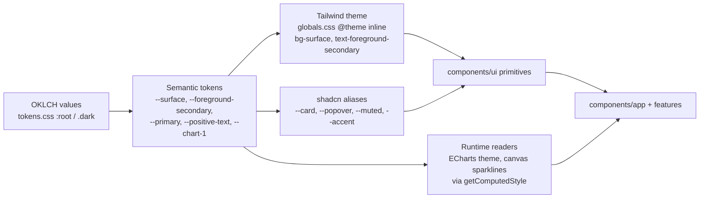

# 01. Foundations and Token Architecture

Status: Accepted (design-system v2)
Last updated: 2026-09-29
Visual source: [reference/visual-spec.md](reference/visual-spec.md) (values measured from the reference screens)
Implementation: [`apps/web/src/styles/tokens.css`](../../apps/web/src/styles/tokens.css), [`apps/web/src/styles/globals.css`](../../apps/web/src/styles/globals.css), [`apps/web/src/lib/design/tokens.contrast.test.ts`](../../apps/web/src/lib/design/tokens.contrast.test.ts)

## 1. Foundations at a glance

| Foundation | Decision | Document |
|---|---|---|
| Color | Neutral-first OKLCH tokens, one vivid cobalt accent, four semantic families, separate chart palette | [02](02-color-system.md) |
| Typography | Geist Sans (UI), Geist Mono (technical values), 14 px base (table cells 13 px), 15 composite type utilities, tabular numbers for all figures | [03](03-typography.md) |
| Spacing | 4 px base; 12 allowed steps | [04](04-spacing-density.md) |
| Density | Default (40 px rows) and Compact (32 px rows); 36 px controls; embedded tables always 32 px | [04](04-spacing-density.md) |
| Layout | Sidebar 208 px (56 px collapsed), top bar 52 px, 20 px gutters, 16 px between page blocks, full-width analytics | [05](05-layout-grid.md) |
| Surfaces | Tonal layers and 1 px hairline borders; shadows only for overlays; radius 2 to 10 px (panels 8, controls 6, badges 4; 2 px only for bar-list bars and engine presence squares) | [06](06-surfaces-borders-radius.md) |
| Icons | Lucide, 16 px default (18 px in the sidebar), stroke 1.75 | [07](07-icons.md) |
| Motion | 100, 150, 200 ms; off under reduced motion | [21](21-motion.md) |
| Z-index | Fixed 12-step scale | this document, section 6 |

## 2. Token layers

1. **Semantic tokens are the only public color API.** There is no primitive palette layer (`blue-500`) exposed to components. Values are written directly as OKLCH on semantic names, because a primitive layer invites components to bypass meaning. The table of values with hex equivalents lives in [02-color-system.md](02-color-system.md).
2. **Tailwind utilities are generated from semantic tokens** with `@theme inline`, so `bg-surface` resolves per theme at runtime. Tailwind's default palette, type scale, radius scale, shadows, easing and animation are reset with `--color-*: initial` (and equivalents). Utilities such as `bg-red-500`, `text-sm` or `rounded-2xl` do not exist in this project; the build silently generates nothing for them and lint rejects them (verified with Tailwind 4.3.3 on 2026-09-29).
3. **shadcn/ui aliases** (`--card`, `--popover`, `--muted`, `--accent`, `--input`, `--destructive`, `--sidebar-*`) point at semantic tokens so copied shadcn components render acceptably before they are restyled. Canonical names are preferred in all new code ([26-implementation-guidelines.md](26-implementation-guidelines.md) section 4).
4. **Runtime readers** (ECharts theme, canvas sparklines) read CSS variables with `getComputedStyle(document.documentElement)` through `lib/design/read-tokens.ts` and re-read on theme change. Charts never hard-code colors.

### 2.1 Naming conventions for tokens

| Pattern | Examples | Rule |
|---|---|---|
| `--{role}` | `--background`, `--surface`, `--foreground`, `--border`, `--ring`, `--primary` | Base role, shadcn-compatible where a shadcn name exists |
| `--{role}-{variant}` | `--surface-subtle`, `--surface-hover`, `--foreground-tertiary`, `--border-strong` | Variant of a role; variants are ordered from least to most emphasis |
| `--{semantic}-{use}` | `--positive-text`, `--negative-subtle`, `--warning-border`, `--info-text` | Semantic family; `-text` for text and icons, `-subtle` for tinted backgrounds, `-border`, `-solid` for fills and marks |
| `--chart-{n}`, `--rank-band-{n}`, `--seq-{n}`, `--div-{pos|neg}-{n}` | `--chart-1`, `--rank-band-2` | Data visualization |
| `--size-{component}` | `--size-control`, `--size-row-compact`, `--size-sidebar` | Component dimensions, exposed as `h-control`, `h-row`, `w-sidebar` |
| `--duration-{speed}`, `--ease-{name}` | `--duration-base`, `--ease-standard` | Motion |
| `--z-{layer}` | `--z-dropdown`, `--z-dialog` | Stacking |
| `--shadow-{surface}` | `--shadow-popover`, `--shadow-dialog` | Overlay elevation |

Primary accent naming: in design language this document calls it "the accent"; in code it is `primary` (`bg-primary`, `text-primary-text`, `bg-primary-subtle`) because shadcn/ui uses `primary` for the brand action color and `accent` for a hovered item surface. The shadcn meaning of `accent` is kept so copied components behave correctly.

## 3. Theme mechanism

| Aspect | Decision |
|---|---|
| Themes | Light (designed first) and Dark (equal quality). Both are fully specified; dark is not an inversion |
| Switch | `next-themes` with `attribute="class"`, `defaultTheme="system"`, `enableSystem`, `disableTransitionOnChange` |
| Where the class lives | `<html class="dark">`. Required: shadcn aliases are declared on `:root` and resolve correctly only when the theme class is on the same element |
| User setting | System, Light or Dark (default System). At 1440 px and up the top bar `ThemeSwitch` flips between Light and Dark; below 1440 px the user menu offers all three (`ThemeMenu` items); the command palette and Settings > Preferences offer all three at every width ([11-navigation.md](11-navigation.md) section 4, [19-responsive-behavior.md](19-responsive-behavior.md) section 3.2). Stored in a cookie so server-rendered HTML matches (no flash of the wrong theme) |
| Charts | ECharts instances re-read tokens and call `setOption` with the new theme on the `themechange` event; no page reload |
| Print and export images | Always light theme |
| `color-scheme` | Set per theme so native scrollbars, date inputs and form autofill match |

## 4. Token files and ownership

| File | Owner | Contents |
|---|---|---|
| `apps/web/src/styles/tokens.css` | Design system | All token values, both themes, sizes, motion, z-index |
| `apps/web/src/styles/globals.css` | Design system | Tailwind import, theme reset, `@theme inline` mapping, composite type utilities, `num`, `focus-ring`, base layer |
| `apps/web/src/lib/design/tokens.contrast.test.ts` | Design system | WCAG and color-vision tests over token values (fails CI on regressions) |
| `apps/web/src/lib/design/read-tokens.ts` (Phase 1) | Design system | Runtime token reader for charts and canvas |
| `apps/web/src/lib/format/*` | Design system | Number, rank, delta, date and URL formatting ([22](22-content-formatting.md)) |

Adding a token: add it to both theme blocks in `tokens.css` (or confirm it inherits correctly), map it in `globals.css` if a utility is needed, add its contrast pairs to the test when it is a text, border or mark color, document it in the relevant file here, and show it in the design-system preview.

## 5. Units and scaling

- All sizes are authored in `rem` (1 rem = 16 px at default zoom). The root font size is never changed, so browser zoom and user font-size settings scale the whole UI.
- Pixel values in this documentation are CSS px at 100% zoom.
- Border widths are `1px` (never rem), focus outlines `2px`.
- Line heights are absolute (`1.25rem`) rather than unitless so row heights stay on the 4 px grid.

## 6. Z-index scale

Components never use raw z-index numbers; they use `z-(--z-dropdown)` style utilities or the token in CSS.

| Token | Value | Used by |
|---|---|---|
| `--z-base` | 0 | normal flow |
| `--z-pinned-cell` | 10 | pinned table columns |
| `--z-table-header` | 20 | sticky table header (above pinned cells) |
| `--z-sticky` | 30 | sticky page header and filter bar |
| `--z-sidebar` | 40 | left navigation (overlays content on tablet) |
| `--z-inspector` | 50 | docked right inspector |
| `--z-dropdown` | 60 | menus, popovers, selects, date pickers, combobox lists |
| `--z-drawer` | 70 | overlay drawers (tablet and mobile inspector) |
| `--z-dialog` | 80 | modal dialogs and their scrim |
| `--z-command` | 90 | command palette |
| `--z-toast` | 100 | toasts |
| `--z-tooltip` | 110 | tooltips (always on top) |

Popovers opened from inside a dialog render in a portal and inherit the dialog's stacking context through Base UI's portal container, so they appear above the dialog without a special value.
