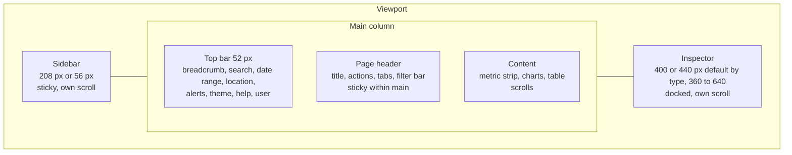

# 05. Layout, Grid and Application Shell

Status: Accepted (design-system v2)
Last updated: 2026-09-29

## 1. Target viewports

| Class | Widths | Status |
|---|---|---|
| Wide desktop | 1680, 1920, 2560 | Primary. Extra width goes to table columns and the inspector, never to empty margins |
| Desktop | 1440 | Primary design reference. Every screen is designed here first |
| Small desktop | 1280 | Fully supported. Sidebar stays expanded; inspector overlays instead of docking when the main column would drop below 720 px (section 6) |
| Tablet | 768 to 1279 | Supported for review and triage: sidebar becomes the 56 px rail at 1024 to 1279 and a drawer below 1024 (section 5), inspector overlays, low-priority columns hide ([19-responsive-behavior.md](19-responsive-behavior.md)) |
| Mobile | 360 to 767 | Monitoring and simple inspection only ([19-responsive-behavior.md](19-responsive-behavior.md)) |

Breakpoint utilities: `md` 768, `lg` 1024, `xl` 1280, `2xl` 1440, `3xl` 1680, `4xl` 1920 (defined in `globals.css`).

## 2. Application shell



```
+-----------+----------------------------------------------------------+--------------------+
| Sidebar   | Top bar (52) ⌂ > Rankings [Search ⌘K] [28 days] [US] [B] | Inspector header   |
| (208)     +----------------------------------------------------------+ (sticky)           |
|           | Page header: Title   meta                [Sec] [Primary] |                    |
| Overview  | Tabs                                                     | Inspector tabs     |
| Matrix    | Filter bar: [vs previous v] [Desktop v] [CRM x] +Filter  |--------------------|
| SEO       +----------------------------------------------------------+                    |
|  Rankings | Metric strip (76)                                        | Inspector content  |
|  ...      +----------------------------------------------------------+ (scrolls)          |
| AI        | Table toolbar (48)                                       |                    |
|  ...      | Table header (40, sticky)                                |                    |
|           | Rows (40)                                                |                    |
|           | ...                                                      |                    |
|           | Table footer (48)                                        |                    |
+-----------+----------------------------------------------------------+--------------------+
```

`[B]` is the notifications bell; theme, help and the user menu follow it. The date range (`[28 days]`) and location (`[US]`) are project-wide scope controls in the top bar on every page where they apply; the filter bar holds only screen-specific scope and filters ([11-navigation.md](11-navigation.md) section 4, [13-filters-search.md](13-filters-search.md) section 1).

### 2.1 Regions

| Region | Size | Position and scroll | Background |
|---|---|---|---|
| Sidebar | 208 px expanded, 56 px collapsed | Fixed to the left, full height, scrolls independently when navigation overflows | `sidebar`, right border `border-subtle` |
| Top bar | 52 px | Sticky at top of the main column | `surface`, bottom border `border-subtle` (hairline) |
| Page header | title block 56 px (title 32, 4 px gap, meta line 20) starting 20 px below the top bar, actions right-aligned and vertically centered on the title block; optional tabs (44 px) and filter bar (36 px controls); 16 px between these blocks; detail pages add the back link line. Totals per composition are in [23-application-patterns.md](23-application-patterns.md) section 3.2 | Sticky below the top bar on table pages; scrolls away on overview and detail pages | `background`, bottom border `border-subtle` |
| Content | fills remaining width; 20 px page gutter left and right (narrower on tablet and mobile, [19-responsive-behavior.md](19-responsive-behavior.md)), 16 px between blocks (header to metric strip, strip to filter bar, panel to panel) | The document scrolls (not a nested scroll container) except on table pages, where the table body is the scroll container so its header can stick under the page header | `background` with panels on `surface` |
| Inspector | 400 px default (440 px for prompt, citation and answer evidence), resizable 360 to 640 px ([16-drawers-dialogs-popovers.md](16-drawers-dialogs-popovers.md) section 2.2); 20 px padding | Docked right, full height below the top bar, own scroll, sticky inspector header | `surface`, left border `border` (hairline), no shadow when docked; `shadow-inspector` only when overlaying |

### 2.2 Scroll model

- Table pages: the page header and filter bar stick; the table header sticks under them; the table body scrolls inside the content region. The page never scrolls horizontally; the table scrolls horizontally inside its own region when columns exceed the width, with the identity column pinned.
- Overview and detail pages: the window scrolls; only the top bar sticks.
- The inspector scrolls independently. Opening it never moves the underlying scroll position.
- Sticky elements never cover the focused element: scroll containers set `scroll-padding-top` to the height of the sticky stack (WCAG 2.4.11).

## 3. Grid

Overview and table pages do not use a 12-column page grid. Their layout is composed of full-width regions stacked vertically, and horizontal splits with fixed rules. Detail pages (T3) are the one exception: they use a 12-column grid with a right rail (last row of the table below).

| Layout | Rule |
|---|---|
| Full-width table | Table fills content width. No max-width |
| Chart plus side list | Chart `minmax(0, 1fr)`, list 360 px fixed (`grid-cols-[minmax(0,1fr)_360px]`) collapsing to stacked below 1280 px |
| Two equal panels | `grid-cols-2 gap-4` at 1280 px and above; stacked below |
| Small multiples | `grid-cols-[repeat(auto-fill,minmax(280px,1fr))] gap-4` |
| Metric strip | One panel, 76 px tall (`h-metric-strip`); cells in a horizontal flex split by full-height 1 px dividers, 20 px cell padding; wraps to two rows below 1024 px |
| Settings | Left local navigation 200 px plus form column `max-w-form` (640 px) |
| Prose (methodology, help) | `max-w-prose` (720 px) |
| Detail page with right rail (T3) | `grid-cols-12 gap-4`: evidence (charts and tables) spans 8 columns (`col-span-8`), the right rail spans 4 (`col-span-4`) and holds stacked panels 16 px apart (Keyword Detail: AI answers, SERP features, recent changes; content per [24-page-templates.md](24-page-templates.md) section 9.4). Below 1280 px the grid becomes one column and the rail panels follow the evidence panels in the same order ([24-page-templates.md](24-page-templates.md) section 5) |

Arbitrary grid templates are allowed only in the documented forms above; new ones are added here.

## 4. Widths

| Element | Width |
|---|---|
| Sidebar | 208 px / 56 px collapsed |
| Inspector | 400 px default; 360 min; 640 max; 440 px default for prompt, citation and answer evidence inspectors ([16-drawers-dialogs-popovers.md](16-drawers-dialogs-popovers.md) section 2.2) |
| Dialog small / medium / large | 400 / 560 / 720 px |
| Command palette | 640 px, max height 480 px |
| Popover (filter) | 280 to 360 px, max height 400 px |
| Menu | 180 to 280 px |
| Tooltip | max 320 px |
| Toast | 360 px |
| Settings form column | 640 px max |
| Metric strip item | min 140 px (`md`), 96 px (`sm`), content-sized ([23-application-patterns.md](23-application-patterns.md) section 2.2) |

Exception: the notification center popover ([18-notifications-alerts.md](18-notifications-alerts.md)) is 380 px wide and up to 560 px tall.

Exception: the `DateRangePicker` popover ([10-forms.md](10-forms.md) section 10.2) is 648 px wide (preset column plus two months).

## 5. Sidebar behavior

| State | Width | Contents | Trigger |
|---|---|---|---|
| Expanded | 208 px | Icons plus labels, group labels, counts | Default at 1280 px and above |
| Collapsed | 56 px | Icons only, tooltips on hover and focus showing the label and shortcut | User toggle (persisted); default at 1024 to 1279 px |
| Drawer | 280 px overlay with scrim | Same as expanded | Below 1024 px, opened from a menu button in the top bar |

Collapse toggle: button at the bottom of the sidebar and shortcut `[`. The state persists in a cookie so server render matches.

## 6. Inspector docking rules

The width resolution order is owned by [16-drawers-dialogs-popovers.md](16-drawers-dialogs-popovers.md) section 2.6:

| Space left for the inspector (viewport minus sidebar minus the 720 px minimum main column) | Behavior |
|---|---|
| At least 360 px (the inspector minimum) | Inspector docks at `min(preferred width, space left)`; main column shrinks but keeps at least 720 px; table keeps its scroll position and pinned columns |
| Less than 360 px, viewport at least 768 px | Inspector overlays the main column at its preferred width (the same floating card, 12 px under the top bar and from the right and bottom edges, no scrim, main content stays interactive) |
| Below 768 px viewport | Inspector becomes a full-screen sheet with a back button |

Details of the inspector pattern are in [16-drawers-dialogs-popovers.md](16-drawers-dialogs-popovers.md) section 2.

## 7. Empty width on large monitors

At 1920 px and above, width goes to: more visible table columns (column priority, [19-responsive-behavior.md](19-responsive-behavior.md) section 6.1), the docked inspector at its per-type default (400 px, or 440 px for prompt, citation and answer evidence, [16-drawers-dialogs-popovers.md](16-drawers-dialogs-popovers.md) section 2.2), and chart plus side list layouts. Content is not centered in a narrow column. The only width-capped regions are prose and settings forms.
