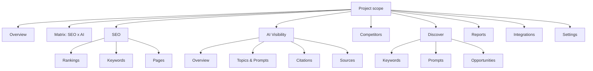

# 11. Navigation

Status: Accepted (design-system v2)
Last updated: 2026-09-29

## 1. Navigation architecture

Primary navigation stays concise: 14 sidebar items in 3 sections separated by 16 px of space (no divider lines). The first section holds Overview, Matrix and two labelled groups, SEO (3 items) and AI Visibility (4 items); the second holds Competitors and Discover (topics are reached through Topics & Prompts, [ADR-DS-022](adr/ADR-DS-022-topics-and-prompts.md)); the third holds Reports, Integrations and Settings. Subpages use local tabs in the page header, never extra sidebar entries.



### 1.1 Sidebar structure (expanded)

```
[N] Northwind CRM          v      <- project switcher (workspace in top bar breadcrumb)

  Overview
  Matrix
SEO
  Rankings
  Keywords
  Pages
AI Visibility
  Overview
  Topics & Prompts
  Citations
  Sources

  Competitors
  Discover                 24     <- count of new candidates

  Reports
  Integrations
  Settings

Last run 06:12 · 1,284 keywords   <- collection status line
  [«] Collapse
```

| Destination | Route (project-scoped) | Local tabs in page header |
|---|---|---|
| Overview | `/` | none |
| Matrix | `/matrix` | Keywords, Clusters, Pages |
| SEO > Rankings | `/seo/rankings` | none (saved views instead) |
| SEO > Keywords | `/seo/keywords` | Inventory, Groups, Metrics history, Imports |
| SEO > Pages | `/seo/pages` | Landing pages, Cannibalization |
| AI Visibility > Overview | `/ai` | none |
| AI Visibility > Topics & Prompts | `/ai/prompts` | Topics, Prompts, Panels, Versions ([ADR-DS-022](adr/ADR-DS-022-topics-and-prompts.md)) |
| AI Visibility > Citations | `/ai/citations` | Domains, Pages, New and lost |
| AI Visibility > Sources | `/ai/sources` | Publishers, Categories, Opportunities |
| Competitors | `/competitors` | Comparison, SEO, AI, Candidates |
| Discover | `/discover` | Keywords, Prompts, Opportunities |
| Reports | `/reports` | Scheduled, Exports, Saved views |
| Integrations | `/integrations` | one tab per connected source (at most 6, section 6) |
| Settings | `/settings` | Local left navigation (section 5) |

Workspace-level destinations (Costs, Operations, Members, Billing, API keys) are in the workspace menu of the top bar and in Settings. Alerts are reached through the notification bell and Settings > Alert rules; detail views of alerts open in the inspector.

As built (keywords UI, step 5 part 1, 2026-10-05): the workspace menu is a "Workspace" group of links at the foot of the project switcher, in the sidebar and in the top bar: Costs (`/{workspace}/costs`, shown with `costs:read`) and Runs (`/{workspace}/ops/runs`, shown with `data:read`, opening on the current project), above the link to all projects. The breadcrumb has no workspace menu yet, and Members and Workspace settings are reached through Settings. Rankings is live in the sidebar and a project opens on it; SEO > Keywords and the other destinations of the table are planned. Costs and Runs are workspace pages outside any project: they have the workspace shell, "Costs" or "Runs" as the current breadcrumb item, and no sidebar item.

Diagnostics ("Why am I losing this keyword/prompt?") are never navigation entries. Keyword diagnostics are a tab in Keyword Detail ([24-page-templates.md](24-page-templates.md) section 9.4). Prompt Detail already has the maximum of 6 tabs ([24-page-templates.md](24-page-templates.md) section 9.6), so prompt diagnostics (Phase 15) must replace or merge an existing tab rather than add a seventh (section 6).

## 2. Sidebar item anatomy

| Element | Spec |
|---|---|
| Item height | 32 px (`h-sidebar-item`), radius 6 px, horizontal padding 8 px, 4 px gap between items, 8 px inset from the sidebar's left and right edges |
| Icon | 18 px (`size-icon-md`), `foreground-tertiary`; `primary-text` when active; 12 px from icon to label ([07-icons.md](07-icons.md) section 6 assignments) |
| Label | `type-body` (14 px), `foreground-secondary`; active: `type-body-strong` (weight 500), `primary-text` |
| Active item | `surface-selected` background, label and icon in `primary-text`, `aria-current="page"` |
| Hover | `surface-hover` |
| Group label | `type-label` (12 px, `foreground-tertiary`), sentence case ("AI Visibility"), 16 px above and 4 px below, not interactive |
| Count badge | Right-aligned neutral subtle `Badge` (22 px, `type-micro num`, `neutral-subtle` background, 4 px radius, [14-badges-status.md](14-badges-status.md) section 1); only for actionable counts (new discovery candidates, unread alerts); max "99+" |
| Section spacing | 16 px of space between sections and between groups. No divider lines |
| Project switcher | Top of the sidebar, 12 px from the top: a 28 px square monogram with radius 6 px (near-black `foreground` fill with a `foreground-inverse` letter in light theme; `primary` fill with a `primary-foreground` letter in dark theme), the project name in `type-subsection-title` (14 / 20 px, weight 600; the screens show about 15 px, within tolerance), and a trailing `ChevronDown` |
| Footer | Collection status line ("Last run 06:12 · 1,284 keywords") in `type-label` (12 px, `foreground-tertiary`) above the Collapse button; the footer ends 16 px from the bottom of the sidebar |
| Sub-level | One level only (group > item). No nested trees in the sidebar |

A parent group (SEO, AI Visibility) is a label, not a link. Child items are always visible when the sidebar is expanded; groups do not collapse, so muscle memory stays stable.

## 3. Collapsed sidebar

- Width 56 px; items become 32 px square icon buttons centered in the rail; group labels are hidden and their 16 px of space remains, so groups stay visible without divider lines.
- Every item shows a tooltip on hover and focus with the full label ("SEO: Rankings") and the item's shortcut if any, placed to the right with 6 px offset ([16-drawers-dialogs-popovers.md](16-drawers-dialogs-popovers.md) section 6.1).
- The active item keeps `surface-selected`.
- Count badges become a 6 px `primary` dot at the icon's top-right (with the count in the tooltip and accessible name).
- The project switcher collapses to its 28 px monogram; clicking opens the same switcher menu.

## 4. Top bar

```
[≡]  [⌂] > Acme > Northwind CRM > Rankings    [Search keywords, prompts, domains  ⌘K] [Cal Last 28 days v] [Pin United States v]  [Bell 3] [◐] [?] [AB]
```

`[⌂]` is the `House` icon, `>` the `ChevronRight` separator, `Cal` the `Calendar` icon and `Pin` the `MapPin` icon ([07-icons.md](07-icons.md) section 6).

| Element | Spec |
|---|---|
| Height | 52 px (`h-topbar`), `surface` background, bottom hairline `border-subtle` |
| Menu button | Only below 1024 px (opens sidebar drawer) |
| Breadcrumb (left) | A leading `House` icon (16 px, `foreground-tertiary`) for the project root: a link to the project Overview, named "Project overview". Then Workspace (menu: switch workspace, Costs, Operations, Members, Workspace settings), Project (menu: switch project, project settings) and the current page. Below 1680 px the Workspace item moves into the Project menu as its first group ([19-responsive-behavior.md](19-responsive-behavior.md) section 3.2). Separators are `ChevronRight` icons (14 px, `foreground-muted`, `aria-hidden`), 8 px from the items on each side. Items in `type-body` (14 px); ancestors in `foreground-tertiary` (hover `foreground`), the current page in `foreground` at weight 500 (`type-body-strong`) |
| Search | 36 px trigger button styled as a search field: `surface`, 1 px `border`, 16 px `Search` icon, placeholder in `foreground-tertiary`, and the `⌘K` hint in a `Kbd` box (radius 4 px) at the right. 440 px wide at 1680 px and up, 360 px at 1440 to 1679 px, 240 px at 1280 to 1439 px ([19-responsive-behavior.md](19-responsive-behavior.md) section 3.2); opens command palette. Becomes an icon button "Search" below 1280 px |
| Date range | Project-wide scope control: a 36 px `secondary` button with a leading 16 px `Calendar` icon, the current window as its label ("Last 28 days", or "Sep 1 to Sep 28, 2026" for a custom window) and a trailing `ChevronDown`. Opens the `DateRangePicker` popover ([10-forms.md](10-forms.md) section 10.2). Writes `win`, `from` and `to` ([13-filters-search.md](13-filters-search.md) section 5) |
| Location | Project-wide scope control: a 36 px `secondary` button with a leading 16 px `MapPin` icon, the current location as its label ("United States"; "All locations" when none is set) and a trailing `ChevronDown`, max 180 px with the full name in its tooltip. Opens the searchable location list (the `location` editor, [13-filters-search.md](13-filters-search.md) section 3) in a popover. Writes `loc` |
| Notifications | 36 px icon button (`icon`, 18 px icon) with unread count badge ([18-notifications-alerts.md](18-notifications-alerts.md)) |
| Theme | `ThemeSwitch` at 1440 px and up: a 52 by 28 px pill switch (`role="switch"`, named "Dark theme", checked in dark). Light: sky track (`--theme-switch-day`) with the knob left and a `Sun` glyph right. Dark: navy track (`--theme-switch-night`) with a filled `Moon` glyph left and the knob right. The knob slides over `--duration-slow`; the new theme is revealed as a circle growing from the switch ([21-motion.md](21-motion.md) section 5.1). Below 1440 px the switch is hidden and the user menu shows a Theme group (System, Light, Dark radio items); at 1440 px and up that group is not in the user menu, so the theme control never appears twice. System stays reachable at every width through the command palette ("Theme: System") and Settings > Preferences (section 5) |
| Help | `HelpMenu`: 36 px icon button with the `CircleHelp` icon, named "Help", immediately left of the user menu at every width. Items: Methodology, Keyboard shortcuts, Documentation, Contact support ([20-accessibility.md](20-accessibility.md) section 15) |
| User menu | 32 px avatar (`size-avatar`, circle; photo, or initials on `neutral-subtle`). The menu shows the name and email, the Theme group (below 1440 px only), "Account settings" (opens Settings > Profile, section 5) and "Sign out". Keyboard shortcuts are in the Help menu; density, reduce motion and single-key shortcuts are in Settings > Preferences, not in this menu |

The controls on the right are right-aligned in this order: search, date range, location, notifications, theme, help, user menu. They are 36 px tall (the avatar 32 px) and 12 px apart (`gap-3`).

Date range and location are project-wide scope: they sit in the top bar on every page, keep their value across pages, and are hidden (not disabled) on pages where they do not apply: Settings, Integrations, and the screens that [13-filters-search.md](13-filters-search.md) section 4 lists without them. Screen-specific scope controls (Compare, Device, Engine) and filters stay in the filter bar ([13-filters-search.md](13-filters-search.md) section 2). The URL keys do not change with the placement. Behavior of each element at narrower widths, including which controls collapse first, is defined in [19-responsive-behavior.md](19-responsive-behavior.md) section 3.2.

## 5. Settings navigation

Settings uses a local left navigation (`SettingsNav`, 200 px) inside the page, not the main sidebar:

```
Your account               Project settings           Workspace settings
  Profile                    General                    General
  Security                   Entities and aliases       Members and roles
  Preferences                Domains                    API keys
                             Taxonomy                   Budgets and usage
                             Engines                    Costs
                             Schedules                  Operations
                             Alert rules                Notifications
                             Data retention             Billing
```

Items are 32 px, same styling as the sidebar. The form column is 640 px max ([10-forms.md](10-forms.md)). The groups appear in this order, top to bottom. On a window too short for the list, the sticky navigation scrolls inside itself.

As built (workspace setup and entities, 2026-10-01): the navigation lists only the sections that exist, so far Profile, Security and Preferences; Project settings > General, Entities and aliases, Domains, Taxonomy and Schedules (keywords UI, step 5); Workspace settings > General and Members and roles, then Costs and Operations, which are links to the workspace pages `/{workspace}/costs` and `/{workspace}/ops/runs` (listed for members with `costs:read` and `data:read`, never the current section; Operations is Runs until the tasks API adds its other views). Engines, Alert rules, Data retention, API keys, Budgets and usage, Notifications and Billing are not listed until their plans build them. A section's own pages (an entity's editor) keep the section current. The routes sit under the project (`/{workspace}/{project}/settings/{section}`, with `workspace` and `members` for the two workspace sections). The account and workspace sections also sit outside any project (`/{workspace}/settings/{section}`, settings follow-ups 2026-10-01), in the workspace shell with "Settings" as the current breadcrumb item and without the Project settings group; the account menu on the workspace root and New project opens them, so a member who can open no project still reaches them. Every member sees every section; one they may not change shows its values read-only with a `Banner` saying who can. Below 1024 px the navigation becomes a `Select`.

**Your account** holds user-level settings. They belong to the person, not to a workspace or project, and they are the same whichever project is open. The avatar menu's "Account settings" item opens Profile.

| Section | Route | Content | Saves |
|---|---|---|---|
| Profile | `/settings/profile` | Photo (upload, remove), name, email (read-only with a Verified badge; the API has no change-email route), and the workspaces the user belongs to with role, project access and "Leave" (not offered to the only owner) | Name through the `SaveBar` (`PATCH /me`) |
| Security | `/settings/security` | Password ("Change password" dialog: current, new with at least 12 characters, confirm; it signs out other sessions). Two-factor authentication: state badge, "New recovery codes" (dialog, codes shown once), "Turn off" (disabled with a reason for owners and admins, who must keep it on). Active sessions: device, place and IP, last active, "This device" badge, "Sign out" per row and "Sign out other sessions" | Each action at once; actions that need a fresh session open the re-authentication dialog first ([20-frontend-specification.md](../20-frontend-specification.md) section 3) |
| Preferences | `/settings/preferences` | Theme (System, Light, Dark segmented control), default table density (Default, Compact), number and date format (`Select` with a live example), "Reduce motion" and "Single-key shortcuts" switches | Each control at once (auto-save, [10-forms.md](10-forms.md) section 13.3); no `SaveBar` |

## 6. Page-level tabs

- Page tabs sit in the page header below the title row, 44 px tall, labels in `type-body` (14 px), `foreground-secondary`, 24 px apart, with a 1 px `border` bottom line across the tab row; the selected tab is `primary-text` at weight 500 with a 2 px `primary` indicator at the bottom edge. Each tab reserves the width of its weight 500 label, so selection does not change width ([09-buttons-controls.md](09-buttons-controls.md) section 12).
- Every tab state is a URL, so tabs are shareable and Back works. Tabs selected by a `?tab=` query parameter use `Tabs` (an APG tablist); tabs that change the route path render as `TabNav`, a `nav` of links with `aria-current="page"` and the same styling ([09-buttons-controls.md](09-buttons-controls.md) section 12).
- Maximum 6 tabs; more means the information architecture needs revision.
- Tab labels are nouns, 1 to 2 words, no counts except for inboxes ("Keywords 24").

Inspector tabs use the same 44 px underline style ([16-drawers-dialogs-popovers.md](16-drawers-dialogs-popovers.md) section 2.3). Chart modes inside a panel use the 32 px segmented style ([09-buttons-controls.md](09-buttons-controls.md) section 12).

## 7. Keyboard navigation

| Shortcut | Action |
|---|---|
| `Cmd/Ctrl+K` | Command palette (includes every navigation destination) |
| `g` then `o` | Go to Overview |
| `g` then `r` | Go to Rankings |
| `g` then `p` | Go to Topics & Prompts |
| `g` then `c` | Go to Citations |
| `g` then `m` | Go to Matrix |
| `[` | Collapse or expand sidebar |
| `/` | Table pages: focus the table search. Other pages: open the command palette in search mode |
| `?` | Keyboard shortcuts dialog |

`[`, `/`, `?` and the sequence shortcuts (`g` then a letter) are single-key shortcuts under WCAG 2.1.4: they are active only when focus is not in a text input, and the user can turn all of them off with the "Single-key shortcuts" switch in Settings > Preferences ([20-accessibility.md](20-accessibility.md) section 14). Every shortcut is also available through the command palette, so none is required.

The sidebar is a `nav` landmark labeled "Primary"; the top bar contains a `nav` labeled "Breadcrumb"; the page content is `main`; the inspector is a `complementary` landmark labeled by the inspected object's name. A "Skip to main content" link is the first focusable element ([20-accessibility.md](20-accessibility.md) section 4.5).

## 8. Project and workspace switching

- The project switcher is a combobox menu with search, recent projects first, and "Create project" at the bottom (permission-gated).
- Switching project keeps the current destination and resets filters that reference project-specific ids (topics, groups, competitors); location, device and date window persist.
- The current project's timezone is shown in the switcher and in date pickers ([22-content-formatting.md](22-content-formatting.md) section 4).
