# Diagrams

Every Mermaid diagram in the documentation package, extracted from its source document (the source document is authoritative; when a source diagram changes, update the copy here). Generated 2026-09-29.

Last updated 2026-09-30: diagrams brought in line with [ADR-022](../adr/ADR-022-python-backend-simplified-platform.md), which wins wherever a source document has not caught up yet.

The locked deployment, paid-call lifecycle and data flow diagrams (architecture locked 2026-09-30) live in [architecture-locked.html](architecture-locked.html) in this folder.

| # | Diagram | Type | Source |
|---|---|---|---|
| 1 | [2. System context](#d1) | Flow | [03-system-architecture.md](../03-system-architecture.md) |
| 2 | [7.1 SEO rank collection](#d2) | Sequence | [03-system-architecture.md](../03-system-architecture.md) |
| 3 | [7.2 AI prompt collection](#d3) | Sequence | [03-system-architecture.md](../03-system-architecture.md) |
| 4 | [7.3 Combined data flow](#d4) | Flow | [03-system-architecture.md](../03-system-architecture.md) |
| 5 | [3. Conceptual model](#d5) | ER | [04-data-model.md](../04-data-model.md) |
| 6 | [4. Task lifecycle](#d6) | State machine | [06-dataforseo-seo-integration.md](../06-dataforseo-seo-integration.md) |
| 7 | [3.3 Import pipeline](#d7) | Flow | [08-seo-keyword-system.md](../08-seo-keyword-system.md) |
| 8 | [5. AI Overview in two contexts, one record](#d8) | Flow | [10-serp-feature-tracking.md](../10-serp-feature-tracking.md) |
| 9 | [2. Pipeline overview](#d9) | Flow | [13-ai-extraction-engine.md](../13-ai-extraction-engine.md) |
| 10 | [5. Source graph](#d10) | Flow | [14-citation-intelligence.md](../14-citation-intelligence.md) |
| 11 | [4.8 Sequence: OAuth connect and backfill](#d11) | Sequence | [18-first-party-integrations.md](../18-first-party-integrations.md) |
| 12 | [5.3 Queue lifecycle](#d12) | Flow | [21-scheduler-workers.md](../21-scheduler-workers.md) |
| 13 | [2. Deployment diagram](#d13) | Flow | [22-infrastructure-devops.md](../22-infrastructure-devops.md) |
| 14 | [8.1 Pipeline overview](#d14) | Flow | [22-infrastructure-devops.md](../22-infrastructure-devops.md) |
| 15 | [4. Backup lifecycle](#d15) | Flow | [23-backup-disaster-recovery.md](../23-backup-disaster-recovery.md) |
| 16 | [1. Summary](#d16) | Timeline | [29-phase-roadmap.md](../29-phase-roadmap.md) |
| 17 | Detailed ER: SEO observation core | ER | [04-data-model.md](../04-data-model.md) |
| 18 | Detailed ER: AI observation core | ER | [04-data-model.md](../04-data-model.md) |

## 1. 2. System context

Source: [03-system-architecture.md](../03-system-architecture.md). Type: Flow.

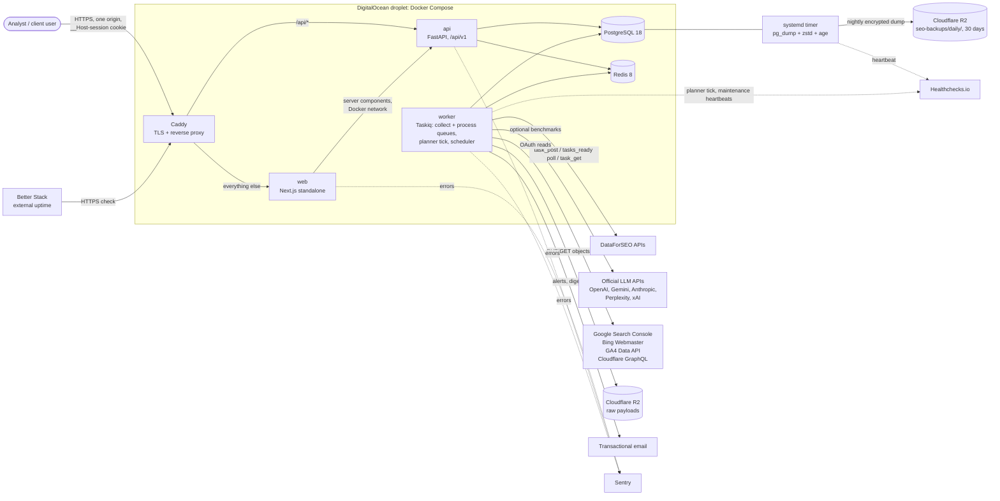

## 2. 7.1 SEO rank collection

Source: [03-system-architecture.md](../03-system-architecture.md). Type: Sequence.

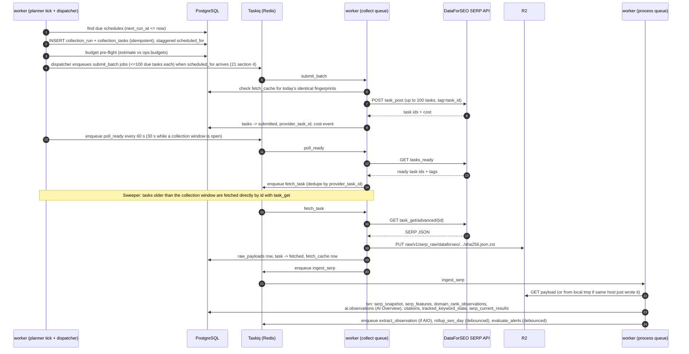

## 3. 7.2 AI prompt collection

Source: [03-system-architecture.md](../03-system-architecture.md). Type: Sequence.

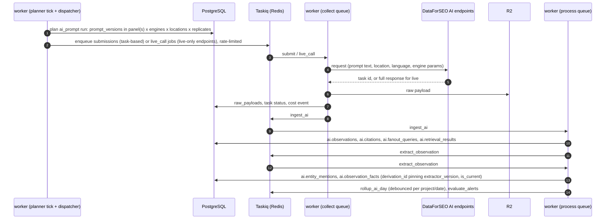

## 4. 7.3 Combined data flow

Source: [03-system-architecture.md](../03-system-architecture.md). Type: Flow.

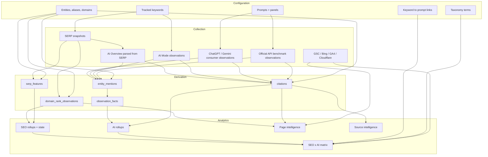

## 5. 3. Conceptual model

Source: [04-data-model.md](../04-data-model.md). Type: ER.

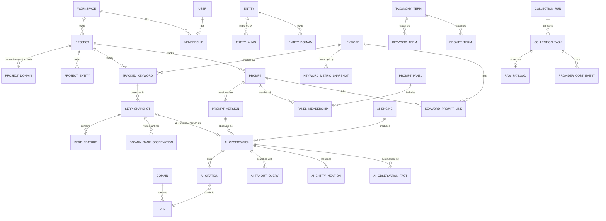

## 6. 4. Task lifecycle

Source: [06-dataforseo-seo-integration.md](../06-dataforseo-seo-integration.md). Type: State machine.

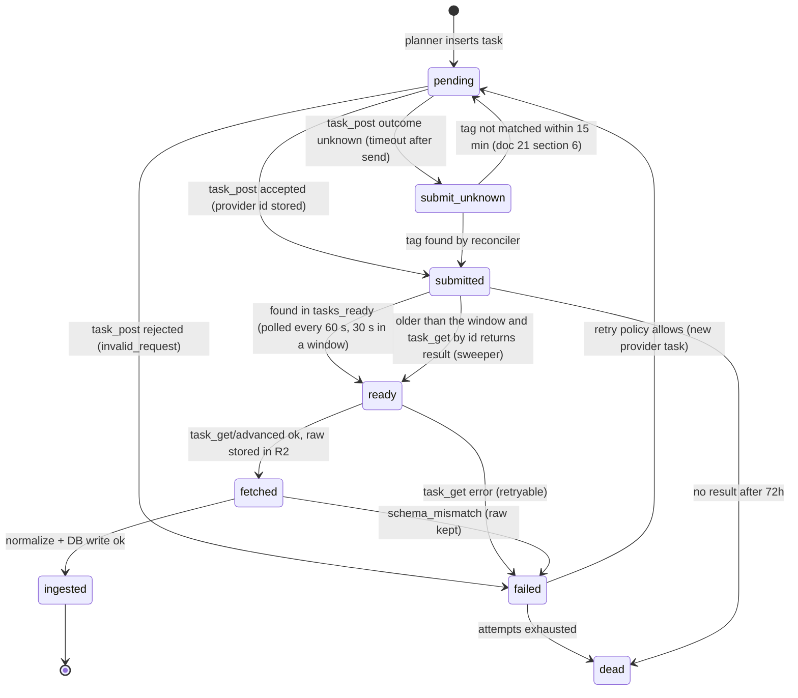

## 7. 3.3 Import pipeline

Source: [08-seo-keyword-system.md](../08-seo-keyword-system.md). Type: Flow.

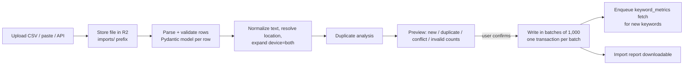

## 8. 5. AI Overview in two contexts, one record

Source: [10-serp-feature-tracking.md](../10-serp-feature-tracking.md). Type: Flow.

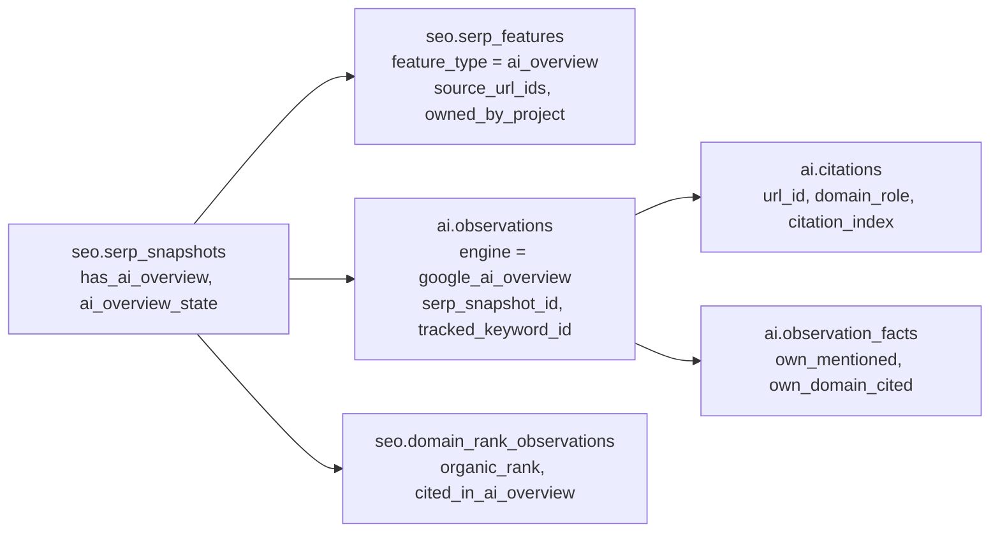

## 9. 2. Pipeline overview

Source: [13-ai-extraction-engine.md](../13-ai-extraction-engine.md). Type: Flow.

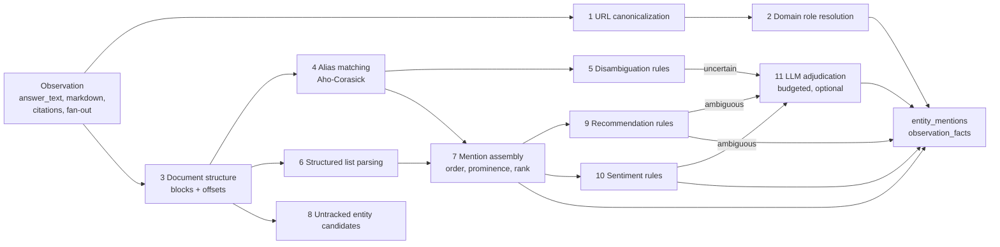

## 10. 5. Source graph

Source: [14-citation-intelligence.md](../14-citation-intelligence.md). Type: Flow.

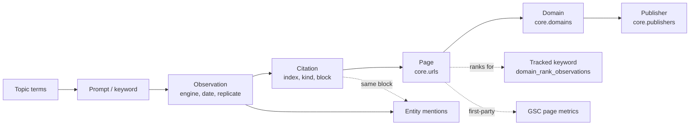

## 11. 4.8 Sequence: OAuth connect and backfill

Source: [18-first-party-integrations.md](../18-first-party-integrations.md). Type: Sequence.

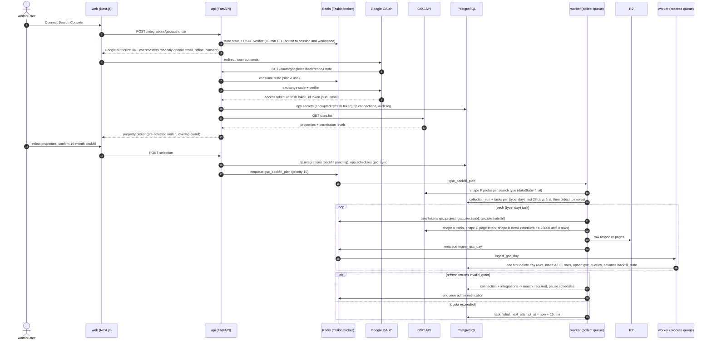

## 12. 5.3 Queue lifecycle

Source: [21-scheduler-workers.md](../21-scheduler-workers.md). Type: Flow.

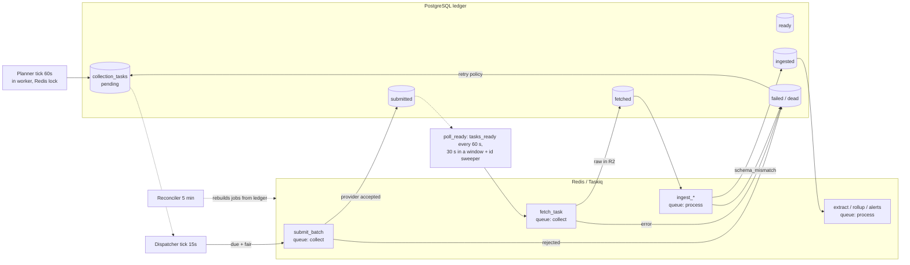

## 13. 2. Deployment diagram

Source: [22-infrastructure-devops.md](../22-infrastructure-devops.md). Type: Flow.

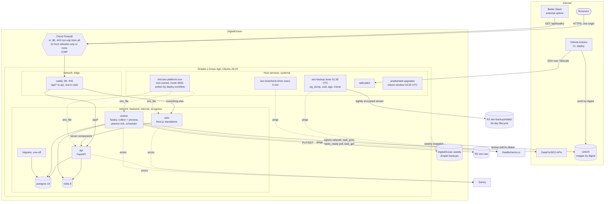

## 14. 8.1 Pipeline overview

Source: [22-infrastructure-devops.md](../22-infrastructure-devops.md). Type: Flow.

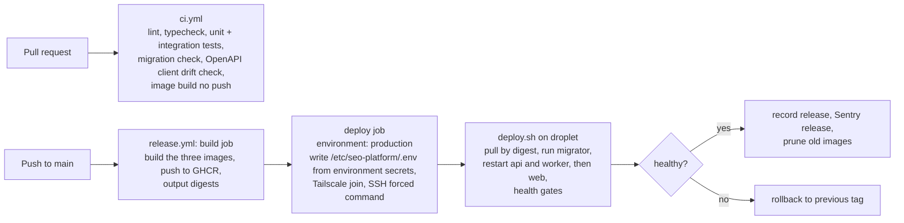

## 15. 4. Backup lifecycle

Source: [23-backup-disaster-recovery.md](../23-backup-disaster-recovery.md). Type: Flow.

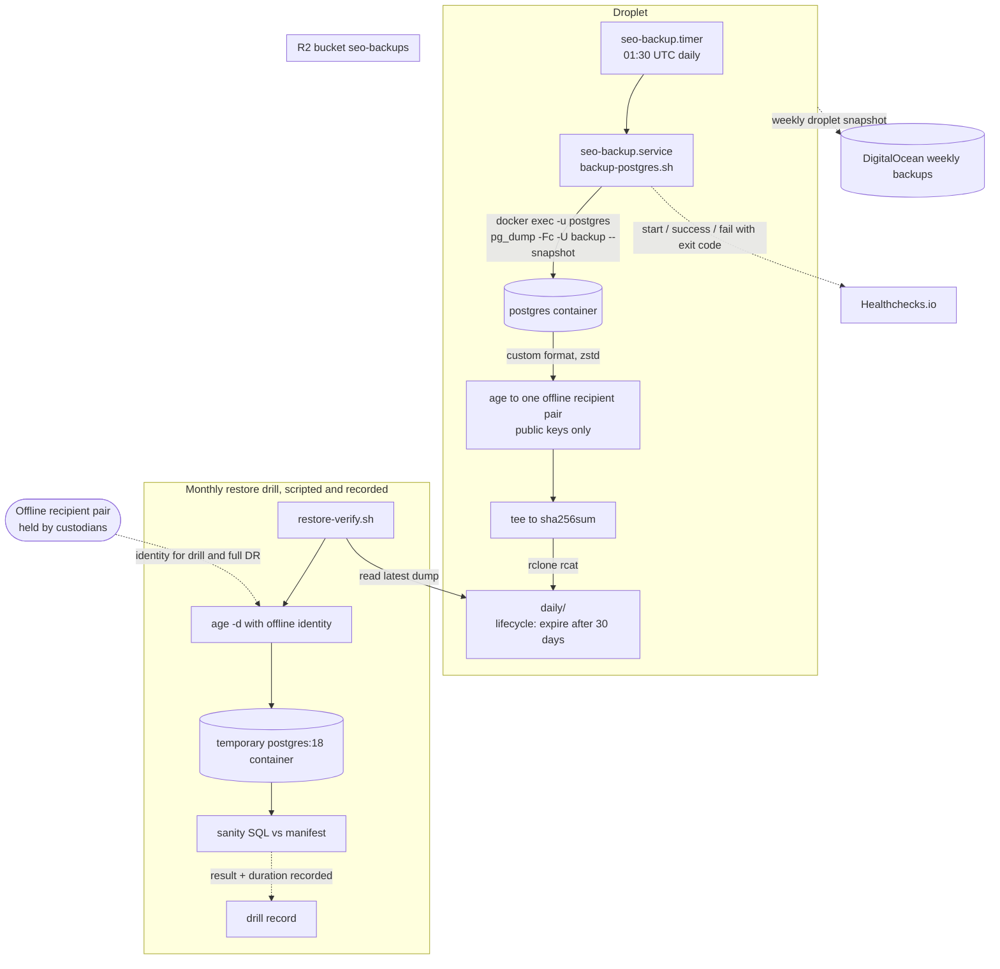

## 16. 1. Summary

Source: [29-phase-roadmap.md](../29-phase-roadmap.md). Type: Timeline.

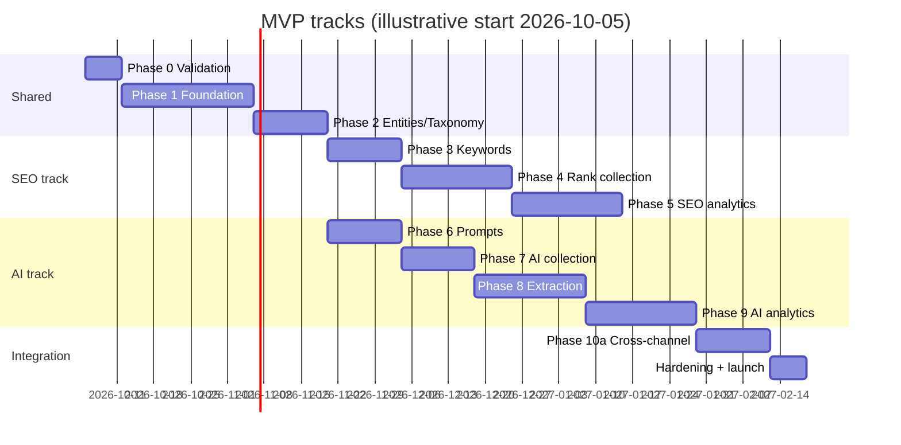

## 17. Detailed ER: SEO observation core

Source: [04-data-model.md](../04-data-model.md) section 7. Type: ER.

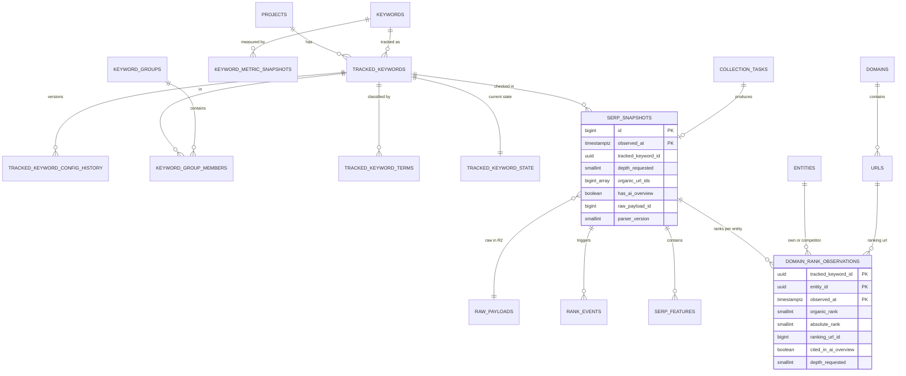

## 18. Detailed ER: AI observation core

Source: [04-data-model.md](../04-data-model.md) section 8. Type: ER.

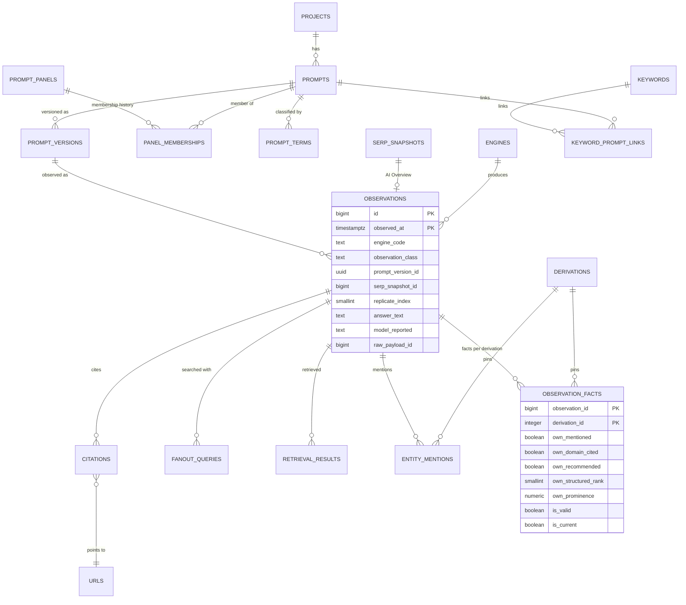
